# Computer Architecture and Digital Electronics

One guide, bottom to top: signals become bits, bits become gates, gates become adders and memory,
and those blocks become a CPU, RAM, SSDs, and a motherboard that run your software. It merges the
previous Computer Architecture reference (backend-flavored, interview-ready) with the Digital
Electronics fundamentals (gates, circuits, storage internals) into a single beginner-to-advanced
path. No prior hardware background is assumed; every abstraction is tied back to code you can
measure.

## How to Use This Guide

- **Software engineer fast path:** Parts 1, 4, 7, 9, 12 through 15, and 17.
- **Interview path:** read each part's interview block, then drill Part 22 end to end.
- **Hardware path:** straight through, building each layer before the next uses it.
- **Hands-on path:** jump to Part 18 and Part 20 and run every snippet, then backfill theory as needed.

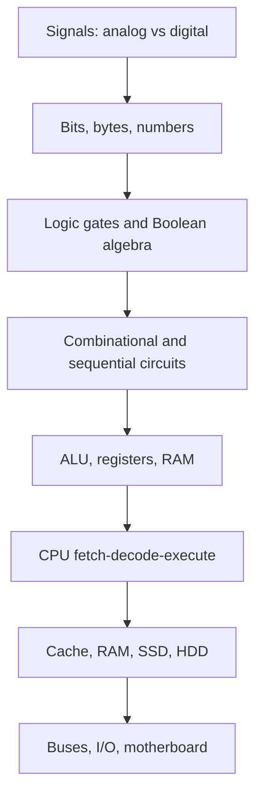

## Table of Contents

- [Part 0. Learning Resources](#part-0-learning-resources)
- [Part 1. Introduction to Digital Electronics](#part-1-introduction-to-digital-electronics)
- [Part 2. Logic Gates and Boolean Algebra](#part-2-logic-gates-and-boolean-algebra)
- [Part 3. Digital Circuits](#part-3-digital-circuits)
- [Part 4. How a CPU Works](#part-4-how-a-cpu-works)
- [Part 5. Instruction Sets and Apple Silicon](#part-5-instruction-sets-and-apple-silicon)
- [Part 6. CPU vs GPU vs TPU vs DPU vs QPU](#part-6-cpu-vs-gpu-vs-tpu-vs-dpu-vs-qpu)
- [Part 7. Caches and Memory Hierarchy](#part-7-caches-and-memory-hierarchy)
- [Part 8. Concurrency Cores Threads and SMT](#part-8-concurrency-cores-threads-and-smt)
- [Part 9. What Backend Developers Must Know](#part-9-what-backend-developers-must-know)
- [Part 10. Branch Prediction and Speculative Execution](#part-10-branch-prediction-and-speculative-execution)
- [Part 11. Power, Clocks, and Thermals](#part-11-power-clocks-and-thermals)
- [Part 12. Virtual Memory, Paging, and the TLB](#part-12-virtual-memory-paging-and-the-tlb)
- [Part 13. I/O, PCIe, Interrupts, and DMA](#part-13-io-pcie-interrupts-and-dma)
- [Part 14. Memory and Storage Systems](#part-14-memory-and-storage-systems)
- [Part 15. Data Representation and Encoding](#part-15-data-representation-and-encoding)
- [Part 16. Models, Boards, and Boot](#part-16-models-boards-and-boot)
- [Part 17. Memory Models: From Barriers to volatile](#part-17-memory-models-from-barriers-to-volatile)
- [Part 18. Code Labs: Locality and Vectorization](#part-18-code-labs-locality-and-vectorization)
- [Part 19. Tools and Ecosystem](#part-19-tools-and-ecosystem)
- [Part 20. End-to-End Walkthroughs](#part-20-end-to-end-walkthroughs)
- [Part 21. Cheat Sheet and Misconceptions](#part-21-cheat-sheet-and-misconceptions)
- [Part 22. Final Interview Drill](#part-22-final-interview-drill)

## Part 0. Learning Resources

Curated videos, reading, and projects. Watch the essentials first, then use the rest as reference
while working through the theory parts.

### 0.1 Essential Videos
- [Exploring How Computers Work](https://www.youtube.com/watch?v=QZwneRb-zqA)
- [How a CPU Works in 100 Seconds // Apple Silicon M1 vs Intel i9](https://www.youtube.com/watch?v=vqs_0W-MSB0)
- [CPU vs GPU vs TPU vs DPU vs QPU](https://www.youtube.com/watch?v=r5NQecwZs1A)
- [COMPUTER SCIENCE explained in 17 Minutes](https://www.youtube.com/watch?v=CxGSnA-RTsA)

### 0.2 Reading Library Blogs Books and Projects

#### Blogs

- [What Every Programmer Should Know About Memory](https://people.freebsd.org/~lstewart/articles/cpumemory.pdf)
- [cpu.land](https://cpu.land/the-basics)


#### Books

- [Crafting Interpreters](https://craftinginterpreters.com/contents.html) **book for building interpreter in C/Java**
- [Writing An Interpreter In Go](https://edu.anarcho-copy.org/Programming%20Languages/Go/writing%20an%20INTERPRETER%20in%20go.pdf) **check your drive**
- [Writing A Compiler In Go]() **check your drive**
- [handmade.network](https://handmade.network/)

#### Project using low level programming

- [c-codebase](https://github.com/PixelRifts/c-codebase)
- [Rift](https://github.com/PixelRifts/Rift/tree/v1)
- [Indie-Toolbox](https://github.com/Indie-Toolbox/Indie-Toolbox)
- [graphit](https://voxelrifts.itch.io/graphit)
- [multieditor](https://handmade.network/p/292/multieditor/)

### 0.3 Video Deep Dives Playlists and Channels

#### Interpreter

- [Creating a Compiler](https://www.youtube.com/playlist?list=PLUDlas_Zy_qC7c5tCgTMYq2idyyT241qs)


#### Single Videos

- [unlock the lowest levels of coding](https://www.youtube.com/watch?v=97i2BAUw5Xc)
- [My 2 Year Journey of Learning C, in 9 minutes](https://www.youtube.com/watch?v=lMvFWKHhVZ0)
- [2 Years Of Learning C | Prime Reacts](https://www.youtube.com/watch?v=8vQtUleZykQ)
- [10 years of embedded coding in 10 minutes](https://www.youtube.com/watch?v=i2ypCsB93gM)
- [X86 Needs To Die](https://www.youtube.com/watch?v=xCBrtopAG80)


#### Playlists

- [Handmade Hero Complete](https://www.youtube.com/playlist?list=PLnuhp3Xd9PYTt6svyQPyRO_AAuMWGxPzU)

- [Mr. 4th Programming](https://www.youtube.com/@Mr4thProgramming)
- [Base](https://www.youtube.com/playlist?list=PLT6InxK-XQvNKTyLXk6H6KKy12UYS_KDL)
- [OS](https://www.youtube.com/playlist?list=PLT6InxK-XQvPV1_4wzNZVn1br7eSt4-kH)
- [x64 Practice](https://www.youtube.com/playlist?list=PLT6InxK-XQvMb8NUTAnnr3GyWjtPhUvuA)
- [Graphics](https://www.youtube.com/playlist?list=PLT6InxK-XQvNKhnBT_nYydBfR9xpfV0XY)
- [Graphics 2](https://www.youtube.com/playlist?list=PLT6InxK-XQvPYA_HLUozeyPGTjwcvYsBj)


#### Complex topics

- [I made the same game in Assembly, C and C++](https://www.youtube.com/watch?v=2eeXj-ck9VA)
- [LLVM in 100 Seconds](https://www.youtube.com/watch?v=BT2Cv-Tjq7Q)
- [i wrote my own memory allocator in C to prove a point](https://www.youtube.com/watch?v=CulF4YQt6zA)


#### Channels

- [Low Level Learning](https://www.youtube.com/@LowLevelLearning/playlists)
- [Tech With Nikola](https://www.youtube.com/@TechWithNikola/videos)
- [Jacob Sorber](https://www.youtube.com/@JacobSorber/playlists)
- [Data Structures](https://www.youtube.com/playlist?list=PL9IEJIKnBJjFiudyP6wSXmykrn67Ykqib)
- [3Blue1Brown](https://www.youtube.com/@3blue1brown/playlists)
- [mycodeschool](https://www.youtube.com/@mycodeschool/playlists)

## Part 1. Introduction to Digital Electronics

Why your software behaves the way it does starts here: how signals survive noise, how bits encode
numbers, and how binary arithmetic drives every calculation above it.

### 1.1 Analog vs Digital Signals

An **analog** signal is continuous: a microphone voltage can be 1.0 V, 1.001 V, 1.0014 V, anything in
between. A **digital** signal is discretized to a small set of levels, almost always two: LOW (0) and
HIGH (1).

Real wires are still analog underneath. Digital design defines thresholds: for example, 0–0.8 V reads
as 0, 2.0–3.3 V reads as 1, and the gap in between is a forbidden zone that gives noise margin. A small
noise spike of 0.2 V corrupts an analog value but leaves a digital value untouched. That noise immunity
is why computers are digital.

Why it matters: every bug about flaky sensors, long cables, or signal integrity is an analog problem
leaking through the digital abstraction. Software sees clean 0s and 1s only because hardware engineers
budgeted noise margins, clock timing, and error correction underneath.

| Property | Analog | Digital |
|---|---|---|
| Values | Continuous, infinite | Discrete, usually 0 and 1 |
| Noise | Every disturbance changes the value | Tolerated up to the noise margin |
| Copying | Each copy degrades | Copies are bit-perfect |
| Examples | Microphone waveform, temperature sensor | CPU pins, USB packets, files on disk |

Common misconception: digital means perfect. It means errors are *detected and corrected* (ECC RAM,
CRC on networks, retransmits) so the abstraction looks perfect.

### 1.2 Bits, Bytes, Words, and Data Representation

- **Bit:** one binary digit, 0 or 1.
- **Byte:** 8 bits. Holds 0–255 unsigned.
- **Nibble:** 4 bits, exactly one hex digit.
- **Word:** the natural chunk a CPU handles at once: 32 bits on a 32-bit machine, 64 bits on yours.
- **KB, MB, GB:** in hardware datasheets powers of 2 (1 KiB = 1024 bytes). In storage marketing powers
  of 10 (1 GB = 1,000,000,000 bytes). That gap is why a "1 TB" drive shows as ~931 GiB in your OS.

N bits hold 2^N patterns. So 8 bits give 256 values, 16 bits give 65,536, 32 bits give ~4.3 billion.

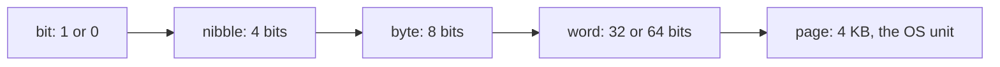

### 1.3 Number Systems and Conversions

Computers use binary. Humans use decimal and hexadecimal (compact binary). Octal appears in Unix
permissions (`chmod 755`). Learn to convert fluently; it is the single most-tested hardware skill.

Powers of 2 to memorize: 2^1=2, 2^2=4, 2^3=8, 2^4=16, 2^5=32, 2^6=64, 2^7=128, 2^8=255+1=256,
2^10=1024, 2^16=65536, 2^20≈1M, 2^30≈1B, 2^32≈4.3B.

Decimal to binary (repeated division). Convert 45:

```
45 / 2 = 22 rem 1
22 / 2 = 11 rem 0
11 / 2 = 5  rem 1
5  / 2 = 2  rem 1
2  / 2 = 1  rem 0
1  / 2 = 0  rem 1  -> read bottom-up: 101101
```

Check: 32 + 8 + 4 + 1 = 45. Correct.

Binary to decimal (positional weights). Convert `101101`:

```
1*32 + 0*16 + 1*8 + 1*4 + 0*2 + 1*1 = 32 + 8 + 4 + 1 = 45
```

Binary to hex (group by 4 from the right). Convert `10110110`:

```
1011 0110 -> B 6 -> 0xB6
```

Hex to binary (expand each digit). Convert `0x3F`:

```
3 = 0011, F = 1111 -> 00111111 = 63
```

Binary to octal (group by 3). Convert `101101`:

```
101 101 -> 5 5 -> 0o55
```

| System | Base | Digits | Where you meet it |
|---|---|---|---|
| Binary | 2 | 0, 1 | Hardware, bit masks |
| Octal | 8 | 0–7 | Unix permissions |
| Decimal | 10 | 0–9 | Human I/O |
| Hex | 16 | 0–9, A–F | Dumps, hashes, addresses, colors |

### 1.4 Binary Arithmetic

Binary arithmetic uses the same column method as decimal, with simpler rules.

Addition rules: 0+0=0, 0+1=1, 1+1=0 carry 1, 1+1+1=1 carry 1.

Example: 13 + 9 = 22.

```
    1101  (13)
+   1001  (9)
  ------
   10110  (16+4+2 = 22)
```

Worked right to left: 1+1=0 carry 1; 0+0+carry=1; 1+0=1; 1+1=0 carry 1; carry 1 → 10110.

Subtraction uses borrow. Example: 13 − 9 = 4.

```
    1101
-   1001
  ------
    0100  (4)
```

Multiplication is shift-and-add. Example: 6 × 5 (`110 × 101`):

```
      110   (6)
×     101   (5)
  -------
      110   (6 × 1)
     000    (6 × 0, shifted)
+  110      (6 × 1, shifted twice)
  -------
    11110   (16+8+4+2 = 30)
```

Division is repeated subtract-and-shift, exactly how a hardware divider works. Example 14 ÷ 3 = 4 rem 2
(`1110 ÷ 11`): 3 goes into 14 four times (12), remainder 2. Hardware does this one bit per cycle.

Overflow rule: an N-bit unsigned addition that produces a carry out of the top bit overflowed. Keep the
low N bits and set the carry flag. `255 + 1` in 8 bits is `0` with carry out 1.

### 1.5 Signed and Unsigned Numbers

An 8-bit pattern like `11111011` means 251 unsigned but −5 signed. The bits do not change; the
interpretation does. Three signed encodings existed historically:

| Encoding | How negatives work | Problem |
|---|---|---|
| Sign-magnitude | Top bit is sign, rest is value | Two zeros (+0 and −0), awkward adders |
| Ones complement | Negate by flipping all bits | Two zeros, end-around carry |
| Two's complement | Negate by flip-all-bits then add 1 | One zero, single adder works — winner |

Two's complement won because addition and subtraction need no special cases.

Negate 5 in 8 bits: 5 = `00000101`, flip → `11111010`, add 1 → `11111011` (−5). Negate back:
flip → `00000100`, add 1 → `00000101` (5).

Range formulas for N bits:

- Unsigned: 0 to 2^N − 1.
- Signed two's complement: −2^(N−1) to 2^(N−1) − 1.

So int8 spans −128 to 127, uint8 spans 0–255, int32 spans about −2.1B to +2.1B.

Signed overflow example: 127 + 1 in int8. `01111111 + 00000001 = 10000000` = −128. The sign flipped
with no carry out of the signed range, which is exactly how the overflow flag is defined: carry into
the top bit differs from carry out.

Interview line: in C, Go, and Rust release builds unsigned and signed overflow wraps silently. In
Java it wraps for ints, in Python ints grow arbitrarily. The same service ported across languages can
compute different totals at the boundary.

> Misconception: one more bit doubles the *maximum*. It squares the *count* of values and roughly
> doubles the unsigned maximum.

Interview questions: convert 0xD3 to binary and decimal. What is −1 in 8-bit two's complement
(`11111111`). Why does `255 + 1` give 0 in a uint8. What range does int64 hold.

### 1.6 Try It: Number Systems in Python

```python
n = 45
print(bin(n), hex(n), oct(n))   # 0b101101 0x2d 0o55
print(int("101101", 2), int("0xB6", 16))  # 45 182

def twos_complement(value: int, bits: int = 8) -> str:
    return format(value & ((1 << bits) - 1), f"0{bits}b")

print(twos_complement(-5))       # 11111011
print(twos_complement(127 + 1))  # 10000000 -> -128 when read signed

flags = 0b1010
flags |= 0b0100    # set bit 2
flags &= ~0b1000   # clear bit 3
print(bin(flags), bool(flags & 0b0010))  # 0b110 True
```

### 1.7 Numbers Interview Questions and Answers

1. **Convert 0xD3 to binary and decimal.**
   D = 1101, 3 = 0011, so `11010011` = 128 + 64 + 16 + 2 + 1 = 211.
2. **What is -1 in 8-bit two's complement, and why?**
   `11111111`. Negation is flip-all-bits plus one, so -1 is the value that plus 1 wraps to zero.
3. **Why does `255 + 1` give 0 in a uint8?**
   8 bits hold 0-255. The carry out of the top bit is dropped, leaving `00000000` with the carry flag set.
4. **What range does int64 hold?**
   -2^63 to 2^63 - 1, about plus or minus 9.2 quintillion. Default for money-cents and timestamps.
5. **Why does `0.1 + 0.2 != 0.3`?**
   Most decimals are not exact in binary floating point. See Part 14 for IEEE 754 and the money-in-cents rule.

## Part 2. Logic Gates and Boolean Algebra

The atoms of computing. Every adder, multiplexer, register, and CPU in this guide is built from
these gates plus the algebra that simplifies them.

### 2.1 The Seven Gates

Gates are the atoms. Every adder, multiplexer, register, and CPU is built from these.

| Gate | Symbol meaning | Expression | Truth table |
|---|---|---|---|
| AND | Output 1 only if all inputs 1 | Y = A·B | 00→0, 01→0, 10→0, 11→1 |
| OR | Output 1 if any input 1 | Y = A+B | 00→0, 01→1, 10→1, 11→1 |
| NOT | Inverts | Y = A' | 0→1, 1→0 |
| NAND | AND then invert | Y = (A·B)' | 00→1, 01→1, 10→1, 11→0 |
| NOR | OR then invert | Y = (A+B)' | 00→1, 01→0, 10→0, 11→0 |
| XOR | Output 1 if inputs differ | Y = A⊕B | 00→0, 01→1, 10→1, 11→0 |
| XNOR | Output 1 if inputs equal | Y = (A⊕B)' | 00→1, 01→0, 10→0, 11→1 |

Full XOR and XNOR tables for reference:

XOR: A=0,B=0→0; A=0,B=1→1; A=1,B=0→1; A=1,B=1→0.
XNOR: A=0,B=0→1; A=0,B=1→0; A=1,B=0→0; A=1,B=1→1.

NAND and NOR are **universal**: any circuit can be built from NAND alone or NOR alone. Fabs optimize
NAND hardest, so standard-cell libraries and FPGAs lean on it. XOR builds adders and parity. XNOR
builds comparators: XNOR outputs 1 exactly when two bits match.

Why it matters: feature flags (`if a AND b`), permission checks (`role == admin OR owner`), and
checksums (XOR folds) are Boolean logic in software form. The same simplifications that shrink circuits
shrink conditionals.

### 2.2 Boolean Algebra Laws

| Law | AND form | OR form |
|---|---|---|
| Identity | A·1 = A | A+0 = A |
| Null | A·0 = 0 | A+1 = 1 |
| Idempotent | A·A = A | A+A = A |
| Complement | A·A' = 0 | A+A' = 1 |
| Commutative | A·B = B·A | A+B = B+A |
| Associative | (A·B)·C = A·(B·C) | (A+B)+C = A+(B+C) |
| Distributive | A·(B+C) = A·B + A·C | A+(B·C) = (A+B)·(A+C) |
| Absorption | A·(A+B) = A | A+(A·B) = A |

### 2.3 De Morgan's Laws

```
(A·B)' = A' + B'
(A+B)' = A' · B'
```

In words: break the bar, flip the operator. Used constantly to convert AND-OR circuits into NAND-only
circuits and to simplify `if (!(a && b))` into `if (!a || !b)` during code review.

Example: simplify `(A·B)' + A'` → by De Morgan the first term is `A' + B'`, so the whole thing is
`A' + B' + A'` = `A' + B'`.

### 2.4 Simplification Example

Simplify Y = A·B + A·B' + A'·B.

```
Y = A·B + A·B' + A'·B
  = A·(B + B') + A'·B     (factor A)
  = A·1 + A'·B             (complement law)
  = A + A'·B
  = A + B                   (absorption: A + A'·B = A + B)
```

The 3-gate circuit collapses to one OR gate. In hardware that means less area, less power, less delay.
In software it means replacing a three-branch conditional with one.

### 2.5 Karnaugh Maps

K-maps find these simplifications visually for 2–4 variables. Rules: group 1s in rectangles of size
1, 2, 4, or 8; wrap around edges; each group must be a power of 2; cover every 1 with the fewest,
largest groups.

Example: Y = Σm(0,1,2,3) for two variables means rows 00, 01, 10, 11 are all 1. One group of four
covers everything, so Y = 1. The output does not depend on inputs at all.

Example with signal: a 3-variable function that is 1 for minterms 0,1,4,5 (where the middle variable
B = 0). Group the four B=0 cells into one block: Y = B'. One inverter replaces the whole truth table.

For 4 variables, plot a 4×4 grid in Gray code order (00, 01, 11, 10 on each axis) so adjacent cells
differ by one bit, then group. Beyond 4 variables use Quine-McCluskey or let the synthesizer do it.

### 2.6 Combinational Design Recipe

Design a 3-input majority voter (output 1 when at least two inputs are 1), used in fault-tolerant
systems and ECC voters:

1. Truth table: 000→0, 001→0, 010→0, 011→1, 100→0, 101→1, 110→1, 111→1.
2. Minterms: Y = A'BC + AB'C + ABC' + ABC.
3. Simplify (K-map or algebra): Y = AB + BC + AC.
4. Build: three 2-input AND gates feeding one 3-input OR gate.

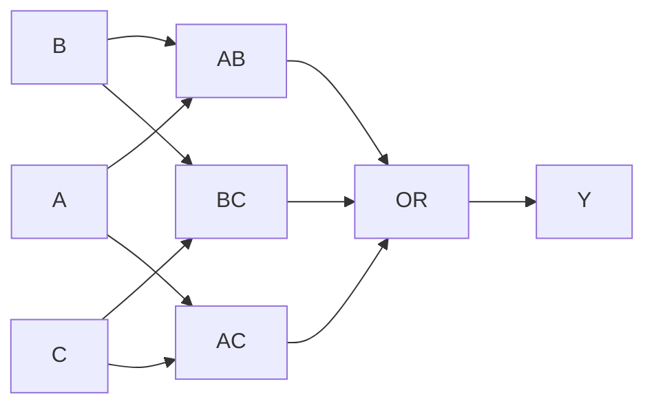

> Misconception: XOR is "either or". Inclusive OR allows both; XOR forbids both. Requirements that say
> "A or B" almost always mean inclusive OR.

Interview questions: build OR from NAND gates. State De Morgan's laws. Simplify `A + A'B`. When is XOR
1. What makes NAND universal.

### 2.7 Gates in Code and Silicon

```python
ops = {
    "AND": lambda a, b: a & b,
    "OR": lambda a, b: a | b,
    "XOR": lambda a, b: a ^ b,
    "NAND": lambda a, b: 1 - (a & b),
}
for name, f in ops.items():
    print(name, [f(a, b) for a in (0, 1) for b in (0, 1)])  # order 00 01 10 11
```

```verilog
// 3-input majority voter from Part 2.6, as synthesizable HDL
module majority (input a, b, c, output y);
  assign y = (a & b) | (b & c) | (a & c);
endmodule
```

### 2.8 Gates Interview Questions and Answers

1. **Build OR using only NAND gates.**
   NOT from NAND by tying inputs: A' = A NAND A. Then A OR B = (A' NAND B'), i.e.
   `NAND(NAND(A,A), NAND(B,B))`. Same trick builds every gate, which is what universal means.
2. **State De Morgan's laws and use one in code.**
   (A·B)' = A' + B' and (A+B)' = A'·B'. So `if (!(a && b))` is `if (!a || !b)`.
3. **Simplify A + A'B.**
   A + A'B = (A + A')(A + B) = 1·(A + B) = A + B. Absorption swallows the redundant term.
4. **When is XOR 1, and what is XNOR for?**
   XOR is 1 exactly when inputs differ; XNOR is 1 exactly when they match, so XNOR builds comparators.
5. **Why do fabs love NAND?**
   Any circuit can be built from NAND alone, so libraries optimize one gate hardest for area and power.

## Part 3. Digital Circuits

Combinational circuits compute; sequential circuits remember. Together they form adders, multiplexers,
registers, and counters — the CPU's building blocks.

### 3.1 Combinational vs Sequential

| Property | Combinational | Sequential |
|---|---|---|
| Memory | None, output is pure function of current inputs | Has state, output depends on history |
| Clock | Not needed | Needs clock to update state safely |
| Examples | Adders, muxes, decoders, ALU | Flip-flops, registers, counters, RAM |
| Hazards | Glitches during input transitions | Metastability if setup/hold violated |

### 3.2 Half Adders and Full Adders

A **half adder** adds two bits. Truth table: 0+0=00, 0+1=01, 1+0=01, 1+1=10. So Sum = A⊕B,
Carry = A·B. It cannot accept a carry-in, so it only works for the lowest bit.

A **full adder** adds three bits: A, B, and carry-in Cin. Truth table:

| A | B | Cin | Sum | Cout |
|---|---|---|---|---|
| 0 | 0 | 0 | 0 | 0 |
| 0 | 0 | 1 | 1 | 0 |
| 0 | 1 | 0 | 1 | 0 |
| 0 | 1 | 1 | 0 | 1 |
| 1 | 0 | 0 | 1 | 0 |
| 1 | 0 | 1 | 0 | 1 |
| 1 | 1 | 0 | 0 | 1 |
| 1 | 1 | 1 | 1 | 1 |

Formulas: Sum = A⊕B⊕Cin. Cout = (A·B) + (Cin·(A⊕B)).

Practical build — 4-bit ripple-carry adder from full adders:


Example: 7 + 5 = 12. `0111 + 0101`: bit0: 1+1=0 carry1; bit1: 1+0+1=0 carry1; bit2: 1+1+1=1 carry1;
bit3: 0+0+1=1. Result `1100` = 12. The carry ripples left to right, which is why wide ripple adders
are slow and real CPUs use carry-lookahead or prefix adders that compute carries in parallel.

### 3.3 Subtractors

A half subtractor computes A−B: Difference = A⊕B, Borrow = A'·B. A full subtractor adds borrow-in:
Difference = A⊕B⊕Bin, Bout = A'·B + Bin·(A⊕B)'.

In practice CPUs rarely build separate subtractors. They reuse the adder: A − B = A + (~B) + 1, i.e.
flip B and set carry-in to 1. One circuit, one extra mux, both operations.

### 3.4 Multiplexers and Demultiplexers

A **multiplexer** picks one of many inputs. A 2-to-1 mux: Y = S'·A + S·B. A 4-to-1 mux uses two select
lines to choose among four inputs and is the standard building block for ALUs, register files, and
bus arbitration.

| S1 | S0 | Y |
|---|---|---|
| 0 | 0 | D0 |
| 0 | 1 | D1 |
| 1 | 0 | D2 |
| 1 | 1 | D3 |

A **demultiplexer** does the reverse: one input routed to the selected output. Together they implement
shared buses and address decoding: the mux selects the speaker, the demux selects the listener.

### 3.5 Encoders and Decoders

A **decoder** converts N lines into 2^N one-hot outputs. A 2-to-4 decoder: input 00→Y0, 01→Y1, 10→Y2,
11→Y3. This is how the CPU selects one RAM row out of thousands from a binary address.

An **encoder** does the reverse. A **priority encoder** resolves the case where several inputs fire at
once (keyboard scanners, interrupt controllers) by picking the highest-priority active line and
outputting its index plus a valid flag.

### 3.6 Comparators

A 1-bit comparator: EQ = (A⊕B)', GT = A·B', LT = A'·B. Wider comparators chain these: compare top bits
first, cascade the result down — the same ripple idea as the adder. `memcmp`, sort comparisons, and
branch instructions (`BEQ`, `BLT`) all bottom out here.

### 3.7 Latches and Flip-Flops

Combinational circuits forget. Storage needs feedback.

- **SR latch:** S sets Q to 1, R resets Q to 0. S=R=1 is forbidden (both outputs fight). Built from two
  cross-coupled NOR or NAND gates. Level-sensitive and the root of all memory.
- **D latch:** D passes through while enabled. Removes the forbidden state.
- **D flip-flop:** captures D only on a clock edge. The standard storage bit in registers, pipelines,
  and state machines.
- **JK flip-flop:** J sets, K resets, J=K=1 toggles. The universal flip-flop; D and T can be derived.
- **T flip-flop:** T=1 toggles each clock. Divides frequency by 2; chains of T flip-flops are counters.

| Type | Key equation or behavior | Use |
|---|---|---|
| SR | S=1 set, R=1 reset | Simple set-reset, debouncing |
| D | Q+ = D on edge | Registers, pipelines |
| JK | Q+ = JQ' + K'Q | General state machines |
| T | Q+ = T⊕Q | Counters, dividers |

Timing matters: data must be stable for **setup time** before the edge and **hold time** after it.
Violations cause **metastability**, where the output hovers between 0 and 1 and resolves randomly.
Clock-domain crossings (data moving between two clocks) need two-flop synchronizers for exactly this
reason.

### 3.8 Registers and Shift Registers

A **register** is N D flip-flops sharing one clock: on each edge all N bits load at once. A 4-bit
register holding `1011` means flip-flop 3 holds 1, 2 holds 0, 1 holds 1, 0 holds 1, all updated
simultaneously on the clock edge. Add a write-enable mux and it holds until told to change — that is
how CPU registers and pipeline stages store values.

Shift registers chain flip-flops output-to-input so bits march one position per clock:

| Type | Path | Use |
|---|---|---|
| SISO | Serial in, serial out | Delay lines |
| SIPO | Serial in, parallel out | UART receiver |
| PISO | Parallel in, serial out | UART transmitter |
| PIPO | Parallel in, parallel out | Plain register |

UART reception is SIPO in the wild: start bit, 8 data bits shifted in one per baud tick, stop bit,
then the full byte is read in parallel.

### 3.9 Counters

Counters are registers that compute their own next value.

- **Asynchronous (ripple) counters:** each flip-flop clocks the next. Simple, but delays add up and
  transient wrong values appear during ripple. Fine for LEDs, bad for synchronous logic.
- **Synchronous counters:** all flip-flops share one clock; combinational logic computes each next bit.
  Clean, fast, the standard choice inside chips.

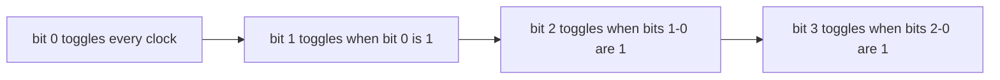

A 2-bit counter cycles 00→01→10→11→00. A decade counter wraps 1001→0000 (mod-10) for clocks and BCD
displays. Program counters, timers, and DRAM refresh controllers are all counters.

> Misconception: flip-flops store data like tiny hard drives. They store it only while powered and
> clocked. Unplug the power and every register and all of RAM forget.

Interview questions: build a full adder from half adders. Difference between latch and flip-flop. How
does a 4-to-1 mux work. What is metastability and how do you avoid it. Design a mod-10 counter.

### 3.10 Flip-Flops and Adders in Verilog

```verilog
module full_adder (input a, b, cin, output sum, cout);
  assign sum = a ^ b ^ cin;
  assign cout = (a & b) | (cin & (a ^ b));
endmodule

module dff (input clk, d, output reg q);
  always @(posedge clk) q <= d;  // captures D only on the rising edge
endmodule

module adder4 (input [3:0] a, b, input cin, output [3:0] sum, output cout);
  wire c1, c2, c3;  // ripple carries between bit slices
  full_adder b0 (.a(a[0]), .b(b[0]), .cin(cin), .sum(sum[0]), .cout(c1));
  full_adder b1 (.a(a[1]), .b(b[1]), .cin(c1),  .sum(sum[1]), .cout(c2));
  full_adder b2 (.a(a[2]), .b(b[2]), .cin(c2),  .sum(sum[2]), .cout(c3));
  full_adder b3 (.a(a[3]), .b(b[3]), .cin(c3),  .sum(sum[3]), .cout(cout));
endmodule
```

### 3.11 Circuits Interview Questions and Answers

1. **Build a full adder from two half adders.**
   HA1 adds A and B giving s1 and c1. HA2 adds s1 and Cin giving Sum and c2. Cout = c1 OR c2.
2. **Latch vs flip-flop?**
   A latch is level-sensitive (transparent while enabled); a flip-flop is edge-triggered, typically two
   latches in master-slave arrangement. Registers and pipelines use flip-flops.
3. **What is metastability and how do you avoid it?**
   Sampling a changing input too close to the clock edge can leave the output hovering between 0 and 1.
   Use two-flop synchronizers on every clock-domain crossing.
4. **What does a 4-to-1 mux do, and where does it appear?**
   Two select lines route one of four inputs to the output. ALUs, register files, and bus arbitration
   are all mux networks.
5. **Ripple vs synchronous counter?**
   Ripple clocks each stage from the last: simple but slow with transient wrong values. Synchronous shares
   one clock with computed next-state: clean and fast, the standard inside chips.

## Part 4. How a CPU Works

From transistors switching current to a gigahertz core retiring billions of instructions: the ladder
of abstraction, the classic fetch-decode-execute loop built from Parts 1-3, then what a modern
out-of-order core adds on top.

### 4.1 From Transistors to Datapath

- **Transistors** are electrically controlled switches. CMOS pairs them so one network pulls the output high
  while the other pulls it low, which is why idle chips sip power and switching chips burn it.
- **Gates** (NOT, AND, OR, NAND, NOR, XOR) combine transistor switches into one-bit logic. NAND is universal:
  any circuit can be built from NAND alone, which is why fabs optimize it hardest.
- **Combinational logic** has no memory: the output is a pure function of current inputs. Multiplexers pick one
  input, decoders route addresses, and the ALU computes add, subtract, AND, OR, and comparisons from gate networks.
- **Sequential logic** adds state: latches and flip-flops hold one bit across clock edges, registers hold a word,
  and SRAM arrays (your caches) are grids of 6-transistor cells with decoders around them.
- **The datapath** wires these together: register file to ALU to writeback, with multiplexers selecting inputs
  under control signals. The **control unit** decodes the opcode and raises those signals, either hardwired
  (fast, fixed) or microcoded (a tiny program per instruction, patchable by firmware updates).

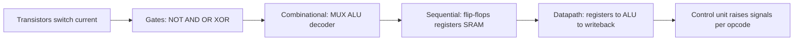

The chain above is the full ladder from physics to programmability. Each layer hides the one below, and each
layer's delay adds to the clock period.

| Design | How it runs one instruction | Trade-off |
|---|---|---|
| Single-cycle | Whole instruction in one long clock | Simple, but clock must fit the slowest instruction |
| Multi-cycle | Instruction spread over short steps | Better clock, but one instruction at a time |
| Pipelined | Overlapped stages, one completing per cycle ideally | Highest throughput, hazards must be handled |

The critical path (slowest combinational chain between two flip-flops) sets the maximum clock. Everything about
modern cores, from deep pipelines to wide superscalar issue, is a way to do more work per tick once the path
cannot get much shorter. Backend relevance is indirect but real: compiler flags like `-march=native` and
profile-guided optimization matter because they pick instruction sequences the actual datapath executes cleanly.

### 4.2 Basic CPU Architecture

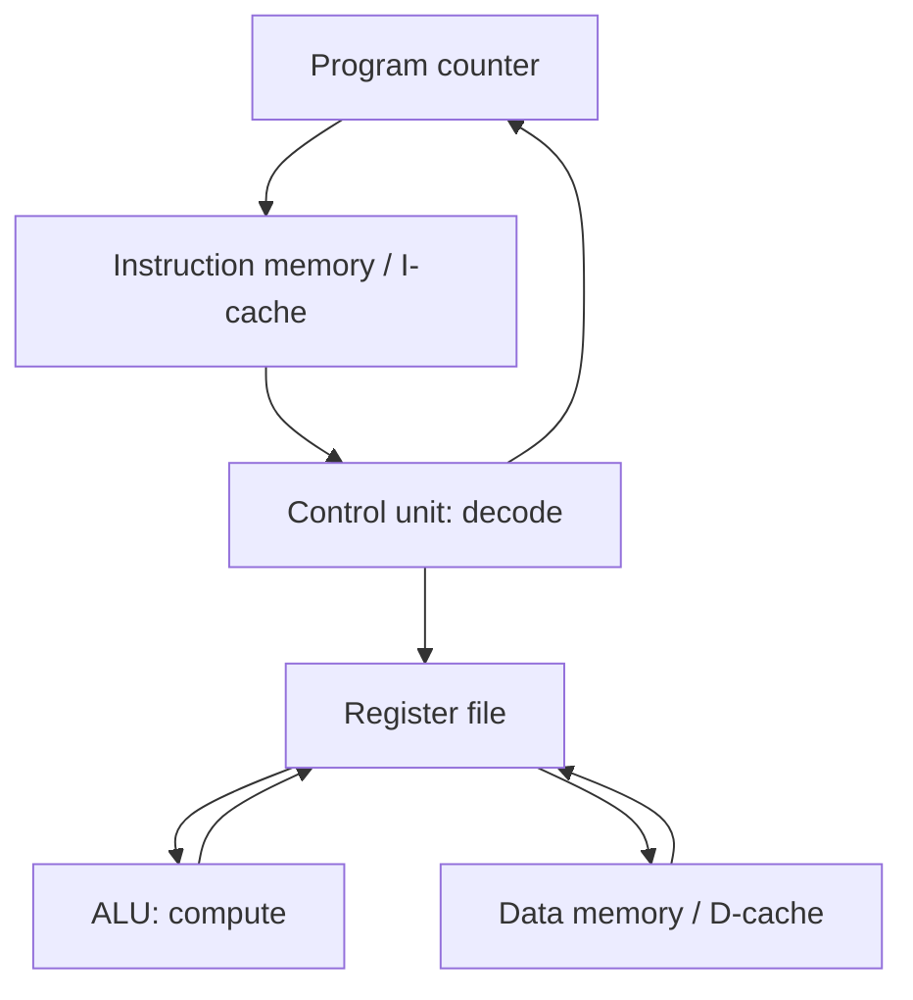

The five actors: program counter (address of next instruction), instruction memory, register file
(fast variables), ALU (math), data memory, all choreographed by the control unit.

### 4.3 Control Unit and ALU

The **ALU** does the computing: add, subtract, AND, OR, XOR, shifts, comparisons. The **control unit**
is the conductor: it decodes each opcode and raises the select lines, write-enables, and mux controls
that route data through the ALU and memory in the right order. ALU = muscle, control unit = choreography.

### 4.4 Designing an ALU from Gates

Step 1 — 1-bit AND/OR unit: compute both `A AND B` and `A OR B`, then mux-select by Op. One AND gate,
one OR gate, one 2-to-1 mux per bit.

Step 2 — add arithmetic: feed A, B, and carry-in into a full adder to get Sum and carry-out. Now each
bit needs a 4-to-1 mux choosing AND, OR, ADD, or XOR/SLT.

Step 3 — chain N copies with carries linked for an N-bit ALU. Add a zero detector (NOR of all result
bits) and the standard flags: Zero, Carry, Overflow, Negative.

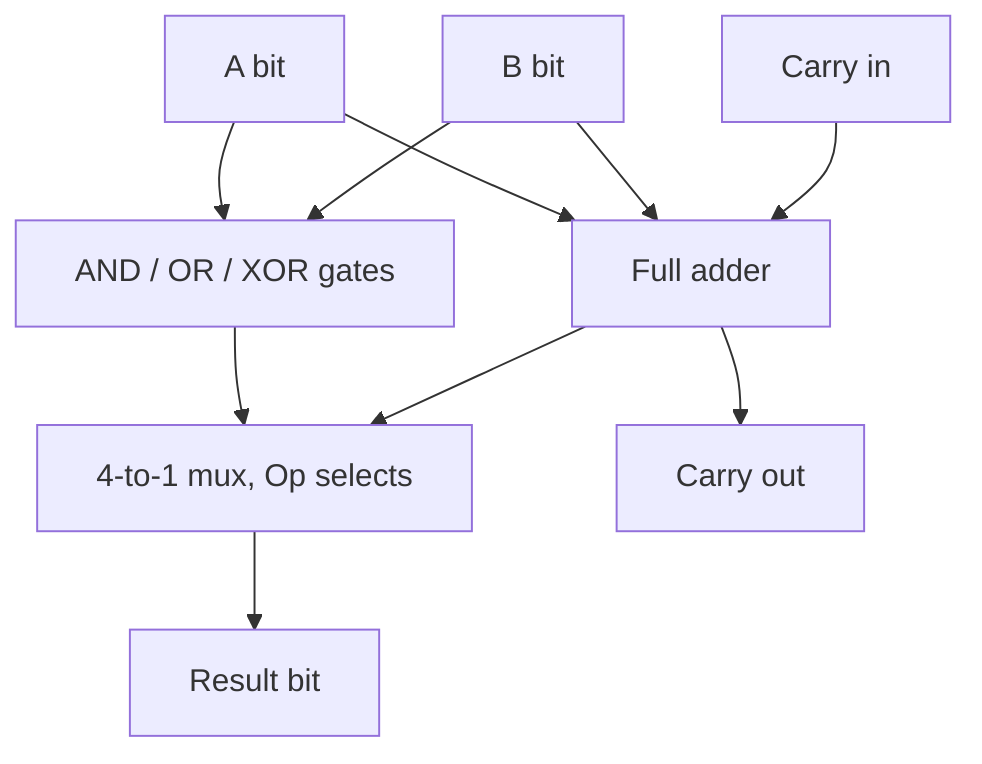

Typical 4-bit ALU operation table:

| Op | Operation | How |
|---|---|---|
| 00 | AND | Bitwise AND gates |
| 01 | OR | Bitwise OR gates |
| 10 | ADD | Full adders, Cin = 0 |
| 11 | SUB | Full adders, B inverted, Cin = 1 |

Subtraction for free: `A − B = A + ~B + 1` reuses the adder with B inverted and carry-in forced to 1.
Set-less-than (used by every `if (a < b)`) subtracts and returns the sign of the result.

### 4.5 Registers and Register Files

The register file is a small SRAM array (16–32 entries) with two read ports and one write port so two
operands can be read and one result written per cycle. x86-64 names them `rax, rbx, ...`; ARM64 names
them `x0–x30`. Special registers: PC (next instruction), SP (top of stack), status flags (zero, carry,
overflow from the last ALU op), and on the control side the instruction register holding the current
instruction.

Why so few: registers are the fastest storage (under 1 ns) but each needs wires to every execution
unit. The compiler's register allocator decides which variables deserve them; the rest spill to stack.

### 4.6 Fetch, Decode, Execute

Every instruction, billions of times per second:

1. **Fetch:** PC → instruction cache → instruction register. PC += instruction size.
2. **Decode:** control unit splits the bits into opcode, sources, destination, immediate.
3. **Execute:** register file reads operands, ALU computes, result writes back or goes to memory.

Worked example: `ADD x2, x0, x1` (x2 = x0 + x1).

```
cycle: fetch 0x8B020020 from address in PC, PC advances
decode: opcode ADD, read x0 (=7), read x1 (=5)
execute: ALU 7 + 5 = 12, Zero=0, Carry=0
writeback: x2 = 12
```

Machine encoding example (simplified): 8-bit opcode + 4-bit dest + 4-bit src1 + 16-bit immediate =
one 32-bit instruction word. Real ISAs pack these fields densely; `objdump -d` shows both the bytes
and the decoded assembly.

### 4.7 Clock Signals, Cycles, and Speed

The clock is a square wave; each rising edge advances all registers at once. One **cycle** is one tick.
**Clock speed** (3 GHz = 3 billion ticks per second) times **IPC** (instructions per cycle) sets
throughput:

```
CPU time = instruction count × CPI × cycle time
throughput = frequency × IPC
```

A 3 GHz core with IPC 2 retires 6 billion instructions per second. Doubling GHz roughly cubes power,
which is why vendors widen IPC instead of pushing 6+ GHz (see Part 11).

### 4.8 Pipelining

Instead of finishing one instruction before starting the next, overlap five stages:

```mermaid
gantt
    title Five-stage pipeline
    dateFormat X
    axisFormat %s
    section instr 1
    Fetch 1   :0, 1
    Decode 1  :1, 2
    Execute 1 :2, 3
    Memory 1  :3, 4
    Writeback 1 :4, 5
    section instr 2
    Fetch 2   :1, 2
    Decode 2  :2, 3
    Execute 2 :3, 4
    Memory 2  :4, 5
    Writeback 2 :5, 6
```

Once filled, one instruction completes per cycle. Hazards (data dependencies, branches, cache misses)
insert bubbles; forwarding, prediction, and out-of-order execution hide most of them. Parts 4.9 and 13 cover hazards and superscalar issue in depth.

> Misconception: a 5 GHz CPU is always faster than a 3 GHz one. IPC, cache behavior, and core count
> dominate. A wide 3 GHz core beats a narrow 5 GHz core on most backend code.

Interview questions: walk through fetch-decode-execute for `LOAD`. How does an ALU subtract without a
subtractor. What do the Zero and Carry flags mean. Why do pipelines stall.

### 4.9 Assembly, Addressing, and Function Calls

You read assembly in flame graphs, crash dumps, and `perf annotate` output. You need about twenty
instructions and one mental model: instructions move values between registers and memory, the ALU
transforms registers, and branches change the program counter.

```asm
; x86-64 (System V): add(a, b) — first args in rdi, rsi, result in rax
add_long:
    mov rax, rdi
    add rax, rsi
    ret
```

```asm
; ARM64 (Apple Silicon, Graviton): same function — args in x0, x1, result in x0
_add_long:
    add x0, x0, x1
    ret
```

Addressing modes, or how an instruction names its data:

| Mode | Example (x86-64) | Meaning |
|---|---|---|
| Immediate | `add rax, 8` | Constant baked into the instruction |
| Register | `add rax, rbx` | Both operands already in registers, the fastest form |
| Direct | `mov rax, [addr]` | Memory at a fixed address |
| Indirect | `mov rax, [rbx]` | Memory at the address held in a register |
| Indexed | `mov rax, [rbx + rcx*8 + 16]` | Base plus scaled index plus offset: the array access pattern |

Function calls run on the stack. The caller puts arguments in registers (spilling extras to the
stack), executes `call`, which pushes the return address; the callee saves the registers it must
preserve, allocates its frame by subtracting from the stack pointer, runs, restores, and returns.

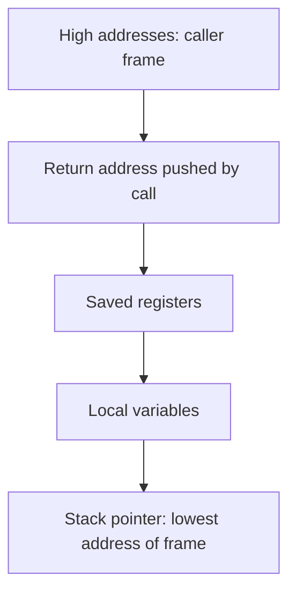

Calling conventions differ (System V on Linux, different register lists on Windows and Apple), but
the shape is constant: narrow register handoff, stack for the overflow, callee-saved versus
caller-saved split. Stack overflows, red-zone collisions, and misaligned stacks in hand-written
assembly or JIT stubs crash exactly here. When a flame graph shows half your time under one frame
setup, you are looking at this machinery — see Part 19 for `perf annotate`.

### 4.10 Pipeline Hazards and Superscalar Fixes

Pipelining works until instructions depend on each other. The three hazard families:

| Hazard | What happens | Example |
|---|---|---|
| Structural | Two stages need the same hardware | Fetch and data access collide on one memory port |
| Data (RAW) | Instruction needs a result not yet computed | `add` reads a register the previous `load` has not delivered |
| Control | Next instruction unknown until a branch resolves | `if` decides between two fetch streams |

Fixes, cheapest first:

- **Forwarding (bypassing):** route the ALU result directly to the next instruction's input instead of
  waiting for writeback. Removes most stalls for back-to-back arithmetic.
- **Stalling and interlocking:** the hardware inserts bubbles when forwarding cannot help. Load-use is
  the classic: the value arrives from cache one cycle too late. Compilers hide this by scheduling
  independent instructions between the load and its use.
- **Branch prediction plus speculation:** guess the branch, fetch and execute ahead, squash on
  mispredict. Part 10 covers the predictors; the hazard framing is why predictors exist at all.
- **Register renaming and out-of-order issue:** map architectural registers onto a larger physical file
  so false dependencies (write-after-write, write-after-read) vanish, then issue whichever micro-op has
  ready operands. This is Tomasulo's algorithm from the IBM 360/91, still the core of every M-series
  and Zen core.
- **Superscalar width plus reorder buffer:** fetch, decode, and retire multiple instructions per cycle
  in order even though they executed out of order, preserving the illusion of sequential execution.

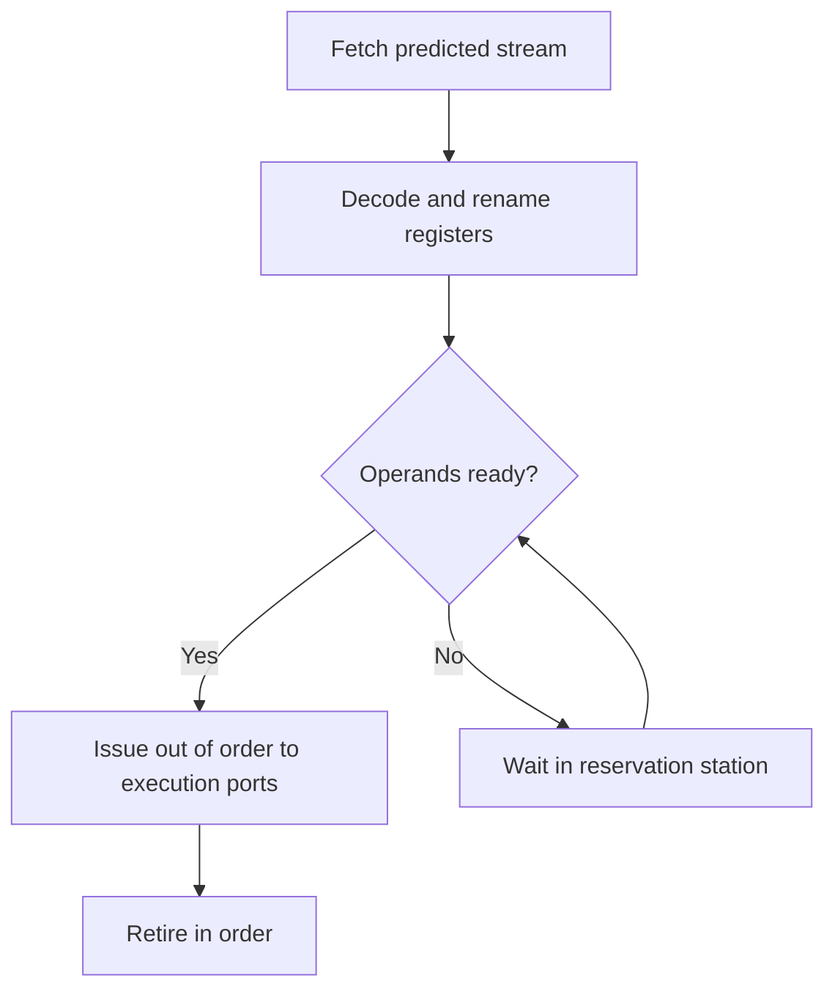

Backend rule: write the code the predictor and renamer like. Straight-line loops with one predictable
exit, independent accumulators (`sum0` through `sum3`, combined at the end) to expose
instruction-level parallelism, and branches sorted so the common path falls through. Unrolling helps
only when it creates independent work; unrolling a dependent chain just unrolls the stall.

### 4.11 The Modern Out-of-Order Core

A classic CPU runs the fetch-decode-execute cycle, often called the instruction cycle. The program counter (PC)
holds the address of the next instruction. The control unit fetches those bytes from memory into the instruction
register, the decoder figures out which operation and operands they encode, the execution units perform it, and the
result is written back to registers or memory. Then the PC advances and the loop repeats, billions of times per second.

Modern cores still honor that logical cycle but overlap hundreds of instructions at once:

- **Clock and datapath:** the clock synchronizes register transfers. Clock speed (GHz) times instructions-per-clock
  (IPC) determines throughput. A 3 GHz core ticks 3 billion times per second, but IPC matters more than GHz today.
- **Registers:** the fastest storage, typically 32 integer plus 32 vector registers on ARM64, with names like `x0-x30`
  on Apple Silicon and `rax, rbx` on x86-64. All computation happens here, not directly in RAM.
- **Control unit and ALU:** the control unit orchestrates data movement; the ALU does arithmetic and logic; the FPU
  and vector units handle floats and SIMD; the load-store unit talks to caches.
- **Pipelining:** like an assembly line, fetch of instruction N+3 overlaps execution of instruction N. A 14-19 stage
  pipeline keeps every stage busy. Pipeline bubbles happen on cache misses and mispredicted branches.
- **Superscalar and out-of-order:** a modern core decodes 4-8 instructions per cycle, renames registers to remove
  false dependencies, dispatches micro-ops to multiple execution ports, executes out of order when operands are ready,
  then retires in order. Apple M-series cores decode 8-wide; high-end Intel Performance-cores decode 6-8-wide.
- **Speculative execution and branch prediction:** the core guesses branch outcomes using pattern tables (TAGE, perceptron
  predictors), executes ahead, and rolls back on a mispredict. Correct predictions are free; mispredicts flush the
  pipeline at 10-20 cycles each.
- **Memory Management Unit (MMU):** translates virtual to physical addresses via the TLB and page tables, enforces
  protection, and raises page faults the OS handles.

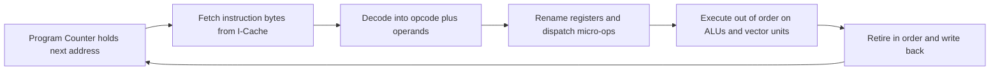

The diagram above traces one logical instruction through a modern out-of-order pipeline. Fetch pulls bytes, decode
cracks them into micro-ops, rename and dispatch schedule them, execution runs them when ready, and retire commits
results in program order before looping.

Pipelining visualized over time looks like this:

```mermaid
gantt
    title Five stage pipeline overlap across four instructions
    dateFormat X
    axisFormat %s
    section Instruction 1
    Fetch 1    :0, 1
    Decode 1   :1, 2
    Execute 1  :2, 3
    Memory 1   :3, 4
    Writeback 1 :4, 5
    section Instruction 2
    Fetch 2    :1, 2
    Decode 2   :2, 3
    Execute 2  :3, 4
    Memory 2   :4, 5
    Writeback 2 :5, 6
    section Instruction 3
    Fetch 3    :2, 3
    Decode 3   :3, 4
    Execute 3  :4, 5
    Memory 3   :5, 6
    Writeback 3 :6, 7
```

The Gantt above shows why a pipeline sustains near one instruction per cycle once filled: each stage works on a
different instruction simultaneously, so five instructions are in flight at any moment.

Key performance vocabulary for interviews:

- **Latency vs throughput:** latency is time for one task; throughput is tasks per second. CPUs optimize latency,
  GPUs optimize throughput. Little's Law connects them: concurrency equals throughput times latency.
- **IPC vs clock:** doubling GHz doubles power roughly cubically, so vendors widen decode and execution (higher IPC)
  instead of pushing 6+ GHz. Apple Silicon bets on wide and efficient; Intel bets on wide plus high boost clocks.
- **RISC vs CISC (today):** both decode to RISC-like micro-ops internally. The ISA difference now shows up in
  code density, decoder complexity, and power, not in whether the backend is RISC.
- **Interrupts and exceptions:** timers, I/O completion, and syscalls trap into the kernel, save registers, run a
  handler, and restore. This is the mechanism behind preemption and async I/O.
- **System calls:** `read`, `write`, `epoll_wait`, and `futex` cross into the kernel. Each crossing costs hundreds
  of nanoseconds to microseconds, which is why batching syscalls and using io_uring or epoll matters.

### 4.12 Seeing It Yourself: From C to Assembly

```c
long add(long a, long b) { return a + b; }  // -O2 emits a single add on x86-64
```

```
$ gcc -O2 -S add.c -o add.s        # emit assembly for your target
$ objdump -d ./server | less       # disassemble: bytes beside decoded asm
$ perf annotate --stdio            # tie hot instructions back to source lines
```

Compiler Explorer (godbolt.org) shows the same for any ISA without a local toolchain. Compare `-O0`
vs `-O2 -march=native` output once and the datapath discussion in 4.1 becomes concrete.

### 4.13 CPU Interview Questions and Answers

1. **What happens during fetch-decode-execute, and what do modern CPUs add?**
   The PC fetches instruction bytes, the decoder cracks them, execution units compute, and results
   retire in order. Modern cores overlap hundreds of instructions with pipelining, decode 4-8 wide,
   rename registers, execute out of order across many ports, predict branches speculatively, and retire
   in order. A mispredict costs 10-20 cycles of rollback.
2. **IPC vs clock: which matters more?**
   Throughput is frequency times IPC, but doubling GHz roughly cubes power, so vendors widen decode and
   execution instead. A wide 3 GHz core beats a narrow 5 GHz core on most backend code.
3. **Pipelining vs superscalar vs out-of-order?**
   Pipelining overlaps stages of different instructions. Superscalar fetches and issues several per
   cycle. Out-of-order executes them when operands are ready and retires in order. Modern cores do all three.
4. **What do the Zero, Carry, and Overflow flags mean?**
   Zero: last result was 0 (drives `BEQ`). Carry: unsigned overflow out of the top bit. Overflow: signed
   overflow into the sign bit. Branches and set-less-than read these, not the raw result.
5. **Why does a load-use pair stall even with forwarding?**
   The loaded value arrives from cache one cycle too late for the very next instruction. Compilers hide
   it by scheduling independent work between the load and its use; wide issue windows hide the rest.
6. **How does an ALU subtract without a subtractor?**
   A - B = A + ~B + 1: invert B, force carry-in to 1, reuse the adder. One mux, both operations.

## Part 5. Instruction Sets and Apple Silicon

The instruction set architecture (ISA) is the contract between software and hardware: which instructions exist,
how functions are called, and how memory is ordered. Two ISAs dominate servers and laptops: x86-64 (Intel, AMD)
and ARM64/AArch64 (Apple Silicon, AWS Graviton, Ampere). Interviews often ask why Apple moved to ARM and whether
ARM servers are worth it, so know the trade-offs rather than picking a winner.

- **x86-64 (CISC heritage):** variable-length instructions (1-15 bytes), dense code, complex decoder, strong
  memory ordering (TSO), huge legacy software base. Intel Raptor Lake and AMD Zen 5 push high boost clocks
  (5-6 GHz), wide vector extensions (AVX2, AVX-512 on select SKUs), and hybrid Performance plus Efficiency cores
  on client parts. Strength: single-thread peak and compatibility. Cost: decoder power and die area.
- **ARM64 (RISC heritage):** fixed 4-byte instructions, large register file (31 general-purpose registers),
  weaker memory ordering (application code uses acquire-release explicitly, handled by compilers), simpler decode
  that leaves power budget for wider execution. Apple M1/M2/M3/M4 and AWS Graviton 3/4 exploit this with very
  wide decode, giant reorder buffers, and system-on-chip integration (unified memory, media engines, Neural Engine).
- **Apple Silicon specifically:** an SoC, not just a CPU. CPU cores, GPU cores, Neural Engine, media encode/decode,
  Secure Enclave, and memory controllers share unified memory on one package. M-series chips pair 4-6 wide
  Performance cores with 4-6 Efficiency cores, per-core L1 caches, shared L2 per cluster, and a system-level cache.
  Rosetta 2 translates x86-64 binaries at install or first launch with near-native speed, which is why the
  transition worked: most apps never needed recompilation on day one.
- **What really differs in practice:** performance per watt (ARM SoCs win on laptops), vector and matrix extensions
  (x86 AVX-512 vs ARM SVE2 and Apple AMX), virtualization and confidential-compute features, and cloud pricing
  (Graviton instances are typically 10-20 percent cheaper per unit of throughput for web, Java, and database
  workloads). Beware blanket claims like ARM is always more efficient: implementation quality beats ISA.

| Dimension | Intel/AMD x86-64 | Apple Silicon / ARM64 servers |
| --- | --- | --- |
| Instruction encoding | Variable length, dense | Fixed 4-byte, simpler decode |
| Registers | 16 GPRs (x86-64) | 31 GPRs (AArch64) |
| Memory model | Strong (TSO) | Weaker (acquire-release) |
| Peak clocks | Up to 6 GHz boost | 3.5-4.5 GHz, wider IPC |
| Power story | High peak, improving efficiency cores | Best perf-per-watt on client |
| Accelerators | AMX, AVX-512, Quick Sync | Neural Engine, AMX, media engines |
| Cloud examples | EC2 M/C/R Intel, Azure Dv5 | EC2 Graviton, Azure Cobalt |

Use this table to answer should we move to Graviton: profile first, check JNI and native images, then trial one
stateless tier. Most backend services port cleanly because the JVM, Go, Node, and Python runtimes already abstract
the ISA; pain concentrates in native dependencies, Docker base images pinned to amd64, and inline assembly.
### 5.2 Try It: Spot the ISA Beneath Your Code

```
$ uname -m            # aarch64 on Apple Silicon and Graviton, x86_64 on Intel/AMD
$ lscpu | head -20    # architecture, cores, caches, flags
$ docker buildx ls    # which platforms your images actually cover
```

```dockerfile
# Building for both ISAs so Graviton and Apple Silicon stop being special
FROM --platform=$BUILDPLATFORM golang:1.23 AS build
ARG TARGETARCH
RUN GOARCH=$TARGETARCH go build -o /server ./cmd/server
```

Shipping multi-arch images kills the most common migration failure: containers pinned to amd64 by
accident while the fleet moved to ARM.

### 5.3 ISA Interview Questions and Answers

1. **RISC vs CISC in one minute?**
   RISC: few fixed-size instructions, load/store only touches memory, compiler plus simple decoder.
   CISC: many variable-size instructions with memory operands. Both decode to RISC-like micro-ops
   today; the difference is code density, decoder cost, and extensions.
2. **Why is Apple Silicon fast at low power — is it just the ARM ISA?**
   Mostly implementation. Fixed-width decode saves power, but the wins come from very wide decode and
   retire, a huge reorder buffer, large shared L2/SLC, and SoC integration (unified memory, media and
   neural engines). Rosetta 2 made migration painless.
3. **Should we move this service to Graviton?**
   Profile first, check JNI and native images, trial one stateless tier. JVM, Go, Node, and Python
   abstract the ISA; pain concentrates in native dependencies, amd64-pinned images, and inline assembly.
   Graviton is typically 10-20 percent cheaper per unit of web, Java, or database throughput.
4. **What does x86 TSO vs ARM weak ordering mean for my code?**
   x86 makes most reorderings invisible; ARM needs explicit acquire-release barriers, which the JVM, Go
   runtime, and C++ atomics insert for you. Never roll your own double-checked locking with plain fields.
5. **RISC-V: why should a backend engineer care?**
   The open ISA (no license fees) is moving from microcontrollers into data-center silicon and Chinese
   hyperscaler fleets. Your code is ready if it is portable C/Go/Rust without inline assembly and your
   images build multi-arch; the Dockerfile in 5.2 already covers it.

## Part 6. CPU vs GPU vs TPU vs DPU vs QPU

Backend interviews love which chip for which workload. The one-line answer: CPUs minimize latency for arbitrary
logic, GPUs maximize throughput for data-parallel math, TPUs maximize throughput per watt for dense ML math, DPUs
offload infrastructure work, and QPUs accelerate narrow quantum algorithms that are not yet mainstream backend tools.

| Chip | Optimized for | Parallelism model | Memory | Backend use cases | Weakness |
| --- | --- | --- | --- | --- | --- |
| CPU | Single-thread latency, any branchy logic | 8-192 cores, ILP plus thread parallelism | Large DDR, deep caches, virtual memory | API servers, databases, business logic, orchestration | FLOPS per watt on dense math |
| GPU | Throughput on parallel math | Thousands of SIMT lanes in warps/warps of 32 | High-bandwidth HBM/GDDR, explicit copies | Training, inference, video, analytics, vector search | Branchy code, small-batch latency, PCIe transfers |
| TPU | Dense matrix ops per watt | Systolic array (MXU) for matmul and convolutions | HBM, XLA-compiled graphs | Large model training and serving on Google Cloud | General code, sparse or control-heavy graphs |
| DPU | Infrastructure offload | ARM cores plus NIC, crypto, and storage accelerators | Own DRAM, DMA to host | TLS, virtual switching, NVMe-oF, service-mesh offload | Not an app compute engine |
| QPU | Quantum interference/optimization | Qubits with superposition and entanglement | Cryogenic/isolated, classical host drives it | Research: optimization, chemistry, factoring demos | Noise, few qubits, no general backend role yet |

- **CPU vs GPU in depth:** a GPU groups 32 threads (NVIDIA warp, AMD wavefront) that execute the same instruction
  together. Coalesced sequential accesses fly; divergent branches serialize. A kernel launch plus PCIe transfer costs
  microseconds, so GPUs win when batches are large (thousands of rows, large matmuls) and lose on single-request
  latency. That is why inference servers batch: batch 32-128 turns GPU idle time into 10-50x throughput.
- **TPU in depth:** Google TPUs surround a systolic matrix-multiply unit with vector and scalar units and compile
  whole graphs with XLA. Pod slices connect thousands of chips with dedicated interconnect. Pick TPUs for dense
  transformer training and serving on GCP; pick GPUs for flexibility across clouds, sparse models, and custom CUDA.
- **DPU in depth:** NVIDIA BlueField, AMD Pensando, and Intel IPU sit on the NIC. They run the virtual switch,
  encryption, tunnel encapsulation, storage initiators, and eBPF or P4 pipelines so host cores serve requests
  instead of packets. Cloud providers use them to deliver bare-metal performance to VMs; platform teams use them
  to offload Envoy sidecars and observability agents.
- **QPU in depth:** superconducting, trapped-ion, and neutral-atom machines expose qubits through cloud queues
  (Braket, Azure Quantum). Coherence times and error rates still limit depth, so backends call them only for
  experiments and hybrid algorithms (VQE, QAOA). Never propose a QPU for CRUD, caching, or queues in an interview.

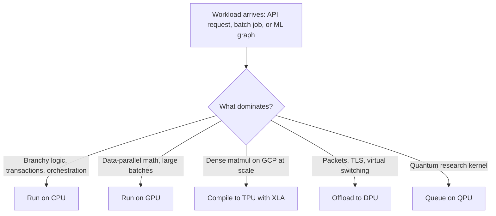

The flowchart above gives you an interview-safe routing rule: classify the bottleneck first, then assign the chip.
Say it aloud as I would put this on the cheapest generalist that meets the SLO and only promote to an accelerator
when profiling proves the bottleneck matches its strength.
### 6.2 Try It: Feel the Batch Effect on a GPU

```python
import time, torch

x = torch.randn(4096, 4096)
device = "cuda" if torch.cuda.is_available() else "cpu"
x = x.to(device)
torch.matmul(x, x)  # warm up

for n in (1, 32, 256):
    batch = torch.stack([x] * n) if n > 1 else x.unsqueeze(0)
    t0 = time.perf_counter()
    torch.matmul(batch, batch)
    if device == "cuda":
        torch.cuda.synchronize()
    dt = (time.perf_counter() - t0) * 1000
    print(f"batch {n}: {dt:.1f}ms total, {dt / n:.2f}ms per item")
```

Per-item cost collapses as batch grows on a GPU and barely moves on a CPU. That curve is the entire
batch-32+ argument in one experiment. No GPU on hand: the same script on CPU still shows how batching
into one kernel beats per-item calls.

### 6.3 Accelerator Interview Questions and Answers

1. **When would you choose a GPU over a CPU, and when would you refuse?**
   Choose GPU for large-batch data-parallel math where thousands of lanes amortize launch and transfer.
   Refuse for branchy low-batch latency paths: single-request inference, transactional CRUD, chatty RPC
   handlers where PCIe plus kernel launch exceeds compute time.
2. **TPU vs GPU vs DPU in one minute?**
   GPUs are general data-parallel processors with CUDA kernels. TPUs are systolic-array accelerators
   compiled wholesale with XLA for dense matmul on GCP. DPUs are NIC-resident computers offloading TLS,
   virtual switching, and storage so host cores serve app logic.
3. **What is a QPU good for in a backend interview?**
   Nothing in production yet. Superconducting, trapped-ion, and neutral-atom machines via Braket or
   Azure Quantum suit research (optimization, chemistry, factoring demos). Never propose one for CRUD.
4. **Why do inference servers batch?**
   Batch 32-128 turns GPU idle time into 10-50x throughput. Below that the launch plus transfer tax
   dominates and CPUs win at batch 1.
5. **Divergent branches on a GPU: what happens?**
   A 32-thread warp executes one instruction at a time, so divergent paths serialize: both sides run
   with lanes masked off. Coalesced sequential accesses fly; random divergent code crawls.

## Part 7. Caches and Memory Hierarchy

The memory hierarchy exists because fast storage is small and large storage is slow. Registers answer in under a
nanosecond, L1 cache in about 1 ns, L2 in 3-10 ns, L3 in 10-40 ns, DRAM in 60-100 ns, NVMe SSD in 10-100 microseconds,
and network storage in milliseconds. Every backend latency story — p99 spikes, slow queries, GC pauses — is partly a
story about which level served the data.

Typical sizes per core on a modern laptop or server:

- **Registers:** ~1-2 KB of directly named storage. Zero cache miss concept; spills go to L1.
- **L1:** 48-192 KB instruction plus 32-64 KB data per core, split I-cache and D-cache, ~4-8 cycle latency,
  private to the core. Hot loops must fit here.
- **L2:** 1-2 MB per core (Apple Performance cores share 16-32 MB per cluster), ~12-20 cycles, private or cluster-shared.
- **L3 / system-level cache:** 16-128 MB shared across cores (AMD 3D V-Cache stacks up to 96+ MB), ~30-60 cycles.
  A shared L3 lets one core reuse another core's lines but creates contention and coherence traffic.
- **DRAM:** gigabytes, ~200-300 cycles. Sequential bandwidth 50-200 GB/s; random pointer-chasing latency dominates.
- **SSD and network:** page faults and remote reads cost 10,000x an L1 hit. One disk read wipes out millions of cached ops.

How caches work:

- **Lines and sets:** data moves in 64-byte cache lines. An address maps to a set; associativity (4-16 ways) decides
  how many lines compete per set. Sequential scans use every byte of each line; strided or random access wastes most of it.
- **Hit, miss, and the three Cs:** compulsory (first touch), capacity (working set exceeds cache), conflict (too many
  addresses share a set). Profilers report miss rate and MPKI (misses per kilo-instruction); rising MPKI with flat IPC
  means memory-bound.
- **Write policies:** write-through pushes every store to the next level (simple, slow); write-back marks lines dirty
  and flushes on eviction (fast, standard for L1/L2/L3). Write-allocate fetches the line on a store miss so later bytes hit.
- **Coherence (MESI):** each line is Modified, Exclusive, Shared, or Invalid across cores. A core writing a Shared line
  must invalidate every other copy, which costs interconnect traffic. This is why false sharing hurts: two threads writing
  different fields on the same 64-byte line ping-pong ownership.
- **Prefetching:** hardware stride prefetchers detect sequential patterns and pull lines early; software prefetch
  (`__builtin_prefetch`, `PREFETCH` hints) helps linked traversal only when the pattern is predictable.
- **TLB and huge pages:** every memory access first translates virtual to physical via the TLB (~1 ns on hit). Random
  access over gigabytes thrashes the TLB; 2 MB huge pages cut TLB pressure by 512x and are a standard database tuning knob.
- **NUMA:** on multi-socket servers each socket has local DRAM. Local access is fast; remote access crosses the
  interconnect at 1.3-2x latency. Pin latency-sensitive threads and allocate memory locally (`numactl`, first-touch policy).

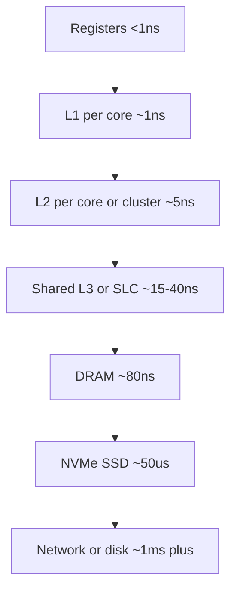

The funnel above is the hierarchy every request walks on a miss: each level is larger and slower, so the goal of
cache-friendly code is to stop as high as possible. Quote the orders of magnitude in interviews: L1 hit 1 ns,
DRAM 100 ns, SSD 100 microseconds.

Practical rules that follow:

- Keep hot working sets under L2/L3 size. A hash table that fits in L3 beats a theoretically better tree that spills to DRAM.
- Favor sequential over random: arrays over pointer chains, column scans that match layout, batch allocations from arenas.
- Pad or shard contended counters to separate cache lines (`@Contended` in Java, 64-byte alignment in Go and Rust).
- Use huge pages for large heaps and read-mostly dictionaries; measure TLB misses with `perf stat -d`.
### 7.2 Try It: Measure the Hierarchy on Your Machine

```
$ lscpu | grep -i cache        # L1/L2/L3 sizes per core
$ perf stat -d ./server        # L1 misses, LLC misses, MPKI, IPC in one run
$ valgrind --tool=cachegrind ./small_input   # simulated miss attribution
```

Rising MPKI with flat IPC means memory-bound: fix layout before scaling out.

### 7.3 Cache Interview Questions and Answers

1. **Explain L1/L2/L3 and why cache locality decides backend speed.**
   L1 (~1 ns, per core) feeds the pipeline; L2 (~5 ns) backs it; shared L3 (~15-40 ns) spans cores;
   DRAM costs ~80-100 ns and disk 100,000x an L1 hit. Data moves in 64-byte lines, so sequential scans
   use full lines while strided or pointer-chasing access wastes them. Keep hot sets in L2/L3, prefer
   arrays over linked nodes, shard hot counters to separate lines.
2. **What are the three Cs of cache misses?**
   Compulsory (first touch), capacity (working set exceeds cache), conflict (too many addresses share a
   set). Profilers report miss rate and MPKI.
3. **Write-through vs write-back?**
   Write-through pushes every store down: simple, slow. Write-back marks lines dirty and flushes on
   eviction: fast, the standard for L1/L2/L3. Write-allocate fetches the line on a store miss.
4. **MESI in one minute?**
   Each line is Modified, Exclusive, Shared, or Invalid across cores. A core writing a Shared line must
   invalidate every other copy. Two threads writing different fields on one 64-byte line ping-pong
   ownership: false sharing. (MOESI/MESIF add Owned/Forward states to cut that traffic on AMD/Intel.)
5. **Your service shows high CPU but low IPC. How do you debug it?**
   High CPU with low instructions-per-cycle means stalls. `perf stat -d` for miss rates and MPKI,
   flame-graph on-CPU stacks, `perf record -b` for branch misses, `cachegrind` for line attribution.
   Check TLB pressure, false sharing, NUMA remote access. Fix layout first; scale out only after IPC recovers.

## Part 8. Concurrency Cores Threads and SMT

Three different things share the name parallelism: instruction-level parallelism inside one core (pipelining,
superscalar), thread-level parallelism across cores, and data-level parallelism across vector lanes. Interviews test
whether you map each to the right primitive: ILP is the compiler and core's job, thread parallelism is your
thread-pool and locking design, data parallelism is SIMD or GPU batches.

- **Cores:** independent execution engines with private L1/L2 and shared L3. More cores raise throughput for parallel
  work but do nothing for single-thread latency. Scaling stops at Amdahl's Law: if 10 percent of work is serial, even
  infinite cores cap speedup at 10x.
- **Hardware threads and SMT:** Simultaneous Multithreading (Intel Hyper-Threading, AMD SMT, IBM POWER) exposes two
  threads per core sharing execution units. When one thread stalls on a cache miss, the other issues. Typical gain is
  15-30 percent throughput on mixed server workloads, near zero on fully saturated vector code. Cloud vCPUs usually equal
  one hardware thread, so an 8-vCPU box may be 4 cores with SMT.
- **Performance vs Efficiency cores:** Apple M-series, Intel Core 12th-gen plus, and ARM server chips mix wide fast cores
  with narrow efficient cores. The OS scheduler parks background work on E-cores and bursts latency-sensitive work on
  P-cores. Backend relevance: tail latency depends on which core served the request, and noisy-neighbor effects grow when
  threads migrate between core types.
- **Processes vs threads vs green threads:** processes isolate memory (separate page tables, expensive fork); OS threads
  share memory with per-thread stacks and kernel scheduling (~microseconds to switch); green threads (goroutines, Java
  virtual threads, Tokio tasks) multiplex thousands onto few OS threads with user-space switching (~tens of nanoseconds).
  Modern backends run tens of thousands of virtual threads or goroutines over dozens of OS threads.
- **Affinity and pinning:** binding latency-critical threads to specific cores (`taskset`, `cpuset`, `isolcpus`) cuts
  migration misses and jitter. Databases and event loops commonly pin; stateless web tiers usually do not need to.
- **Coherence cost of sharing:** atomics and locks bounce the line between cores. An uncontended CAS costs ~10-20 ns;
  heavily contended it costs hundreds of nanoseconds plus pipeline stalls. Shard counters per core and combine on read.

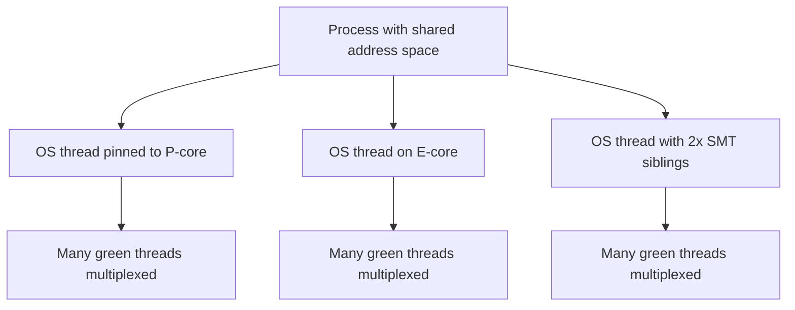

The diagram above separates what the OS schedules from what the runtime schedules: a few OS threads occupy cores
and SMT slots while thousands of green threads take turns on top. If green threads block on I/O, the runtime parks
them; if OS threads block, the kernel pays a full context switch.
### 8.2 Try It: Size Pools and Pin Threads

```python
import os
print(os.cpu_count())  # logical CPUs: cores x SMT siblings, not physical cores
```

```
$ nproc && lscpu | grep -E "Thread|Core|Socket"   # disentangle threads vs cores
$ taskset -c 0-3 ./latency-critical               # pin to specific cores
$ vmstat 1            # watch cs column: collapsing throughput past a thread count = oversubscription
```

CPU-bound pools to cores (discount SMT), I/O-bound pools to Little's Law concurrency, event loops to
one thread per core with blocking work hived off. Never size by request count.

### 8.3 Concurrency Interview Questions and Answers

1. **Cores vs threads vs SMT: how do you size a thread pool?**
   Cores execute independently; SMT threads share one core's units for 15-30 percent extra throughput
   on mixed work. OS threads are kernel-scheduled; green threads multiplex in user space. CPU-bound to
   cores, I/O-bound to concurrency from Little's Law, event loops one per core.
2. **Why do P-cores vs E-cores matter for tail latency?**
   The scheduler parks background work on E-cores and bursts latency-sensitive work on P-cores, so which
   core served a request changes its latency and noisy-neighbor effects grow on migration.
3. **What does a context switch cost, and how do you reduce them?**
   Direct cost 1-10 microseconds plus cold caches, TLB churn, NUMA migration. Size pools to cores, use
   non-blocking I/O and virtual threads or goroutines, batch syscalls, avoid 20x vCPU oversubscription,
   pin latency-critical threads, diagnose with `vmstat` and `perf sched`.
4. **Processes vs threads vs green threads?**
   Processes isolate memory with expensive fork; OS threads share memory with microsecond kernel
   switching; green threads multiplex thousands onto few OS threads with nanosecond user-space switching.
   Modern backends run tens of thousands of virtual threads or goroutines over dozens of OS threads.
5. **What is Amdahl's Law in one line?**
   If 10 percent of work is serial, even infinite cores cap speedup at 10x. Parallelize the serial
   fraction or stop adding cores.

## Part 9. What Backend Developers Must Know

You rarely program the CPU directly, but its costs leak into every p99, every capacity plan, and every Why is this
slow after deploy thread. These five effects cover the majority of backend CPU questions.

- **Context switches: what they cost and when they bite.** A voluntary switch (blocking on I/O, lock, `await`) saves
  registers, swaps stacks, and traps into the scheduler; an involuntary switch (timeslice expiry, higher-priority wakeup)
  adds TLB pressure and cache pollution. Direct cost is 1-10 microseconds, but the indirect cost — cold L1/L2, migrated
  NUMA locality, woken cache lines — dominates. Symptoms: high `cs` in `vmstat`, high scheduler latency, throughput that
  collapses past a thread count. Fixes: size pools to cores not requests (one event-loop thread per core, bounded worker
  pools), use non-blocking I/O and virtual threads or goroutines so parking is cheap, batch syscalls, and stop oversubscribing
  vCPUs 20x on latency-sensitive tiers.
- **Cache locality: the cheapest optimization.** Sequential array scans run at memory bandwidth; pointer-chasing linked
  structures run at pointer latency, often 10-50x slower on the same data volume. Prefer flat arrays, struct-of-arrays,
  arena allocation, and batching. Keep per-request hot state small enough for L1/L2: a 200-byte request context stays hot,
  a 200 KB context does not. Columnar formats (Parquet, Arrow) exist precisely because analytics scans one column
  sequentially instead of hopping across rows. Compression helps twice: less I/O and smaller cache footprint.
- **Branch prediction and predictable hot paths.** Sorted or biased branches predict well; random branches mispredict and
  flush 10-20 cycles each. Real examples: checking `if (user == null)` on a path where it is almost never null is free;
  a hash-bucket chain with unpredictable comparisons is not. Prefer lookup tables, branchless selects (`Math.min`, masked
  moves), and separating hot from cold paths so the instruction cache holds the common case. Profile with `perf record`
  branch-miss rate before rewriting conditions by hand.
- **SIMD and vectorization: doing 4-16 values per instruction.** SSE, AVX2, AVX-512 (x86) and NEON, SVE2 (ARM) apply one
  op to a whole register: 8 floats with AVX2, 16 with AVX-512. Compilers auto-vectorize simple counted loops over
  contiguous arrays with no aliasing or early exits; they give up on pointer hops and data-dependent branches. Help them:
  use `for i in range(n)` over slices, `restrict`-style non-aliasing guarantees (separate arrays, typed memoryviews),
  and library kernels (NumPy, Arrow compute, Java Vector API, Go assembly kernels) instead of hand-rolled scalar loops.
  GPUs extend the same idea to thousands of lanes; SIMD is the on-CPU version you get for free.
- **Syscalls, user vs kernel, and I/O batching.** Every `read`, `send`, `fsync`, or `futex` crosses protection rings,
  validates buffers, and may block. High-QPS services win by crossing rarely: buffered writes, `readv/writev`, `sendfile`,
  epoll/kqueue/io\_uring instead of one-thread-per-connection blocking reads, and connection pooling to avoid TLS handshake
  syscalls per request. `strace -c` showing 30 percent of time in `futex` means lock contention; showing millions of tiny
  `read` calls means missing buffering.
- **Memory model and safe publication.** x86 TSO makes most reorderings invisible, but ARM needs explicit acquire-release
  barriers, which the JVM, Go runtime, and C++ atomics insert for you. Rules: never roll your own double-checked locking
  with plain fields, publish shared state via `volatile`, `AtomicReference`, `sync.Mutex`, or channels, and keep mutable
  sharing narrow. The MESI traffic from one hot atomic counter can cap an entire service; shard it per core and aggregate.
- **GC, allocators, and CPU interplay.** Allocation is cheap (bump pointer in TLAB), but cache misses during marking and
  page faults from heap growth are not. Keep young-gen churn low (reuse buffers, stream instead of materializing lists),
  size heaps so working sets fit DRAM on the local NUMA node, and prefer off-heap or pooled direct buffers for I/O paths.

Latency numbers to memorize (approximate, modern server):

| Operation | Cost | Mental model |
| --- | --- | --- |
| L1 hit | ~1 ns | Free in a hot loop |
| Branch mispredict | ~5-15 ns | 15 wasted cycles |
| L3 hit | ~15-40 ns | Cross-core share |
| DRAM random | ~80-100 ns | 300 stalled cycles |
| Uncontended CAS | ~10-20 ns | Line stays local |
| Contended CAS | ~100-500 ns | Line ping-pong |
| Context switch | ~1-10 us | 10,000 L1 hits lost |
| Syscall round trip | ~0.5-2 us | Batch them |
| SSD 4K read | ~50-100 us | 1M L1 hits lost |
| Cross-AZ RPC | ~0.5-2 ms | 10M L1 hits lost |

Quote the ratios, not just absolutes: a cache miss costs 100x an L1 hit, a context switch 10,000x, a disk read 100,000x.
### 9.2 Try It: Find Your Bottleneck

```
$ perf stat -d ./server            # IPC + MPKI: compute-bound (high IPC) vs memory-bound (high MPKI)
$ perf record -b ./server && perf report   # branch-miss rate before rewriting conditions
$ strace -c -p $PID                # 30% futex = lock contention; millions of tiny reads = missing buffering
$ py-spy record -o flame.svg -- ./app.py    # Python flame graph without code changes
```

### 9.3 Backend Performance Interview Questions and Answers

1. **Cache locality: the cheapest optimization?**
   Sequential scans run at bandwidth; pointer-chasing runs at latency, 10-50x slower on the same data.
   Flat arrays, struct-of-arrays, arenas, small hot state, columnar formats for analytics.
2. **Branch prediction and hot paths?**
   Sorted or biased branches predict well; random ones flush 10-20 cycles each. Lookup tables,
   branchless selects, separate hot from cold code paths. Profile branch-miss rate first.
3. **SIMD in one minute?**
   One op on 4-16 values per register (AVX2/AVX-512, NEON/SVE2). Compilers vectorize simple counted
   loops over contiguous non-aliasing arrays. Counted index loops, separate arrays, library kernels.
4. **Syscalls and I/O batching?**
   Every crossing costs 0.5-2 microseconds and may block. Buffered writes, readv/writev, sendfile,
   epoll/kqueue/io_uring, connection pooling. `strace -c` tells you whether locks or tiny reads dominate.
5. **Memory model and safe publication?**
   x86 TSO hides most reorderings; ARM needs explicit acquire-release barriers, inserted by the JVM, Go
   runtime, and C++ atomics. Publish via volatile, AtomicReference, mutexes, or channels; shard hot
   atomics per core to avoid MESI ping-pong.

## Part 10. Branch Prediction and Speculative Execution

Guessing right keeps a 14-19 stage pipeline full; guessing wrong flushes 10-20 cycles of work. This
part turns the one-line mentions in Parts 4 and 9 into the full mechanism: what predictors track, how
speculation recovers, and what Spectre and Meltdown taught the industry.

### 10.1 How Predictors Learn Your Branches

- **1-bit and 2-bit saturating counters:** remember taken/not-taken per branch address. The 2-bit
  version needs two consecutive surprises before flipping, which stops loops with one odd iteration
  from thrashing. State machine: Strongly-Not-Taken -> Weakly-Not-Taken -> Weakly-Taken ->
  Strongly-Taken.
- **Pattern and history tables (TAGE):** index by branch address XOR global history, so `if (x)` after
  different call paths predicts differently per path. The longest matching history wins.
- **Perceptron predictors:** tiny neural nets per branch; modern AMD and Intel ship these for hard,
  data-dependent branches.
- **Indirect branch predictors and BTB:** `switch`, virtual calls, and function pointers need a Branch
  Target Buffer predicting the *destination*, not just taken/not-taken.

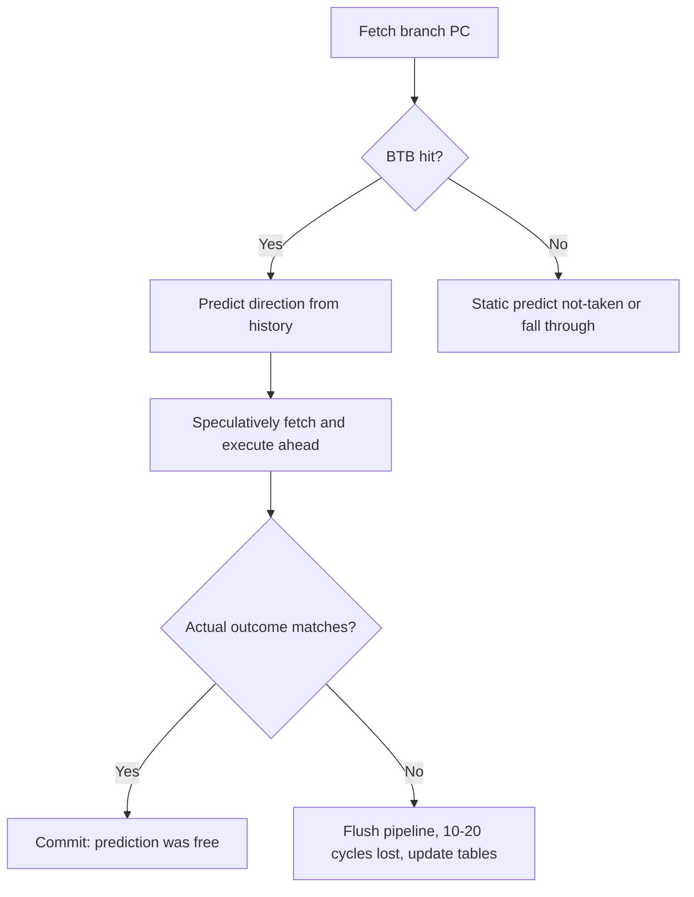

### 10.2 Spectre, Meltdown, and What Changed

- **Meltdown (2018):** out-of-order loads bypassed permission checks before the fault retired, leaking
  kernel memory via cache timing. Fixed with KPTI (separate kernel page tables): correct, costs 5-30
  percent on syscall-heavy workloads.
- **Spectre v1/v2:** tricked the victim's own speculation (bounds-check bypass, branch-target
  injection) into leaking. Fixed with retpolines, IBRS/STIBP microcode, bounds clipping
  (`array_index_nospec`), and site isolation in browsers.
- **Backend cost you still pay:** KPTI page-table switches on every syscall, retpoline-throttled
  indirect calls, and disabled SMT on some security-sensitive fleets. When someone says "post-2018
  cloud got 10 percent slower," this is a big slice of it.

### 10.3 Try It: Make a Branch Predictable

```python
import random, time

data = [random.random() for _ in range(200_000)]
t0 = time.perf_counter()
s1 = sum(1 for x in data if x > 0.5)          # random: predictor helpless
t1 = time.perf_counter()
data.sort()
s2 = sum(1 for x in data if x > 0.5)          # sorted: predictor nearly perfect
t2 = time.perf_counter()
print(f"random {(t1-t0)*1000:.1f}ms, sorted {(t2-t1)*1000:.1f}ms")
```

The sorted pass runs dramatically faster on identical comparisons: that gap is pure branch prediction.
Compilers do this transformation for you when they can (lookup tables, branchless selects, `cmov`).

### 10.4 Prediction Interview Questions and Answers

1. **What does a mispredict cost, and why?**
   10-20 cycles: every speculatively fetched instruction after the branch is flushed and the pipeline
   refills. Correct predictions are free, which is why biased branches are nearly invisible.
2. **2-bit counter vs TAGE in one minute?**
   2-bit counters remember per-branch bias with hysteresis. TAGE indexes by branch plus global history
   so the same branch predicts differently on different paths. Perceptron predictors learn
   data-dependent patterns no table catches.
3. **Spectre vs Meltdown in one minute?**
   Meltdown: faulty out-of-order loads read kernel memory before the fault retires; fixed by KPTI.
   Spectre: attacker steers the victim's own speculation into leaking; fixed by retpolines, microcode,
   bounds clipping, site isolation.
4. **How do you write predictor-friendly code?**
   One predictable exit per loop, sort or bias branches so the common path falls through, hoist
   unpredictable tests out of hot loops, prefer tables and branchless selects over data-dependent `if`s.

## Part 11. Power, Clocks, and Thermals

Clock speed stalled near 5-6 GHz because power did not scale with transistors. This part explains why,
what vendors do instead, and how it changes benchmarking.

### 11.1 Why GHz Stopped Growing

Dynamic power follows `P = C x V^2 x f`: each switch charges capacitance at voltage V, f times per
second. Dennard scaling (shrink transistors, drop voltage, hold power density) ended around 2006;
since then smaller transistors leak more at rest and the voltage floor barely moves, so higher clocks
mean melting silicon.

What vendors do instead:

- **DVFS:** scale voltage and frequency to the workload. Bursty request handlers turbo up, idle cores park.
- **Turbo and thermal headroom:** boost one core far above base while the package stays under its
  thermal and current budget. Sustained all-core loads clock lower than single-thread bursts.
- **Gating and dark silicon:** clock-gate idle units, power-gate whole cores, leave accelerators dark
  until needed. A phone SoC can only light a fraction of its transistors at once without throttling.
- **Wider, not faster:** spend the transistor budget on more cores, wider decode, bigger caches, and
  matrix engines at modest clocks. Apple Silicon, Graviton, and Zen all bet this way.

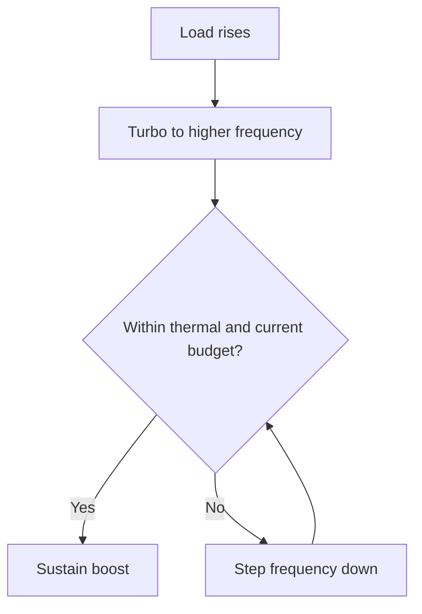

### 11.2 Try It: See Turbo and Throttling

```
$ cat /proc/cpuinfo | grep -m1 "model name"   # advertised vs base clock
$ sudo cpupower frequency-info                # current governor and boost state
$ dmesg | grep -i -E "thermal|throttl"          # kernel saw heat pressure
$ lscpu | grep -i mhz                          # compare before / during load
```

Benchmark at a pinned frequency (`performance` governor) or turbo noise drowns real deltas.

### 11.3 Power Interview Questions and Answers

1. **Why did clocks stop near 5 GHz, and how should that change benchmarking?**
   Dennard scaling ended so voltage stopped dropping while leakage rose; `P = C x V^2 x f` turns extra
   GHz into cubic power for linear speed. Vendors went wider with turbo as borrowing against thermal
   budget. Pin the governor, compare at fixed clocks, size capacity at sustained all-core frequency.
2. **DVFS vs turbo vs throttling?**
   DVFS is deliberate scaling to the workload. Turbo is opportunistic boost inside thermal budget.
   Throttling is forced slowdown when the budget is blown. Same knob, different intent.
3. **Dark silicon in one line?**
   A modern SoC can only power a fraction of its transistors at once without melting, so accelerators
   stay dark until their workload arrives.

## Part 12. Virtual Memory, Paging, and the TLB

Every process gets a private address space and the OS oversubscribes physical RAM. The MMU translates
each virtual address, checks permissions, and faults to the OS when the mapping is missing or forbidden.

### 12.1 Pages, Tables, and the TLB

Paging splits both spaces into fixed pages (4 KB standard, 2 MB and 1 GB huge pages). A multi-level
page table is a tree: each level indexes the next with 9 bits on x86-64 and ARM64, so unmapped regions
cost no memory. Translating means walking that tree; the TLB caches recent translations so the walk
happens only on miss.

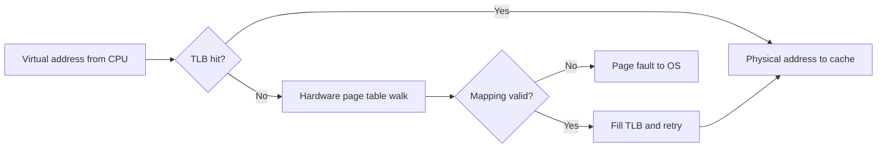

| Page size | TLB reach with 1024 entries | Best for |
|---|---|---|
| 4 KB | 4 MB | General processes, fine-grained protection |
| 2 MB | 2 GB | Databases, JVM heaps, vector stores |
| 1 GB | 1 TB | Terabyte in-memory engines on bare metal |

### 12.2 What the OS Does on a Fault

- **Minor fault:** page exists in memory (file cache, copy-on-write zero page) but is not yet mapped.
  Cheap: wire the page-table entry and resume. `mmap` startup and first-touch allocation look like this.
- **Major fault:** page is on disk or network. The faulting thread sleeps while the page is read in.
  One major fault costs more than a million L1 hits, which is why cold-start scans spike p99.
- **Swap or reclaim:** under pressure the OS evicts cold pages. Containers with tight memory limits die
  by thrashing here long before any OOM headline.
- **Copy-on-write:** `fork` shares pages read-only until either side writes, then copies. This is why
  forking a 10 GB process is instant until the child touches memory.

### 12.3 Try It: Watch Faults and TLB Pressure

```
$ /usr/bin/time -v ./server 2>&1 | grep -E "faults|Maximum resident"   # minor vs major faults
$ perf stat -d ./server 2>&1 | grep -i tlb    # dTLB miss rates: huge pages help here
$ sar -B 1 3                                   # paging activity under load
$ free -h && vmstat 1                          # swap use + si/so columns climbing = thrashing
```

Pre-touch or pre-fault memory-mapped files before serving; keep NUMA-local allocation (first-touch or
explicit pinning) so the page walk and the data land on the same socket.

### 12.4 Virtual Memory Interview Questions and Answers

1. **Explain virtual memory and what happens on a TLB miss.**
   Every process sees a private virtual address space; the MMU translates each address via multi-level
   page tables with permission checks. The TLB caches recent translations. On a miss the hardware walks
   the tables: hit means fill the TLB and retry, miss means page fault to the OS. Minor faults map an
   in-memory page and resume; major faults sleep the thread for disk or network.
2. **Huge pages: when and why?**
   2 MB pages shrink page tables 512x and cut TLB misses for multi-GB heaps: standard Postgres, Redis,
   and JVM tuning. Verify with `perf stat` dTLB miss rates before and after.
3. **Minor vs major fault?**
   Minor: page already in RAM, just unmapped — microseconds. Major: page on disk or network — the thread
   sleeps milliseconds. `time -v` reports both; major faults in a hot path are a p99 emergency.
4. **How do NUMA and paging interact?**
   On multi-socket hosts, memory local to the socket answers faster at 1.3-2x latency. First-touch
   allocation or `numactl` keeps pages near their threads; remote walks and remote data stack the penalty.

## Part 13. I/O, PCIe, Interrupts, and DMA

The CPU never bit-bangs a modern SSD or NIC. It programs a controller, goes back to useful work, and
learns the transfer finished via an interrupt or by polling a completion queue.

### 13.1 Three I/O Styles

| Style | How the CPU moves data | Cost profile |
|---|---|---|
| Programmed I/O | CPU reads and writes every byte | Simple, burns a core per byte |
| Interrupt-driven | Device interrupts when done | Good for rare events, storms at high rate |
| DMA | Controller moves bulk memory itself | Best throughput, CPU free during transfer |

PCIe is the fabric: lanes of high-speed serial, devices exposing memory-mapped registers and doorbells,
MSI-X interrupts routed per-queue so each core handles its own completions. NVMe queues, NIC rings, and
GPU command queues all sit on this model: the driver writes descriptors, rings the doorbell, the device
DMAs data and posts a completion.

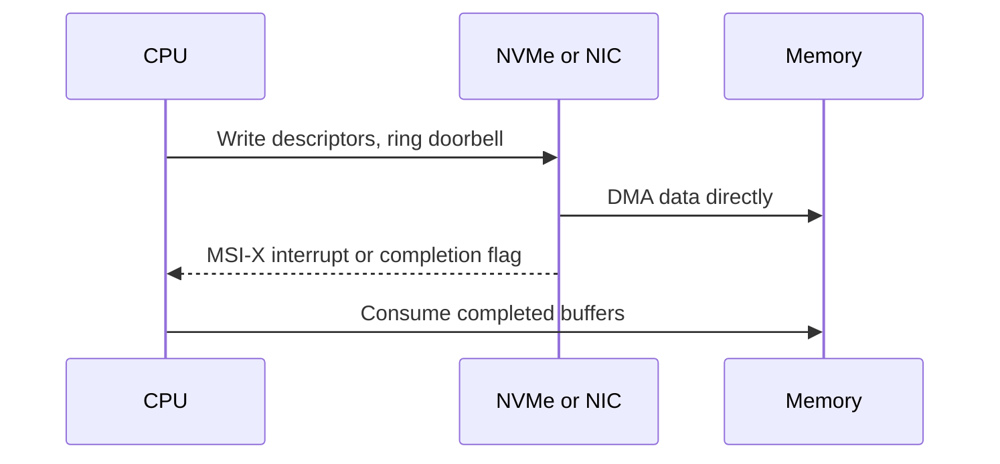

### 13.2 Interrupts, Affinity, and Why They Matter

```mermaid
flowchart TD
    E["Device event"] --> Q{"Interrupts enabled?"}
    Q -- "Yes" --> S["Finish instruction, save context"]
    S --> ISR["Run interrupt handler"]
    ISR --> R["Restore and resume"]
    Q -- "No" --> P["Event waits as pending"]
```

Affinity and MSI-X route each device queue's interrupts to one core so caches stay warm — check
`/proc/interrupts` when NIC load looks lopsided.

### 13.3 SATA vs NVMe vs PCIe

SATA and NVMe are often confused with the physical plug. Separate the three layers: the connector
(2.5-inch, M.2), the bus (SATA, PCIe), and the protocol (AHCI, NVMe). Performance comes from the bus
plus the protocol, not the shape.

| Property | SATA SSD (AHCI) | NVMe SSD (PCIe) |
|---|---|---|
| Designed for | Spinning disks, 2004 | Flash, 2011, parallelism from day one |
| Queues | 1 queue, 32 commands | 64k queues x 64k commands each |
| CPU cost per I/O | Legacy path, heavier locking | MSI-X per-core queues, doorbell registers |
| Bandwidth | ~550 MB/s ceiling (SATA III 6 Gbps minus encoding) | PCIe 3.0 x4 ~3.5 GB/s, Gen4 x4 ~7 GB/s, Gen5 x4 ~14 GB/s |
| Latency | ~100 us | ~20-50 us |
| Random 4K read IOPS | ~50-100k | ~500k-1M+ |
| Best for | Drop-in laptop upgrades, bulk cheap flash | Databases, boot, scratch, ML data, WAL |

How an NVMe read actually flows:

```
1. Driver builds a command (opcode READ, namespace, LBA, length,
   destination memory address) in a submission queue in RAM.
2. Driver rings the doorbell register on the SSD: new work waiting.
3. SSD DMAs the command in, reads NAND pages into its buffer.
4. SSD DMAs the data straight into host RAM (no CPU copy).
5. SSD posts a completion entry to the completion queue and raises
   one MSI-X interrupt to the core that owns that queue.
6. Driver reaps completions in a batch and hands pages to the app.
```

SATA/AHCI does one queue shared across cores with heavier locking and one interrupt style from the
spinning-disk era. Same NAND behind either interface benchmarks 10x apart on random I/O because the
plumbing, not the flash, is the bottleneck.

M.2 confusion cleared: an M.2 stick can speak SATA (B-key, ~550 MB/s) or NVMe (M-key, GB/s). U.2 is
the 2.5-inch NVMe form for servers. Always check `lspci` link speed, not the physical size.

### 13.4 The PCI Bus and PCIe: How Devices Talk to the CPU

PCI (Peripheral Component Interconnect) was the 1990s parallel shared bus: every card shared one set
of wires, one device spoke at a time, 133 MB/s at best. **PCIe (PCI Express)** replaced it with serial
point-to-point links and kept the PCI software model (configuration space, enumeration, BARs), which is
why `lspci` still works on a machine with no physical PCI slots.

- **Lanes:** each lane is a full-duplex differential pair (one transmit, one receive). A x1 link has 1
  lane, x4 has 4, x16 (GPUs) has 16. Bandwidth scales linearly with lanes.
- **Generations:** each doubles per-lane speed. Per-lane each direction: Gen3 ~1 GB/s, Gen4 ~2 GB/s,
  Gen5 ~4 GB/s. A Gen4 x4 NVMe drive: 4 x 2 = ~8 GB/s raw, ~7 GB/s after encoding.
- **Packets, not wires:** devices exchange Transaction Layer Packets (memory reads/writes, completions,
  messages) routed by address. Switches fan one root port out to many endpoints like a network.
- **Root complex:** the CPU-side agent that owns the hierarchy. Everything the CPU reads or writes to a
  device address crosses it.
- **BARs (Base Address Registers):** during enumeration the BIOS/OS sizes each device's memory windows
  and maps them into physical address space. MMIO to those addresses hits device registers; DMA from
  the device writes to RAM addresses it was given.
- **MSI-X interrupts:** devices write a message to a special address instead of toggling a shared
  pin, so each queue can interrupt its own core with no sharing.

```mermaid
flowchart TD
    CPU["CPU cores"] <--> RC["Root complex"]
    RC <--> SW["PCIe switch"]
    SW <--> NVME["NVMe SSD x4"]
    SW <--> NIC["NIC x8 or x16"]
    SW <--> GPUC["GPU x16"]
    RC <--> DRAM["DRAM controller"]
```

Reading `lspci -vv` output: `LnkSta: Speed 16GT/s, Width x4` means Gen4 x4, healthy. A drive rated for
x4 showing `Width x1` or Gen1 speed means a bad slot, bifurcation limit, or power-saving ASPM state,
and it directly caps throughput. NUMA adds one more rule: a device behind socket 1's root complex is
faster for socket 1's cores, so pin latency-sensitive I/O threads near their device.

PCI vs PCIe vs SATA vs NVMe in one line: PCI is the dead parallel bus, PCIe is the live serial fabric
everything plugs into, SATA/AHCI is the old disk protocol that can ride SATA (or M.2 SATA), and NVMe is
the modern flash protocol that rides PCIe.

### 13.5 Try It: Trace an I/O Path

```
$ cat /proc/interrupts | grep -E "nvme|eth"   # one queue per core = MSI-X balanced
$ ethtool -S eth0 | grep -i -E "queue|drop"    # queue balance and drops
$ iostat -x 1                                   # device queue depth and utilization
$ sudo bpftrace -e 'tracepoint:block:block_rq_issue { @[args->dev] = count(); }'  # live block I/O
```

### 13.6 I/O Interview Questions and Answers

1. **Interrupts vs polling vs DMA: which for a 100 Gbps NIC?**
   Interrupts per packet drown at that rate, programmed I/O burns cores per byte. DMA with per-queue
   MSI-X, interrupt coalescing, batched doorbells, and user-space polling (`io_uring`, DPDK) on dedicated
   cores. The driver posts descriptor rings, the NIC DMAs into memory, completions are consumed in batches.
2. **Level-triggered vs edge-triggered (`epoll`) and `io_uring`?**
   Level-triggered suits steady streams (re-notified while ready). Edge-triggered plus `io_uring`
   completion queues suit millions of small ops with fewer syscalls. Coalescing plus batched doorbells is
   why `sendmmsg` and jumbo frames exist.
3. **What does a DPU offload, exactly?**
   The whole dance: TLS, virtual switching, tunnel encapsulation, storage initiators, eBPF or P4
   pipelines — off the host cores onto the NIC computer.
4. **PCI vs PCIe vs SATA vs NVMe in one minute?**
   PCI is the dead parallel shared bus. PCIe is the live serial fabric everything plugs into. SATA/AHCI
   is the old disk protocol over SATA links. NVMe is the modern flash protocol over PCIe.
5. **Why does a Gen4 x4 NVMe drive show 7 GB/s not 8?**
   4 lanes times ~2 GB/s per lane is ~8 GB/s raw; encoding overhead lands around 7 GB/s usable.
6. **What does `Width x1` in `lspci` mean for an x4 drive?**
   Negotiated one lane instead of four: bad slot, bifurcation limit, or ASPM power saving. Throughput
   caps at a quarter until fixed.

## Part 14. Memory and Storage Systems

### 14.1 Memory Hierarchy

Fast storage is small, large storage is slow. Every access checks the fastest level first.

```mermaid
flowchart TD
    R["Registers: ~1 KB, under 1 ns"] --> L1["L1: ~64 KB per core, ~1 ns"]
    L1 --> L2["L2: ~1-2 MB per core, ~5 ns"]
    L2 --> L3["L3: shared ~16-128 MB, ~20 ns"]
    L3 --> DRAM["DRAM: GBs, ~80 ns"]
    DRAM --> SSD["SSD: TBs, ~50 us"]
    SSD --> HDD["HDD or network: ms"]
```

| Level | Size | Latency | Role |
|---|---|---|---|
| Registers | ~1 KB | <1 ns | Current operands |
| L1/L2 | KB–MB | 1–5 ns | Hot loops |
| L3 | tens of MB | 15–40 ns | Shared working set |
| DRAM | GBs | ~80 ns | Running processes |
| SSD | TBs | ~50–100 us | Persistent fast data |
| HDD/network | TBs+ | ms | Archive, cold data |

Locality makes it work: **temporal** (recently used is reused) and **spatial** (neighbors of used data
are used next). Caches exploit both with 64-byte lines and prefetchers.

### 14.2 SRAM vs DRAM

| Property | SRAM | DRAM |
|---|---|---|
| Cell | 6 transistors, flip-flop | 1 transistor + 1 capacitor |
| Speed | Very fast (~1 ns) | Slower (~50 ns + refresh) |
| Density | Large, expensive | Dense, cheap |
| Refresh | Never, holds while powered | Every few ms or charge leaks |
| Used for | Caches, register files | Main memory |

How RAM stores and retrieves: the address splits into row and column. Wordlines open one row, bitlines
sense each column's charge (DRAM) or flip-flop state (SRAM), sense amplifiers latch the row into a
buffer, and column muxes pick the requested bytes. Writing reverses the flow. DRAM then precharges for
the next access and the memory controller refreshes idle rows in the background.

#### Storing a bit in SRAM

An SRAM cell is two cross-coupled inverters (4 transistors) that hold each other at 1/0, plus 2 access
transistors to the bitlines. To store a 1: drive `bit = 1, bit_bar = 0`, raise the wordline, the latch
flips and holds. To read: precharge both bitlines high, raise the wordline, one side pulls its line
down, and the sense amplifier detects which side moved. No refresh needed because the inverters keep
driving the value while powered. That is why SRAM is fast and why 6 transistors per bit make it big
and expensive.

#### Storing a bit in DRAM, step by step

A DRAM cell is 1 transistor plus 1 capacitor. Charged capacitor = 1, empty = 0. Charge leaks within
milliseconds, so every read is destructive and must be written back, and every row is refreshed
periodically whether you touch it or not.

```
1. Idle: bitlines precharged to Vdd/2, wordline closed.
2. ACTIVATE row: controller sends row address, wordline opens every
   transistor in that row at once.
3. Charge sharing: each capacitor nudges its bitline slightly up (1)
   or down (0). The swing is tiny, tens of millivolts.
4. Sense: sense amplifiers detect the direction and drive each bitline
   to full 0 or Vdd, latching the whole row (typically 8 KB) into the
   row buffer. This also restores the capacitors.
5. READ/WRITE: column address picks bytes from the row buffer.
   A second access to the same row is a fast row-buffer hit.
6. PRECHARGE: close the row, reset bitlines for the next access.
```

```mermaid
flowchart TD
    A["Controller sends ACTIVATE plus row address"] --> B["Wordline opens all cells in the row"]
    B --> C["Capacitors nudge bitlines up or down"]
    C --> D["Sense amplifiers latch full row into row buffer"]
    D --> E["READ or WRITE columns from the buffer"]
    E --> F["PRECHARGE row, refresh idle rows in background"]
```

Row-buffer hits serve in ~15 ns, row conflicts (close one row, open another) cost ~50 ns plus. That
is why sequential access within a row is fast, random rows are slow, and the controller reorders
requests to favor hits. Refresh touches every row about every 64 ms (8192 refresh commands), briefly
blocking that bank, which is one source of tail latency in RAM-heavy services.

### 14.3 RAM and ROM Types

| Type | Volatile | Behavior |
|---|---|---|
| SRAM | Yes | Cache, no refresh |
| DRAM (DDR4/DDR5) | Yes | Main memory |
| Mask ROM | No | Factory-fixed firmware |
| PROM/EPROM/EEPROM | No | One-time or electrically erasable firmware |
| Flash (NOR/NAND) | No | BIOS chips, SSDs, USB sticks |

NOR flash executes code in place (firmware); NAND flash stores bulk data (SSDs). Your SSD is an array
of NAND plus a controller that hides its quirks.

### 14.4 Cache Memory

L1 splits into instruction and data caches per core; L2 backs each core or cluster; L3 (or system-level
cache) is shared. Three mapping policies:

| Policy | Rule | Trade-off |
|---|---|---|
| Direct-mapped | Each block has exactly one home | Simple, most conflicts |
| Set-associative (4–16 ways) | Each block has a small set of homes | The standard balance |
| Fully associative | Anywhere | Flexible, expensive, small TLBs only |

On a miss the line (64 bytes) is fetched from below and possibly evicts a victim (LRU approximation).
Writes use write-back (dirty lines flushed on eviction, the norm) or write-through (every store goes
down, simple but slow). Miss types: compulsory (first touch), capacity (working set too big), conflict
(too many addresses share a set).

### 14.5 HDD Architecture

A hard drive stacks spinning platters coated with magnetic grains. Each surface has a head on an
actuator arm. Data lives on concentric **tracks** divided into **sectors** (traditionally 512 bytes
or 4 Kn). A cylinder is the same track across all platters.

Reading and writing: to write, the head magnetizes grains in one of two orientations. To read, the
head senses the magnetic transitions as it flies nanometers above the spinning surface. Seek time moves
the arm (ms), rotational latency waits for the sector (~4 ms at 7200 RPM), transfer streams the bits.

Access time ≈ seek + rotation + transfer. Sequential reads stream at 100–200 MB/s; random 4 KB reads
collapse to under 1 MB/s because each seeks. That 100x gap is why databases love sequential layouts
and why indexing exists.

#### How a write physically lands on a platter

```
1. OS sends a 4 KB block write. It sits first in the HDD's DRAM cache.
2. Firmware translates the logical block address (LBA) to a physical
   zone, track, and sector, skipping grown defect lists.
3. Voice-coil actuator seeks the arm to the target track (2–8 ms).
4. Controller waits for the target sector to rotate under the head.
5. Write current through the head magnetizes grains vertically
   (perpendicular recording) as they pass. ECC bytes are written
   alongside the data.
6. Optional read-after-write verifies the sector; failures remap to
   a spare sector transparently.
7. Drive acknowledges. Write-back cache acks early for speed,
   write-through acks after the platter for safety.
```

Reading reverses it: seek, wait for rotation, sense magnetic transitions as resistance changes in the
read head, correct up to a few bad bits with ECC, return the sector.

```mermaid
flowchart LR
    OS["OS block write"] --> CACHE["HDD DRAM cache"]
    CACHE --> SEEK["Seek arm to track"]
    SEEK --> WAIT["Wait for sector rotation"]
    WAIT --> MAG["Magnetize grains, write ECC"]
    MAG --> ACK["Acknowledge to OS"]
```

CMR vs SMR: conventional (CMR) tracks sit side by side and allow random rewrites. Shingled (SMR)
tracks overlap like roof tiles for 20–25 percent more capacity, but rewriting one track requires
rewriting its neighbors, so random writes stall. SMR suits archives; databases and RAID rebuilds want
CMR. Check the datasheet before buying bulk drives.

### 14.6 SSD and NAND Flash

NAND flash stores charge in floating-gate or charge-trap cells arranged in strings. No moving parts:
any page reads in tens of microseconds regardless of location.

| Type | Bits per cell | Relative speed and endurance | Use |
|---|---|---|---|
| SLC | 1 | Fastest, ~100k cycles | Industrial, write cache |
| MLC | 2 | Balanced, ~3k cycles | Older consumer drives |
| TLC | 3 | Slower, ~1k cycles | Mainstream SSDs |
| QLC | 4 | Slowest, ~hundreds of cycles | Cheap bulk storage |

Hierarchy: cell → string → **page** (4–16 KB, read/write unit) → **block** (hundreds of pages, erase
unit). Rules that shape everything: pages write once before erase, erases happen per block, blocks
wear out. So the controller does garbage collection (copy live pages, erase the block), wear leveling
(spread erases evenly), over-provisioning (spare blocks for GC and bad blocks), and an FTL flash
translation layer that remaps logical addresses so the OS never sees the churn.

#### Program, read, and erase: the three NAND operations

A NAND cell is a transistor with an extra isolated gate that traps electrons. More trapped electrons
raise the threshold voltage. Reading applies reference voltages and checks at which point the cell
conducts; TLC needs 7 references to distinguish 8 levels, QLC needs 15 for 16 levels, which is why
denser NAND reads slower and wears faster.

```
READ a page (fast, ~50 us): apply reference voltages, sense each
  cell's level, run ECC (LDPC) to fix borderline cells.
PROGRAM a page (slower, ~1 ms): only on an erased page. Pulse
  electrons in (ISPP), verify, repeat until the level is right.
ERASE a block (slowest, ~ms): whole block at once, high voltage
  clears every cell. The only way to reuse a page.
```

Golden rule: no in-place overwrite. Every write goes to a fresh erased page elsewhere (out-of-place
write). The old page is marked invalid. Garbage collection later copies the still-live pages out of a
mostly-invalid block and erases it. **Write amplification** = NAND bytes written ÷ host bytes written;
random small writes can push it to 2–4x, sequential writes keep it near 1x.

```mermaid
flowchart TD
    H["Host 4 KB write"] --> BUF["SSD DRAM buffer"]
    BUF --> FTL["FTL picks an erased page, updates LBA to PBA map"]
    FTL --> PROG["Program page, mark old page invalid"]
    PROG --> ACK["Acknowledge"]
    PROG -.-> GC["Later: GC copies live pages, erases block"]
```

Power-loss protection (capacitors on enterprise drives) flushes the DRAM buffer to NAND on outage.
Consumer drives without it can lose seconds of acknowledged writes, which is why databases demand
enterprise SSDs or `fsync` on a filesystem that orders correctly.

### 14.7 Controllers, Sectors, Blocks, Pages, File Systems

The storage controller (HDD PCB, SSD controller, RAID card, cloud EBS backend) translates OS block
reads and writes into device operations, queues them, and hides retries and remapping. File systems
(ext4, XFS, APFS, NTFS) layer files, directories, permissions, and journals on top of that block
interface. A journal (or copy-on-write design like ZFS and Btrfs) replays interrupted writes after a
crash so metadata stays consistent.

### 14.8 RAID Levels

| Level | Layout | Usable of N disks | Failures tolerated | Notes |
|---|---|---|---|---|
| RAID 0 | Stripe, no parity | 100 percent | 0 | Fast, any disk kills the array |
| RAID 1 | Mirror | 50 percent | 1 per pair | Simple, good for boot |
| RAID 5 | Stripe + 1 parity | (N−1)/N | 1 | Rebuilds are slow and risky on TB drives |
| RAID 6 | Stripe + 2 parity | (N−2)/N | 2 | Standard for large HDD arrays |
| RAID 10 | Mirror then stripe | 50 percent | 1+ (if lucky) | Best random I/O, database default |

Parity math is XOR across stripes: any one missing chunk is the XOR of the survivors. RAID is
availability, not backup: it survives disk death, not deletion, corruption, or fire.

### 14.9 Persistence, Durability, Reliability

- **Persistence** means data survives power loss (flash, disk, not RAM).
- **Durability** means acknowledged writes survive crashes (fsync, journal, replication).
- **Reliability** means data stays correct over time: ECC, checksums, scrubbing, SMART monitoring,
  and backups.

SSDs lie a little: without power loss protection, writes in the DRAM cache can vanish on outage.
Databases call `fsync` and enterprise drives add capacitors for exactly this reason.

> Misconception: deleting a file erases it. Deletion usually unlinks metadata; the bytes remain until
> overwritten, which is why forensics and secure-erase exist.

Interview questions: SRAM vs DRAM cell and use. Why random HDD reads are 100x slower than sequential.
What TLC means. Usable capacity and fault tolerance of RAID 5 vs RAID 10. Where does an acknowledged
write live after fsync. Why a Gen4 x4 NVMe drive shows 7 GB/s not 8. What `Width x1` in `lspci` means.
CMR vs SMR for a database. What write amplification is and what drives it up.

### 14.10 Try It: Know Your Own Storage Stack

```
$ lsblk -t && iostat -x 1              # alignment, queue depth, utilization
$ nvme list && nvme smart-log /dev/nvme0n1  # drives, wear percentage, temperature
$ sudo smartctl -a /dev/sda | grep -i -E "realloc|pending|wear|power_on"  # drive health
$ df -h && mount | grep -E "ext4|xfs|apfs"   # filesystem per mount
$ cat /sys/block/nvme0n1/queue/scheduler       # none (NVMe) vs mq-deadline/kyber (SATA)
```

Checklist: NVMe on PCIe Gen4 x4 for databases and WAL; `none` scheduler on NVMe; `utf8mb4` on MySQL
text; enterprise SSDs with power-loss protection where `fsync` durability matters.

### 14.11 Storage Interview Questions and Answers

1. **SRAM vs DRAM cell and use?**
   SRAM: 6 transistors, latch, no refresh, ~1 ns, big and expensive: caches and register files. DRAM: 1
   transistor plus 1 capacitor, leaks in milliseconds, needs refresh, dense and cheap: main memory.
2. **Walk the DRAM read path.**
   ACTIVATE row, charge sharing nudges bitlines, sense amplifiers latch the 8 KB row into the row
   buffer, column reads serve from the buffer, PRECHARGE closes. Row-buffer hits ~15 ns, conflicts ~50 ns.
3. **Why are random HDD reads 100x slower than sequential?**
   Every random read pays seek (ms) plus rotation (~4 ms); sequential streams at 100-200 MB/s while
   random 4 KB collapses under 1 MB/s. CMR allows random rewrites; SMR suits archives.
4. **TLC vs QLC: what does it cost?**
   TLC: 3 bits per cell, 7 reference voltages, ~1k program-erase cycles. QLC: 4 bits, 15 references,
   hundreds of cycles. Denser and cheaper, slower and shorter-lived.
5. **What is write amplification, and what drives it up?**
   NAND bytes written divided by host bytes written. No in-place overwrite plus garbage collection means
   random small writes hit 2-4x; sequential stays near 1x.
6. **SATA vs NVMe: same NAND, 10x apart on random I/O — why?**
   One shared AHCI queue with legacy interrupts vs 64k NVMe queues with per-core MSI-X, doorbells, and
   GB/s PCIe bandwidth. See Part 13 for the full queue and doorbell flow. The plumbing, not the flash,
   is the bottleneck.
7. **RAID 5 vs RAID 10 for a database?**
   RAID 5: (N-1)/N usable, survives 1 disk, slow risky rebuilds on TB drives. RAID 10: 50 percent
   usable, best random I/O, database default. Neither is a backup.
8. **Where does an acknowledged write live after fsync?**
   On durable media or power-loss-protected buffers, ordered through journal and device cache flush.
   Consumer SSDs without capacitors can lose DRAM-cached writes on outage.

## Part 15. Data Representation and Encoding

### 15.1 ASCII and Unicode

ASCII assigns 0–127 to English letters, digits, and control codes. `A` is 65, `a` is 97, `0` is 48.
Unicode extends this to every script plus emoji: each character gets a **code point** like U+0041 (A)
or U+1F600 (grinning face). Encodings (UTF-8, UTF-16) decide how code points become bytes.

### 15.2 UTF-8 and UTF-16

UTF-8 is variable-length and ASCII-compatible, the backend default:

| Code point range | Bytes | Pattern |
|---|---|---|
| U+0000–U+007F | 1 | 0xxxxxxx |
| U+0080–U+07FF | 2 | 110xxxxx 10xxxxxx |
| U+0800–U+FFFF | 3 | 1110xxxx 10xxxxxx 10xxxxxx |
| U+10000–U+10FFFF | 4 | 11110xxx 10xxxxxx 10xxxxxx 10xxxxxx |

Example: `é` (U+00E9) encodes as `11000011 10101001` (0xC3 0xA9). UTF-16 uses 2 bytes per unit with
surrogate pairs for characters above U+FFFF (JavaScript strings, Java `char`, Windows APIs). The
MySQL `utf8` versus `utf8mb4` trap: the former stores 3 bytes max and rejects emoji; always use
`utf8mb4`.

### 15.3 Integers and IEEE 754 Floats

Integers follow Part 1.5. Floats follow IEEE 754: a double is 1 sign bit, 11 exponent bits (bias
1023), 52 mantissa bits. Value = (−1)^sign × 1.mantissa × 2^(exponent−bias) for normals.

Worked example: 13.25. Binary 1101.01 = 1.10101 × 2^3. Sign 0, exponent 3+1023 = 1026 = `10000000010`,
mantissa `101010...0`. So `0.1 + 0.2 != 0.3` in every hardware-float language, and money belongs in
integer cents or decimal types.

Special values: all-zero exponent with zero mantissa is ±0; all-one exponent with zero mantissa is
±infinity; all-one exponent with nonzero mantissa is NaN.

### 15.4 Endianness

Little-endian (x86, ARM as you deploy it, RISC-V) stores the least significant byte at the lowest
address. Big-endian (network order, some file formats) stores the most significant first.

Value `0x12345678` at address 0x100:

| Address | Little-endian byte | Big-endian byte |
|---|---|---|
| 0x100 | 0x78 | 0x12 |
| 0x101 | 0x56 | 0x34 |
| 0x102 | 0x34 | 0x56 |
| 0x103 | 0x12 | 0x78 |

Use `htons`/`ntohs` at network boundaries and specify byte order in every binary protocol, Parquet
footer, and hex dump you read.

### 15.5 How Data Types Sit in Memory

A 32-bit int is 4 consecutive bytes in whatever endianness the machine uses. A C struct gets padded so
each field aligns to its size: `struct { char a; int b; char c; }` is typically 12 bytes, not 6
(3 padding after `a`, 3 after `c`). Reorder fields largest-first to shrink hot structs.

Pointers are just addresses-sized integers; arrays are contiguous elements (index math is
base + i × size); strings are bytes plus a convention (NUL terminator in C, length prefix in Go, Java,
and Rust).

> Misconception: `char` is one character. In UTF-8 a character is 1–4 bytes, and one visible glyph can
> be several code points (base + combining marks + variation selectors).

Interview questions: encode `é` in UTF-8. Break down an IEEE 754 double. What breaks when code assumes
1 char = 1 byte. How is `0x12345678` laid out in little-endian memory.

### 15.6 Try It: Encoding Bugs in the Open

```python
print(0.1 + 0.2)                    # 0.30000000000000004: binary, not decimal
print((0.1 + 0.2) == 0.3)           # False: never == floats

print("é".encode("utf-8"))          # b'\xc3\xa9': 2 bytes, not 1 char
print(len("é"), len("é".encode("utf-8")))  # 1 character, 2 bytes
print(b"\xc3\xa9".decode("latin-1"))       # é: mojibake from wrong charset

import struct
print(struct.pack("<I", 0x12345678).hex())  # 78563412: little-endian layout
print(struct.pack(">I", 0x12345678).hex())  # 12345678: big-endian layout
```

```sql
-- MySQL trap: utf8 is 3-byte, rejects emoji. Always real UTF-8.
ALTER TABLE posts MODIFY body TEXT CHARACTER SET utf8mb4 COLLATE utf8mb4_unicode_ci;
```

### 15.7 Encoding Interview Questions and Answers

1. **Encode `é` in UTF-8.**
   U+00E9 falls in the 2-byte range: `11000011 10101001` (0xC3 0xA9).
2. **Break down an IEEE 754 double.**
   1 sign bit, 11 exponent bits (bias 1023), 52 mantissa bits: value = (-1)^sign × 1.mantissa ×
   2^(exponent-bias), with all-zero/all-one exponents reserved for zero, infinity, NaN.
3. **What breaks when code assumes 1 char = 1 byte?**
   Truncation splits multi-byte sequences, `VARCHAR(10)` counts characters not bytes, emoji vanish under
   `utf8` instead of `utf8mb4`, and string offsets drift across languages.
4. **How is `0x12345678` laid out in little-endian memory?**
   Lowest address holds the small end: 78 56 34 12. Network order is the reverse; `htons`/`ntohs` bridge
   the boundary.
5. **Money math is off by a cent. Where do you look first?**
   Encoding before logic: float rounding, decimal scale, timestamp truncation. Then serialization, column
   types, and API contracts, with a regression test asserting exact decimals.

## Part 16. Models, Boards, and Boot

How the machine is organized: one shared memory or two, what the ISA promises, what the motherboard connects, and how the whole thing wakes up when you press power.

### 16.1 Von Neumann vs Harvard

| Property | Von Neumann | Harvard |
|---|---|---|
| Memory | One store for code and data | Separate instruction and data memories |
| Buses | Shared | Separate, parallel access |
| Examples | Laptops, servers, phones at system level | Microcontrollers, DSPs; split L1 I/D cache inside every core |
| Strength | Flexible, self-modifying code, one memory to manage | No fetch-vs-data contention, deterministic timing |

```mermaid
flowchart LR
    subgraph Von["Von Neumann"]
    VCPU["CPU"] <--> VMEM["Single memory: code plus data"]
    end
    subgraph Har["Harvard"]
    HCPU["CPU"] <--> HIM["Instruction memory"]
    HCPU <--> HDM["Data memory"]
    end
```

Modern cores are modified Harvard locally (split L1) on a von Neumann system (shared DRAM). Self-modifying
code and JITs must flush the I-cache precisely because the two views can disagree.

### 16.2 RISC vs CISC and the Open-ISA Wave

| Property | RISC (ARM, RISC-V) | CISC (x86-64) |
|---|---|---|
| Instructions | Few, fixed-size, load/store only touches memory | Many, variable-size, memory operands allowed |
| Philosophy | Compiler + simple decoder + wide execution | Hardware does more per instruction |
| Today | Both decode to RISC-like micro-ops internally | Difference is code density, decoder cost, extensions |

The ISA matters less than implementation quality: Apple Silicon, Graviton, and Zen all win through wide
decode, huge reorder buffers, and integration, not acronyms.

- **RISC-V: the open third pole.** No license fees, modular extensions (M, A, F, D, C, V), moving from
  microcontrollers into data-center silicon and hyperscaler fleets. Your code is ready if it avoids
  inline assembly and builds multi-arch (see Part 5.2); the CPU-vs-accelerator placement stays
  where Part 6 put it: cheapest generalist that meets the SLO, promote only on proof.

### 16.3 Booting: From Power Button to PID 1

Pressing power replays the whole stack in miniature. Firmware initializes what software assumes:

```
1. Power-on and BootROM: on-chip ROM runs first, initializes clocks and RAM just enough
   to load the next stage, verifies signatures (Apple Silicon, phones, Secure Boot PCs).
2. Firmware (UEFI or BIOS): discovers hardware, trains DRAM, enumerates PCIe devices
   (this is when BARs from Part 13 get assigned), picks a boot device.
3. Bootloader (GRUB, systemd-boot, Apple iBoot): loads the kernel and initramfs into memory.
4. Kernel start: sets up page tables (Part 12), interrupt handlers (Part 13), schedulers,
   and drivers, then starts PID 1.
5. Cloud twist: on EC2 or GCE most of this already happened on the host. Your VM or
   container starts at step 3 or 4 under a hypervisor — which is why cloud boot is seconds
   while bare-metal POST can take minutes.
```

```mermaid
flowchart LR
    ROM["BootROM: clocks, RAM, verify"] --> FW["UEFI/BIOS: train DRAM, enumerate PCIe"]
    FW --> BL["Bootloader: load kernel"]
    BL --> K["Kernel: page tables, IRQs, drivers"]
    K --> INIT["PID 1: userspace"]
```

Backend takeaway: every cold start, from Lambda init to Kubernetes pod scheduling, replays a slice
of this chain. Knowing which stage is slow (firmware, bootloader, kernel, image pull, runtime init)
tells you where to optimize instead of guessing.

```
$ dmesg | head -50                  # firmware + kernel boot log, with timestamps
$ systemd-analyze blame | head      # which userspace unit ate your boot time
$ lsusb && lspci -tv               # bus topology: what hangs off what
$ sudo dmidecode -t baseboard      # motherboard and chipset identity
```

### 16.4 Buses, Chipset, and Motherboard

Classic three buses: **address** (which device or cell), **data** (the bytes), **control** (read/write,
clock, interrupts). Modern form: DDR channels to DRAM, PCIe lanes to NVMe/GPU/NIC, USB/SATA for
peripherals, and on-chip fabrics (Infinity Fabric, Apple fabric, Intel mesh) between cores, caches,
and memory controllers.

```mermaid
flowchart TD
    CPU["CPU package: cores, caches, memory controller"] <--> DRAM["DDR5 DIMMs"]
    CPU <--> PCIE["PCIe switch"]
    PCIE <--> NVME["NVMe SSD"]
    PCIE <--> NIC["NIC"]
    PCIE <--> GPUC["GPU"]
    CHIP["Chipset"] <--> USB["USB, SATA, audio, BIOS flash"]
    CPU <--> CHIP
```

The chipset is the slower I/O hub; the motherboard is power delivery, clocks, and these traces. When a
device misbehaves, `lspci`, link-width checks, and reseating are the hardware equivalents of reading
the stack trace.

> Misconception: the CPU does all the work. On a modern machine the CPU programs accelerators and
> controllers, and DMA engines, GPUs, NICs, and SSD controllers move the bytes.

See Part 22 for the capstone drill on these questions.

### 16.5 Models and Boards Interview Questions and Answers

1. **Von Neumann vs Harvard with an example of each?**
   Von Neumann: one store for code and data — laptops, servers, phones at system level. Harvard:
   separate instruction and data memories — microcontrollers, DSPs, and the split L1 I/D cache inside
   every modern core (modified Harvard locally, von Neumann globally).
2. **Why does the split L1 exist if the system is von Neumann?**
   Fetch-vs-data contention: the core fetches the next instruction every cycle while loading data.
   Separate L1s give both full bandwidth; self-modifying code and JITs must flush the I-cache because
   the two views can disagree.
3. **RISC vs CISC in one minute?**
   RISC: few fixed-size instructions, load/store only touches memory. CISC: many variable-size
   instructions with memory operands. Both decode to RISC-like micro-ops today; difference is code
   density, decoder cost, extensions.
4. **What does the chipset do, and what is the motherboard?**
   The chipset is the slower I/O hub (USB, SATA, audio, BIOS flash); the motherboard is power delivery,
   clocks, and the traces connecting CPU, DRAM, PCIe, and chipset. `lspci` link-width checks are the
   hardware equivalent of reading a stack trace.
5. **Walk a cold boot to first request.**
   BootROM verifies, UEFI trains DRAM and enumerates PCIe (BAR assignment), bootloader loads the
   kernel, kernel sets up page tables and IRQs, PID 1 starts, image pulls, runtime inits, app binds its
   port. Profile each stage (`dmesg`, `systemd-analyze`) before optimizing.

## Part 17. Memory Models: From Barriers to `volatile`

Part 9 named the rules; this part shows the mechanism. x86's Total Store Order hides most reorderings
while ARM64's weaker model exposes them, and your language runtime inserts the barriers you never see.

### 17.1 What the Hardware Reorders, and How Languages Hide It

- **x86-64 TSO:** stores become visible in order, loads can pass older stores to different addresses.
  Dekker-style flag protocols mostly work by accident; you still need barriers for publication safety.
- **ARM64 / RISC-V:** loads and stores to different addresses can both reorder. The compiler and the
  JVM/Go/C++ runtime emit `dmb`/`fence` instructions around `volatile`, atomics, mutexes, and channels.
- **The contract ladder:** hardware guarantees little; the ISA adds acquire/release; the language
  memory model (Java JMM, Go memory model, C++11 atomics) promises what your code can rely on.
  Program to the language model, never to observed hardware behavior.

```mermaid
flowchart TD
    HW["Hardware: cores, store buffers, caches"] --> ISA["ISA ordering: TSO on x86, acquire-release on ARM"]
    ISA --> LANG["Language model: volatile, atomics, locks, channels"]
    LANG --> APP["Your code: publish once, share narrowly"]
```

### 17.2 Try It: Watch Reordering (or Its Absence)

```c
// Compile for both ISAs and compare the barriers the compiler emits.
#include <stdatomic.h>
atomic_int flag = 0;
int data = 0;

void publish(void) { data = 42; atomic_store_explicit(&flag, 1, memory_order_release); }
int consume(void) {
    if (atomic_load_explicit(&flag, memory_order_acquire)) return data;
    return -1;
}
```

```
$ gcc -O2 -S mm.c -o mm.s && grep -E "mfence|dmb|sync" mm.s   # x86: often nothing extra
$ aarch64-linux-gnu-gcc -O2 -S mm.c -o mm_arm.s && grep -E "dmb|stl|lda" mm_arm.s  # ARM: barriers present
```

Same source, different fences: the runtime pays for ordering only where the ISA needs it.

### 17.3 Memory Model Interview Questions and Answers

1. **Why does double-checked locking need `volatile` (or an atomic)?**
   Without it the reference can publish before the object is constructed (reordered stores on weak
   models, compiler motion everywhere). Acquire/release on the flag makes construction happen-before use.
2. **TSO vs weak ordering in one minute?**
   TSO (x86) keeps stores ordered; weak models (ARM) reorder both. Language runtimes insert barriers so
   `volatile`, atomics, locks, and channels behave the same everywhere.
3. **One hot atomic counter caps my service. Fix?**
   MESI ping-pong on one line. Shard per core (or per thread), sum on read. Same pattern as Part 7's
   false-sharing rule, now at the language level.

## Part 18. Code Labs: Locality and Vectorization

Python will not show cycle-level truth (the interpreter hides vectorization and pinning), but it demonstrates the two
effects interviewers ask you to reason about: sequential locality beats strided access, and batching vector work beats
scalar loops. Both snippets use only the standard library plus NumPy, run anywhere, and print timings you can quote.

Row-major sequential scan versus strided column scan over the same matrix:

```python
import time
import numpy as np

# 4000x4000 float64 matrix: 128 MB, spills out of any L3.
# C-order (row-major) means a[i, :] is contiguous, a[:, j] strided.
a = np.random.rand(4000, 4000)

def row_sum(m: np.ndarray) -> float:
    total = 0.0
    # Sequential: each 64-byte line serves 8 doubles before the next miss.
    for i in range(m.shape[0]):
        total += float(np.sum(m[i, :]))
    return total

def col_sum(m: np.ndarray) -> float:
    total = 0.0
    # Strided: each access touches a new line, wasting 7/8 of every fetch.
    for j in range(m.shape[1]):
        total += float(np.sum(m[:, j]))
    return total

for name, fn in (("row-major", row_sum), ("column-strided", col_sum)):
    start = time.perf_counter()
    fn(a)
    elapsed = time.perf_counter() - start
    print(f"{name}: {elapsed:.2f}s")
```

This example allocates one large row-major matrix, then sums it both ways. The row pass streams contiguous lines and
lets the hardware prefetcher run ahead, while the column pass jumps 32 KB per element and thrashes sets and TLB entries.
Expect the strided version to run several times slower on identical FLOPs; that gap is pure memory hierarchy, and it is
why columnar stores transpose data before scanning.

Scalar Python loop versus batched NumPy (SIMD-backed) over the same vector:

```python
import time
import numpy as np

# One million floats: small enough for L3, large enough to matter.
x = np.random.rand(1_000_000)
y = np.random.rand(1_000_000)

def scalar_dot(xs: np.ndarray, ys: np.ndarray) -> float:
    total = 0.0
    # Pure-Python loop: one interpreter iteration per element, no vectorization.
    for i in range(len(xs)):
        total += float(xs[i]) * float(ys[i])
    return total

def vector_dot(xs: np.ndarray, ys: np.ndarray) -> float:
    # One call into a C kernel compiled with SIMD: 4-8 doubles per instruction.
    return float(np.dot(xs, ys))

# Warm up imports and caches, then time each path once.
vector_dot(x[:1000], y[:1000])
t0 = time.perf_counter(); scalar_dot(x, y); t1 = time.perf_counter()
vector_dot(x, y); t2 = time.perf_counter()
print(f"scalar loop: {(t1 - t0) * 1000:.1f}ms")
print(f"numpy dot:   {(t2 - t1) * 1000:.1f}ms")
```

This example contrasts interpreter overhead plus scalar execution against a single dispatched kernel that the BLAS and
SIMD units chew through at bandwidth speed. Expect 50-500x difference. The lesson transfers to every runtime: batch work
into contiguous kernels (NumPy, Arrow, Java Vector API, DB vectorized scans) instead of per-element callbacks, and keep
the hot loop free of branches the vectorizer cannot prove safe.
### 18.2 Try It: Run the Locality Lab

```python
import time
import numpy as np

a = np.random.rand(4000, 4000)  # 128 MB: spills out of any L3

def row_sum(m):
    return sum(float(np.sum(m[i, :])) for i in range(m.shape[0]))

def col_sum(m):
    return sum(float(np.sum(m[:, j])) for j in range(m.shape[1]))

for name, fn in (("row-major", row_sum), ("column-strided", col_sum)):
    t0 = time.perf_counter(); fn(a); t1 = time.perf_counter()
    print(f"{name}: {(t1 - t0):.2f}s")
```

Expect the strided version several times slower on identical FLOPs: pure memory hierarchy, and the
reason columnar stores transpose before scanning.

### 18.3 Vectorization Interview Questions and Answers

1. **Why is the NumPy dot 50-500x faster than the scalar loop?**
   One dispatched C kernel running SIMD at bandwidth speed vs one interpreter iteration per element.
   Batch contiguous work into kernels (NumPy, Arrow, Java Vector API, DB vectorized scans).
2. **What stops auto-vectorization?**
   Pointer hops, aliasing, data-dependent exits, unpredictable branches. Counted index loops over
   separate contiguous arrays vectorize; linked traversal never does.
3. **How do you verify instead of hoping?**
   `-fopt-info-vec` (GCC), `-Rpass=loop-vectorize` (Clang), `perf stat` IPC lift on the hot loop.

## Part 19. Tools and Ecosystem

- **Profilers:** `perf stat/record/report` (cycles, IPC, cache-misses, branch-misses), `perf top` for live hotspots,
  async-profiler and JFR for JVM (CPU plus allocation flames), `py-spy` and `cProfile` for Python, `pprof` for Go,
  Instruments (Time Profiler, Allocations) on Apple Silicon. Always profile optimized builds; debug builds hide inlining.
- **Flame graphs and traces:** Brendan Gregg flame graphs turn `perf` stacks into boxes you can read; `perf sched` and
  `bpftrace` expose run-queue latency and off-CPU time. If CPU is idle but latency is high, the answer is locks or I/O,
  not ALU.
- **Cache and topology inspection:** `lscpu`, `lstopo` (hwloc), `/sys/devices/system/cpu`, `numactl --hardware` for NUMA
  layout; `perf stat -d` for L1/LLC miss rates; `valgrind --tool=cachegrind` for simulated miss attribution on small inputs.
- **Benchmarking discipline:** `hyperfine` for CLI timing, JMH for Java, `pytest-benchmark` or `timeit` with repeats for
  Python, `taskset` plus `nice` to isolate cores. Pin frequency governors (`performance`), disable turbo during comparison
  only if you say so, warm up JITs and caches, and report medians with variance, never single runs.
- **Compilers and flags:** `-O2/-O3`, `-march=native`, link-time optimization, and profile-guided optimization decide
  whether loops vectorize. Check with `-fopt-info-vec` (GCC) or `-Rpass=loop-vectorize` (Clang); on JVM inspect with
  `-XX:+PrintCompilation` and the Vector API instead of JNI for kernels.
- **Accelerator stacks:** CUDA and cuDNN (NVIDIA GPU), ROCm (AMD), XLA and TPUs on GCP, Metal Performance Shaders and
  MLX on Apple Silicon, ONNX Runtime and TensorRT for portable inference. DPUs program via DOCA, P4, or eBPF offload SDKs.
- **Capacity planning:** track IPC, MPKI, and context-switch rate per service, not just CPU percent. A service at 40
  percent CPU with high MPKI is memory-bound and needs layout work; one at 90 percent with IPC near 2 is compute-bound
  and needs scale-out or vectorization.

- **Numbers and encoding:** `python3 -c` for two's complement and struct layouts, Compiler Explorer
  for codegen, `pahole` for struct padding, `utf8mb4` checks for MySQL text.
- **Memory and I/O path:** `numastat` and `numactl --hardware` for locality, `sar -B` for major
  faults, `iostat -x` and `nvme list` for device queues, `ethtool -S` plus `cat /proc/interrupts`
  for NIC queue balance.
- **Disassembly and inspection:** `objdump -d`, `perf annotate`, Compiler Explorer for ISA comparison.
- **Power and boot:** `cpupower frequency-info`, `dmesg` thermal lines, `systemd-analyze blame` for
  cold-start attribution.

### 19.2 Try It: One Pass Over a Sick Server

```
$ uptime && free -h && iostat -x 1 3        # load, memory, device pressure
$ perf stat -d -p $PID sleep 5              # IPC + MPKI + TLB in one shot
$ sudo perf record -g -p $PID sleep 10 && sudo perf report --no-children  # who burns cycles
$ strace -c -p $PID                         # syscall profile: locks vs tiny I/O
$ dmesg | tail -20                           # OOM kills, thermal events, link errors
```

Five commands separate compute-bound (scale out) from memory-bound (fix layout), from lock-bound
(fix sharing), from I/O-bound (fix the path) — in that order.

### 19.3 Tools Interview Questions and Answers

1. **Which one command separates compute-bound from memory-bound?**
   `perf stat -d`: high IPC means compute-bound, high MPKI means memory-bound. Fix layout before
   scaling out.
2. **Flame graph shows wide flat boxes under one frame setup — what is it?**
   Allocation or frame-construction overhead (see Part 4.9's stack-frame discussion): copying, boxing, or
   oversized frames. Reduce churn, reuse buffers, shrink hot state.
3. **What do `Width x1` and Gen1 speed in `lspci` tell you?**
   Negotiated below capability: bad slot, bifurcation, or power saving. Fix the plumbing before blaming
   NAND, drivers, or the app.

## Part 20. End-to-End Walkthroughs

### 20.1 Building an Adder from Gates

Goal: 1 + 1 with a half adder. Inputs A=1, B=1. XOR gives Sum = 0. AND gives Carry = 1. Read as
binary `10` = 2. Correct. Chain four full adders for a nibble, eight for a byte, 64 for a register.

### 20.2 Building a 1-Bit ALU Slice

Inputs A, B, Op. Compute AND, OR, and ADD in parallel with gates and a full adder, then select with a
mux. Op=10, A=1, B=1, Cin=0: AND=1, OR=1, ADD sum=0 carry=1. Mux picks sum 0, carry-out 1. Tile 64
slices with carries chained and you have the integer heart of a CPU core.

### 20.3 How Registers and RAM Hold Bits

Loading `1011` into a 4-bit register: present the bits on D inputs, raise write-enable, clock edge
captures all four flip-flops at once (Part 3.8). Until the next enabled
edge they hold. RAM is the same idea at scale: decode the address to one row, sense or drive the
columns, write back and refresh on DRAM (Part 14.2).

### 20.4 How HDDs and SSDs Store Bits

HDD write of `10`: firmware maps the LBA, seeks the arm, waits for rotation, and magnetizes two grain
regions north-up then south-up as they pass under the head (Part 14.5, CMR vs SMR). Read: sense the transitions, fix bits with ECC. SSD write of `10`: the FTL picks an erased
page, programs charge levels into two NAND cells, marks the old page invalid (Part 14.6). Read: apply reference voltages and correct with LDPC.
Erase clears whole blocks for reuse. One spins rust, the other traps electrons; both present the same
block interface to the OS.

### 20.5 How a CPU Executes `LOAD x1, [0x1000]`

Fetch the instruction bytes at PC. Decode: opcode LOAD, dest x1, address 0x1000. Execute: MMU
translates 0x1000 (TLB hit or page walk), L1D checked, then L2, L3, DRAM on miss. Data returns up the
hierarchy and lands in x1. PC advances. A cache hit costs ~1 ns; a DRAM trip ~80 ns; a major page
fault milliseconds.

### 20.6 Data Journey: CPU to Disk and Back

A Postgres `SELECT`: NIC DMAs packets to RAM over PCIe (lane width and NUMA affinity from Part 13), CPU parses the query, buffer pool checked (DRAM row-buffer hit or NVMe submission queue read (Part 13.3)), pages land in L3/L2/L1 as scanned, results formatted in registers, socket
buffers DMA back to the NIC. Every layer caches the one below; sizing each layer is capacity planning.

## Part 21. Cheat Sheet and Misconceptions

- Deleting is not erasing; formatting is not destruction. Bytes persist until overwritten.
- More GHz is not faster; more cores do not speed single requests. IPC, locality, and sharing dominate.
- `0.1 + 0.2 != 0.3` in floats; money goes in cents or decimals with explicit scale.
- RAID is not backup; flushing is not durability without fsync and power-loss protection.
- Registers and RAM forget on power loss; only flash and disk persist.
- `1 char` is not `1 byte` in UTF-8; `VARCHAR(10)` counts characters, and MySQL `utf8` rejects emoji.
- A cache miss costs ~100x an L1 hit, a context switch ~10,000x, a disk read ~100,000x.
- Little-endian stores the small end first; network order is big-endian.
- Turbos are borrowing, not income; size capacity at sustained all-core clocks.
- `Width x1` for an x4 drive is a plumbing fault, not a NAND fault.

Must-know one-liners: two's complement negate is flip-plus-one. NAND is universal. Sum is
triple-XOR, carry is majority. SRAM is caches, DRAM is memory. TLC is 3 bits per cell. NVMe wins on
queues, not just NAND. DMA moves data while the CPU does other work. MESI ping-pong is why you shard
hot counters. Huge pages cut TLB pressure 512x.

## Part 22. Final Interview Drill

Ask each aloud, answer in under two minutes, then check the part cited. Fifteen confident answers
means the guide did its job.

1. **Convert 0xD3 to binary and decimal, and give -1 in 8-bit two's complement.** (Part 1)
   `11010011` = 211; -1 is `11111111` (flip-plus-one wraps to zero).
2. **Build OR from NAND only.** (Part 2)
   NOT from NAND by tying inputs; A OR B = (A' NAND B'). Universality in one gate.
3. **Add 13 + 9 in binary and name the flags.** (Parts 1, 4)
   `1101 + 1001 = 10110` (22). Zero = 0, Carry = 0, Overflow = 0; 127 + 1 in int8 would set Overflow.
4. **Full adder from two half adders?** (Part 3)
   HA1 adds A and B; HA2 adds that sum and Cin; Cout is either carry ORed together.
5. **Latch vs flip-flop, and what is metastability?** (Part 3)
   Level-sensitive vs edge-triggered; sampling too close to the edge hovers. Two-flop synchronizers
   on every clock-domain crossing.
6. **Walk fetch-decode-execute for `ADD x2, x0, x1`.** (Part 4)
   Fetch at PC, decode opcode and registers, ALU adds, write back x2, PC advances. Modern cores do it
   pipelined, superscalar, out-of-order, speculative.
7. **RISC vs CISC in one minute, with a Graviton recommendation.** (Parts 5, 16)
   Fixed vs variable, load/store vs memory operands, both micro-op based today. Trial one stateless
   tier; runtimes abstract the ISA, native deps do not.
8. **GPU, TPU, DPU, QPU: place each workload.** (Part 6)
   GPU for batched parallel math, TPU for dense GCP matmul at scale, DPU for infra offload, QPU for
   research only. CPUs win at batch 1.
9. **Explain L1/L2/L3 and fix a high-CPU low-IPC service.** (Parts 7, 9)
   1 ns / 5 ns / 15-40 ns / 80 ns / 50 us ladder; 64-byte lines; three Cs; MESI; `perf stat -d`, fix
   layout and sharing before scaling out.
10. **Size a thread pool for CPU-bound vs I/O-bound work.** (Part 8)
    Cores for CPU-bound (discount SMT), Little's Law concurrency for I/O-bound, one event loop per core.
    Amdahl caps the rest.
11. **Spectre vs Meltdown, and the cost we still pay.** (Part 10)
    Meltdown: faulty loads read kernel memory, fixed by KPTI. Spectre: victim speculation leaks, fixed
    by retpolines, microcode, bounds clipping. Syscalls and indirect calls cost more forever.
12. **Minor vs major page fault, and when huge pages help.** (Part 12)
    Minor maps in-memory pages in microseconds; major sleeps for disk. 2 MB pages shrink tables 512x for
    multi-GB heaps; verify with `perf stat` dTLB rates.
13. **Walk an NVMe read, and explain a `Width x1` link.** (Parts 13, 14)
    Doorbell, DMA to RAM, completion plus MSI-X, batched reaping. x1 on an x4 drive is slot,
    bifurcation, or power saving — fix plumbing first.
14. **Why is random HDD I/O 100x slower, and RAID 5 vs 10 for a database?** (Part 14)
    Seek plus rotation per random read; CMR for rewrites. RAID 10 for random I/O and rebuilds; RAID 5
    for cheap bulk. Neither is a backup.
15. **UTF-8 `é`, IEEE 754 `13.25`, and little-endian `0x12345678`.** (Part 15)
    `C3 A9`; sign 0, exponent 1026, mantissa `101010...`; bytes `78 56 34 12` at increasing addresses.
    Money in cents, `utf8mb4` for text, `htons` at boundaries.
