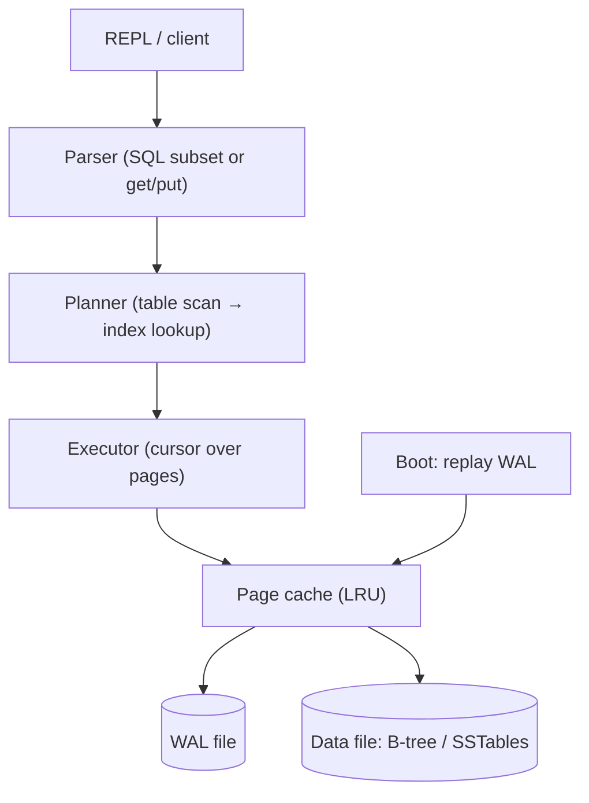

# Build your own database


## Blogs and websites

- [Let's Build a Simple Database](https://cstack.github.io/db_tutorial/)

## Introduction

Building a toy database — a B-tree over a pager, an LSM over SSTables, or a minimal SQL engine — is the fastest way to make every other page in this guide concrete. You stop memorizing "WAL then flush" and start feeling why crash recovery, page splits, and compaction exist.

Do this when storage internals, query planning, or distributed-systems interviews feel like vocabulary instead of machinery. A weekend prototype that survives `kill -9` teaches more than a month of re-reading.

## Theory / Core Concepts

### The minimal stack

| Layer | Responsibility | Prototype scope |
|---|---|---|
| Pager / file manager | Fixed-size pages, cache, fsync | `read(page_id)`, `write(page_id)`, LRU |
| WAL | Ordered durable log, replay on boot | Append + checkpoint + `REDO` |
| Data structure | B-tree or LSM for key lookup | Insert/get/delete, splits or flushes |
| Query front end | Parse → plan → execute | Start with `get/put`, grow to `SELECT` |
| Concurrency | Locks or MVCC snapshots | Single-writer + shared readers first |

### B-tree vs LSM as first builds

- **B-tree first**: teaches pages, splits, free lists, and buffer management. Smaller conceptual surface; harder page-level code.
- **LSM first**: teaches memtables, flushing, compaction, and Bloom filters. Simpler writes; compaction logic is the boss fight.
- Either way, add the WAL before the second feature — durability is the invariant everything else assumes.

**Real-life scenario:** An engineer following the classic SQLite-clone tutorial hits the "split a full leaf" exercise and finally understands why production B-trees need free-page maps and why page size (4 KB vs 16 KB) is a read/write trade-off, not a constant.

## Architecture



| Milestone | Delivers | Proves |
|---|---|---|
| 1. Pager + REPL | `insert`/`select` on one table | File I/O + serialization |
| 2. B-tree | Multi-page data, splits | Ordered storage |
| 3. WAL + recovery | Survives `kill -9` | Durability |
| 4. Index + planner | `WHERE` uses an index | Query planning |
| 5. Concurrency | Readers during writes | Locking/snapshots |

**Real-life scenario:** A study group builds the same five milestones in parallel across Python, Go, and Rust, then fault-injects each other's engines with `kill -9` mid-write — the WAL milestone is where most implementations fail first, exactly like production.

## Deep Dive / How it works

Recommended build order with the invariant each step protects:

1. **Serialization**: fixed page layout (header + cell array + payload) so bytes on disk are unambiguous. Test: hexdump a page and decode it by hand.
2. **Pager**: cache + evict + fsync discipline. Test: write 10k rows with a 10-page cache; every read must still be correct.
3. **B-tree insert/split**: leaf split, parent update, root growth. Test: insert sorted, reverse, and random keys; verify order by full scan.
4. **WAL**: log record per mutation with LSN, checkpoint pointer, replay that converges to the same checksum after `kill -9`. Test: crash-loop 100 times mid-insert; zero divergence.
5. **SQL subset**: `CREATE TABLE`, `SELECT ... WHERE`, one join strategy (nested loop), `EXPLAIN` showing the plan. Test: every query has an expected plan, not just expected rows.
6. **Index + optimizer**: secondary B-tree, cost choice between scan and lookup. Test:rowing table where the wrong plan is 100× slower, proving the optimizer matters.

Common traps: forgetting fsync ordering (data before WAL-commit = fiction), growing the page cache unboundedly, and testing only clean shutdowns. Chaos-test from milestone 3 onward.

## Practical Examples

```bash
# Project skeleton worth starting from
mkdir -p tinydb/{pager,wal,btree,sql} tests
touch tinydb/__init__.py tinydb/{pager,wal,btree,sql}/__init__.py
ls tinydb
```

```python
# The durability contract in miniature: WAL append, then mutate, then commit
def put(pager, wal, key, value):
    lsn = wal.append({"op": "put", "key": key, "value": value})
    pager.apply(key, value)   # dirty pages in cache
    wal.commit(lsn)           # fsync boundary: commit is durable here
    pager.flush()             # cached pages may reach disk later

def recover(pager, wal):
    for record in wal.since(pager.checkpoint_lsn()):
        pager.apply(record["key"], record["value"])  # REDO to convergence
```

```bash
# Crash-loop harness: the test that matters most
for i in $(seq 1 100); do
  python -m tinydb.load --rows 1000 &
  PID=$!
  sleep 0.05 && kill -9 $PID
  python -m tinydb.verify || { echo "diverged on run $i"; exit 1; }
done
echo "100 crashes, zero divergence"
```

## Interview Questions

- **Q: Why build a database to learn databases?**
  A: Implementation forces the invariants (fsync order, split logic, replay convergence) that reading leaves as slogans — and gives concrete stories for "tell me about a hard bug."
- **Q: B-tree or LSM for a first build?**
  A: B-tree for page mechanics, LSM for write-path intuition; either is defensible, but WAL + crash tests are non-negotiable in both.
- **Q: How do you prove durability?**
  A: Crash-loop testing: random `kill -9` during writes, replay, checksum comparison — clean-shutdown tests prove nothing about durability.
- **Q: What is the smallest query engine worth building?**
  A: Parse → plan (scan vs index) → execute with `EXPLAIN`; the optimizer choice between two plans teaches more than supporting ten SQL features.
- **Q: What would you add to scale your toy to production?**
  A: Concurrency (MVCC/locking), real planner statistics, replication (WAL shipping/Raft), and online backup — each maps to a chapter in this guide.

## Summary

1. Build in milestones: pager → B-tree → WAL → SQL → index → concurrency.
2. WAL + crash-loop tests are the durability proof; everything else assumes them.
3. Page splits teach reads, compaction teaches writes — pick your first boss fight.
4. Every query needs an expected plan, not just expected rows.
5. The prototype's value is the bugs: each one maps to a production incident pattern.
