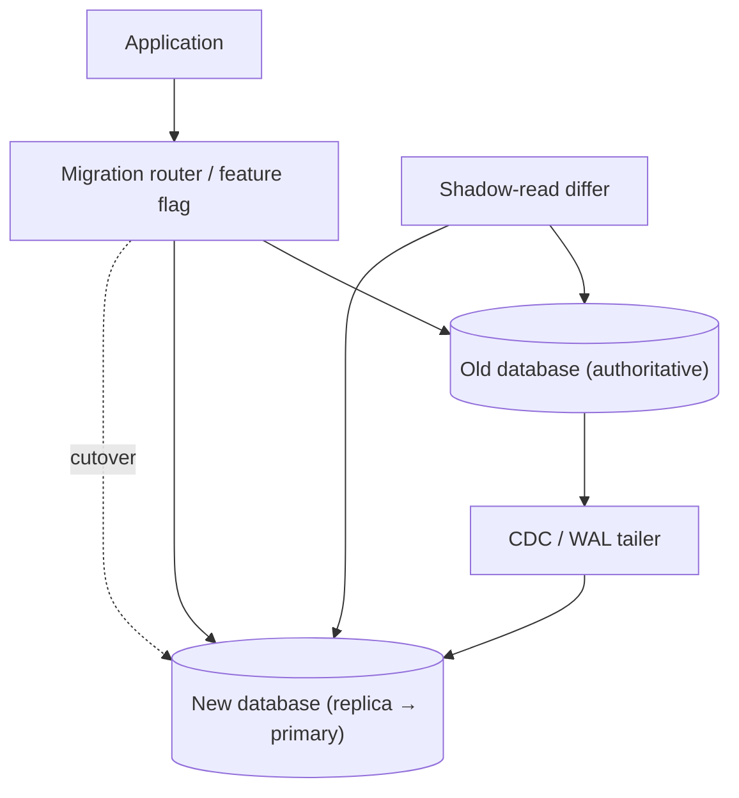

# Database Migration

## Blogs and websites


## Medium


## Youtube

- [System Design: Migrating 50TB at 100k RPS (The Hard Way)](https://www.youtube.com/watch?v=JR6Z1k1kKMM)

## Introduction

Database migration moves data and traffic from one system to another — version upgrades, engine switches (MySQL → Postgres), or schema overhauls — without losing writes or taking the product down. It is a distributed-systems problem wearing an ops costume: two live systems must agree on every write during cutover.

Migrate when the current store blocks the roadmap (scale ceiling, missing features, cost), never for fashion. Every migration needs a rollback story decided before the first byte moves.

## Theory / Core Concepts

### Migration strategies

| Strategy | How it works | Downtime | Risk |
|---|---|---|---|
| Big-bang dump/restore | Stop writes, dump, load, switch | Hours | Simplest, longest outage |
| Dual-write | App writes both, reads old, backfill, switch | ~Zero | App complexity, write skew |
| CDC/log shipping | Replicate via WAL/binlog, cutover when lag ≈ 0 | Seconds–minutes | Lag monitoring, schema mapping |
| Expand-contract | Additive schema changes across deploys | Zero | Slowest, safest for schema |
| Strangler per-domain | Migrate one bounded context at a time | Zero per slice | Routing + cross-domain joins |

### The invariants

- **No lost writes**: every accepted write lands in exactly one authoritative place per phase, with CDC closing the gap.
- **Reversible until committed**: keep the old system warm and the old code path deployable until the new system proves itself.
- **Verified, not hoped**: row counts, checksums, and shadow-read diffing — "replication lag is zero" is a dashboard, not a feeling.

**Real-life scenario:** A team migrating 50 TB at 100k RPS dual-writes behind a feature flag, backfills in idempotent chunks with checksums, and runs shadow reads for a week — cutover flips in seconds because the new system already served 100% of reads in the dark.

## Architecture



| Phase | Traffic | Source of truth | Exit criteria |
|---|---|---|---|
| 1. Backfill | 100% old | Old | Checksums match, lag bounded |
| 2. Dual-write + shadow | Writes both, reads old | Old (new verified) | Diff rate ≈ 0 for days |
| 3. Cutover | Reads → new | New | Lag ≈ 0, rollback tested |
| 4. Decommission | 100% new | New | Old retained read-only, then dropped |

**Real-life scenario:** During phase 2, shadow diffs catch a timezone truncation bug in the new schema's timestamp mapping — caught in the dark with zero user impact instead of as a post-cutover incident.

## Deep Dive / How it works

Write path during dual-write: app writes old first (authoritative), then new, wrapped in an outbox or idempotent retry so a crash between the two converges instead of diverging. CDC (Debezium, native logical replication, DynamoDB Streams) tails the old log and replays into the new system, collapsing the backfill-then-catch-up window to seconds of lag.

Read path during shadow mode: serve from old, replay the same query against new, diff and sample-log mismatches. Cutover is a flag flip plus DNS/connection drain when lag is ~0 and error budgets are green — preceded by a rehearsed rollback (reverse the flag, replay new-system writes back if needed).

Schema mapping is where migrations die: type mismatches (MySQL `DATETIME` vs Postgres `timestamptz`), collation differences, sequence/identity gaps, and constraint behavior (deferrable FKs). Convert with tools (ora2pg, pgLoader, AWS DMS SCT), then hand-verify edge types with targeted queries.

**Real-life scenario:** A MySQL → Postgres migration stalls on `0000-00-00` zero-dates MySQL tolerated; the team adds a CDC transform mapping them to NULL with a logged quarantine table, backfills cleanly, and ships a validation query that proves zero unmapped values remain.

## Practical Examples

```bash
# Postgres logical replication for near-zero-downtime cutover
# publisher (old primary)
psql -c "ALTER SYSTEM SET wal_level = logical;"
psql -c "CREATE PUBLICATION app_pub FOR ALL TABLES;"

# subscriber (new system): initial copy + streaming catch-up
psql -c "CREATE SUBSCRIPTION app_sub CONNECTION 'host=old-db dbname=app' PUBLICATION app_pub;"
psql -c "SELECT * FROM pg_stat_subscription;"  -- watch replay lag -> 0
```

```sql
-- Verification queries worth running before ANY cutover
-- row counts per table
SELECT 'orders' AS tbl, count(*) FROM orders
UNION ALL SELECT 'users', count(*) FROM users;
-- checksum sample (same query both sides, compare)
SELECT md5(string_agg(id::text || amount::text, ',' ORDER BY id))
FROM orders WHERE created_at > now() - interval '7 days';
```

```python
# Idempotent backfill chunk (safe to re-run after crashes)
def backfill_chunk(conn_old, conn_new, table, last_id, batch=5000):
    rows = conn_old.execute(
        f"SELECT * FROM {table} WHERE id > %s ORDER BY id LIMIT %s",
        (last_id, batch)).fetchall()
    for r in rows:
        conn_new.execute(
            f"INSERT INTO {table} (...) VALUES (...) ON CONFLICT (id) DO NOTHING", r)
    return rows[-1]["id"] if rows else None
```

## Interview Questions

- **Q: How do you migrate 50 TB with near-zero downtime?**
  A: CDC/log-shipping replication with backfill + streaming catch-up, dual-write or shadow verification, cutover at ~zero lag, rehearsed rollback — never big-bang at that scale.
- **Q: Dual-write vs CDC — which and when?**
  A: CDC when the engines support log tailing (less app code, ordered replay); dual-write when crossing paradigms (SQL → NoSQL) or CDC can't express the transform. Often both: CDC for bulk, dual-write for new writes.
- **Q: How do you prove no data was lost?**
  A: Row counts + checksums per table/partition, shadow-read diffing over days, and lag ≈ 0 at cutover — three independent signals, not one dashboard.
- **Q: What is expand-contract and why does it matter?**
  A: Schema changes in additive phases across deploys (add column → dual-write → migrate reads → drop old) so old and new code coexist — the zero-downtime DDL pattern.
- **Q: How do you roll back after cutover?**
  A: Keep the old system warm with reverse CDC (or retained writes) for a defined window; rollback is a flag flip plus replay of new-system writes — decided and rehearsed before cutover.
- **Q: Where do migrations actually fail?**
  A: Type/collation mapping, sequences, constraint semantics, and untested rollback — the planning checklist matters more than the copy tool.

## Summary

1. Migration = distributed consensus between two live systems; plan writes, verification, and rollback first.
2. Big-bang for small, CDC + shadow reads for large, expand-contract for schema, strangler per domain.
3. Cut over on measured signals (lag ≈ 0, diff ≈ 0), never on schedule pressure.
4. Schema mapping edge cases kill migrations — verify types explicitly.
5. Keep the old system warm until the new one has proven itself in production traffic.
