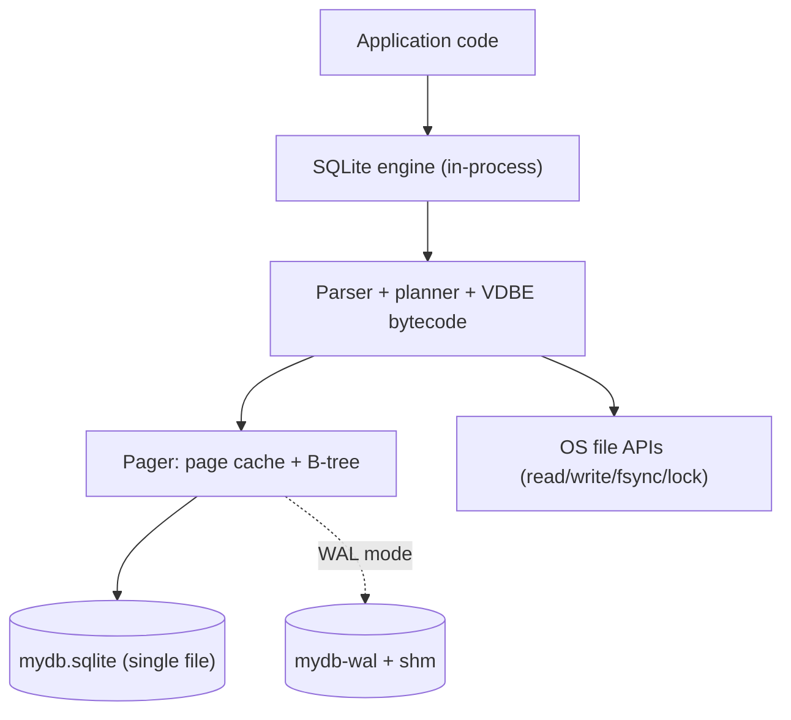

# Sqlite 


## Youtube

- [SQLite first impressions](https://www.youtube.com/watch?v=C_il-JH9iJc)
- [The Perfect Dependency - SQLite Case Study](https://www.youtube.com/watch?v=ZP7ef4eVnac)

## Introduction

SQLite is a serverless, zero-configuration, transactional SQL engine contained in a single cross-platform file (plus a ~750 KB C library). No server process, no network port, no setup: the application links the engine and reads/writes ordinary files with full ACID guarantees. It runs inside phones, browsers, airplanes, and embedded devices — the most deployed database in the world.

Choose SQLite when one process (or a few coordinated processes) owns the data: mobile apps, desktop tools, edge caches, test doubles, small-to-medium websites (it handles ~100k hits/day sites comfortably). Move to Postgres/MySQL when you need concurrent writers at scale, network access, or row-level security across many roles.

## Theory / Core Concepts

### Serverless architecture

| Aspect | SQLite | Client-server DB |
|---|---|---|
| Process model | In-process library | Separate server + connections |
| Configuration | Zero-conf, single file | Users, ports, auth, pooling |
| Concurrency | One writer at a time (WAL allows concurrent readers) | Many writers with MVCC/locks |
| Latency | Function call (microseconds) | Network round trip |
| Scaling | Vertical (file on fast disk) | Horizontal replicas |

### Storage and journaling

- **Single-file format**: header + B-tree pages (default 4 KB) holding tables and indexes; cross-platform byte order.
- **Rollback journal (default)**: pre-image copied aside, then blocks updated; crash recovery rolls back the journal.
- **WAL mode** (`PRAGMA journal_mode=WAL`): writes append to `-wal`, readers see snapshots, one writer + many readers concurrently; checkpoint merges back. Prefer WAL for anything with concurrent readers.
- **Typing**: flexible type affinity (`TEXT`, `INTEGER`, `REAL`, `BLOB`, `NUMERIC`) — values carry types, columns suggest them.

**Real-life scenario:** A mobile notes app keeps each user's data in one SQLite file synced via object storage; offline edits work with zero backend, and sync uploads the file delta — the database is a local file, not a service to operate.

## Architecture



| Component | Responsibility | Tuning note |
|---|---|---|
| Parser/planner | SQL → bytecode, simple cost choices | `EXPLAIN QUERY PLAN` before blaming speed |
| VDBE | Bytecode VM executing the plan | Deterministic, tiny footprint |
| Pager + cache | Page cache (`cache_size`), dirty tracking | Raise `cache_size` for working sets |
| Journal/WAL | Atomic commit + crash recovery | WAL for concurrent readers |
| `sqlite3` CLI | Inspection, dumps, `.recover` | Primary ops tool |

**Real-life scenario:** A CI pipeline runs the full test suite against per-test SQLite files created from a schema dump; 2,000 tests finish in 40 seconds with zero database containers — file-per-test parallelism replaces shared-state flakiness.

## Deep Dive / How it works

Write path: `BEGIN` → B-tree pages modified in cache → journal/WAL records appended → `COMMIT` fsyncs the journal/WAL then the database file → lock released. Durability settings form a ladder: `synchronous=FULL` (safest, fsyncs twice) → `NORMAL` (WAL-safe, one fsync) → `OFF` (fast, corruption on OS crash). Keep `FULL` for money data, `NORMAL`+WAL for most apps.

Read path: shared lock → B-tree descent from cache or file → result rows. Readers never block the writer in WAL mode and the writer never blocks readers — but there is still exactly one writer, so write-heavy concurrency serializes. Long-running read transactions pin WAL growth (checkpoint can't purge), the classic "idle transaction bloats storage" incident.

Limits worth quoting in interviews: ~281 TB max DB, 2 GB practical string/blob, 32766 columns (compile-time), and the famous "one writer" rule. Concurrency story: `BEGIN IMMEDIATE` to reserve the write lock early instead of deadlocking on upgrade from shared.

**Real-life scenario:** A small SaaS runs its entire MVP on one SQLite file behind Litestream replication (WAL shipped to S3); reads are instant local function calls, disaster recovery is "download file + replay", and the team defers Postgres until write concurrency actually binds.

## Practical Examples

```sql
-- Pragmas that define production behavior (run at connection setup)
PRAGMA journal_mode = WAL;      -- concurrent readers + one writer
PRAGMA synchronous = NORMAL;    -- safe with WAL, faster commits
PRAGMA foreign_keys = ON;       -- off by default: enable explicitly
PRAGMA busy_timeout = 5000;     -- wait 5 s on locked instead of failing

CREATE TABLE users (
  id INTEGER PRIMARY KEY,
  email TEXT UNIQUE NOT NULL,
  created_at TEXT NOT NULL DEFAULT (datetime('now'))
);
CREATE INDEX idx_users_email ON users(email);
```

```bash
# Inspect, dump, restore, and recover with the CLI
sqlite3 app.db "PRAGMA integrity_check;"
sqlite3 app.db ".dump" > backup.sql
sqlite3 restored.db < backup.sql
sqlite3 app.db ".recover" | sqlite3 recovered.db
ls -lh app.db app.db-wal
```

```python
# Correct Python usage: one connection per thread, explicit commits
import sqlite3
conn = sqlite3.connect("app.db", timeout=5.0, isolation_level=None)
conn.execute("PRAGMA journal_mode=WAL;")
conn.execute("PRAGMA foreign_keys=ON;")
conn.execute("BEGIN IMMEDIATE;")
try:
    conn.execute("INSERT INTO users(email) VALUES (?)", ("ava@example.com",))
    conn.execute("COMMIT;")
except sqlite3.IntegrityError:
    conn.execute("ROLLBACK;")
    raise
```

## Interview Questions

- **Q: When is SQLite the right choice vs Postgres?**
  A: Single-owner data, embedded/mobile/edge, tests, small sites — zero ops and microsecond latency. Postgres when many concurrent writers, network access, or advanced auth/replication are needed.
- **Q: How does WAL mode change concurrency?**
  A: Rollback journal serializes readers and writers; WAL lets readers snapshot while one writer appends, with checkpoints merging back. One writer remains the rule either way.
- **Q: What does `synchronous` control?**
  A: How aggressively commits fsync: FULL (safest), NORMAL (WAL-safe default-ish), OFF (fast, unsafe on crash). It trades durability for speed explicitly.
- **Q: Why did the database file grow during a long report?**
  A: A lingering read transaction pins WAL frames so checkpoints can't reclaim them. Fix: short transactions, `busy_timeout`, and monitoring WAL size.
- **Q: How do you back up SQLite in production?**
  A: Online backup API / `.backup`, Litestream WAL shipping to S3 for point-in-time, or file copy only with the write lock held — never bare `cp` on a live rollback-journal DB.
- **Q: What breaks first at scale?**
  A: Write concurrency (single writer), then file size on one volume, then the need for network access and roles — each is a clean trigger to migrate to Postgres.

## Summary

1. SQLite = ACID SQL as a library in a single file; zero ops, microsecond latency.
2. WAL mode + `busy_timeout` + `foreign_keys=ON` is the production pragma trio.
3. One writer, many readers — size workloads and expectations around that rule.
4. Back up via API/Litestream, never bare file copies on live databases.
5. Perfect default until concurrent writers, network access, or multi-TB scale say otherwise.
