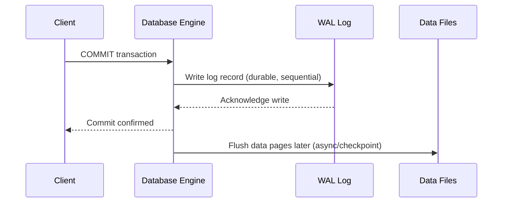

# Write Ahead logging


## Youtube

- [What is Write Ahead logging? WAL Explained in System Design](https://www.youtube.com/watch?v=cqORW8yzyFg)
    - [Why Uber Engineering Switched from Postgres to MySQL](https://www.uber.com/us/en/blog/postgres-to-mysql-migration/)
    - [Why Uber Moved from Postgres to MySQL](https://medium.com/databases-in-simple-words/why-uber-moved-from-postgres-to-mysql-b6ecfa9ff0d9)


## Theory
### Write-Ahead Logging (WAL)

WAL is a technique where changes to data are first recorded in a durable log before being applied to the actual data files. This guarantees durability and enables crash recovery — since even if the database crashes before writing changes to disk, the log can be replayed to reconstruct the correct state.



- **Advantages:** durability guarantee without requiring every data page write to be synchronous, faster commits (sequential log writes vs random data writes), enables crash recovery and replication
- **Disadvantages:** additional storage for logs, log management/archiving complexity

**Real-life scenario:** A Postgres primary commits 10k TPS because commits only fsync the sequential WAL; data pages flush lazily at checkpoints — throughput comes from the log, not from writing every page synchronously.

## Deep Dive / How it works

Write path detail: each mutation produces a WAL record with a Log Sequence Number (LSN); the commit fsyncs all records up to the commit LSN, then returns success. Data pages may still be dirty in the buffer pool — durability lives in the log, not the heap. Checkpoints flush dirty pages and record a redo pointer bounding replay work.

Read path impact: none directly — WAL is write-side infrastructure. But long-running transactions pin WAL (it can't be recycled past the oldest active snapshot), so an idle `psql` session can fill the disk: the classic "WAL bloat from a forgotten transaction" incident.

Replication reuses the same log: physical replicas stream WAL records and replay them; logical decoding parses them into row changes for CDC tools like Debezium. Archiving (`archive_command` to S3) plus base backups gives point-in-time recovery to any LSN.

**Real-life scenario:** A replica lags hours behind; the cause is a 6-hour analytics transaction on the primary pinning WAL plus a slow disk on the replica stalling replay — two bottlenecks, one symptom, both visible in `pg_stat_replication` and replay-lag metrics.

## Practical Examples

```sql
-- Observe WAL generation and checkpoint behavior
SHOW wal_level;              -- replica | logical (needed for CDC)
SHOW max_wal_size;           -- checkpoint/replay bound
SELECT pg_current_wal_lsn(); -- current log position
CHECKPOINT;                  -- force flush + new redo pointer
```

```bash
# Archive WAL to object storage for PITR (postgresql.conf)
# archive_mode = on
# archive_command = 'aws s3 cp %p s3://backups/wal/%f'
ls -lh pg_wal/ | tail -n 5
```

## Interview Questions

- **Q: Why write to a log first instead of the data pages directly?**
  A: Sequential log appends are orders of magnitude faster than random page writes, and the log gives crash replay + replication + PITR from one mechanism.
- **Q: What does "committed" mean in a WAL database?**
  A: The commit's WAL records are fsynced — replay can reconstruct the change even if data pages never reached disk. Commit durability = log durability.
- **Q: How do checkpoints bound recovery time?**
  A: Checkpoints flush dirty pages and record a redo LSN; recovery replays only WAL after that pointer, so checkpoint frequency trades runtime I/O against crash RTO.
- **Q: How does WAL enable both replication and CDC?**
  A: Physical replicas replay raw WAL bytes; logical decoding parses WAL into row-level changes streamed to Kafka/search/warehouse — one log, two consumers.
- **Q: What fills a disk with WAL?**
  A: Unarchived accumulation (broken `archive_command`),pinned WAL from long transactions or lagging replication slots — monitor `pg_wal` size and slot lag, alert before the disk fills.

## Summary

1. WAL = durability + crash replay + replication + PITR from one append-only log.
2. Commits fsync the log, not data pages — that is where write throughput comes from.
3. Checkpoints bound replay work; cadence trades steady-state I/O for crash RTO.
4. Long transactions and lagging slots pin WAL — monitor both.
5. Archive the log and you get point-in-time recovery for free.

