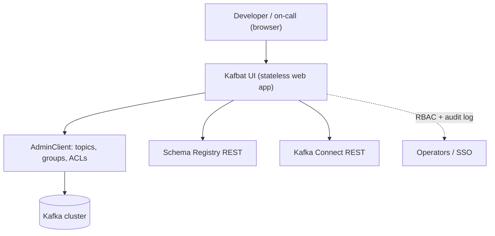

# Kafbat UI

**Kafbat UI** (formerly `provectus/kafka-ui`) is the active, community-maintained open-source web UI for Apache Kafka. It serves as the direct successor to the now-inactive Provectus project.


## Project Status

| Feature | Provectus (`provectus/kafka-ui`) | Kafbat (`kafbat/kafka-ui`) |
| :--- | :--- | :--- |
| **Status** | 🔴 Inactive / Abandoned | 🟢 Active / Maintained |
| **Github link** | [provectus/kafka-ui](https://github.com/provectus/kafka-ui) | [kafbat/kafka-ui](https://github.com/kafbat/kafka-ui) |
| **Security** | Unpatched Vulnerabilities (CVEs) | Actively Patched |
| **Version** | Stalled at v0.7.x | v1.0+ |
| **Docker Image** | `provectuslabs/kafka-ui` | `ghcr.io/kafbat/kafka-ui` |

## Why the Split?
The original creator (Provectus) paused development on the project around late 2023. To prevent the tool from dying, the core open-source maintainers and community forked the repository. They rebranded it as **Kafbat** to facilitate continued security updates, bug fixes, and feature development.

## Key Improvements in Kafbat
* **Security:** Critical CVEs found in old dependencies have been resolved.
* **RBAC:** Enhanced Role-Based Access Control and ACL management.
* **Smart Filters:** Better filtering capabilities for topic messages.
* **Bug Fixes:** Resolution of long-standing issues from the original repo.

## Migration Guide
Since Kafbat is a direct fork, it is largely backward compatible. In most cases, migration only requires changing the Docker image source.

### Docker Compose
Update your `docker-compose.yaml`:

```yaml
services:
  kafka-ui:
    # OLD: image: provectuslabs/kafka-ui:latest
    # NEW:
    image: ghcr.io/kafbat/kafka-ui:latest
    container_name: kafka-ui
    ports:
      - "8080:8080"
    environment:
      - KAFKA_CLUSTERS_0_NAME=local
      - KAFKA_CLUSTERS_0_BOOTSTRAPSERVERS=kafka:9092
```

## Introduction

Kafbat UI is the operational console for Kafka: browse topics/partitions, inspect consumer-group lag, view and produce messages, manage schemas and connectors, all without memorizing CLI flags. It doesn't replace alerting or GitOps topic management — it accelerates debugging, onboarding, and incident response by making cluster state visible.

Deploy it per environment (dev/staging/prod) with read-only RBAC by default; grant produce/admin only to operators who already hold those Kafka ACLs.

## Theory / Core Concepts

### What the UI covers

| Capability | Replaces CLI | Interview note |
|---|---|---|
| Topic/partition browser | `kafka-topics.sh --describe` | See RF, ISR, segment spread visually |
| Consumer-group lag view | `kafka-consumer-groups.sh --describe` | Lag per partition, not just totals |
| Message viewer + producer | `kafka-console-{consumer,producer}.sh` | Filter by key/header/timestamp, produce test events |
| Schema Registry browser | `curl` on Registry REST | Compatibility + version diffs |
| Connect management | Connect REST calls | Connector status, restart, pause |
| RBAC + audit | Shared admin credentials | Per-role visibility, action logging |

### Where it fits in ops

Kafbat UI is a read-mostly lens over APIs Kafka already exposes (AdminClient, Consumer Group APIs, Registry, Connect REST). It speeds humans up; automation (topic creation, ACLs, quotas) still belongs in version-controlled GitOps so the UI never becomes the undocumented source of truth.

**Real-life scenario:** Consumer lag pages at 2 AM; the on-call opens Kafbat UI, sees one partition's lag spiking while others are flat (hot key, not broker failure), inspects recent messages on that partition, and finds a single malformed event poison-looping the consumer — diagnosed in 4 minutes without SSH.

## Architecture



| Component | Responsibility | Ops note |
|---|---|---|
| UI container | Stateless frontend + backend | Scale horizontally, no local state |
| Cluster configs | Bootstrap servers per env | One UI deployment per environment |
| RBAC | Role → allowed actions/views | Read-only default; produce/admin gated |
| Auth | SSO/OAuth/OIDC, LDAP | No shared admin passwords |

**Real-life scenario:** A platform team runs one Kafbat UI per environment behind SSO: developers get read + produce-to-dev-topics, operators get admin on staging/prod — the same RBAC model as the underlying Kafka ACLs, mirrored in the UI.

## Deep Dive / How it works

Read path: the UI calls AdminClient (`describeTopics`, `describeConsumerGroups`, `listOffsets`) and renders partition counts, ISR states, and per-partition lag; message viewing consumes from a chosen offset with server-side filtering (key contains, header match, timestamp range) so the browser never pulls millions of records.

Write path: producing test messages, creating topics, or restarting connectors all go through the same APIs automation uses — gated by the UI's RBAC mapping to Kafka ACLs. Every mutating action should audit-log (who, what, when) for incident review.

Security posture: run the old Provectus image and known CVEs ride along; Kafbat tracks patches. Put the UI behind SSO, restrict network access to VPN/office, and treat "anyone can produce to prod" as a finding, not a convenience.

**Real-life scenario:** After migrating the image to `ghcr.io/kafbat/kafka-ui`, a CVE scan goes green and smart filters let support find a customer's order event by header in seconds — the migration paid for itself in one incident.

## Practical Examples

```bash
# Pin a patched version and wire SSO-friendly read-only defaults
docker run -d --name kafbat-ui -p 8080:8080 \
  -e KAFKA_CLUSTERS_0_NAME=prod \
  -e KAFKA_CLUSTERS_0_BOOTSTRAPSERVERS=kafka1:9092,kafka2:9092 \
  -e AUTH_TYPE=oauth2 \
  ghcr.io/kafbat/kafka-ui:v1.3.0
```

```bash
# What to check in the UI during a lag incident (and the CLI equivalents)
kafka-consumer-groups.sh --bootstrap-server kafka:9092 \
  --group checkout-svc --describe   # per-partition CURRENT-OFFSET vs LOG-END-OFFSET
kafka-topics.sh --bootstrap-server kafka:9092 \
  --describe --topic orders          # RF, ISR, leader spread
```

```yaml
# RBAC sketch: developers read everywhere, produce only in dev
# (map to your SSO groups; mirror underlying Kafka ACLs)
rbac:
  roles:
    - name: developer
      clusters: [dev]
      actions: [view, produce]
    - name: operator
      clusters: [staging, prod]
      actions: [view, produce, admin]
```

## Interview Questions

- **Q: Why Kafbat over the old Provectus image?**
  A: Provectus is abandoned at v0.7.x with unpatched CVEs; Kafbat is the maintained fork (v1.0+) with security fixes, RBAC improvements, and smart filters — same API, safe upgrade path.
- **Q: Does a Kafka UI replace CLI/GitOps management?**
  A: No — it accelerates humans (debugging, lag triage, message inspection) while automation owns topic/ACL/quota state in version control. UI actions should audit-log; bulk changes stay in GitOps.
- **Q: How do you secure a Kafka UI in production?**
  A: Patched image (Kafbat), SSO/OAuth with RBAC (read-only default), VPN-only network access, and Kafka ACLs underneath so the UI can't exceed what the service account allows.
- **Q: Walk me through a lag incident using the UI.**
  A: Group lag view → isolate partition(s) → check ISR/leader health → inspect recent messages (poison pill?) → seek past or fix consumer → verify lag drains. The UI compresses four CLI tools into one screen.
- **Q: What can't the UI tell you?**
  A: Long-term trends and alerting (needs Prometheus/Grafana on broker metrics) and why a plan is slow (needs `EXPLAIN`-level consumer profiling) — the UI shows state, monitoring shows history.

## Summary

1. Kafbat UI = maintained Kafka console (Provectus successor): topics, lag, messages, schemas, connectors in one view.
2. Migrate by swapping the image to `ghcr.io/kafbat/kafka-ui` — backward compatible, CVE-clean.
3. Deploy per environment behind SSO with read-only defaults; mirror Kafka ACLs in UI roles.
4. Use it for debugging and incident triage; keep topic/ACL/quota state in GitOps with audit-logged UI actions.
