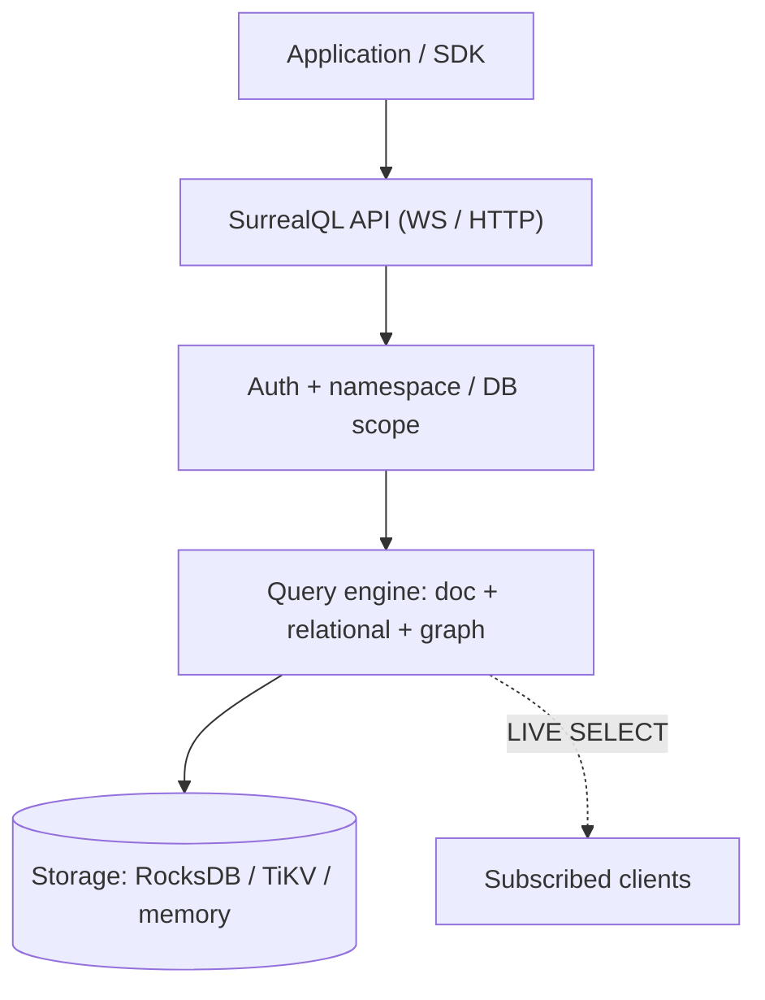

# SurrealDB basics 

## Youtube

### Introduction

- [SurrealDB in 100 Seconds](https://www.youtube.com/watch?v=C7WFwgDRStM)
- [Beyond Surreal? A closer look at NewSQL Relational Data](https://www.youtube.com/watch?v=LCAIkx1p1k0)
- [Rust Powered Database SurrealDB (It's Pretty Ambitious)](https://www.youtube.com/watch?v=DPQbuW9dQ7w)
- [SurrealDB - Rust Embedded Database - Quick Tutorial](https://www.youtube.com/watch?v=iOyvum0D3LM)

## Introduction

SurrealDB is a multi-model database (document + relational rows + graph edges + key-value + time series) with a Rust core, SurrealQL query language, and built-in realtime (live queries), auth, and server-side functions. One binary covers embedded to distributed modes, which makes it attractive for prototypes and edge deployments that would otherwise need Postgres + Redis + a queue.

Treat it as a consolidation bet for small-to-medium workloads: great when one team wants documents, relations, and graph traversals without operating three systems; not yet the answer for massive scale, strict compliance ecosystems, or workloads needing the mature tooling of Postgres/Mongo.

## Theory / Core Concepts

### Multi-model in one engine

| Model | How it looks | Use when |
|---|---|---|
| Document | Nested records, flexible fields | Product catalogs, profiles |
| Relational | Tables + typed fields + constraints | Ledgers, inventories |
| Graph | `RELATE` edges with properties | Friends, fraud, recommendations |
| Key-value / series | Fast lookups, time-ordered data | Sessions, metrics |

### SurrealQL highlights

- `RELATE author:1->wrote->post:9 SET time = time::now()` creates a graph edge inline.
- `LIVE SELECT` streams matching changes to subscribed clients (realtime without a separate pub/sub).
- Schemafull tables enforce types; schemaless tables allow iteration — pick per table, not per database.
- Namespaces → databases → tables scope multi-tenancy (`USE NS app DB prod`).

**Real-life scenario:** A hackathon team ships a collaborative app with documents for posts, `RELATE` edges for follows, and `LIVE SELECT` for the activity feed — one SurrealDB instance replaces what would have been Postgres + Redis Pub/Sub + a graph prototype.

## Architecture



| Layer | Responsibility | Scaling note |
|---|---|---|
| Protocol | WebSocket realtime + HTTP queries | WS for live, HTTP for request/response |
| Auth | Users, scopes, row-level rules | Define access at table level early |
| Functions | Server-side logic, future WASM | Keep hot logic close to data, not in clients |
| Storage | Embedded RocksDB → distributed TiKV | Start embedded, plan the TiKV jump past one node |

## Deep Dive / How it works

Write path: SurrealQL statement → auth/scope check → storage transaction (single-node ACID in embedded mode) → secondary indexes updated → live-query subscribers notified for matching `LIVE` selections. Graph edges are first-class records, so traversals avoid join tables.

Read path: query planner uses indexes for anchored filters, then traverses `RELATE` edges by record links; unanchored full-graph scans cost like full-table scans anywhere else. Realtime is change-data-capture built in — clients hold a `LIVE` cursor instead of polling.

Trade-offs: young distributed story (consensus/scaling less battle-tested than Postgres/Cassandra), smaller ecosystem (drivers, ORMs, DBAs-for-hire), and migration risk if you outgrow single-node. Mitigate by keeping domain boundaries clean so extraction to specialist stores stays possible.

## Practical Examples

```sql
-- Schemafull users, schemaless posts, graph follows
DEFINE TABLE user SCHEMAFULL;
DEFINE FIELD name ON user TYPE string;
DEFINE FIELD email ON user TYPE string ASSERT string::is::email($value);

CREATE user:1 SET name = 'Ava', email = 'ava@example.com';
CREATE post:9 SET title = 'Hello Surreal', author = user:1;
RELATE user:1->wrote->post:9 SET at = time::now();
RELATE user:2->follows->user:1 SET at = time::now();
```

```sql
-- Traverse: who follows Ava, and what did they write?
SELECT <-follows<-user.name AS followers,
       ->wrote->post.title AS posts
FROM user:1;

-- Realtime feed: clients subscribe once, get deltas
LIVE SELECT * FROM post WHERE author = user:1;
```

```bash
# Run it locally (single binary) and connect
surreal start --user root --pass root memory
# then: USE NS app DB demo; CREATE user:1 SET name = 'Ava';
```

## Interview Questions

- **Q: What does multi-model mean here?**
  A: One engine querying documents, relations, graph edges, and KV without ETL between systems — SurrealQL spans all four in one statement.
- **Q: How do live queries replace polling?**
  A: `LIVE SELECT` holds a subscription; matching writes push deltas to clients — realtime feeds/notifications without a separate broker for moderate scale.
- **Q: When would you still choose Postgres over SurrealDB?**
  A: Strict compliance/tooling needs, massive scale with proven HA, PostGIS/pgvector-class extensions, or teams that need hireable operational expertise.
- **Q: How do you avoid lock-in with a young database?**
  A: Clean bounded contexts, keep the system of record exportable (CDC/dumps), and isolate Surreal-specific features (live queries, graph edges) behind repository interfaces.

## Summary

1. SurrealDB consolidates document + relational + graph + realtime in one binary.
2. `RELATE` edges and `LIVE SELECT` are the two features that replace extra infrastructure.
3. Scope with namespaces/databases; choose schemafull vs schemaless per table.
4. Great consolidation bet under moderate scale; plan extraction seams for growth.
5. Evaluate the distributed/HA story against your RPO/RTO before committing production data.
