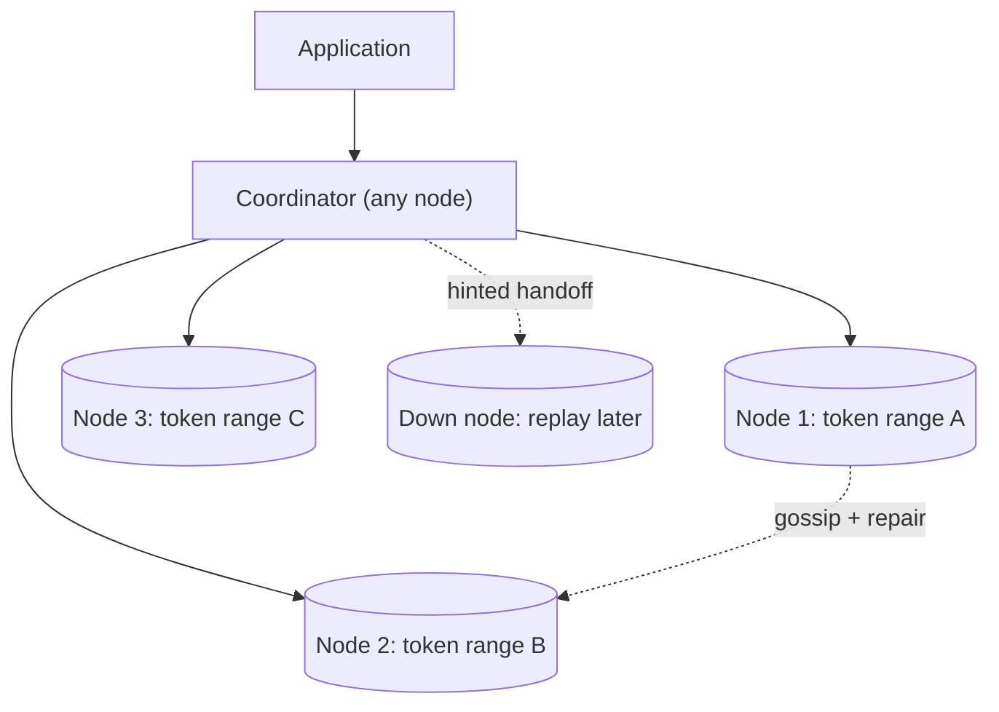

# Apache Cassandra


## Udemy

- [Learn Apache Cassandra in 2 hours | NoSQL Database](https://www.udemy.com/course/learn-cassandra-from-scratch/)
- [Learn Apache Cassandra from Scratch](https://www.udemy.com/course/learn-apache-cassandra-from-scracth/)
- [Apache Cassandra : Everything You Need To Know](https://www.udemy.com/course/everything-cassandra/)

## Introduction

Apache Cassandra is a masterless, wide-column NoSQL store built for linear horizontal scale and always-on availability across racks, regions, and clouds. Born at Facebook (Dynamo + BigTable ideas), it powers write-heavy workloads like time series, messaging inboxes, and IoT telemetry at Discord, Netflix, and Apple scale.

Choose it when you need multi-datacenter active-active writes with tunable consistency and can model data around known query patterns. Avoid it for ad-hoc joins, secondary-index-heavy access, or strongly-consistent transactional workloads.

## Theory / Core Concepts

### Partitioning and tokens

| Concept | What it is | Interview note |
|---|---|---|
| Partition key | First part of PRIMARY KEY; decides the node | Wrong key = hotspots |
| Clustering key | Sorts rows inside a partition | Range scans only within a partition |
| Token ring | Murmur3 hash space split across nodes | `vnum_tokens` spreads load |
| Replication | `SimpleStrategy` / `NetworkTopologyStrategy` | NTS with RF=3 per DC is the prod default |

### Consistency tuning

`ONE / QUORUM / LOCAL_QUORUM / ALL` per read and write, plus `EACH_QUORUM` for multi-DC. `W + R > RF` gives strong consistency; `LOCAL_QUORUM` both sides is the common low-latency strong-ish default. Hinted handoff + read repair cover transient misses.

### LSM storage engine

Memtable → immutable SSTables → leveled/size-tiered compaction, with commitlog as WAL and Bloom filters skipping SSTables. Writes are sequential; tombstones mark deletes until `gc_grace_seconds` passes.

**Real-life scenario:** A messaging team models `messages_by_conversation (conversation_id, message_id)` so one partition holds one thread in time order — fetching a page is a single-partition slice, while cross-conversation search is deliberately pushed to Elasticsearch instead of Cassandra.

## Architecture



| Component | Responsibility | Scaling note |
|---|---|---|
| Gossip | Membership + failure detection | Seed nodes bootstrap, all nodes equal |
| Commitlog + memtable | Durable write buffer | Size memtables for write bursts |
| SSTables + compaction | Sorted persistent storage | STCS for write-heavy, LCS for read-heavy |
| Repair / anti-entropy | Replica convergence | Run incrementally; never skip with deletes |

## Deep Dive / How it works

Write path: coordinator hashes partition key → forwards to RF replicas → each appends to commitlog + memtable → acknowledges per CL → coordinator returns after W acks. Later memtable flush creates SSTables; compaction merges and evicts tombstones after grace.

Read path: coordinator asks RF replicas → digest comparison → read repair on mismatch → returns after R acks. Partition too large (>100 MB guideline) causes heap pressure and slow repair — split by time bucketing (`..._by_month`) before it hurts.

Failure story: single-node loss is absorbed by RF replicas; quorum reads during a partition stay consistent or fail loudly with `LOCAL_QUORUM`; `ALL` maximizes consistency and maximizes outage blast radius — pick deliberately.

## Practical Examples

```sql
-- Model around the query: one partition per conversation, clustered by time
CREATE TABLE messages_by_conversation (
  conversation_id uuid,
  message_id timeuuid,
  sender_id uuid,
  body text,
  PRIMARY KEY (conversation_id, message_id)
) WITH CLUSTERING ORDER BY (message_id DESC);

-- Single-partition page fetch (fast path)
SELECT sender_id, body FROM messages_by_conversation
WHERE conversation_id = 123e4567-e89b-12d3-a456-426614174000
LIMIT 50;
```

```sql
-- Time-bucketed sensor table avoids unbounded partitions
CREATE TABLE readings_by_sensor_month (
  sensor_id uuid,
  month text,
  ts timestamp,
  value double,
  PRIMARY KEY ((sensor_id, month), ts)
) WITH CLUSTERING ORDER BY (ts DESC);
```

```bash
# Operate it like prod: status, repair, cleanup after topology change
nodetool status
nodetool repair -pr -j 2 mykeyspace
nodetool cleanup mykeyspace
```

## Interview Questions

- **Q: Partition key vs clustering key?**
  A: Partition key picks the node (hash); clustering key orders rows inside that partition. Cross-partition range scans are the modeling smell.
- **Q: How do you get strong consistency from Cassandra?**
  A: `W + R > RF`, e.g., QUORUM/QUORUM with RF=3. LOCAL_QUORUM both sides keeps it single-DC fast.
- **Q: What happens on node failure during a write?**
  A: Coordinator writes to remaining replicas + stores hints; the down node replays hints on return, with read repair and anti-entropy repair converging the rest.
- **Q: Why do deletes come back (zombie data)?**
  A: Tombstones expire after `gc_grace_seconds`; a down node that missed the tombstone resurrects data. Run repair within the grace window, always.
- **Q: When is Cassandra the wrong choice?**
  A: Ad-hoc analytics, joins, heavy secondary-index queries, or serializable transactions — use Postgres/warehouse/search alongside it.

## Summary

1. Model queries first: partition key places, clustering key orders.
2. Tune consistency per operation; QUORUM/QUORUM over RF=3 is the default strong answer.
3. LSM + tombstones explain both write speed and the repair discipline deletes demand.
4. Bucket unbounded partitions by time before repair and heap suffer.
5. Cassandra owns write-heavy keyed access; pair it with search/analytics stores for the rest.
