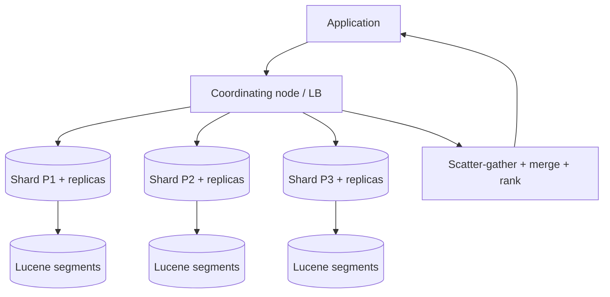

# Elastic search

## Introduction

- [Why Elasticsearch Is So Fast](https://www.youtube.com/watch?v=aGv1kd8XFog)
- [How Elastic Search Work ? System Design Deep Dives Podcast](https://www.youtube.com/watch?v=LHQMNFKU_ME)

## Overview

Elasticsearch is a distributed search and analytics engine built on Apache Lucene. It stores JSON documents in an inverted index plus columnar doc-values, exposing full-text relevance ranking, aggregations, and vector (kNN) search behind a REST API. It powers product search, log analytics (ELK/EFK), SIEM, and RAG retrieval.

Use it when queries are "find and rank by relevance / aggregate over billions of events" rather than relational joins or strict transactions. Keep the system of record in Postgres/Mongo; index a denormalized projection into Elasticsearch.

## Theory / Core Concepts

### Documents, indices, shards

| Concept | What it is | Interview note |
|---|---|---|
| Document | JSON unit (`products/1`) | Immutable-ish; updates reindex |
| Index | Collection of documents with mappings | Like a table, but sharded |
| Shard | Lucene instance (primary + replicas) | Unit of parallelism and recovery |
| Mapping | Field types + analyzers | Wrong mapping = wrong search; plan before indexing |
| Relevance | BM25 score of term match | Tune with `match` vs `term` deliberately |

### Analysis chain

`character filter → tokenizer → token filter (lowercase, stem, synonyms)` turns `"Running Shoes!"` into `[run, shoe]`. Same analyzer at index and query time, or recall silently breaks.

### Inverted index vs doc values

- **Inverted index**: term → posting list (doc ids + positions). Serves full-text search.
- **Doc values / columnar**: doc → field values on disk. Serves sorting and aggregations.
- **HNSW graph** (8.x kNN): vector field for semantic search alongside BM25 (hybrid retrieval).

**Real-life scenario:** A marketplace indexes 20M products with an `english` analyzer plus a synonym filter (`sneakers ⇔ sports shoes`), so a query for "running sneakers" still matches listings titled "men's running sports shoes" with BM25 ranking the best matches first.

## Architecture



| Component | Responsibility | Scaling note |
|---|---|---|
| Data nodes | Store shards, execute search | Add nodes + rebalance past ~30–50 GB/shard |
| Master-eligible nodes | Cluster state, shard assignment | Dedicated 3-node quorum in prod |
| Ingest / coordinating | Pipeline + fan-out merge | Isolate hot indexing from search |
| ILM snapshots | Rollover + force-merge + S3 backup | Hot → warm → cold → frozen |

**Real-life scenario:** A logging platform rolls daily indices (`logs-2026.10.08`), force-merges warm indices to one segment, and snapshots to S3 — hot nodes stay fast while 90 days of history remains searchable from cheap frozen storage.

## Deep Dive / How it works

Write path: `POST /idx/_doc` → routing hash picks shard → primary validates mapping, writes to in-memory buffer + translog (WAL) → refresh (default 1 s) opens a new Lucene segment for search → flush commits segments + clears translog. Refresh interval is the visibility-vs-indexing-throughput knob.

Read path: coordinating node fans out to one copy of each shard → each shard scores locally (BM25) with distributed term statistics → coordinator merges, re-sorts, returns top-K. Deep pagination (`from: 100000`) is expensive — use `search_after` or PIT + point-in-time readers.

Failure handling: replica promotion on node loss (yellow → green), split-brain prevented by master quorum, translog replay on unclean restart. Shard count is fixed at index creation — over-sharding burns heap (each shard ~20–50 MB heap overhead), under-sharding caps parallelism.

**Real-life scenario:** After a data-node OOM, the cluster goes yellow with unassigned replicas; the on-call confirms primaries are intact, restarts the node, and watches replicas re-sync from translog/segments instead of panicking — yellow means degraded redundancy, not data loss.

## Practical Examples

```bash
# Create an index with explicit mapping (do this BEFORE bulk load)
curl -s -X PUT localhost:9200/products -H 'Content-Type: application/json' -d '{
  "settings": {"number_of_shards": 3, "number_of_replicas": 1},
  "mappings": {"properties": {
    "name": {"type": "text", "analyzer": "english"},
    "price": {"type": "double"},
    "tags": {"type": "keyword"},
    "embedding": {"type": "dense_vector", "dims": 384}
  }}
}'

# Index one document
curl -s -X POST localhost:9200/products/_doc/1 -H 'Content-Type: application/json' -d '{
  "name": "Trail running shoes", "price": 129.99, "tags": ["outdoor", "footwear"]
}'
```

```bash
# Full-text search with filter + aggregation
curl -s -X GET localhost:9200/products/_search -H 'Content-Type: application/json' -d '{
  "query": {"bool": {
    "must": [{"match": {"name": "running shoes"}}],
    "filter": [{"term": {"tags": "outdoor"}}]
  }},
  "aggs": {"avg_price": {"avg": {"field": "price"}}},
  "size": 5
}'
# match = analyzed relevance query; term = exact keyword filter (cached, unscored)
```

```bash
# Hybrid BM25 + kNN (Elasticsearch 8.x)
curl -s -X GET localhost:9200/products/_search -H 'Content-Type: application/json' -d '{
  "knn": {"field": "embedding", "query_vector": [0.11, -0.02, 0.43], "k": 10, "num_candidates": 100},
  "query": {"match": {"name": "running shoes"}},
  "size": 10
}'
```

## Interview Questions

- **Q: Why is Elasticsearch faster than `LIKE '%...%'` in Postgres for full text?**
  A: Inverted index jumps straight to the posting list per term with BM25 ranking; `LIKE '%x%'` scans. The index pays build cost once for O(terms) lookups.
- **Q: `text` vs `keyword` — when does the wrong choice hurt?**
  A: `text` is analyzed for relevance search; `keyword` is exact-match/sort/aggregate. Filtering on `text` or full-text on `keyword` gives wrong or empty results.
- **Q: What does refresh interval control?**
  A: How often in-memory writes become searchable segments. 1 s default = near-real-time; raising it (30 s / -1 for bulk) boosts indexing throughput at the cost of visibility lag.
- **Q: How do you handle deep pagination?**
  A: Avoid large `from/size` (each shard sorts then discards); use `search_after` with a tiebreaker sort or point-in-time readers for stable deep scans.
- **Q: Primary vs replica shard in a search answer?**
  A: Primaries take writes; replicas serve reads and take over on failure. Replica count = read parallelism + fault tolerance; shard count = write parallelism set at creation.
- **Q: Sketch an ELK logging pipeline in a system-design answer.**
  A: App → Filebeat/Fluent Bit → (Kafka buffer) → Logstash/ingest pipeline → hot data nodes → ILM rollover to warm/cold + S3 snapshots; Kibana + alerting on top; mention backpressure and index templates.

## Summary

1. Elasticsearch = distributed Lucene: inverted index for search, doc values for aggregations, kNN for vectors.
2. Mappings and analyzers must be designed before bulk load; reindex to change them.
3. Shard count is fixed at creation — size for ~10–50 GB per shard, keep heap per shard in mind.
4. Refresh trades visibility for indexing speed; deep pagination needs `search_after`, not big `from`.
5. Use it as a searchable projection of a system of record, with ILM + snapshots for lifecycle and recovery.
