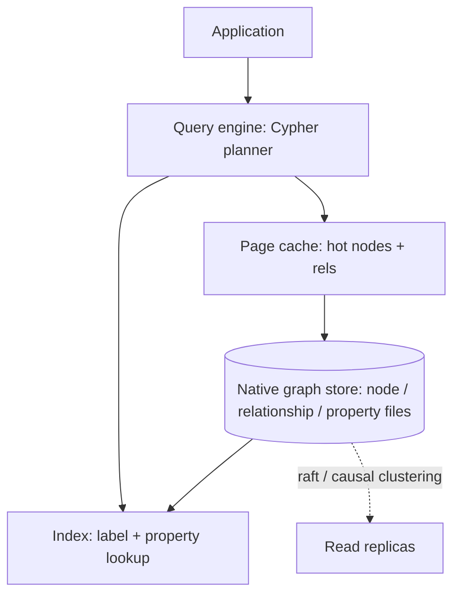

# Graph Database


## Youtube

- [Graph Databases Will Change Your Freakin' Life (Best Intro Into Graph Databases)](https://www.youtube.com/watch?v=GekQqFZm7mA)

## Introduction

A graph database stores nodes (entities), relationships (edges), and properties natively, making multi-hop traversals ("friends of friends who bought X") first-class operations instead of expensive recursive joins. Neo4j, Amazon Neptune, and TigerGraph dominate; SurrealDB and others add graph flavors.

Reach for one when the queries are about connections — fraud rings, recommendations, knowledge graphs, access-control hierarchies, network topology — and the relational version needs 5+ joins or recursive CTEs that get slower with depth.

## Theory / Core Concepts

### Property graph vs RDF

| Model | Structure | Query language | Best for |
|---|---|---|---|
| Property graph | Nodes + directed edges, both with key-value properties | Cypher, Gremlin, GSQL | Applications, recommendations, fraud |
| RDF triple store | Subject-predicate-object triples + ontologies | SPARQL | Knowledge graphs, linked data, reasoning |

Most interviews mean property graphs (Neo4j-style) when they say "graph DB".

### Why not recursive joins

A 4-hop "friends of friends of friends" query in SQL needs recursive CTEs whose cost explodes with fan-out. A graph DB stores adjacency with each node (index-free adjacency), so each hop is a pointer chase — O(degree) per hop regardless of total graph size.

### Storage patterns

- **Native graph storage** (Neo4j): nodes/records with direct relationship pointers; traversals never touch a global index.
- **Layered on KV/document** (some multi-model stores): edges as documents; simpler ops, slower deep traversals.

**Real-life scenario:** A fraud team models accounts, devices, and transactions as a graph; a new account sharing a device with three previously-flagged accounts is caught by a 2-hop traversal in milliseconds — the same check in SQL needed four joins over hundred-million-row tables and timed out.

## Architecture



| Component | Responsibility | Scaling note |
|---|---|---|
| Transaction log + checkpoints | Durability (like WAL) | Same replay-on-crash story |
| Page cache | Hot subgraph in RAM | Size for working set, not full graph |
| Causal clustering | Read replicas + core consensus | Writes on core, scale reads horizontally |
| Full-text / vector index | Entry-point lookup ("find start node") | Graph traversal starts from indexed anchors |

**Real-life scenario:** A social app keeps the 2-hop neighborhood of active users in page cache, routes writes to the 3-node core and feed reads to 5 replicas — p99 feed latency stays flat as reads scale 10×.

## Deep Dive / How it works

Write path: `CREATE`/`MERGE` appends node and relationship records with properties, updates label/property indexes, commits via transaction log. Relationship creation is O(1) pointer wiring — no join-table inserts, no foreign-key fan-out.

Read path: anchor (indexed label/property lookup, e.g., `MATCH (u:User {id: 42})`) → expand (follow relationship pointers hop by hop, filtering by type/direction/properties) → project/aggregate. The planner chooses expand direction by degree estimates; `PROFILE` shows estimated vs actual rows per hop — cardinality misestimates compound exactly like relational misestimates.

Supernodes (a celebrity with 50M followers, a popular product) are the classic pathology: traversals touching them explode. Mitigations include degree caps, time-windowed edges, relationship partitioning, and bidirectional BFS from both ends.

**Real-life scenario:** A recommendation query slows from 40 ms to 4 s after a viral product becomes a supernode; the team adds a `RECENT` edge window (only last-90-day purchases traversed) plus a degree-aware planner hint, restoring latency without changing results users see.

## Practical Examples

```cypher
-- Anchor on an indexed property, traverse 2 hops, rank
MATCH (u:User {id: 42})-[:PURCHASED]->(p:Product)<-[:PURCHASED]-(other:User)
MATCH (other)-[:PURCHASED]->(rec:Product)
WHERE NOT (u)-[:PURCHASED]->(rec)
RETURN rec.name, count(*) AS bought_together
ORDER BY bought_together DESC
LIMIT 10;
```

```cypher
-- Fraud ring: accounts sharing devices within 2 hops of a flagged account
MATCH (flagged:Account {flagged: true})-[:USES_DEVICE|SHARES_IP*1..2]-(suspect:Account)
WHERE suspect <> flagged
RETURN suspect.id, count(*) AS signals
ORDER BY signals DESC;
```

```cypher
-- Shortest path for access or routing questions
MATCH path = shortestPath(
  (a:Employee {id: 7})-[:REPORTS_TO*1..10]->(ceo:Employee {title: 'CEO'})
)
RETURN [n IN nodes(path) | n.name] AS chain, length(path) AS hops;
```

```bash
# Sanity checks worth running before blaming the database
# 1. Is the anchor indexed?  2. PROFILE the hop fan-out
echo "CREATE INDEX user_id IF NOT EXISTS FOR (u:User) ON (u.id);"
```

## Interview Questions

- **Q: When does a graph DB beat Postgres for connected data?**
  A: When queries traverse 3+ hops with selective anchors — index-free adjacency makes each hop O(degree) instead of join cost that grows with table size and depth.
- **Q: What is index-free adjacency?**
  A: Each node physically stores pointers to its relationships, so traversal is pointer chasing from the start node rather than global index lookups per hop.
- **Q: What is a supernode and how do you handle it?**
  A: A node with extreme degree that blows up traversals. Mitigate with degree caps, time-windowed edges, bidirectional search, and separating hot edges from traversal paths.
- **Q: How do you enter the graph — can you traverse without an index?**
  A: You need an anchor: a label/property or full-text/vector index locates start nodes, then traversal proceeds by pointers. Unanchored full-graph scans are the graph equivalent of full table scans.
- **Q: Sketch fraud detection in a system-design answer.**
  A: Stream transactions/edges into the graph, run periodic 1–3 hop pattern queries (shared device/IP/account, velocity fan-out), score and push to a review queue; mention supernode guards and read-replica scaling.

## Summary

1. Graph DBs make relationship hops O(degree) via index-free adjacency — depth is cheap, anchors matter.
2. Property graphs + Cypher cover most app cases; RDF/SPARQL covers ontology reasoning.
3. Every fast query starts at an indexed anchor; profile hop fan-out like join cardinality.
4. Supernodes are the #1 production pathology — bound degree explicitly.
5. Choose graphs for connection queries, keep tabular/aggregate workloads in relational or columnar stores.
