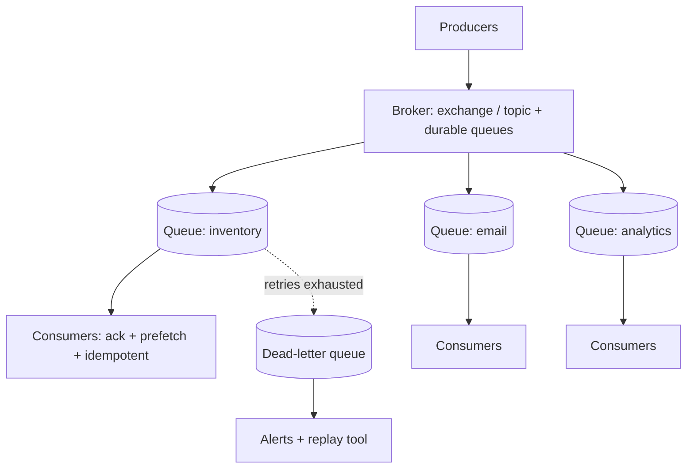

# Queue System


## Youtube


### Message Queues

- [Message Queues in System Design Interviews w/ Meta Staff Engineer](https://www.youtube.com/watch?v=1ISRd0bS714)
- [Master Queues | System Design Interview](https://www.youtube.com/watch?v=2tCfITBVKjA)


### Comparisions

- [Kafka vs RabbitMQ](https://www.youtube.com/watch?v=1HOVtQ-_fcE)
- [The Best Queue System for Scaling - Not Kafka!](https://www.youtube.com/watch?v=xVkMrozIBpg)
- [What is a Message Queue and When should you use Messaging Queue Systems Like RabbitMQ and Kafka](https://www.youtube.com/watch?v=W4_aGb_MOls)
- [When to Use Kafka or RabbitMQ | System Design](https://www.youtube.com/watch?v=w8xWTIFU4C8)
- [Kafka vs. RabbitMQ - who wins and why? | Systems Design Interview 0 to 1 with Ex-Google SWE](https://www.youtube.com/watch?v=_5mu7lZz5X4)

## Introduction

A message queue decouples producers from consumers in time, topology, and speed: producers append, the broker durably buffers, consumers process at their own pace with retries. The payoff is resilience (traffic spikes buffer instead of cascading), independent scaling, and clean failure isolation between services.

Use queues when work can be asynchronous — order processing, emails, ETL, webhook delivery. Keep synchronous request/response for reads needing immediate consistency or sub-100 ms user-facing latency.

## Theory / Core Concepts

### Queue vs log vs pub/sub

| Pattern | Model | Replay | Best for |
|---|---|---|---|
| Point-to-point queue | Each message → one consumer | Ack removes | Task distribution, RPC |
| Log (Kafka) | Append-only partitions, offsets | Rewind/replay any offset | Event sourcing, stream processing |
| Pub/sub topic | Each message → all subscribers | Depends on retention | Notifications, cache invalidation |

### Delivery semantics

- **At-most-once**: fast, may lose. Metrics, best-effort signals.
- **At-least-once**: ack + redelivery, may duplicate. The sane default — pair with idempotent consumers.
- **Exactly-once**: transactions/idempotence scoped to one system (Kafka EOS). True end-to-end exactly-once needs idempotency keys at the sink.

### Ordering, retries, dead letters

Ordering is per-partition/per-queue with a single active consumer group — global ordering and horizontal scale conflict, so scope ordering keys narrowly (per user, per order). Retries need backoff + jitter + a cap, then a dead-letter queue with alerting and replay tooling, or one poison message stalls everything.

**Real-life scenario:** A checkout flow publishes `payment.authorized` once; inventory, email, and analytics consume independently with idempotency keys on `order_id`. A duplicate redelivery after a consumer crash debits nothing twice — the key makes at-least-once behave exactly-once.

## Architecture



| Decision | Options | Rule of thumb |
|---|---|---|
| Broker | RabbitMQ / Kafka / SQS / Pulsar | Routing richness → RabbitMQ; replay + throughput → Kafka; managed simplicity → SQS |
| Durability | Persistent + confirms | Always on for money/mutations |
| Consumption | Push vs poll, prefetch | Bound unacked work (prefetch/MAX poll) |
| Failure path | DLQ + cap + alert | Design before the first incident |

**Real-life scenario:** A flash sale spikes checkouts 20×; the queue absorbs the burst, inventory consumers autoscale on queue depth, and p99 checkout latency stays flat — without the buffer, the inventory DB would have fallen over in the first minute.

## Deep Dive / How it works

Publish path: producer sends with durability flags → broker routes (exchange binding / topic partition) → fsync per persistence settings → confirm/ack back. No confirm means "accepted by TCP", not "stored".

Consume path: broker delivers up to prefetch → handler runs business logic → ack deletes, nack redelivers, reject routes to DLQ. Visibility timeouts (SQS) and session heartbeats (Kafka) detect crashed consumers; tune them shorter than the business SLA but longer than p99 processing time, or healthy work redelivers spuriously.

Backpressure is the design center: bounded queues + consumer autoscaling on depth/age + load shedding (reject with `Retry-After` upstream) + circuit breakers. An unbounded buffer just moves the OOM from the service to the broker.

**Real-life scenario:** An image-resize queue uses visibility timeout 5 min (p99 job 90 s) plus a 3-retry cap to DLQ; a bad image that segfaults workers lands in quarantine with its payload id after 15 minutes instead of wedging the queue all night.

## Practical Examples

```python
# Idempotent consumer sketch (works on any broker)
seen = set()  # prod: Redis/Dynamo with TTL on the idempotency key

def handle(msg):
    key = msg["order_id"]
    if not seen_add(key):   # SETNX semantics
        return "duplicate-skip"
    debit_inventory(msg)
    send_email(msg)
```

```bash
# Kafka: durable topic + consumer group with bounded fetch
kafka-topics.sh --bootstrap-server localhost:9092 --create \
  --topic orders --partitions 12 --replication-factor 3 \
  --config min.insync.replicas=2 --config retention.ms=604800000

kafka-console-consumer.sh --bootstrap-server localhost:9092 \
  --topic orders --group inventory-svc \
  --from-beginning --max-messages 5
```

```bash
# RabbitMQ: durable topology with dead-lettering
rabbitmqadmin declare exchange name=orders type=topic durable=true
rabbitmqadmin declare queue name=orders.inventory durable=true \
  arguments='{"x-dead-letter-exchange":"orders.dlx"}'
rabbitmqadmin declare binding source=orders destination=orders.inventory routing_key="order.*"
```

## Interview Questions

- **Q: Why put a queue between services instead of direct HTTP calls?**
  A: Time/topology/speed decoupling: bursts buffer, consumers scale and deploy independently, and one slow downstream stops cascading into timeouts upstream.
- **Q: How do you choose between RabbitMQ and Kafka?**
  A: RabbitMQ for routing flexibility, per-message acks, moderate throughput; Kafka for replayable high-throughput logs and stream processing. Often both: RabbitMQ for tasks, Kafka for events.
- **Q: How do you get effectively-exactly-once processing?**
  A: At-least-once delivery + idempotent consumers (dedupe keys at the sink) + transactional produce where the broker supports it. No magic — the sink idempotency is the load-bearing piece.
- **Q: What breaks with one poison message?**
  A: Infinite redelivery head-of-line-blocks the partition/queue. Fix: retry cap with exponential backoff + jitter, then DLQ quarantine with alerts and replay.
- **Q: How do you preserve order and still scale?**
  A: Order per key (user/order id → partition/routing key) with one active consumer per partition; scale by key cardinality, not by abandoning ordering.
- **Q: Sketch checkout with a queue under flash-sale load.**
  A: API validates → publishes `order.created` → broker buffers burst → inventory/email/analytics consume independently with prefetch bounds → autoscale on queue depth/age → DLQ + idempotency keys for safety.

## Summary

1. Queues buy decoupling, buffering, and isolated failure — the backbone of async system design.
2. Default to at-least-once + idempotent consumers; exactly-once is scoped, not universal.
3. Order per key, retry with cap + backoff, quarantine to DLQ with replay.
4. Bound everything (prefetch, visibility timeout, queue depth) and autoscale on age/depth.
5. RabbitMQ for routing, Kafka for replayable scale, managed queues for simplicity — match the broker to the pattern.
