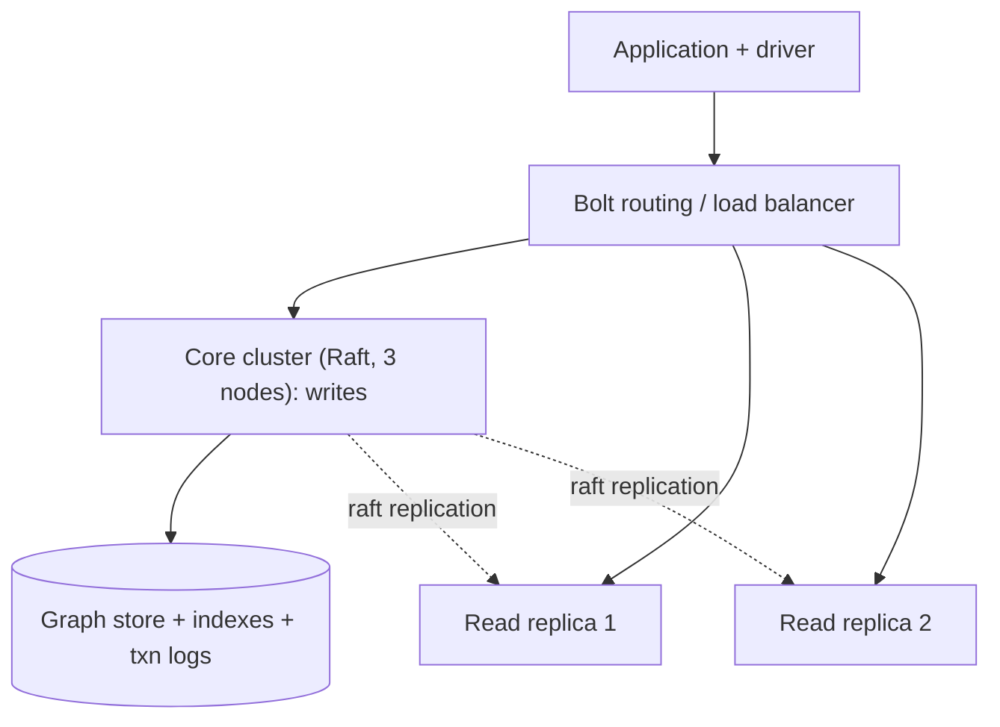

# Neo4j


## Documentation

### Official documentation

- [Querying with Cypher](https://neo4j.com/developer/cypher/querying/)
- [Core concepts](https://neo4j.com/docs/cypher-manual/current/queries/concepts/)


### neo4j migrations 

- [official documentation](https://neo4j.com/labs/neo4j-migrations/2.0/introduction/)
- [Migrating Neo4J graph schemas in managed Kubernetes](https://www.youtube.com/watch?v=P-XkvEHPXKQ)


## Youtube

- [Intro to Graph Databases Series](https://www.youtube.com/playlist?list=PL9Hl4pk2FsvWM9GWaguRhlCQ-pa-ERd4U)
- [Neo4j Course for Beginners](https://www.youtube.com/watch?v=_IgbB24scLI)

## Introduction

Neo4j is the reference native property-graph database: nodes, relationships, and properties stored with index-free adjacency, queried in Cypher, with causal clustering for HA and Bloom/Browser for visualization. It is the default answer for "we need a graph database" in interviews and in production alike.

Use it for connected-data workloads — recommendations, fraud rings, identity resolution, access graphs, knowledge graphs — where traversals beat joins. See [Graph Database](./graph-database.md) for the general model; this page is Neo4j-specific operations and Cypher.

## Theory / Core Concepts

### Data model recap

`(person:Person {id: 7})-[:FOLLOWS {since: 2024}]->(friend:Person)`: labels group nodes, relationship types direct edges, properties live on both. Multiple labels per node, multiple properties per relationship — schema-optional with constraints added deliberately.

### Indexes and constraints

| Feature | Syntax | Purpose |
|---|---|---|
| Range index | `CREATE INDEX FOR (u:User) ON (u.email)` | Anchor lookups |
| Full-text index | `CREATE FULLTEXT INDEX ... FOR (p:Post) ON EACH [p.title]` | Text entry points |
| Vector index (5.x) | `CREATE VECTOR INDEX ... OPTIONS {dimensions: 384}` | Semantic anchors + hybrid search |
| Uniqueness | `CREATE CONSTRAINT FOR (u:User) REQUIRE u.id IS UNIQUE` | Identity + upsert safety |
| Existence / type | `REQUIRE u.email IS NOT NULL` | Application invariants in the DB |

### Transactions and clustering

Single-node ACID transactions; causal clustering (3+ core members via Raft) gives HA with read replicas scaling horizontally. Bookmark chaining (`dbms.routing` + bookmarks) provides read-your-write across the cluster.

**Real-life scenario:** A fraud team adds `CREATE CONSTRAINT FOR (a:Account) REQUIRE a.id IS UNIQUE` before backfilling, so concurrent ingestion jobs `MERGE` safely on account id instead of creating duplicate nodes that later corrupt ring queries.

## Architecture



| Component | Responsibility | Scaling note |
|---|---|---|
| Core members | Writes + consensus | Keep at 3–5; never scale writes by adding cores |
| Read replicas | Scale traversal reads | Add freely; mind replication lag for fresh writes |
| Page cache | Hot subgraph in RAM | Size for active working set |
| Bloom / Browser | Exploration + stakeholder demos | Great for query development, not prod access |

**Real-life scenario:** A recommendations API routes writes to the core and feed reads to six replicas with bookmark-aware sessions — users see their own new follows immediately while read throughput scales past 50k qps.

## Deep Dive / How it works

Write path: Cypher `CREATE`/`MERGE` → constraint validation → transaction log append → page-cache mutation → commit + Raft replication to core majority. `MERGE` is match-or-create in one atomic step — the idempotent ingestion primitive.

Read path: planner anchors on the most selective index (or vector/full-text entry point) → expands relationship pointers hop by hop → filters, aggregates, projects. `PROFILE` exposes estimated vs actual rows per operator; a 100× misestimate at hop 2 compounds into seconds of wasted expansion — add or rewrite the anchor before touching the traversal.

Supernode defense in Neo4j specifically: degree caps in the pattern (`-[r:BOUGHT]->` with `WHERE size((p)<-[:BOUGHT]-()) < 100000`), time-windowed relationship types (`BOUGHT_2026`), bidirectional `shortestPath`, and APOC batching for backfills (`apoc.periodic.iterate`) so billion-edge loads don't blow the heap.

**Real-life scenario:** A backfill creating 200M edges OOMs on one giant transaction; rewriting it as `apoc.periodic.iterate` batches of 50k with periodic commit finishes in 40 minutes with flat heap — batching is the production ingestion pattern.

## Practical Examples

```cypher
-- Upsert-safe ingestion with constraints
MERGE (u:User {id: 42})
ON CREATE SET u.name = 'Ava', u.created = date()
ON MATCH SET u.lastSeen = date();
```

```cypher
-- Recommendations: friends-of-friends products, anchored and ranked
MATCH (me:User {id: 42})-[:FOLLOWS]->(f:User)-[:BOUGHT]->(p:Product)
WHERE NOT (me)-[:BOUGHT]->(p)
RETURN p.name, count(*) AS score
ORDER BY score DESC
LIMIT 10;
```

```cypher
-- Fraud ring expansion with a degree guard
MATCH (a:Account {id: 'a-1'})-[r:TRANSFER*1..3]-(b:Account)
WHERE size((b)-[:TRANSFER]-()) < 5000
RETURN b.id, length(r) AS hops, count(*) AS paths
ORDER BY paths DESC
LIMIT 20;
```

```bash
# Operate it: backup, check consistency, run migrations versioned
neo4j-admin database backup --to-path=/backups neo4j
neo4j-admin database check-consistency --database=neo4j
# neo4j-migrations: versioned Cypher changelogs in CI, applied in order
```

## Interview Questions

- **Q: `MATCH` vs `MERGE` vs `CREATE`?**
  A: `MATCH` finds, `CREATE` always inserts, `MERGE` matches or creates atomically — use `MERGE` with uniqueness constraints for idempotent ingestion.
- **Q: How do you make traversals fast?**
  A: Selective indexed anchor first, expand by lowest-degree direction, filter early, cap supernodes, and `PROFILE` every hop's cardinality.
- **Q: Core vs read replica — where do writes go?**
  A: Writes to core members (Raft majority); reads fan out to replicas. Scale reads by adding replicas; never by adding cores.
- **Q: How do you load a billion edges without OOM?**
  A: `apoc.periodic.iterate` in 10–100k batches with periodic commit, indexes/constraints created first, parallel where the graph structure allows.
- **Q: How do migrations work in Neo4j?**
  A: Versioned Cypher changelogs (neo4j-migrations) applied in order via CI — same expand-contract discipline as relational migrations.

## Summary

1. Neo4j = native property graph + Cypher + causal clustering; the default graph answer.
2. Anchor on indexes/constraints, then traverse; `PROFILE` hop fan-out like join cardinality.
3. `MERGE` + uniqueness constraints make ingestion idempotent.
4. Cores take writes, replicas take reads; batch backfills with APOC.
5. Bound supernodes explicitly — viral nodes are a correctness-of-latency issue, not just data.
