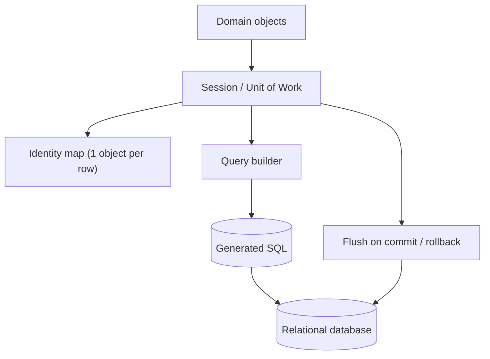

# Object Relationship Model(ORM)


## Youtube

- [I Would Never Use an ORM, by Matteo Collina](https://www.youtube.com/watch?v=qfRQ5zhYuJE)

## Introduction

An ORM (Object-Relational Mapper) maps classes to tables and objects to rows, so application code works with `user.orders` instead of hand-written `JOIN`s. SQLAlchemy, Hibernate/JPA, Django ORM, Prisma, TypeORM, and ActiveRecord dominate. It is a productivity layer: schema migrations, query building, identity maps, and unit-of-work come bundled.

Use one when domain logic is object-shaped and CRUD-heavy; drop to raw SQL or a query builder for hot paths, bulk loads, and reporting queries where the abstraction hides cost.

## Theory / Core Concepts

### What the ORM actually does

| Concern | ORM handling | Leaks when |
|---|---|---|
| Mapping | Class ↔ table, field ↔ column, relations ↔ FK | Composite keys, legacy schemas |
| Identity map | One object per row per session | Stale reads across sessions |
| Unit of work | Batches inserts/updates, flushes on commit | Surprise write bursts at flush |
| Lazy vs eager loading | Loads relations on access or up front | N+1 queries, cartesian explosion |
| Migrations | Versioned DDL from model diffs | Data backfills, zero-downtime renames |

### Lazy loading and the N+1 problem

```python
# N+1: 1 query for users + N queries for orders
users = session.query(User).all()
for u in users:
    print(u.orders)  # lazy load fires one SELECT per user
```

```python
# Fix: eager load in 1-2 queries
users = session.query(User).options(selectinload(User.orders)).all()
```

| Strategy | Queries | Risk |
|---|---|---|
| Lazy | 1 + N | N+1 latency death |
| Joined eager | 1 with JOIN | Row multiplication, wide rows |
| Select-in eager | 2 (parents + children IN) | Usually the sweet spot |
| Explicit batch | 2 with manual mapping | Most control |

**Real-life scenario:** A Django list endpoint slows from 80 ms to 4 s at 500 rows because the template touches `order.customer.name` per row; adding `select_related`/`prefetch_related` collapses 1001 queries to 2 with identical output.

## Architecture



| Layer | Responsibility | Interview note |
|---|---|---|
| Models | Schema + relations + validations | Fat-model vs anemic trade-off |
| Session | Change tracking, flush ordering | Flush ≠ commit; know both |
| Migrations | Versioned DDL + rollbacks | Expand-contract for zero downtime |
| Cache (L1/L2) | Identity map + optional shared cache | Invalidation is the hard part |

**Real-life scenario:** A checkout service keeps business rules in models, runs writes through one request-scoped session with explicit commit, and routes a slow admin report to raw SQL — the ORM owns the domain, SQL owns the analytics.

## Deep Dive / How it works

Write path: mutate objects → session tracks dirty state → `flush()` topologically orders INSERT/UPDATE/DELETE (parents before children, nullables deferred) → single transaction commit. Bulk inserts bypass this (use `bulk_save_objects` / `COPY` / batch JDBC) because per-object bookkeeping is O(n) Python/Java overhead.

Read path: query builder emits SQL → rows hydrated into objects → identity map dedupes → lazy proxies queue follow-ups. The planner you must carry in your head: every dot-access on an unloaded relation is a potential query; every eager join multiplies rows. `EXPLAIN` the generated SQL, not the Python.

Failure modes: stale reads across sessions (identity map is per-session, not global), lost updates without optimistic locking (`version` column + `WHERE version = ?`), migration locks (`ALTER TABLE` rewriting billion-row tables), and connection-pool exhaustion from long sessions holding connections.

**Real-life scenario:** Two admins edit the same product; without a `version` column the second save silently overwrites the first. Adding optimistic locking turns it into a clean 409 conflict with a retry prompt instead of lost data.

## Practical Examples

```python
# SQLAlchemy: explicit session, eager loading, optimistic locking
from sqlalchemy import Column, Integer, String, ForeignKey, select
from sqlalchemy.orm import relationship, selectinload, Session

class User(Base):
    __tablename__ = "users"
    id = Column(Integer, primary_key=True)
    name = Column(String, nullable=False)
    version_id = Column(Integer, nullable=False, default=1)
    orders = relationship("Order", back_populates="user")
    __mapper_args__ = {"version_id_col": version_id}

with Session(engine) as s:
    users = s.execute(
        select(User).options(selectinload(User.orders)).limit(100)
    ).scalars().all()
```

```python
# Zero-downtime rename: expand then contract across two deploys
# Deploy 1: add new column, dual-write, backfill
# Deploy 2: switch reads, drop old column
# Alembic sketch
def upgrade():
    op.add_column("users", sa.Column("display_name", sa.String(), nullable=True))
```

```sql
-- What to check when the ORM is slow: read the generated SQL
EXPLAIN (ANALYZE, BUFFERS)
SELECT users.*, orders.* FROM users LEFT JOIN orders ON orders.user_id = users.id;
-- look for: seq scans on hot filters, missing index on FK, row explosion
```

## Interview Questions

- **Q: What is the N+1 problem and how do you fix it?**
  A: One query for parents plus one per child via lazy loading. Fix with joined/select-in eager loading or explicit batching; verify with a query counter in tests.
- **Q: When should you bypass the ORM?**
  A: Bulk loads, complex reporting/aggregations, recursive queries, and latency-critical hot paths — anywhere generated SQL hides cost or the abstraction adds O(n) overhead.
- **Q: How does optimistic locking work?**
  A: A `version` column checked in `UPDATE ... WHERE id = ? AND version = ?`; a mismatch raises a concurrency error instead of silently overwriting.
- **Q: ORM session vs database transaction?**
  A: The session tracks object changes; flush writes SQL; commit commits the DB transaction. Holding sessions open holds connections — keep them request-scoped.
- **Q: How do you rename a column with zero downtime?**
  A: Expand-contract: add new column, dual-write, backfill, switch reads, drop old — across two deploys, never a single rewriting `ALTER` on a hot table.
- **Q: Defend or critique ORMs in a system-design answer?**
  A: ORMs win on velocity and consistency for domain writes; raw SQL/query builders win on bulk, reporting, and hot paths. Mature answer: ORM by default, SQL escape hatch measured, N+1 tests enforced.

## Summary

1. ORMs map objects to rows with identity map + unit of work — productivity for domain writes.
2. N+1 is the #1 pathology: eager-load deliberately, count queries in tests.
3. Flush ≠ commit; sessions are request-scoped and hold connections.
4. Optimistic locking prevents silent overwrites; expand-contract enables safe migrations.
5. Default to the ORM for the domain, drop to SQL for bulk, reporting, and hot paths.
