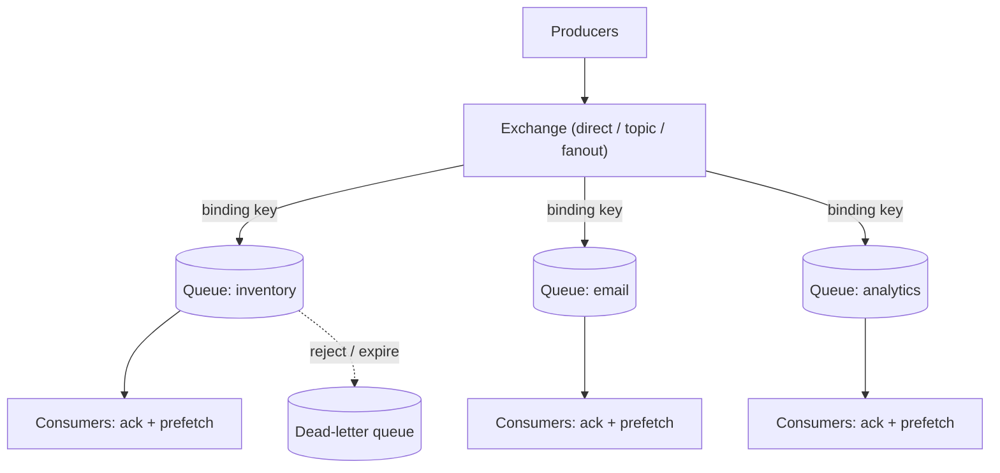

# RabbitMQ


## Blogs

- [RabbitMQ: A Complete Guide to Message Broker, Performance, and Reliability](https://medium.com/@erickzanetti/rabbitmq-a-complete-guide-to-message-broker-performance-and-reliability-3999ee776d85)


## Youtube


### Deployment

- [RabbitMQ beginners guide](https://www.youtube.com/playlist?list=PLHq1uqvAteVswmKZovQrqFfJ74ndV6xSL)

## Introduction

RabbitMQ is a general-purpose message broker speaking AMQP (plus MQTT/STOMP plugins): producers publish to exchanges, bindings route to queues, consumers acknowledge. It excels at flexible routing, per-message acknowledgments, and operational simplicity for task queues, RPC, and event distribution at moderate throughput.

Pick RabbitMQ when routing logic (topics, headers, delayed, dead-letter flows) and broker-managed delivery guarantees matter more than raw log throughput — the complement to Kafka, not its clone.

## Theory / Core Concepts

### Exchanges, bindings, queues

| Exchange type | Routes by | Use for |
|---|---|---|
| Direct | Exact routing key | Task queues per type |
| Fanout | Broadcast to all bound queues | Notifications, cache invalidation |
| Topic | `*.critical.#` patterns | Log levels, multi-tenant events |
| Headers | Header key-values (no key needed) | Content-based routing |
| Consistent-hash / plugins | Hash spread | Work distribution |

### Delivery semantics

- **Ack modes**: auto-ack (fast, lossy) vs manual ack (at-least-once with redelivery).
- **Durability**: durable exchange + durable queue + persistent delivery mode — all three, or a restart eats messages.
- **Prefetch (`basic.qos`)**: caps unacked messages per consumer; the fairness knob that prevents one slow consumer hoarding work.
- **Dead-letter exchanges (DLX)**: rejected/expired/overflowed messages route to a quarantine queue for inspection and replay.

**Real-life scenario:** An order pipeline publishes `order.created` to a topic exchange; bindings fan out to inventory, email, and analytics queues, each with its own retry/DLX policy — one publish, three independent consumers with isolated failure handling.

## Architecture



| Component | Responsibility | Scaling note |
|---|---|---|
| Virtual hosts | Tenancy + permissions boundary | One vhost per service/domain |
| Classic vs quorum queues | Classic = speed; quorum = Raft safety | Quorum for anything you cannot afford to lose |
| Mirroring / clustering | HA across nodes | Quorum queues replace old mirroring |
| Management UI + Prometheus | Queue depth, publish/ack rates | Alert on depth growth, not just consumer count |

**Real-life scenario:** A payments team runs quorum queues with producers confirms on, consumers manual-ack with prefetch 10, and depth/latency alerts — a consumer deploy that slows processing pages before the queue becomes a swamp.

## Deep Dive / How it works

Publish path: channel → exchange match → routed copies appended to bound queues (durable → fsync per persistence settings) → publisher confirm (`confirm.select`) asynchronously acks. No confirm = "sent to TCP", not "stored".

Consume path: broker pushes (or consumer polls) up to prefetch → handler processes → `basic.ack` removes; `nack(requeue)` redelivers, `reject` without requeue plus DLX policy quarantines. Poison messages need a retry cap + DLX, otherwise one bad payload redelivers forever and head-of-line-blocks the queue.

Failure story: node loss with classic queues loses unmigrated messages; quorum queues keep majority-confirmed messages with minutes-scale leader re-election. Split-brain demands operator policy (pause-minority) — decide before the partition, not during.

**Real-life scenario:** A PDF-render queue without DLX gets one corrupt file that crashes every worker; redelivery loops burn CPU for an hour. After adding 5-retry cap → DLX + alerting, the sixth failure quarantines the file and pages with the payload id attached.

## Practical Examples

```bash
# Declare topology once (durable exchange + queues + DLX), then publish persistent
rabbitmqadmin declare exchange name=orders type=topic durable=true
rabbitmqadmin declare queue name=orders.inventory durable=true \
  arguments='{"x-dead-letter-exchange":"orders.dlx"}'
rabbitmqadmin declare binding source=orders destination=orders.inventory routing_key="order.*"
```

```python
# Producer: confirms on, persistent delivery
import pika
params = pika.ConnectionParameters("localhost")
conn = pika.BlockingConnection(params)
ch = conn.channel()
ch.confirm_delivery()
ch.basic_publish(exchange="orders", routing_key="order.created",
                 body=b'{"id": 9001}', properties=pika.BasicProperties(delivery_mode=2))
```

```python
# Consumer: manual ack, bounded prefetch, DLX on repeated failure
ch.basic_qos(prefetch_count=10)
def on_msg(ch, method, props, body):
    try:
        handle(body)
        ch.basic_ack(delivery_tag=method.delivery_tag)
    except TransientError:
        ch.basic_nack(delivery_tag=method.delivery_tag, requeue=True)
    except Exception:
        ch.basic_nack(delivery_tag=method.delivery_tag, requeue=False)  # -> DLX
ch.basic_consume(queue="orders.inventory", on_message_callback=on_msg)
```

## Interview Questions

- **Q: RabbitMQ vs Kafka in one minute?**
  A: RabbitMQ = smart broker, flexible routing, per-message acks, moderate throughput; Kafka = dumb-fast log, replayable partitions, huge throughput. Routing complexity favors RabbitMQ; event sourcing at scale favors Kafka.
- **Q: How do you guarantee a message survives a broker restart?**
  A: Durable exchange + durable queue + persistent (`delivery_mode=2`) messages + publisher confirms — miss any one and loss is possible.
- **Q: What does prefetch control and what breaks without it?**
  A: Max unacked messages per consumer. Unbounded prefetch lets one fast consumer grab everything while others idle, and a crash redelivers a mountain.
- **Q: How do you handle poison messages?**
  A: Retry counter (header/x-death) with a cap, then reject to a DLX quarantine queue with alerting and a replay tool — never infinite requeue.
- **Q: Classic vs quorum queues?**
  A: Classic for max speed/tolerable loss; quorum (Raft) for safety and HA. New durable workloads should default to quorum.
- **Q: Sketch an order pipeline with failures considered.**
  A: Topic exchange → per-domain queues → manual ack + prefetch → retry with backoff → DLX quarantine → idempotent consumers (dedupe on order id) → depth/age alerts.

## Summary

1. Exchanges route, queues buffer, consumers acknowledge — design all three deliberately.
2. Durability is a trio (exchange + queue + persistent + confirms); partial durability is no durability.
3. Prefetch bounds blast radius; DLX bounds poison damage.
4. Quorum queues for anything valuable; classic only where loss is acceptable.
5. Idempotent consumers + depth alerting turn the broker from a hope into a system.
