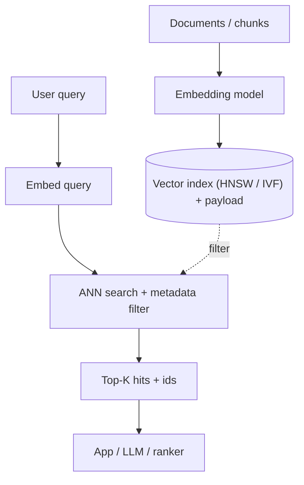

# Vector Database


## Youtube

- [The Power of Vector Databases For Knowledge Search](https://www.youtube.com/watch?v=awIm3rQOBxE)
- [Vector databases are so hot right now. WTF are they?](https://www.youtube.com/watch?v=klTvEwg3oJ4)


## Medium

- [The Simplified Introduction of Vector Databases](https://medium.com/@dwivedi.ankit21/the-simplified-introduction-of-vector-databases-d1d9c22ea828)

## Introduction

A vector database stores high-dimensional embeddings (arrays of floats produced by ML models) and answers nearest-neighbor queries — "find the 10 documents most similar to this query" — at scale. It is the memory layer behind semantic search, RAG chatbots, recommendation engines, and image/audio similarity search.

Use one when ranking by meaning or similarity matters more than exact keyword match or relational joins. Keep ground-truth records in your primary database; store embeddings plus a pointer (document id) in the vector store.

## Theory / Core Concepts

### Embeddings

An embedding maps text, images, or audio to a dense vector (e.g., 384–3072 dimensions) where distance ≈ semantic dissimilarity. Same meaning, different wording → nearby vectors. Common models: sentence-transformers, OpenAI `text-embedding-3-*`, Cohere embed, CLIP for images.

### Distance metrics

| Metric | Formula idea | When to use |
|---|---|---|
| Cosine similarity | Angle between vectors (normalized) | Text search, most RAG setups |
| Euclidean (L2) | Straight-line distance | Image embeddings, clustering |
| Dot product | Unnormalized alignment | Retrieval with trained bi-encoders |
| Hamming | Bit differences | Binary/quantized vectors |

Pick the metric your embedding model was trained with — mismatching metric and model silently degrades recall.

### Approximate Nearest Neighbor (ANN)

Exact search is O(n·d) per query — impossible at millions of vectors. ANN indexes trade a few percent recall for 100–1000× speedups:

- **HNSW** (Hierarchical Navigable Small World): graph-based, best recall/latency balance, higher memory. Default choice (pgvector, Qdrant, Weaviate, Pinecone).
- **IVF** (Inverted File Index): partitions space into clusters, probes top-k clusters. Lower memory, needs training step (FAISS, Milvus).
- **PQ** (Product Quantization): compresses vectors into codes. Massive memory savings, slight recall loss; often combined as IVF-PQ.
- **LSH** (Locality-Sensitive Hashing): hash collisions ≈ similarity. Simple, rarely best today.

### Metadata filtering

Production queries are hybrid: "top-10 similar support tickets from tenant X, filed this year." The store must combine vector similarity with scalar filters (`tenant_id = ? AND year = ?`). Pre-filtering (filter then search) vs post-filtering (search then filter) changes recall — prefer engines with native pre-filtered HNSW.

**Real-life scenario:** A help-desk RAG bot embeds 2M past tickets with a 768-dim model, stores them in HNSW with a `tenant_id` payload filter, and answers new questions by retrieving the 8 most similar same-tenant tickets as LLM context — cutting hallucinations because the model grounds on real tickets.

## Architecture



| Component | Responsibility | Scaling note |
|---|---|---|
| Chunker | Splits docs into retrievable units | Chunk size ~200–800 tokens typical |
| Embedder | Query + doc vectors in same space | GPU batch for backfill, CPU ok for queries |
| Index | ANN structure + payload store | Shard by tenant or collection past ~10–50M vectors |
| Ranker (optional) | Cross-encoder re-rank of top-K | Rerank top-50 → top-5 for quality wins |

**Real-life scenario:** An e-commerce site shards its 40M product vectors by category, keeps HNSW `ef_search` tuned for p99 < 50 ms, and re-ranks the top-30 with a cross-encoder — search feels instant while conversion-relevant ranking stays high quality.

## Deep Dive / How it works

Write path: chunk → embed → insert vector with payload (`doc_id`, `tenant_id`, `ts`). HNSW inserts walk the layered graph and link the new node to its nearest neighbors per layer — O(log n). IVF instead assigns the vector to the nearest centroid.

Read path: embed query → enter graph at top layer → greedy walk down to `ef_search` candidates → score exact distances → apply payload filter (pre-filter prunes the graph walk; post-filter over-fetches then discards) → return top-K with scores.

Trade-offs worth internalizing: higher `M` (graph degree) and `ef_construction` raise recall and build cost; higher `ef_search` raises recall and query latency. Quantization (PQ/scalar) cuts memory 4–8× at ~1–3 points of recall loss. Recall is measured against brute-force ground truth on a sample — always benchmark with your data, not vendor numbers.

**Real-life scenario:** A team chasing p99 latency halves `ef_search` from 200 to 100, loses 0.5% recall, and gains 35% latency headroom — an acceptable trade because the downstream LLM tolerates one slightly-off passage in eight.

## Practical Examples

```python
# Chunk, embed, upsert with Qdrant
from qdrant_client import QdrantClient
from qdrant_client.models import VectorParams, Distance, PointStruct

client = QdrantClient(host="localhost", port=6333)
client.recreate_collection(
    collection_name="tickets",
    vectors_config=VectorParams(size=768, distance=Distance.COSINE),
)

client.upsert(collection_name="tickets", points=[
    PointStruct(id=1, vector=[0.12, -0.03, 0.44, 0.01],
                payload={"tenant_id": "acme", "year": 2026}),
])
```

```python
# Filtered similarity search: same tenant, this year, top 5
hits = client.search(
    collection_name="tickets",
    query_vector=[0.11, -0.02, 0.43, 0.02],
    query_filter={"must": [
        {"key": "tenant_id", "match": {"value": "acme"}},
        {"key": "year", "match": {"value": 2026}},
    ]},
    limit=5,
)
for h in hits:
    print(h.id, round(h.score, 4), h.payload)
```

```sql
-- Same idea in Postgres with pgvector (HNSW + pre-filter)
CREATE EXTENSION vector;
CREATE TABLE docs (
  id bigserial PRIMARY KEY,
  tenant_id text NOT NULL,
  embedding vector(768) NOT NULL
);
CREATE INDEX ON docs USING hnsw (embedding vector_cosine_ops);

SELECT id, 1 - (embedding <=> '[0.11,-0.02,0.43,0.02]'::vector) AS score
FROM docs
WHERE tenant_id = 'acme'
ORDER BY embedding <=> '[0.11,-0.02,0.43,0.02]'::vector
LIMIT 5;
```

## Interview Questions

- **Q: Why not just store embeddings in Postgres as arrays and scan?**
  A: Brute-force distance over millions of high-dim vectors is O(n·d) per query — milliseconds become seconds. ANN indexes (HNSW/IVF) give ~100× speedups at ~99% recall.
- **Q: Cosine vs Euclidean — does it matter?**
  A: Yes: use the metric the embedding model trained with (usually cosine for text). Mixing metrics silently shifts rankings with no error raised.
- **Q: What is HNSW's `ef_search` trade-off?**
  A: Higher `ef_search` explores more candidates: better recall, higher latency. Tune it against a recall-vs-p99 curve on your own data.
- **Q: Pre-filter vs post-filter for tenant isolation?**
  A: Pre-filtering constrains the ANN walk to matching vectors (correct with small tenants); post-filtering over-fetches then discards (can return too few results for selective filters). Prefer native pre-filter support.
- **Q: How do you evaluate a vector-search setup?**
  A: Recall@K against brute-force ground truth on a sampled query set, plus p50/p99 latency and index memory — report all three, never recall alone.
- **Q: Where do vectors fit in a RAG system-design answer?**
  A: Ingest (chunk → embed → upsert with metadata) → retrieve (embed query → filtered ANN top-K → optional re-rank) → generate (LLM with cited passages). Mention chunking, metric choice, and freshness/invalidation.

## Summary

1. Vector DBs answer "most similar" queries over embeddings — the memory behind semantic search and RAG.
2. Match the distance metric to the embedding model; mismatches degrade recall silently.
3. HNSW is the default ANN index; tune `M`/`ef_*`, quantize when memory binds.
4. Native metadata pre-filtering is what makes multi-tenant vector search correct.
5. Evaluate with recall@K + p99 latency + memory on your own data, and keep ground truth in the primary DB.
