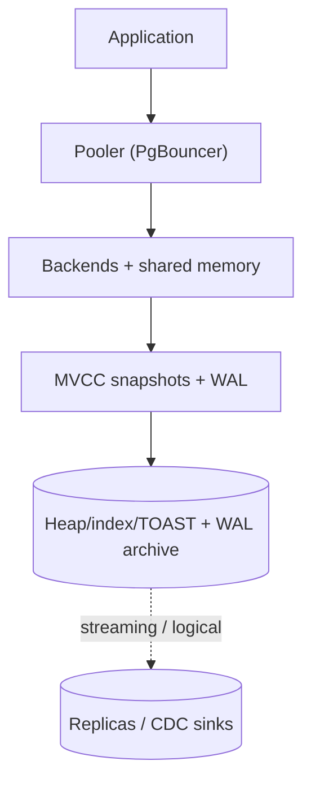

# PostgreSQL Internals

A deep, implementation-oriented guide to **how PostgreSQL actually works** — processes, memory, storage, MVCC, VACUUM, WAL, execution, replication, and production architecture. For experienced backend engineers who already know SQL, transactions, and basic distributed systems.

## Learning Roadmap

```text
Architecture
    ↓
Connections
    ↓
Memory
    ↓
Storage
    ↓
MVCC
    ↓
VACUUM
    ↓
WAL
    ↓
Write Path
    ↓
Checkpoints
    ↓
Indexes
    ↓
Query Execution
    ↓
Locks
    ↓
Transactions
    ↓
Replication
    ↓
Logical Replication / CDC
    ↓
Partitioning
    ↓
Performance
    ↓
Scaling
    ↓
Backup / Recovery
    ↓
Failure Scenarios
    ↓
Real-World Architecture
```

## Suggested Order

### Foundations

- [PostgreSQL Architecture](./postgresql-architecture.md) — processes, shared memory, background workers
- [PostgreSQL Connection Internals](./postgresql-connection-internals.md) — TCP → auth → backend → pooling
- [PostgreSQL Memory Architecture](./postgresql-memory-architecture.md) — shared vs private, work_mem accounting
- [PostgreSQL Storage Architecture](./postgresql-storage-architecture.md) — PGDATA, pages, TOAST, FSM/VM

### MVCC and Writes

- [MVCC Internals](./mvcc-internals.md) — xmin/xmax, snapshots, HOT, wraparound
- [VACUUM Internals](./vacuum-internals.md) — phases, autovacuum, bloat, freezing
- [WAL: Write-Ahead Logging](./wal.md) — records, flush, sync modes, retention
- [PostgreSQL Write Path](./postgresql-write-path.md) — INSERT/UPDATE/DELETE traces
- [Checkpoints and Background Writer](./checkpoints-background-writer.md) — redo pointer, spike tuning

### Execution

- [Index Internals](./index-internals.md) — B-tree, AMs, index-only scans, bloat
- [Query Execution Internals](./query-execution-internals.md) — parse → plan → execute, plan shapes
- [PostgreSQL Statistics](./postgresql-statistics.md) — ANALYZE, histograms, extended stats
- [Locks and Concurrency Internals](./locks-concurrency-internals.md) — modes, queues, deadlocks
- [Isolation and Transaction Internals](./isolation-transaction-internals.md) — levels, SSI, 2PC

### Distribution

- [Replication Internals](./replication-internals.md) — streaming, slots, sync modes, failover
- [Logical Replication](./logical-replication.md) — publications, identity, conflicts
- [Logical Decoding and CDC](./logical-decoding-cdc.md) — slots → Kafka pipelines
- [Partitioning Internals](./partitioning-internals.md) — routing, pruning, maintenance

### Operations

- [Tablespaces and Storage](./tablespaces-storage.md) — I/O isolation, device strategy
- [Temporary Files and Disk Usage](./temporary-files-disk-usage.md) — spill, temp tables
- [Parallel Query Internals](./parallel-query-internals.md) — Gather, workers, overhead
- [PostgreSQL Extensions](./postgresql-extensions.md) — packaging, lifecycle, security
- [Foreign Data Wrappers](./foreign-data-wrappers.md) — federation, pushdown
- [Monitoring PostgreSQL Internals](./monitoring-postgres-internals.md) — stats views, alerts
- [PostgreSQL Logging and Debugging](./postgresql-logging-debugging.md) — slow queries, lock waits
- [Configuration Internals](./configuration-internals.md) — precedence, reload vs restart
- [Backup and Recovery Internals](./backup-recovery-internals.md) — base + WAL, PITR, RPO/RTO
- [Crash Recovery Internals](./crash-recovery-internals.md) — REDO, torn pages
- [PostgreSQL Performance Internals](./postgresql-performance-internals.md) — bound-finding method

### Strategy

- [Why PostgreSQL Can Struggle With Write-Heavy Workloads](./why-postgres-struggles-with-writes.md) — amplification stack
- [PostgreSQL Scaling](./postgresql-scaling.md) — ladder: tune → pool → replicate → partition → shard
- [PostgreSQL as More Than a Database](./postgres-as-platform.md) — JSONB, PostGIS, queues, search
- [How PostgreSQL Can Replace Parts of a Tech Stack](./postgres-replacing-tech-stack.md) — consolidation recipes
- [Advanced PostgreSQL Features](./advanced-postgres-features.md) — RLS, types, FTS, triggers
- [PostgreSQL Security Internals](./postgresql-security-internals.md) — roles, TLS, RLS, auditing
- [PostgreSQL Source Code Architecture](./postgresql-source-code-architecture.md) — tree map, query trace
- [Important PostgreSQL System Catalogs](./postgresql-system-catalogs.md) — pg_class and friends

### Capstone

- [PostgreSQL Failure Scenarios](./postgresql-failure-scenarios.md) — 20 incidents with runbooks
- [Real-World PostgreSQL Architecture](./real-world-postgres-architecture.md) — topologies, K8s, cloud
- [PostgreSQL Architecture Case Studies](./postgres-architecture-case-studies.md) — 17 design scenarios
- [Deep-Dive "What Actually Happens?" Questions](./what-actually-happens.md) — 32 end-to-end traces
- [PostgreSQL Internals Projects](./postgresql-internals-projects.md) — 30 hands-on labs
- [Interview-Level PostgreSQL Internals](./postgres-internals-interview.md) — 31 questions with answers
- [Links](./links.md) — external resources

## Dependency Map

```text
Connection Internals → PgBouncer → Memory → Performance
MVCC → UPDATE → Dead Tuples → VACUUM → Autovacuum → Bloat
WAL → Checkpoint → Crash Recovery → Replication → Backup/PITR
Statistics → Planner → Plan shapes → Indexes → Partitioning
Locks → Transactions → Isolation levels → Application retry logic
Logical decoding → CDC → Kafka → Warehouse/search sinks
```

## Key Mental Models

- **Connections:** app → TCP → listener → auth → backend process → session → query.
- **Queries:** SQL → parse → rewrite → plan → execute → access method → buffers → storage.
- **Writes:** tuple change → buffers → WAL → flush → commit → lazy page writeback.
- **MVCC:** transaction → snapshot → xmin/xmax → versions → VACUUM.
- **Recovery:** WAL → checkpoint → crash → replay → consistency.
- **Replication:** primary → WAL → sender → network → receiver → replay → standby.

## Architecture Recap



**Real-life scenario:** A new backend engineer reads this roadmap top to bottom over two weeks, tracing one slow checkout query through connections, memory, storage, MVCC, and vacuum — by the end they diagnose a bloat-driven seq scan from `n_dead_tup` velocity alone, without senior help.

## Interview Questions

- **Q: How do you use this roadmap in an interview?**
  A: Follow the failing symptom down the stack: connections → memory → storage → MVCC/vacuum → WAL → replication — naming the file (mechanism) at each step instead of guessing.
- **Q: What is the single highest-leverage internals topic for interviews?**
  A: MVCC + VACUUM + WAL as one story (versions → reclaim → durability) — it answers half the "why is Postgres slow/expensive" questions.

## Summary

1. Foundations (processes, connections, memory, storage) precede MVCC, which precedes WAL, which precedes everything distributed.
2. Every file ends with takeaways; every mechanism links its metrics — read mechanism plus meter together.
3. The interview file compresses all of this into 31 questions; the case-studies file turns it into design judgment.
4. Learn by tracing one real query down the whole stack, not by memorizing files in order.
