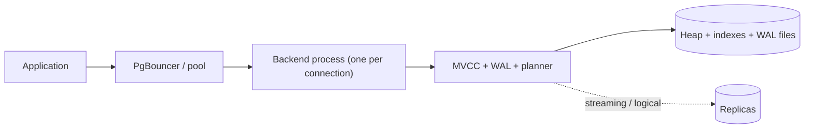

# Introduction to PostgreSQL

PostgreSQL is an open-source, process-based, MVCC relational database with an extensible architecture: pluggable index access methods, extensions (PostGIS, pgvector, TimescaleDB), logical replication, and JSONB support that let it serve as OLTP store, analytics engine, queue, search index, and CDC source.

This section covers PostgreSQL from the user level up; the deep internals series starts at [PostgreSQL Internals](./README.md).

## Why PostgreSQL

- **Correctness-first**: MVCC + WAL + SSI give strong guarantees without read locks.
- **Extensible**: types, indexes, functions, FDWs, and background workers without forking the server.
- **Operational maturity**: streaming/logical replication, PITR, and a large HA ecosystem (Patroni, CloudNativePG, managed clouds).

## Core Concepts (User Level)

```sql
-- databases hold schemas, schemas hold tables
CREATE DATABASE app;
CREATE TABLE users (id bigserial PRIMARY KEY, email text UNIQUE NOT NULL);

-- transactions are atomic, consistent, isolated, durable
BEGIN;
UPDATE accounts SET balance = balance - 100 WHERE id = 1;
UPDATE accounts SET balance = balance + 100 WHERE id = 2;
COMMIT;
```

- **Schemas** namespace tables; **constraints** (PK, FK, unique, check, exclusion) enforce invariants in the database, not the app.
- **Indexes** (B-tree default, plus GIN/GiST/BRIN/hash) trade write cost for read speed — see [Index Internals](./index-internals.md).
- **Transactions** with Read Committed (default), Repeatable Read, or Serializable isolation — see [Isolation and Transaction Internals](./isolation-transaction-internals.md).

## Connecting

```bash
psql "host=localhost dbname=app user=app"
```

Authentication (`pg_hba.conf`, SCRAM), TLS, and pooling (PgBouncer) are covered in [PostgreSQL Connection Internals](./postgresql-connection-internals.md).

## Where Next

- Internals roadmap: [PostgreSQL Internals](./README.md)
- Architecture overview: [PostgreSQL Architecture](./postgresql-architecture.md)
- External resources: [Links](./links.md)

## Architecture



**Real-life scenario:** A team outgrows slow checkout queries; they add a covering index (see [Index Internals](./index-internals.md)), move sessions to PgBouncer, and cut p99 from 900 ms to 60 ms — the user-level playbook before touching internals.

## Interview Questions

- **Q: Why is Postgres the default choice for new OLTP services?**
  A: Correctness-first MVCC + WAL durability, extensibility (types, indexes, extensions), and a mature HA/replication ecosystem.
- **Q: When does Postgres stop being enough?**
  A: Single-writer WAL/vacuum saturation on extreme writes, or specialist ceilings (vectors, search relevance, streams) — then extract via logical replication/CDC.
- **Q: What are the first three things to check when Postgres is slow?**
  A: Connection pressure (`pg_stat_activity` + pool stats), the plan (`EXPLAIN` — seq scan? misestimate?), and bloat/vacuum lag (dead tuples) — in that order.

## Summary

1. Postgres = process-based MVCC relational DB with WAL durability and deep extensibility.
2. Schemas/constraints/indexes enforce integrity in the DB; transactions default to Read Committed.
3. Pool connections (PgBouncer), index hot paths, and read `EXPLAIN` before scaling hardware.
4. This page is the user-level map; the internals series traces every mechanism underneath.
