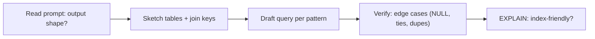

# Leetcode Problems

## Resources

- [Leetcode 50 sql problem](https://leetcode.com/studyplan/top-sql-50/)
    - [Crack SQL Interview in 50 Qs](https://www.youtube.com/playlist?list=PL5TWX8S_wvBPtMyBAjifOT1CfLwQPng86)

## Questions

### Select

- [Recyclable and Low Fat Products](leetcode-problems/select/RecyclableAndLowFatProducts.sql)
- [Find Customer Referee](leetcode-problems/select/FindCustomerReferee.sql)
- [Big Countries](leetcode-problems/select/BigCountries.sql)
- [Article Views I](leetcode-problems/select/ArticleViewsI.sql)
- [Invalid Tweets](leetcode-problems/select/InvalidTweets.sql)

### Basic Joins

- [Replace Employee ID With The Unique Identifier](leetcode-problems/join/ReplaceEmployeeIDWithTheUniqueIdentifier.sql)

## How to Practise (Interview Patterns)

Work the problems grouped by pattern, not by number. Each pattern below maps to the guide that teaches it:

| Pattern | Practice focus | Study first |
|---|---|---|
| Select + `WHERE` | Filtering, `NULL` handling, `LIKE` | [Basic Queries](./basic-queries.md), [Filtering](./filtering-data.md) |
| Joins | `INNER`/`LEFT`, self-joins, `ON` vs `WHERE` | [Joins](./joins.md) |
| Aggregation | `GROUP BY` + `HAVING`, `COUNT`/`SUM` conditionals | [Group By](./group-by.md) |
| Top-N per group | `ROW_NUMBER()` / `RANK()` in a subquery | [Window Functions](./window-functions.md) |
| Set logic | `UNION`, `EXCEPT`, `EXISTS` vs `IN` | [Set Operations](./set-operations.md) |
| Date math | `DATE_TRUNC`, gaps, streaks | [Functions](./functions.md) |

**Real-life scenario:** A candidate grinding 50 random problems plateaus; switching to pattern blocks (10 joins, then 10 aggregations, then 10 window functions) with `EXPLAIN` on each answer turns repetition into transferable technique — interviewers test patterns, not memorized solutions.

## Architecture

## Interview Questions

- **Q: How do you approach an unseen SQL interview problem?**
  A: Name the output shape, sketch tables and join keys, pick the pattern (join/aggregate/window/set), draft, then check NULLs, ties, and duplicates before optimizing.
- **Q: What edge cases do interviewers hide in SQL problems?**
  A: NULL semantics, tied rankings, duplicate rows inflating joins, and date boundaries — state assumptions aloud and handle each explicitly.
- **Q: When is a window function better than `GROUP BY` here?**
  A: When the answer needs per-row detail plus an aggregate (rank, running total, previous value) — `GROUP BY` collapses rows, window functions preserve them.

## Summary

1. Practise by pattern (joins, aggregation, windows, sets), not by problem number.
2. Every solution needs an edge-case pass: NULLs, ties, duplicates, dates.
3. Read the execution plan for your answers — interview-ready means index-aware.
4. The solved files under `leetcode-problems/` are references; the pattern is the skill.
