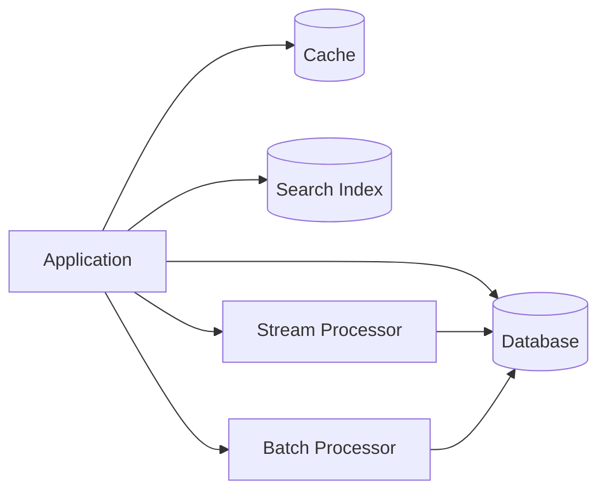
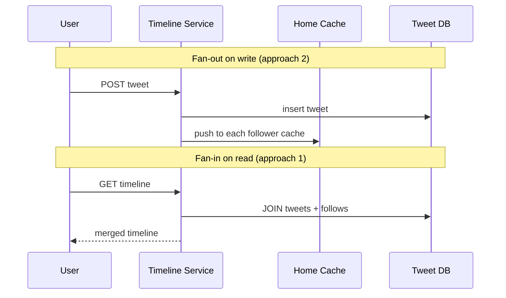

# Chapter 1: Reliable, Scalable, and Maintainable Applications

## Introduction
CPU power is rarely the limiting factor anymore — it is the data size that is. A data-intensive application is built from standard building blocks that provide commonly needed functionality. Our task is to pick the right tools and ensure data remains correct and complete, performs well, and scales despite faults.

Common building blocks:
1. Store data so it can be found later (databases).
2. Remember expensive results to speed up reads (caches).
3. Search by keyword or filter (search indexes).
4. Send messages asynchronously (stream processing).
5. Periodically crunch large data (batch processing).

Three concerns that matter for almost every system:
- **Reliability:** work correctly even in adversity.
- **Scalability:** reasonable ways to deal with growth.
- **Maintainability:** different people can work on it productively.

---

## Section 1: Thinking About Data Systems

Many new tools blur category boundaries. Redis is used as message queue, Kafka has database-like durability. If you have an app-managed cache (Memcached) or search server (Elasticsearch) separate from the main DB, application code must keep them in sync.

---

## Section 2: Reliability

System should continue to work correctly even in face of faults and human errors.

- **Fault:** one component deviating from spec.
- **Failure:** whole system stops serving users.

Prefer tolerating faults over preventing them. Netflix Chaos Monkey deliberately injects faults to test resilience.

### Hardware Faults
Disks crash, RAM fails, power dies, cables unplugged. Mitigate with redundancy: RAID, dual power, hot-swappable CPUs, batteries/generators. Trend is toward software tolerance for loss of entire machines, enabling rolling upgrades without downtime.

### Software Errors
Systematic errors cause more correlated failures than random hardware faults. Examples: leap-second bug hanging everything, runaway process eating CPU/memory/disk, slow dependency returning corrupt data. No quick fix — add assumptions checks, monitoring, and fast recovery paths.

### Human Errors
Config errors cause most outages. Make systems reliable despite humans:
1. Minimize opportunity for error — good abstractions, APIs, admin UIs that make right thing easy.
2. Sandbox with real data for safe exploration.
3. Test thoroughly at all levels.
4. Fast rollback, recompute tools.
5. Telemetry: metrics and error rates with early warnings.
6. Good management practices and training.

---

## Section 3: Scalability

Describe load first with **load parameters** (requests/sec, read/write ratio, active users), then ask:
1. How is performance affected if load rises and resources stay constant?
2. How many more resources are needed to hold performance steady?

### Twitter Example
- Post tweet: 4.6k req/sec avg, 12k peak.
- Home timeline: 300k req/sec.

Approach 1: fan-in on read — JOIN tweets + follows at read time. Simple write, heavy read. Struggled under timeline load.
Approach 2: fan-out on write — maintain per-user timeline cache, insert tweet into all followers' caches on post. 4.6k writes/sec x ~75 followers = ~345k writes/sec. A 30M-follower user causes 30M writes for one tweet.
Hybrid used in practice: fan-out for normal users, fan-in merge for celebrities.

### Describing Performance
Batch systems care about **throughput** (records/sec). Online systems care about **response time** (client-seen latency vs waiting latency).

Don't use mean — use **percentiles**: p50 median, p95, p99, p999. Amazon uses p999 for SLAs because slowest customers often have most data. Measuring on client side with realistic load matters. Queueing delays dominate high percentiles. Tail latency amplifies when one user request fans out to many backend calls.

SLOs/SLAs pin these expectations (e.g. median <200ms, p99 <1s).

### Coping With Load
- **Scale up (vertical):** bigger machine. Simple until cost/hardware limits.
- **Scale out (horizontal):** more small machines. Standard for stateless services, complex for stateful data.
- **Elastic:** auto-add resources on load spike. Good for unpredictable load, but more operational surprises than manual scaling.

In early startups, iterate fast over scaling for hypothetical load.

---

## Section 4: Maintainability

Most cost is maintenance, not initial development.

### Operability
Make routine tasks easy: good monitoring, automation + standard tools, avoid single-machine dependence, good docs, good defaults with overrides, self-healing with manual control, keep platforms patched, preserve organizational knowledge.

### Simplicity
Remove accidental complexity with good **abstraction** — clean facade hiding implementation, reusable across uses. Complex state spaces, tight coupling, hacks, and inconsistencies hurt.

### Evolvability
Requirements change. Agile, TDD, and refactoring help adapt. Distinguish functional requirements (what) from non-functional (security, reliability, compliance, scalability, maintainability).

---

## Diagrams and Code

### Building blocks of a data-intensive application



### Fan-out on write vs fan-in on read (Twitter)



### Code: percentiles and load math

```python
import statistics

latencies_ms = [12, 15, 13, 14, 200, 16, 12, 18, 300, 14]

def percentile(data, p):
    s = sorted(data)
    k = (len(s) - 1) * p / 100
    f, c = int(k), min(int(k) + 1, len(s) - 1)
    return s[f] + (s[c] - s[f]) * (k - f)

print("p50:", percentile(latencies_ms, 50))
print("p99:", percentile(latencies_ms, 99))

# Twitter-style fan-out estimate
tweets_per_sec = 4600
avg_followers = 75
print("fan-out writes/sec:", tweets_per_sec * avg_followers)
```

## Conclusion
### Key Takeaways
1. Fault vs failure: tolerate component faults so system stays up.
2. Describe load with parameters before scaling; optimize p95/p99, watch tail latency.
3. Twitter lesson: fan-out on write vs fan-in on read is a read/write tradeoff.
4. Operability, simplicity (abstraction), and evolvability dominate long-term cost.
