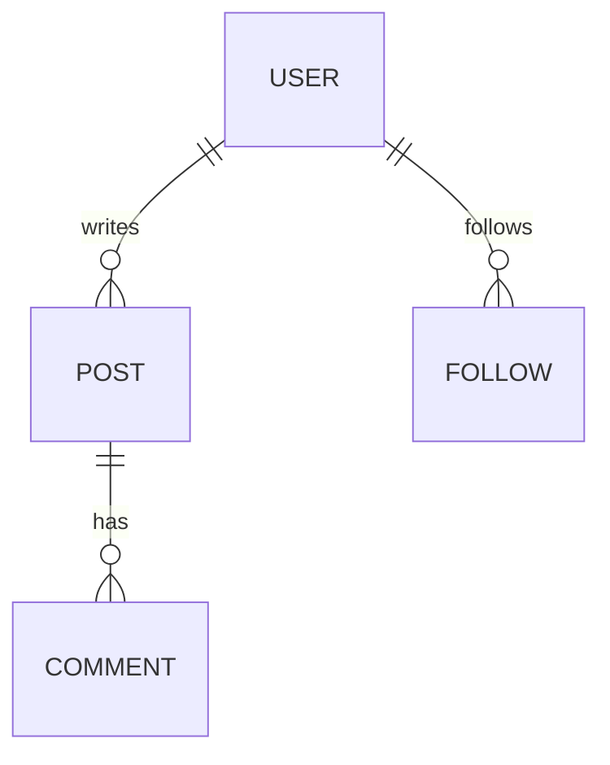
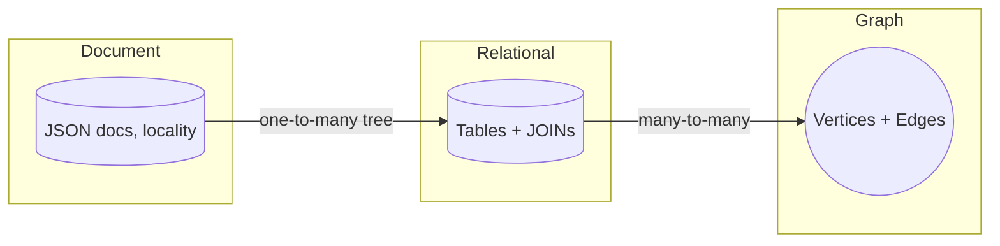

# Chapter 2: Data Models and Query Languages

## Introduction
Data models shape how we think about problems. Most apps layer one model on top of another, each hiding complexity below. This chapter compares relational, document, and graph models, plus declarative vs imperative query styles.

---

## Section 1: Relational vs Document Model

SQL/relational model: data in **relations** (tables) of unordered **tuples** (rows). Dominant since mid-1980s for transaction + batch processing. Goal was hiding storage details behind cleaner interface; query optimizer picks access path and join order.

NoSQL ("Not Only SQL", 2009 hashtag) drivers: greater scalability/write throughput, OSS preference, specialized queries (MapReduce), more dynamic model. Polyglot persistence is norm — relational stays alongside non-relational.

**Object-relational mismatch:** app code uses objects, DB uses tables/rows/columns. ORMs (ActiveRecord, Hibernate) reduce boilerplate but can't hide the difference.

One-to-many handling:
1. Normalized: many-side rows in separate table with foreign key (most common).
2. SQL multi-valued columns with in-row query support (XML/JSON types).
3. Encoded JSON/XML blob, app parses (least favorable).

JSON locality advantage: all relevant info in one place, one query suffices — vs multi-table JOIN. Document DBs support one-to-many natively.

### Many-to-One and Many-to-Many
- Relational: refer by ID, joins are easy. Removing duplication is **normalization**.
- Document: joins weak or missing. Must denormalize (duplicate) or simulate join in app code (cache small slow-changing tables in memory). Many-to-many is painful in documents.

**Which leads to simpler code?**
- Document-like tree of one-to-many, whole tree loaded together, few cross-record links → document model.
- Many-to-many + joins → relational model.

### Schema Flexibility
- Relational = **schema-on-write**: explicit schema, DB enforces on write. Like static type checking. Change needs migration (`ALTER TABLE`, backfill).
- Document = **schema-on-read**: implicit structure, interpreted on read. Like dynamic typing. Add fields by just writing new docs + defensive read code.

Schema-on-read wins when items heterogeneous (many object types, external uncontrolled sources). Schema wins when all records share shape — documents and enforces it.

### Data Locality
Benefit only if documents stay small. DB loads whole doc even for one field; updates rewrite whole doc. Spanner (nested tables), Oracle index-clustered tables, Bigtable column-families give locality inside relational models. Models are converging: Postgres/MySQL JSON, RethinkDB joins, Mongo client-side reference resolution.

---

## Section 2: Query Languages for Data

SQL is **declarative**: state pattern wanted, not how to get it. Concise, hides engine details so optimizer can improve, parallelizes well. Imperative (DOM-loop style code) specifies steps in order and parallelizes poorly.

Web parallel: CSS selector (declarative) vs JS DOM loop (imperative) — same lesson as SQL vs imperative query APIs.

### MapReduce Querying
Google-popularized bulk model: mapper extracts key-value per record, reducer aggregates per key. Supported by MongoDB/CouchDB for read-only scans. Halfway between declarative and imperative.

Example — sharks per month: PostgreSQL is one GROUP BY; Mongo MapReduce needs map + reduce functions + output collection. Mongo 2.2+ added declarative **aggregation pipeline** (`$match`, `$group`) — same expressiveness as SQL subset, friendlier to optimizer.

Map is pure (no side effects, no extra queries) so it can run anywhere/retried.

---

## Section 3: Graph-Like Data Models

For pervasive many-to-many, model as graph: **vertices** (nodes/entities) + **edges** (relationships/arcs). Social graphs, web graph, road networks. Algorithms: shortest path, PageRank.

Two flavors + three declarative languages (Cypher, SPARQL, Datalog):
- **Property graph** (Neo4j, Titan): vertex = id + in/out edges + properties; edge = id + tail + head + label + properties.
- **Triple-store** (Datomic, AllegroGraph): (subject, predicate, object) triples, e.g. (Jim, likes, bananas). Turtle/N3 syntax.

Cypher example: `(person)-[:BORN_IN]->()-[:WITHIN*0..]->(us)` — variable-length traversal `*0..` follows WITHIN any depth. SQL needs recursive CTE (`WITH RECURSIVE`) for same.

Datalog generalizes triples to `predicate(subject, object)` + **rules** that compose/recurse like functions. Less handy for one-offs, better for complex connected data.

---

## Diagrams and Code

### Relational vs document vs graph





### Code: same query in three models

```sql
SELECT date_trunc('month', observation_timestamp) AS month,
       sum(num_animals) AS total
FROM observations
WHERE family = 'Sharks'
GROUP BY month;
```

```js
db.observations.aggregate([
  { $match: { family: "Sharks" } },
  { $group: {
      _id: { year: { $year: "$observationTimestamp" },
             month: { $month: "$observationTimestamp" } },
      totalAnimals: { $sum: "$numAnimals" }
  } }
]);
```

```cypher
MATCH (person)-[:BORN_IN]->()-[:WITHIN*0..]->(us:Location {name: 'United States'}),
      (person)-[:LIVES_IN]->()-[:WITHIN*0..]->(eu:Location {name: 'Europe'})
RETURN person.name
```

```sql
WITH RECURSIVE in_usa(vertex_id) AS (
  SELECT vertex_id FROM vertices WHERE properties->>'name' = 'United States'
  UNION
  SELECT edges.tail_vertex FROM edges
  JOIN in_usa ON edges.head_vertex = in_usa.vertex_id
  WHERE edges.label = 'within'
)
SELECT properties->>'name' FROM vertices JOIN in_usa USING (vertex_id);
```

## Conclusion
### Key Takeaways
1. Relational: joins + many-to-many strength, schema-on-write, optimizer hides access path.
2. Document: locality + schema flexibility for tree data; weak joins, keep docs small.
3. Declarative (SQL/Cypher/pipeline) beats imperative for optimizer freedom + parallelism.
4. Graph property vs triple-store for dense relationships; Cypher/SPARQL/Datalog for traversal.
