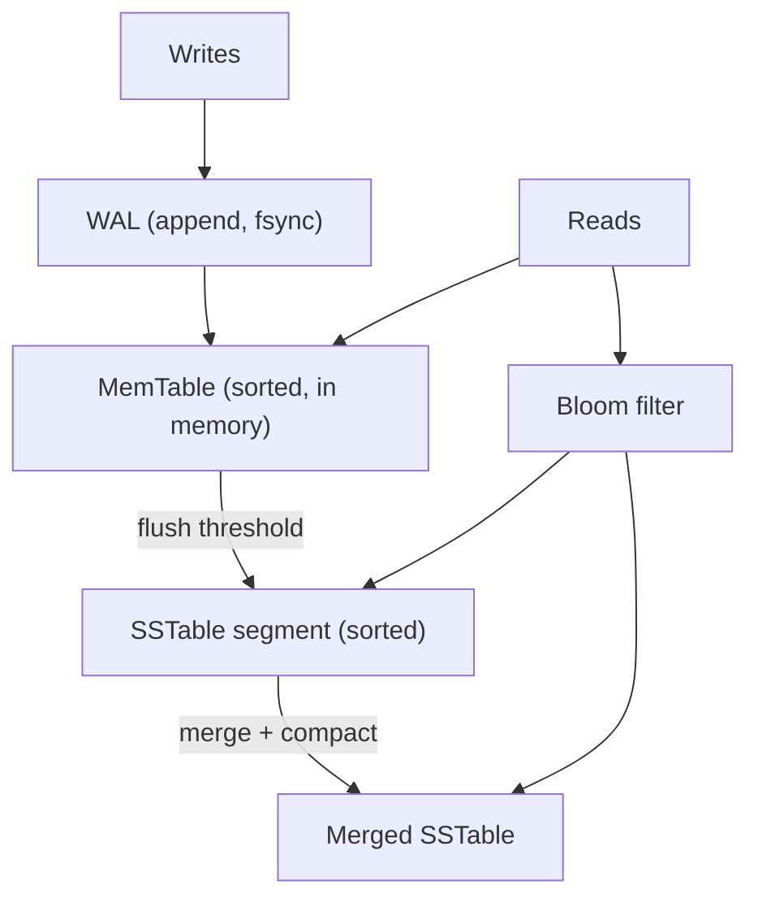
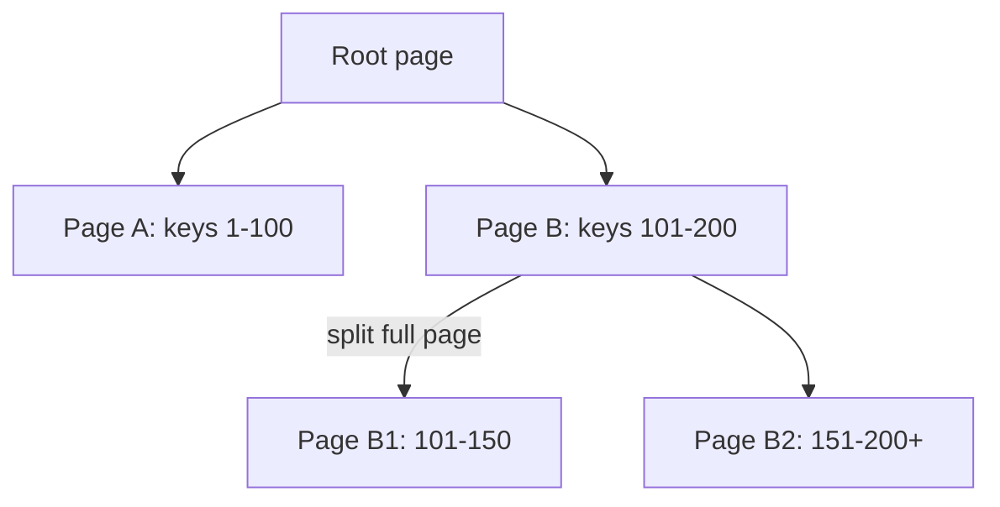

# Chapter 3: Storage and Retrieval

## Introduction
Databases do two things: store data and give it back. This chapter covers the index structures that power them — hash indexes, SSTables/LSM-trees, B-trees — then OLTP vs OLAP and column storage.

---

## Section 1: Hash Indexes

Simplest DB: append `key,value` to file, scan for lookup (O(n)). Add **index** — derived metadata mapping key to byte offset — for fast reads. Every index slows writes, so don't index everything; pick with query patterns in mind.

Bitcask-style hash index: in-memory hash map key → file offset. Append-only writes.

Scaling past one file: break log into **segments**, close when full, compact + merge in background (throw away duplicates, keep latest per key). Segments immutable after write, so merging is safe offline; switch reads to merged file, delete olds.

Real-implementation issues:
- File format: binary, not CSV.
- Deletes: append **tombstone** marker.
- Crash recovery: snapshot hash maps to disk, replay log.
- Partial writes: checksums to detect torn records.
- Concurrency: single writer thread (sequential appends), many readers (immutable segments).

Pros: sequential writes (fast on spinning disk), simple concurrency/crash recovery, no fragmentation. Cons: hash table must fit RAM, no range queries.

---

## Section 2: SSTables and LSM-Trees

Require segments sorted by key: **SSTable** (Sorted String Table). Each key appears once per merged file.

Wins over hash segments:
1. Merging is a simple mergesort; keep newest on duplicate.
2. Sparse in-memory index suffices (e.g. one key per few KB) — binary-search to nearest offset, scan forward.
3. Group records into blocks + compress before writing.

Write path with **memtable** (in-memory balanced tree: red-black/AVL):
1. Write → memtable.
2. Memtable over threshold (MBs) → flush to SSTable on disk.
3. Read → memtable, then newest segment → older.
4. Background merge/compaction discards overwritten/deleted values.

Crash loses memtable → keep separate append-only log (not sorted) only for recovery; discard on flush. This family is **LSM-tree** (Log-Structured Merge-Tree): LevelDB, RocksDB, Cassandra, HBase, Lucene term dictionary.

Speed non-existent-key lookups with **Bloom filters**. Compaction strategies: **size-tiered** (merge small into larger; HBase, Cassandra option) vs **leveled** (key range split into levels; LevelDB, RocksDB, Cassandra option). Leveled uses less disk; size-tiered needs less compaction IO tuning.

Size-tiered vs leveled and unchecked compaction growth can eat disk and interfere with live reads/writes — tune and monitor.

---

## Section 3: B-Trees

Standard in almost all relational DBs. Like SSTables keep keys sorted (range queries easy), but break data into fixed **pages/blocks** (traditionally 4 KB) instead of variable segments. Root page → child refs; depth O(log n); branching factor in hundreds; 3–4 levels hold 100s of TB.

Writes overwrite pages in place: find leaf, update, write back. Full page → split in two half-full, update parent. Overwrites never move page location (vs LSM append-only).

Crash: torn multi-page writes corrupt index → **write-ahead log (WAL / redo log)** records intent before pages. Concurrency: **latches** (lightweight locks) on tree internals. Optimizations: copy-on-write pages, key-prefix abbreviation, sibling pointers.

### LSM vs B-Tree
- LSM faster writes: sequential appends, lower write amplification, better compression, smaller files.
- B-tree faster reads: one place per key; LSM checks memtable + many SSTables.
- LSM compaction can spike and stall reads/writes; B-trees more predictable latency.
- B-tree exactly-one-location gives strong transactional semantics (range locks attach directly).

---

## Section 4: Other Indexes

- **Secondary index:** non-unique values; either list of row IDs per value or make entries unique by appending row ID. Built on B-tree or LSM.
- **Clustered index:** store row inside index (InnoDB primary). **Covering index** answers queries from index alone. Heap files otherwise hold rows with index → pointer.
- **Multi-column/concatenated:** `(lastname, firstname)` — order matters; good for left-prefix, useless for first-name-only. Geospatial uses same trick (lat+lon) but true 2-D needs special trees (R-tree/PostGIS).
- **Full-text/fuzzy:** normalization, stemming, proximity. Lucene uses SSTable-like term dictionary + finite-state automaton (trie-like) in-memory map.

### In-Memory
Durability vs cost tradeoff. Memcached = cache only. VoltDB/MemSQL/TimesTen = relational in-memory with logs/snapshots/replication for durability; Redis/Couchbase = async weak durability. Wins: no encode-to-disk overhead, exotic structures (queues, sets) easy. Serve reads from RAM, reload from disk/replica on restart.

---

## Section 5: OLTP vs OLAP

- **OLTP:** small low-latency random reads/writes (MySQL, Postgres, Oracle). Bottleneck: disk seeks.
- **OLAP:** scan millions of rows, few columns, aggregates (Hive, Presto, Spark, Redshift). Bottleneck: disk bandwidth.

Early 90s split: don't run analytics on OLTP. **Data warehouse** = read-only copy of all OLTP systems via **ETL** (extract-transform-load): periodic dump or continuous stream, cleaned into analysis schema. Often relational (SQL good for analytics) but internals differ.

**Star schema:** central **fact table** (events: transactions/sales, 100s of columns) + **dimension tables** (who/what/where/when). Snowflake = normalized dimensions.

---

## Section 6: Column-Oriented Storage

Row stores load whole rows even for 4-column queries. Column stores keep each column together — read only needed columns.

Wins: compression (repeated values + **bitmap + run-length encoding**; bitmaps answer IN/AND/OR fast), **vectorized/SIMD** CPU processing, same sort order across columns (often by date).

Cost: writes hard — no in-place update into compressed columns. Solution: buffer in memory like LSM, merge later. **Materialized aggregates/views** and **OLAP cubes** precompute common counts/sums; DB maintains them, writes pay the price.

---

## Diagrams and Code

### LSM write and read path



### B-tree page split



### Code: minimal SSTable-style store

```python
import bisect

class MemTable:
    def __init__(self, threshold=3):
        self.keys = []
        self.vals = {}
        self.threshold = threshold
        self.segments = []

    def put(self, k, v):
        if k not in self.vals:
            bisect.insort(self.keys, k)
        self.vals[k] = v
        if len(self.keys) >= self.threshold:
            self.flush()

    def flush(self):
        self.segments.append({k: self.vals[k] for k in self.keys})
        self.keys = []
        self.vals = {}

    def get(self, k):
        if k in self.vals:
            return self.vals[k]
        for seg in reversed(self.segments):
            if k in seg:
                return seg[k]
        return None

store = MemTable(threshold=3)
for k, v in [("a", 1), ("b", 2), ("c", 3), ("d", 4)]:
    store.put(k, v)
print(store.get("b"))
print(store.segments)
```

```sql
SELECT dim_date.weekday, dim_product.category,
       SUM(fact_sales.quantity) AS quantity_sold
FROM fact_sales
JOIN dim_date ON fact_sales.date_key = dim_date.date_key
JOIN dim_product ON fact_sales.product_sk = dim_product.product_sk
WHERE dim_date.year = 2013
  AND dim_product.category IN ('Fresh fruit', 'Candy')
GROUP BY dim_date.weekday, dim_product.category;
```

## Conclusion
### Key Takeaways
1. Hash index: RAM map + segmented append log + compaction; fast writes, no ranges.
2. LSM/SSTable: sorted + memtable + WAL; write-optimized, Bloom filters, leveled vs size-tiered.
3. B-tree: fixed pages + WAL + latches; read-optimized, O(log n), exactly-once key location.
4. OLTP (rows, seeks) vs warehouse/OLAP (columns, bandwidth, star schema, ETL).
