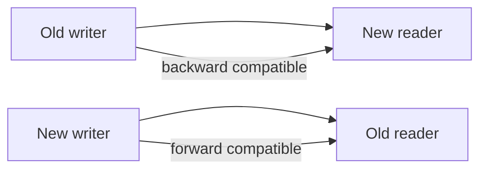
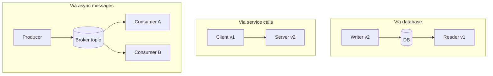

# Chapter 4: Encoding and Evolution

## Introduction
App features change, so stored data must change too. Old and new code plus old and new formats coexist — rolling upgrades, mobile clients lagging, five-year-old rows still on disk. **Data outlives code.** Maintain both directions:
- **Backward compatibility:** new code reads old data.
- **Forward compatibility:** old code reads new data (ignore unknown fields).

---

## Section 1: Formats for Encoding Data

In-memory (pointers, objects) vs bytes on disk/wire. Translation = **encode/serialize/marshal** and **decode/parse/deserialize**.

Avoid language built-ins: tied to one language, instantiate-arbitrary-class security holes, bad versioning, poor efficiency.

Textual (JSON, XML, CSV): human-readable, good for interchange, but ambiguous numbers/large ints, no binary (Base64 +33%), optional schema (XML/JSON) or none (CSV).

Binary: MessagePack/BSON/BJSON (JSON-like, ~20-30% smaller — often not worth losing readability for small payloads), WBXML/Fast Infoset (XML-like).

### Thrift and Protocol Buffers
Schema-driven with codegen. Field **tags** (numbers) replace names on wire. Thrift BinaryProtocol vs CompactProtocol (type+tag in one byte); Protobuf similar with different bit-packing.

Schema evolution rules:
- Add only **optional/defaulted** fields, never reuse a tag.
- Remove only optional fields, never reuse tag.
- Forward compat: old code ignores unknown tags.
- Backward compat: new code reads old data (missing fields get defaults).
- Changing a type risks truncation/precision loss.

Properties: compact (omit names), schema doubles as up-to-date docs, schema registry checks compat, codegen gives compile-time types.

### Avro
Hadoop subproject, 2009. Two schema languages (Avro IDL for humans, JSON for machines). No tags — decode by **field order**, so reader needs schema. Ships writer schema with data (file header) or negotiates per connection; per-record version when schemas vary.

Resolution uses **writer schema + reader schema**: forward = new writer/old reader; backward = new reader/old writer. Only add/remove fields **with defaults**. Renames break forward compat; type changes allowed only if Avro can convert. Friendly to dynamically generated schemas (dump DB → generate Avro JSON automatically vs hand-maintaining Thrift tag maps).

---

## Section 2: Modes of Dataflow

### Via Databases
Writer encodes, reader decodes — possibly years apart. Needs both compat directions. Migrations (rewrite whole DB) expensive; most relational DBs allow cheap adds (nullable column backfilled with NULL on read). Caution: old code overwriting new-shaped rows can silently drop new fields.

### Via Service Calls
Each service owned by one team, independently deployable — old and new versions coexist, so expect mixed traffic. Client/server, SOA/microservices.

- **REST:** design philosophy on HTTP (verbs, caching, content negotiation), URLs for resources, OpenAPI/Swagger docs, great for public APIs and debugging.
- **SOAP:** XML protocol with WSDL codegen, heavier.
- **RPC (Thrift, Avro RPC, gRPC/Protobuf, Finagle, Rest.li):** makes remote look like local call — flawed idea. Network vs local: unpredictable, timeouts with no result, retries cause duplicates without **idempotence**, wildly variable latency, no shared pointers, cross-language type mapping. Modern frameworks admit remoteness (futures/promises). Assume servers update first, clients second → need backward compat on requests, forward on responses.

### Via Asynchronous Message Passing
Producer → **broker/queue (RabbitMQ, ActiveMQ, HornetQ, NATS, Kafka)** → consumers. Advantages over direct RPC: buffers unavailable recipients, auto-redelivery, no need to know recipient IP, fan-out to many, sender/receiver decoupled. One-way (reply needs second channel). Any encoding works if it stays compat.

**Actor model:** per-entity actors + async messages instead of threads (single message at a time, no locks). Distributed actors = broker + actors fused. Akka (Java serialization default — swap for Protobuf for rolling upgrades), Orleans (custom format, same caveat), Erlang OTP (record-schema changes hard).

---

## Diagrams and Code

### Compatibility matrix



### Dataflow modes



### Code: schemas and evolution

```protobuf
syntax = "proto3";

message Person {
  string user_name = 1;
  int64 favorite_number = 2;
  repeated string interests = 3;
}
```

```json
{
  "type": "record",
  "name": "Person",
  "fields": [
    {"name": "userName", "type": "string"},
    {"name": "favoriteNumber", "type": ["null", "long"], "default": null},
    {"name": "interests", "type": {"type": "array", "items": "string"}}
  ]
}
```

```python
def reader_view(record, known_fields):
    return {k: record[k] for k in known_fields if k in record}

new_data = {"user_name": "Martin", "favorite_number": 1337, "interests": ["hacking"], "nickname": "mk"}
print(reader_view(new_data, {"user_name", "favorite_number", "interests"}))

old_data = {"user_name": "Ada"}
print({**{"favorite_number": None, "interests": []}, **old_data})
```

## Conclusion
### Key Takeaways
1. Support both compat directions; data outlives code, avoid full rewrites.
2. Thrift/Protobuf: tags, optional-only adds. Avro: order-based, writer+reader resolution, default-required changes.
3. DB flow needs both directions; RPC assumes servers-first; async via broker decouples + buffers.
4. RPC ≠ local call: timeouts, retries, idempotence, encoding costs are fundamental.
