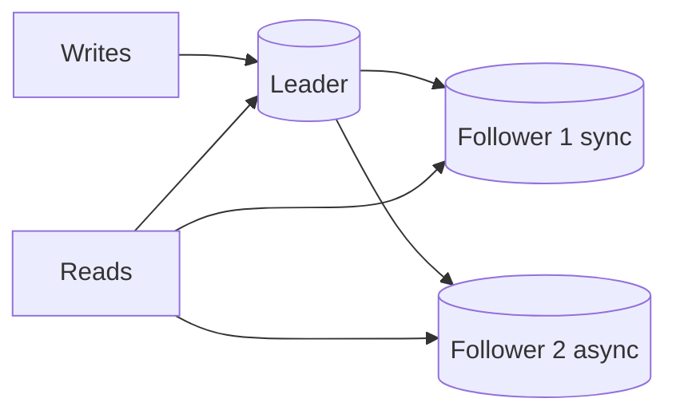
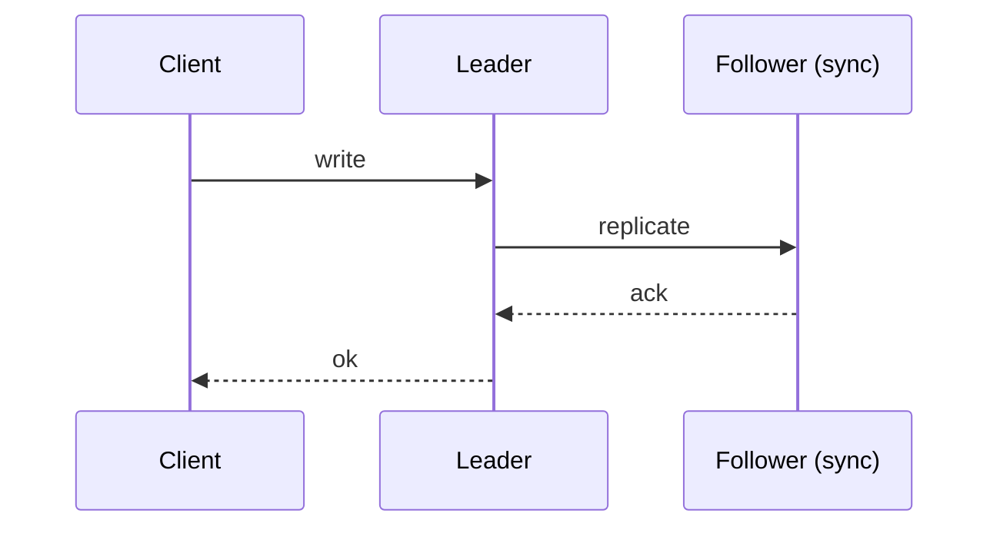
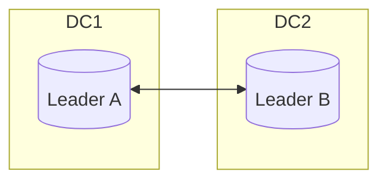
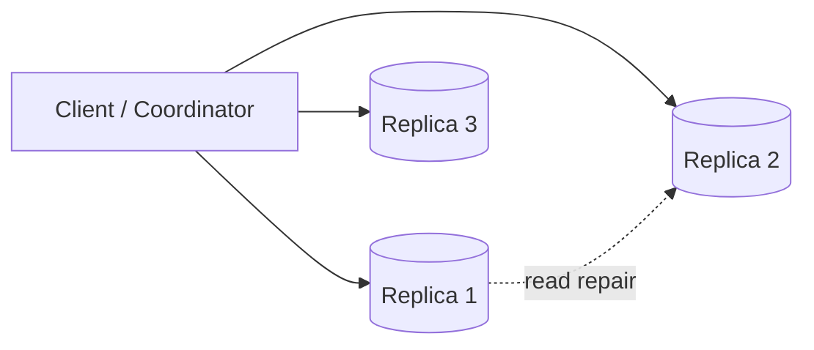

# Chapter 5: Replication

## Introduction
Keep copies on multiple machines to stay close to users (latency), survive failures (availability), and scale reads (throughput). Hard part is handling **changes**: single-leader, multi-leader, leaderless.

---

## Section 1: Leaders and Followers

One **leader** (master/primary) accepts writes, streams changes via **replication log / change stream**; **followers** (read replicas, slaves, hot standbys) apply it. Reads go anywhere, writes only to leader. Used by Postgres, MySQL, Oracle, SQL Server, MongoDB, RethinkDB, Espresso, Kafka, RabbitMQ.

### Synchronous vs Asynchronous
- **Sync:** follower confirms before success. Guaranteed up-to-date copy, but one slow/dead follower blocks writes.
- **Async:** leader replies immediately. Leader never blocks, but writes can be lost on failover.

Practice: **semi-sync** — one sync follower, rest async.

### Setting Up New Followers
Files copy insufficient (DB keeps writing). Without downtime: snapshot leader → copy to follower → follower replays changes since snapshot → caught up.

### Node Outages
- **Follower fails:** catch-up recovery — replays log gap from last processed transaction.
- **Leader fails (failover):** detect dead (timeout) → elect most-up-to-date replica → repoint clients + followers. Risks with async: new leader missing writes (must discard → dangerous for external systems), split brain (two leaders), when to declare dead. Many teams fail over manually.

### Replication Log Implementations
- **Statement-based:** ship SQL (`INSERT/UPDATE/DELETE`). Breaks on nondeterminism (`NOW()`, `RAND()`, auto-increment order, triggers/side effects). Fix nondeterminism by substituting leader's fixed values — generally avoid.
- **WAL shipping:** ship byte-level storage logs (Postgres, Oracle). Fast but coupled to engine version — no mixed-version rolling upgrade, downtime required.
- **Logical/row-based:** rows changed (insert values, delete keys, update old+new + commit marker). Decoupled, backward-compatible, parseable for CDC (warehouses, caches). MySQL binlog style.
- **Trigger-based:** app code logs changes to table for external reader. Flexible, but overhead + bug-prone.

---

## Section 2: Problems With Replication Lag

Read-scaling needs async followers → **eventual consistency**. Lag from milliseconds to minutes. Three anomalies + fixes:

### Reading Your Own Writes (read-after-write)
User writes via leader, reads from lagging follower, misses own write. Fix: read own-modifiable data from leader (e.g. own profile); or route all reads to leader for N seconds after update (track timestamp — hard cross-device, needs central metadata + same-DC routing).

### Monotonic Reads
User sees time move backward (first read hits fresh replica, refresh hits lagging one). Fix: **sticky sessions** — hash user ID to one replica; reroute only on failure.

### Consistent Prefix Reads
Causally ordered writes read out of order (question appears after answer) — acute in partitioned DBs with no global order. Fix: co-locate causally related writes on same partition, written in order.

If lag to minutes is unacceptable, use transactions/stronger guarantees (Ch. 7).

---

## Section 3: Multi-Leader Replication

Every node is leader for its writes, follower for others'. Only sensible across datacenters or offline devices, rarely inside one DC.

Use cases: **per-DC leader** (local writes hide cross-ocean latency, DCs survive independently — Tungsten/MySQL, BDR/Postgres, GoldenGate/Oracle), **offline clients** (device = leader, sync later — CouchDB/calendar), **collaborative editing** (keystroke-granularity, no locking — Google Docs/Etherpad).

Retrofitted auto-increment/triggers/constraints break — often considered dangerous, avoid if possible.

### Handling Write Conflicts
Async detection only (sync detection = just use single-leader). Strategies:
1. **Avoid:** route each record's writes through one leader (e.g. user → home DC).
2. **Converge:** unique write IDs, highest wins (**LWW** — simple, loses data); per-replica IDs, higher wins (also lossy); merge values; record conflict for later resolution.
3. **Custom:** on-write handler (must be fast) or on-read multi-version return (CouchDB siblings; app/user merges).

### Topologies
- **All-to-all:** every leader → every leader. Best fault tolerance, but fast links overtake slow (causality breaks; needs **version vectors**). No causal order in BDR; Tungsten doesn't even detect.
- **Circular** (MySQL default) / **Star:** write passes through intermediaries; each node has ID + seen-list to stop loops. One node failure stalls flow.

---

## Section 4: Leaderless Replication (Dynamo-style)

No failover — client (or coordinator) writes/reads **several replicas in parallel** (Riak, Cassandra, Voldemort, Dynamo). Version numbers pick newest on read.

Catch-up: **read repair** (client writes back fresher value to stale replica) + **anti-entropy** (background diff + copy, unordered).

### Quorums
n replicas, w confirm writes, r queried on reads. **w + r > n** → read overlaps a fresh node. Odd n (3/5), w = r = majority typical. Smaller w/r = lower latency + higher availability, staler reads. Breaks when: sloppy quorum places w/r on different nodes, concurrent writes (merge needed), read/write races, partial-write failures unrolled back, failed-node restore breaks quorum. Optimized for tolerable eventual consistency.

### Sloppy Quorums and Hinted Handoff
During partition, accept writes on any w reachable nodes (outside home n), hand off to home nodes later. Increases write availability, sacrifices read freshness. Multi-DC: wait only for local quorum, async cross-DC.

### Detecting Concurrent Writes
Overwriting by arrival order diverges replicas. Options:
- **LWW by timestamp:** converges, drops data. OK for caches, bad where loss matters.
- **Happens-before:** track causality; concurrent = neither happened-before other.
- **Version vectors (per-key per-replica counters, Riak causal context):** client sends read versions back on write; server overwrites ≤ version, keeps higher as **siblings**. App merges siblings; deletes need **tombstones** or resurrection. CRDTs auto-merge to avoid hand-rolled merge bugs.

---

## Diagrams and Code

### Single-leader replication and failover





### Multi-leader and leaderless





### Code: quorum check and version vectors

```python
def quorum_ok(n, w, r):
    return w + r > n and w > 0 and r > 0 and w <= n and r <= n

for n, w, r in [(3, 2, 2), (3, 1, 1), (5, 3, 3), (5, 1, 5)]:
    print(n, w, r, quorum_ok(n, w, r))

def merge_siblings(values):
    out = set()
    for v in values:
        out.update(v if isinstance(v, (set, list, tuple)) else [v])
    return sorted(out)

print(quorum_ok(3, 2, 2))
print(merge_siblings([{"a", "b"}, {"b", "c"}]))
```

```python
class VersionVector(dict):
    def increment(self, node):
        self[node] = self.get(node, 0) + 1
        return self

    def concurrent_with(self, other):
        a_gt = any(self.get(k, 0) > other.get(k, 0) for k in self)
        b_gt = any(other.get(k, 0) > self.get(k, 0) for k in other)
        return a_gt and b_gt

v1 = VersionVector({"a": 2, "b": 1})
v2 = VersionVector({"a": 2, "b": 2})
print(v1.concurrent_with(v2))
print(v2.increment("a"))
```

## Conclusion
### Key Takeaways
1. Single-leader: one sync + rest async; failover risks split brain + lost async writes.
2. Lag anomalies: read-your-writes (leader reads), monotonic (sticky replica), prefix (same-partition causal order).
3. Multi-leader only for multi-DC/offline/collab; conflicts need avoid/LWW/merge handlers.
4. Leaderless: w + r > n, read repair + anti-entropy, version vectors over LWW when loss matters.
