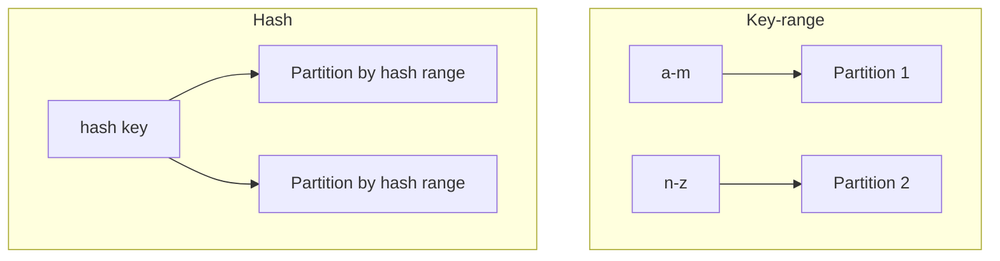
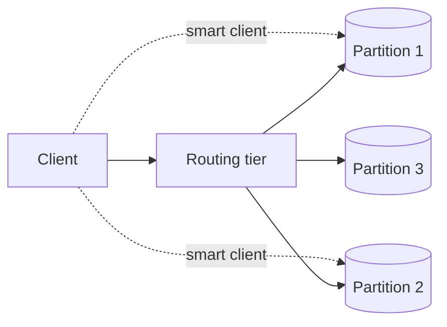
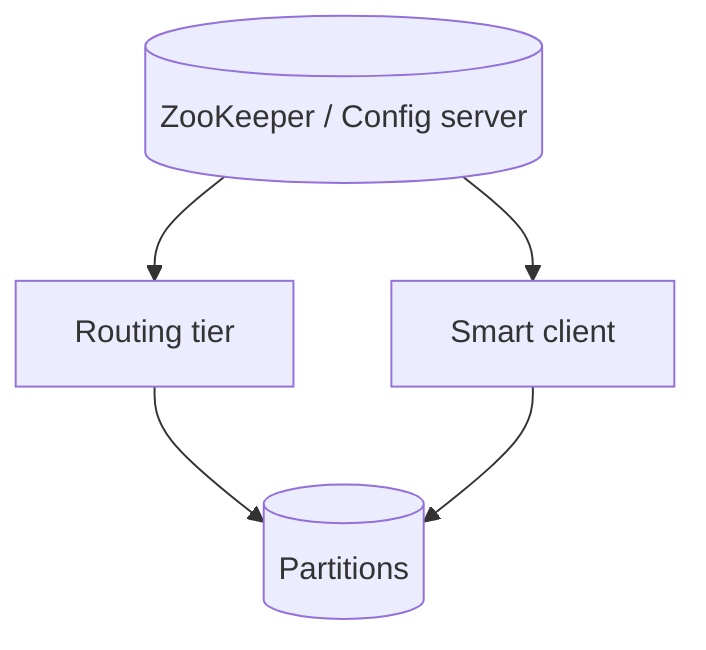

# Chapter 6: Partitioning

## Introduction
Replication isn't enough for huge data or query load — split into **partitions** (shards), each a small DB. Replication (availability/latency) and partitioning (scalability) combine: each node leads some partitions, follows others.

---

## Section 1: Partitioning of Key-Valve Data

Goal: spread data + load evenly. **Skew** = unfair split; **hot spot** = overloaded partition.

Random assignment spreads well but forces querying all nodes for any key.

### Partition by Key Range
Sort keys, cut continuous ranges (encyclopedia volumes A–B, C–D). Boundaries manual or auto. Keys sorted per partition → range scans easy. Downside: access-pattern hot spots (e.g. today's dates). Used by HBase, RethinkDB, MongoDB pre-2.4.

### Partition by Hash of Key
Hash (MD5, Murmur3, Fowler-Noll-Vo — non-crypto fine) → partition by hash range (**consistent hashing** for even boundaries). Skew disappears, but adjacent keys scatter → range queries fan out to all partitions (Riak, Couchbase, Voldemort limitation; Mongo hash-sharding same).

Compromise: **compound key** — hash first part for partition, sort rest inside (Cassandra: `(zipcode, user, timestamp)` — all of one zipcode's users together, ordered by time).

### Skewed Workloads and Hot Spots
Celebrity key (millions of reads/writes) still overloads one partition. App-level fix: prepend/append random salt to spread writes — pays back with scatter reads + bookkeeping.

---

## Section 2: Partitioning and Secondary Indexes

Secondaries don't map neatly to partitions. Two choices:

- **By document (local index):** each partition indexes its own docs. Writes touch one partition (fast writes), reads **scatter/gather** all partitions (tail-latency risk). MongoDB, Riak, Cassandra, Elasticsearch, SolrCloud, VoltDB.
- **By term (global index):** partition index by indexed term, not document. Reads hit one partition (fast reads), writes fan out + complex (usually async). Hash term for balance, range-split term for range scans.

---

## Section 3: Rebalancing Partitions

Move load as throughput/storage/failures shift. Requirements: fair after, live reads/writes during, minimal movement.

- **Hash mod N:** `hash(key) mod N`. N change → almost everything moves. Never use.
- **Fixed partitions:** many more partitions than nodes (e.g. 1000/10 nodes), steal some per new node. Key→partition stable, only assignment moves. Riak, Elasticsearch, Couchbase, Voldemort. Risk: fixed count too big (overhead) or too small (giant partitions, slow rebalance/recovery).
- **Dynamic (B-tree-like):** split over-size, merge under-size. Count follows volume. HBase, MongoDB 2.4+ (pre-split to avoid cold single-partition start).
- **Proportional to nodes:** fixed partitions-per-node (Cassandra 256/node). Random split choice can unbalance.

Fully automatic rebalance can saturate network/nodes — keep a human in the loop.

---

## Section 4: Request Routing (Service Discovery)

Client needs key → node mapping. Options:
1. Any node + forward.
2. Routing tier (partition-aware load balancer).
3. Smart client with partition map.

Map changes must propagate: **ZooKeeper** authoritative mapping (HBase, SolrCloud, Kafka; MongoDB uses config servers + mongos), or **gossip protocol** (Cassandra, Riak), or fixed tier (Couchbase moxi). **MPP** databases add sophisticated parallel query planning on top.

---

## Diagrams and Code

### Range vs hash partitioning



### Request routing options





### Code: consistent hashing ring

```python
import hashlib
import bisect

class HashRing:
    def __init__(self, nodes, replicas=100):
        self.ring = []
        self.nodes = {}
        for n in nodes:
            for i in range(replicas):
                h = int(hashlib.md5(f"{n}:{i}".encode()).hexdigest(), 16)
                self.ring.append(h)
                self.nodes[h] = n
        self.ring.sort()

    def get(self, key):
        h = int(hashlib.md5(key.encode()).hexdigest(), 16)
        i = bisect.bisect(self.ring, h) % len(self.ring)
        return self.nodes[self.ring[i]]

ring = HashRing(["n1", "n2", "n3"])
print([ring.get(f"user:{i}") for i in range(5)])
print(ring.get("celebrity:alice"))
```

```python
def salted_key(hot_key, salt):
    return f"{hot_key}#{salt}"

print(salted_key("celebrity:alice", 7))
```

## Conclusion
### Key Takeaways
1. Range = scans, hot spots. Hash = balance, no ranges. Compound = middle ground.
2. Local index: fast writes, scatter reads. Global: fast reads, slow/async writes.
3. Rebalance: fixed/dynamic/proportional — never mod N; human-gated.
4. Routing via ZooKeeper/gossip/routing tier; keep mapping fresh.
