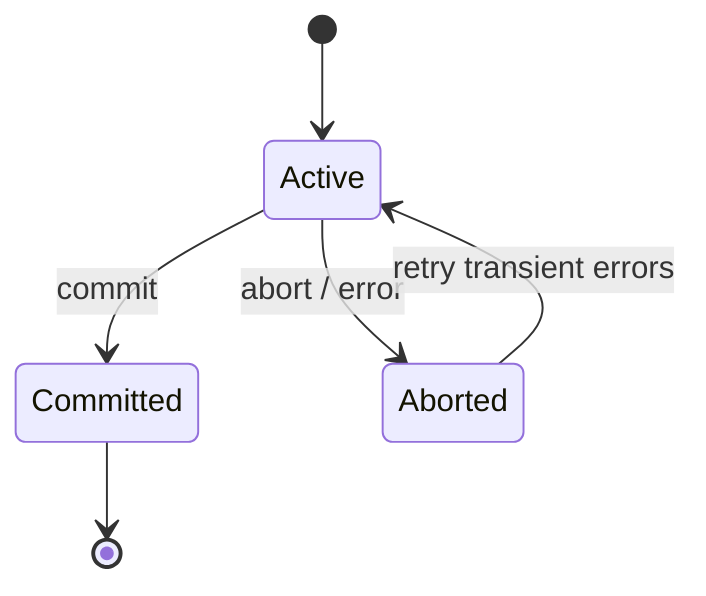
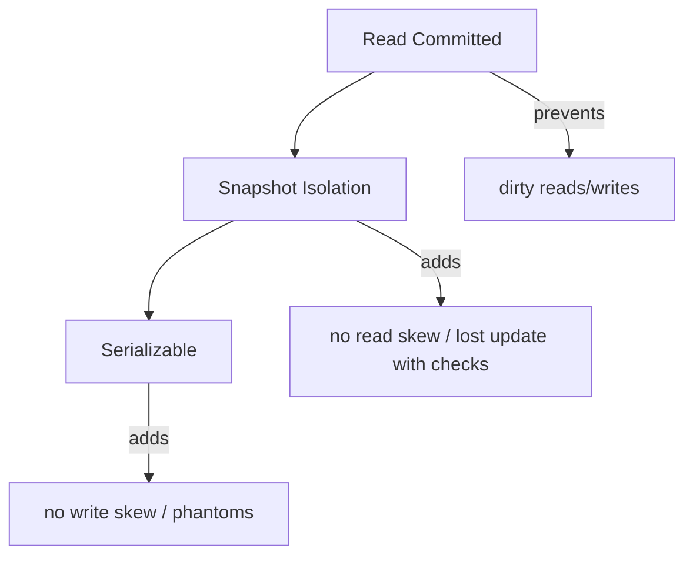

# Chapter 7: Transactions

## Introduction
Apps fail mid-write, networks cut off, concurrent clients overwrite each other, readers see half-updated state. **Transaction** groups reads/writes into one logical unit: all commit or all abort/rollback. DB handles safety guarantees so app ignores many error paths.

---

## Section 1: The Slippery Concept of a Transaction

"Abandon transactions for scale" and "transactions are vendor lock-in" are both hyperbole. Safety model is **ACID**; non-ACID is **BASE** (Basically Available, Soft state, Eventually consistent — effectively "not ACID").

### ACID
- **Atomicity:** all-or-nothing; fault → abort + safe retry. Prefer "abortability". Crash recovery via log.
- **Consistency:** app invariants hold (bank balance, foreign keys). App property, not DB's.
- **Isolation:** concurrent txns act as if serial. Locks per object.
- **Durability:** committed = never forgotten. Single node: fsync to disk. Replicated: copied to N nodes.

Single-object atomicity/isolation is universal; multi-object across partitions is what distributed stores drop. Leaderless stores won't undo — app must recover. Retry hazard: network succeeds but ack lost → double-apply; overload retries amplify; only retry transient errors (deadlock, failover), never permanent (constraint violation). Use backoff + limits.

---

## Section 2: Weak Isolation Levels

Serializable is expensive, so production uses weaker levels that stop *some* races. Read committed is default in Postgres, Oracle, SQL Server, MemSQL.

### Read Committed
1. No **dirty reads** (only committed visible). Impl: keep old + new value, readers get old — no read locks stalling writers.
2. No **dirty writes** (only overwrite committed). Impl: row-level write locks.

Still allows read skew, lost update, write skew, phantoms.

### Snapshot Isolation (Repeatable Read)
Each txn reads **consistent snapshot** frozen at start — fixes **read skew/nonrepeatable read** (Alice sees $500+$400=$900 vanishing; backups/analytics/integrity checks inconsistent). Readers never block writers and vice versa.

Impl: **MVCC** — multiple versions per object with timestamps; index points to all versions (or copy-on-write tree like CouchDB). Garbage-collect versions no txn can see. Called serializable in Oracle, repeatable read in Postgres/MySQL.

### Preventing Lost Updates
Read-modify-write race: two counters increment from same base, one clobbered. Fixes:
- **Atomic ops:** `UPDATE counters SET value = value + 1` (Mongo/Redis have equivalents). Best when expressible; ORMs often hide unsafe cycles.
- **Explicit locking:** `SELECT ... FOR UPDATE`.
- **Auto-detect:** DB aborts loser under snapshot (Postgres repeatable read, Oracle serializable, SQL Server snapshot). MySQL InnoDB repeatable read does NOT.
- **Compare-and-set:** `UPDATE ... WHERE content = 'old'` — fails if changed.
- **Conflict resolution:** replicated DBs keep siblings, app merges / LWW (Ch. 5).

### Write Skew and Phantoms
**Write skew:** two txns read same set (2 doctors on call), each updates *different* row (self off-call), both commit → invariant broken (0 doctors). Needs serializable, DB constraints/triggers/materialized views, or `SELECT ... FOR UPDATE` on depended rows.

**Phantom:** write in one txn changes another's *search* result (rows added/removed mid-txn, no lockable rows yet). Fix with materialized conflicts (artificial lock rows) or serializable.

---

## Section 3: Serializability

Strongest: parallel txns end as if serial. Three implementations:

### Actual Serial Execution
One thread, one txn at a time (VoltDB/H-Store, Redis, Datomic). Feasible now: RAM cheap, OLTP txns tiny (analytics use snapshot instead). Sometimes beats concurrent engines; capped at single-CPU throughput.

Scale via **stored procedures** (submit whole txn upfront, no network round-trips) + **partitioning** (one thread per partition; cross-partition slow). Modern procs use Java/Groovy (VoltDB), Clojure (Datomic), Lua (Redis) — not PL/SQL. VoltDB replicates by re-executing deterministic procs.

### Two-Phase Locking (2PL)
**Pessimistic:** shared lock for read, exclusive for write, hold to commit/abort; writers block readers and reverse. Deadlock → detect + abort one. MySQL InnoDB + SQL Server serializable. Predictable correctness, worst throughput/latency: one slow txn stalls all; p99 suffers. Predicate locks (match search condition, incl. not-yet-existing rows) stop phantoms but costly → **index-range locks** approximate by locking larger range.

NOTE: 2PL (locking) ≠ 2PC (commit) — different chapters.

### Serializable Snapshot Isolation (SSI)
**Optimistic** (2008): run on snapshot, track stale reads (MVCC visibility ignored committed writes) + writes affecting prior reads (non-blocking index-range notices); abort on commit if premise violated. Writers never block readers. Beats 2PL when contention low; abort rate kills it under high contention (keep read-write txns short; long read-only OK). Distributable across partitions/cores, unlike single-thread serial.

---

## Diagrams and Code

### Transaction lifecycle and isolation ladder





### Code: atomic transfer and retry on serialization failure

```sql
BEGIN;
SELECT balance FROM accounts WHERE id = 1 FOR UPDATE;
UPDATE accounts SET balance = balance - 100 WHERE id = 1;
UPDATE accounts SET balance = balance + 100 WHERE id = 2;
COMMIT;
```

```sql
UPDATE counters SET value = value + 1 WHERE key = 'foo';

UPDATE wiki_pages SET content = 'new content'
WHERE id = 1234 AND content = 'old content';
```

```python
import time
import random

class SerializationFailure(Exception):
    pass

def transfer(db, retries=5):
    for attempt in range(retries):
        try:
            db.begin()
            db.execute("SELECT balance FROM accounts WHERE id = 1 FOR UPDATE")
            db.execute("UPDATE accounts SET balance = balance - 100 WHERE id = 1")
            db.execute("UPDATE accounts SET balance = balance + 100 WHERE id = 2")
            db.commit()
            return True
        except SerializationFailure:
            db.rollback()
            time.sleep((2 ** attempt) * 0.01 + random.random() * 0.01)
    return False
```

## Conclusion
### Key Takeaways
1. ACID: abortability + app invariants + serial illusion + fsync/replication. BASE = not-ACID.
2. Read committed stops dirty R/W; snapshot stops skew via MVCC; neither stops write skew/phantoms.
3. Lost update: atomic > FOR UPDATE > auto-abort > CAS > merge.
4. Serializable via serial thread, 2PL (pessimistic, slow), or SSI (optimistic, aborts on contention).
