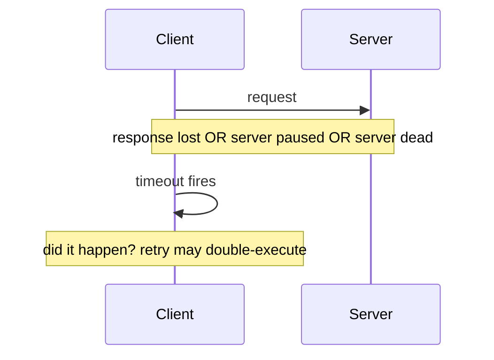
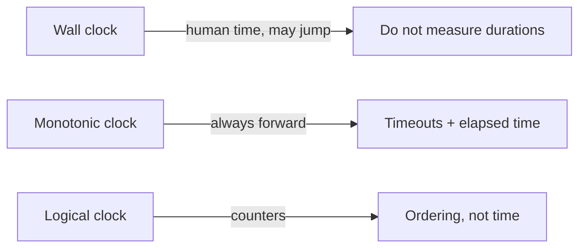
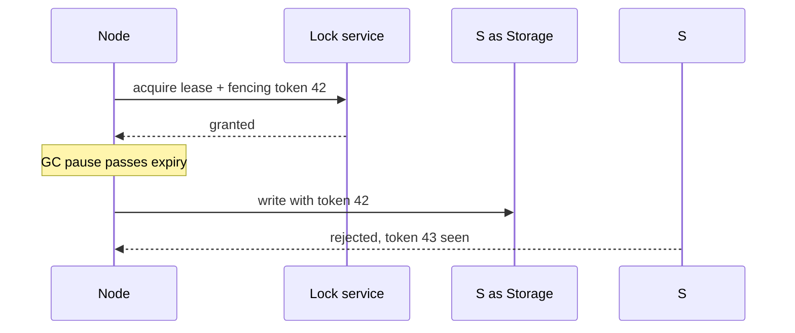

# Chapter 8: The Trouble with Distributed Systems

## Introduction
Single-computer programs are deterministic — same input, same result. Distributed systems are nondeterministic: parts fail unpredictably while others work. Accept partial failure and build fault-tolerance in; test by injecting faults.

---

## Section 1: Faults and Partial Failures

No total failure vs total success — gray states. Know expected behavior under fault, enumerate possibilities, chaos-test (kill nodes, partition network, pause processes) before prod does it for you.

---

## Section 2: Unreliable Networks

Shared-nothing systems talk only via network — async packet network with no delivery or timing guarantees. Send request, possible outcomes: lost, queued, remote dead, remote paused, response lost, response delayed. No response tells you nothing about what happened.

If you need certainty, need positive app-level reply — TCP ACK or RST/FIN only proves packet arrived, not processed.

### Timeouts and Unbounded Delays
- Long timeout: slow detection, idle capacity.
- Short timeout: fast detection, false positives — double-execution, cascading failover load.

Theory says `2d + r` (max delay + processing), but d unbounded in practice. Measure distribution + jitter experimentally (AWS, Akka, Cassandra style), adapt timeouts continuously. Some latency-sensitive paths use UDP (VoIP, live stream) where stale data worthless.

Queue sources: switch buffers, OS runqueues, hypervisor steal, TCP flow control, GC pauses. Ethernet/IP are packet-switched (queue → unbounded) vs telephone circuits (reserved bandwidth → bounded but wasteful for bursty data). TCP adapts to available bandwidth; circuits waste it.

---

## Section 3: Unreliable Clocks

Every machine's clock drifts. NTP syncs wall clocks via server hierarchy (GPS-backed), but still tens-of-ms uncertainty; jumps possible.

- **Time-of-day (wall):** date/time for humans, NTP-synced, can jump backward — never measure durations.
- **Monotonic:** always forward, meaningless absolute value, NTP only slews rate — right for timeouts.
- **Logical:** counters (Lamport, version vectors) for ordering — no wall time at all.

Don't order cross-node events by wall clock — LWW on timestamps loses data in multi-leader/leaderless stores. Track causality explicitly.

Confidence intervals: treat reading as range `[earliest, latest]`, not point. Spanner waits out uncertainty before committing to get externally-consistent snapshots; Google deploys GPS/atomic clocks per DC to shrink interval.

### Process Pauses
Leader lease ≠ guarantee: GC stop-the-world, VM suspend, laptop sleep, context switch, sync disk, swap, SIGSTOP can pause a holder past expiry while it believes it still holds lock. Fencing (Ch. 9) required. Real-time (RTOS) deadlines need bare-metal testing, no dynamic alloc, documented worst-case — not typical servers.

---

## Section 4: Knowledge, Truth, and Lies

No node sees global truth — only **system model** assumptions algorithms are proved against. Don't trust self-judgment; decide by **quorum** (majority vote).

- **Fencing tokens:** lock service returns increasing number per grant (ZooKeeper zxid/cversion); storage rejects writes with older token — blocks paused ex-leader.
- **Byzantine faults:** nodes lie/attack. BFT algorithms costly, impractical inside own DCs; relevant for multi-org/P2P. Weak lying (bad disk, bug, misconfig) handled by checksums + validation.

Models:
- Timing: synchronous (bounded delay — unrealistic), partially synchronous (sync mostly — realistic), asynchronous (no timing — very restrictive, FLP impossibility).
- Failure: crash-stop (gone forever), crash-recovery (may return — most useful + partial-sync), Byzantine (anything).
- Properties: **safety** (once broken, irreversible) must always hold; **liveness** (eventually restored) may caveat.

Handle even "impossible" cases — at least with explicit error.

---

## Diagrams and Code

### Timeout ambiguity



### Clocks and leases





### Code: monotonic timeouts with jitter

```python
import time
import random

start = time.monotonic()
deadline = start + 2.0

def timed_out():
    return time.monotonic() > deadline

def backoff_with_jitter(attempt, base=0.05, cap=2.0):
    return min(cap, base * (2 ** attempt)) + random.uniform(0, 0.05)

print(timed_out())
print([round(backoff_with_jitter(i), 3) for i in range(4)])
print(time.monotonic() - start >= 0)
```

## Conclusion
### Key Takeaways
1. Design for partial failure; app-level replies only truth.
2. No correct timeout — measure, adapt; packet networks queue unboundedly.
3. Wall for humans, monotonic for durations, logical for order. Pause-aware leases + fencing.
4. Quorums over self-belief; partial-sync + crash-recovery is practical model.
