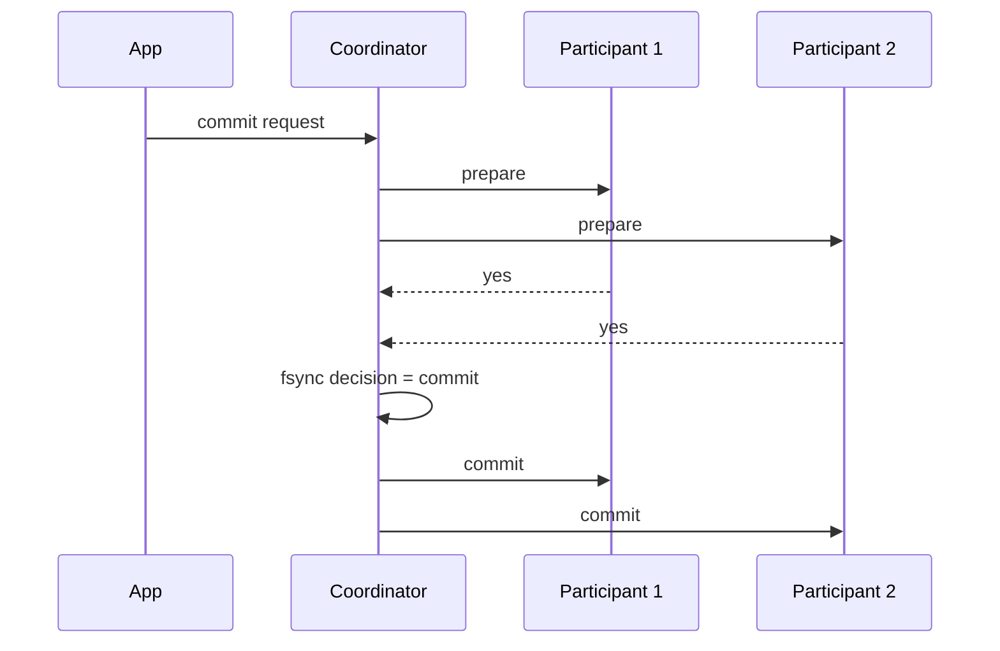
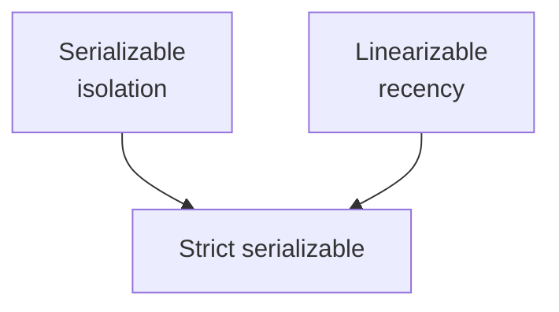

# Chapter 9: Consistency and Consensus

## Introduction
Letting the whole service fail is simple; better is a reusable abstraction with useful guarantees. Core one: **consensus** — getting all nodes to agree (leader election, atomic commit). Prevents split brain where two nodes both think they're leader.

---

## Section 1: Consistency Guarantees

Most replicated DBs give at least **eventual consistency** — temporary divergence, eventual convergence. Weak = fast/available but app must handle quirks; strong = easy to reason, slower/less fault-tolerant.

Isolation (Ch. 7) = avoid races among concurrent txns. Distributed consistency = recency/ordering of replicas under faults/delays.

---

## Section 2: Linearizability

Makes system look like single copy, every operation atomic. Once any client reads new value, all later reads return it. Test by recording request/response timings and checking sequential validity. `cas(x, old, new)` is canonical linearizable op.

- **Serializability:** txns behave as if in *some* serial order (isolation).
- **Linearizability:** reads/writes have recency on single register.
- Both = **strict serializability**. 2PL/serial execution typically linearizable; SSI is not by design.

When you need it:
1. **Lock/leader election:** only one leader — ZooKeeper/etcd via consensus.
2. **Uniqueness constraints:** username, email, seat, stock — check-and-set or lock; foreign-key checks don't need it.
3. **Cross-channel timing:** uploader → storage → queue → resizer race; linearizable storage removes it.

Implementations: single copy (not fault-tolerant), single-leader replication (potentially), consensus algorithms (yes). Multi-leader no, leaderless (Dynamo-style) probably no — and slow if forced.

CAP: only linearizability + one network fault considered (Consistent-or-Available-under-Partition). Delays, dead nodes, other tradeoffs ignored — historically influential, little design value now. Main cost of linearizability is **performance always**, not just during partitions. If you don't need it, replicas stay available under partition.

---

## Section 3: Ordering Guarantees

**Causality:** cause before effect (question before answer). **Causally consistent** = you see causes before effects (snapshot isolation qualifies). Partial order (concurrent ops any order) vs linearizable total order (any two comparable). Linearizability preserves causality but costs; causal is strongest model that stays fast + available under network trouble.

Track dependencies:
- **Version vectors** distinguish concurrent vs causal — precise but heavy.
- **Sequence numbers / Lamport timestamps** `(counter, nodeID)`: each node/client tracks max seen, bumps own on receive. Compact total order consistent with causality, but forces order on concurrent ops.

**Total order broadcast** = reliable + same-order delivery to all nodes (ZooKeeper/etcd). Equivalent to repeated consensus; basis for **state machine replication** (same writes same order → same state). Fixed at delivery — no retroactive inserts. Use: replication, serializable txns, log, fencing.

Build linearizable storage on total-order log: append claim (e.g. username), read log, first claim wins. Reads linearizable via log-append-then-read, `sync()`-style position wait (ZooKeeper), or sync-updated replica. Reverse (total order from linearizable register): increment-and-get sequence, attach, deliver in order.

---

## Section 4: Distributed Transactions and Consensus

Agree on leader + agree on commit/abort. Impossible in pure async with crashes (FLP) — timeouts/crash detection make it practical.

### Atomic Commit and 2PC
Single node: order of disk writes decides. Multi-node: sending commit independently breaks atomicity. 2PC (prepare → commit/abort) via **coordinator**:
1. App reads/writes participants, gets txn ID.
2. Coordinator sends prepare; participant fsyncs + votes yes (point of no return) or no.
3. All yes → commit, else abort; coordinator fsyncs decision first, retries sends forever.

Failure: coordinator dead before prepare → safe abort. After yes-vote → participant blocked (**in doubt**) until coordinator recovers via log. 3PC needs perfect failure detector — not practical. XA standardizes 2PC across Postgres/MySQL/Oracle + ActiveMQ/MQ (C API, not wire protocol). Costs: fsync + round-trips (~10x slower), locks held while in doubt stall app, coordinator log = stateful single point, lowest-common-denominator (no cross-system deadlock detection). Exactly-once queue+DB processing is the payoff use.

### Fault-Tolerant Consensus
Properties: uniform agreement, integrity (no double-decide), validity (decided value was proposed), termination (non-crashed eventually decide — needs majority up). Algorithms: Viewstamped Replication, Paxos, Raft, Zab — all but Paxos give total-order broadcast directly.

Internally all use leader + **epochs** (Paxos ballot, VSR view, Raft term): unique leader per epoch, higher epoch wins. Two votes: elect leader, then approve proposal — quorums must overlap (vs 2PC needing *every* yes). Limits: strict majority required, fixed voter set (dynamic membership hard), timeout-based failure detection flaps across DCs.

### Membership and Coordination Services
ZooKeeper/etcd/Consul: tiny in-memory dataset, replicated via total-order broadcast. Not general DBs — used indirectly (HBase, YARN, Kafka). Provide linearizable CAS, total-order fencing tokens (zxid/cversion), session failure detection + ephemeral lock release, watch notifications, service discovery (though DNS + cache often suffices).

---

## Diagrams and Code

### 2PC happy path and coordinator failure





### Code: Lamport clock and 2PC sketch

```python
class Lamport:
    def __init__(self, node):
        self.node = node
        self.counter = 0

    def tick(self):
        self.counter += 1
        return (self.counter, self.node)

    def receive(self, remote):
        self.counter = max(self.counter, remote[0]) + 1
        return (self.counter, self.node)

a = Lamport("a")
b = Lamport("b")
t1 = a.tick()
t2 = b.receive(t1)
print(t1, t2, t2 > t1)
```

```python
class Coordinator:
    def __init__(self, parts):
        self.parts = parts
        self.log = []

    def commit(self, txn):
        votes = [p.prepare(txn) for p in self.parts]
        decision = "commit" if all(v == "yes" for v in votes) else "abort"
        self.log.append((txn, decision))
        for p in self.parts:
            p.send(decision, txn)
        return decision
```

```sql
SELECT * FROM doctors WHERE on_call = true AND shift_id = 1234 FOR UPDATE;
```

## Conclusion
### Key Takeaways
1. Eventual always; linearizable when recency matters (leader, uniqueness, cross-channel).
2. Causal = fast + available; Lamport for compact order, vectors for concurrency detection.
3. Total-order broadcast ⇔ consensus; state-machine replication keeps replicas identical.
4. 2PC for atomic commit but blocking + slow; Raft/Paxos/Zab + ZooKeeper for leader/coordination.
