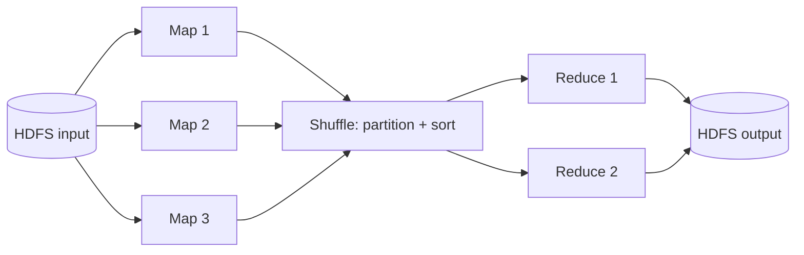
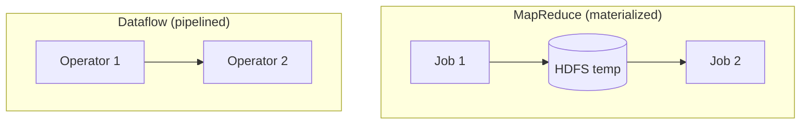

# Chapter 10: Batch Processing

## Introduction
Three system kinds:
- **Services (online):** wait for request, reply fast.
- **Batch (offline):** run job over large bounded input, produce output. Scheduled, may take days, no user waiting.
- **Stream (near-real-time):** consume unbounded input shortly after arrival (Ch. 11).

This chapter: Unix tools → MapReduce/HDFS → dataflow engines.

---

## Section 1: Batch Processing With Unix Tools

Log analysis in minutes: `awk`/`sed`/`grep`/`sort`/`uniq`/`xargs`.

Top-5 pages example:
```
cat access.log | awk '{print $7}' | sort | uniq -c | sort -r -n | head -n 5
```
Split by whitespace ($7 = URL), sort, count uniques, numeric reverse sort, top 5.

Why Unix wins:
- **Uniform interface:** everything is a file/byte stream via stdin/stdout. Any output plugs into any input; write your own tool by obeying the convention.
- Immutability-friendly: inputs untouched, pipeline stoppable anytime, intermediate stages dumpable to files for fault tolerance; auto-sorts across cores, handles larger-than-RAM.
- Limitation: single machine only → Hadoop.

---

## Section 2: MapReduce and Distributed Filesystems

MapReduce = Unix tools across thousands of machines. stdin/stdout replaced by distributed filesystem files (HDFS). HDFS = shared-nothing: per-machine daemon + central **NameNode** tracking block placement; blocks replicated or erasure-coded (Reed-Solomon).

Job = mapper + reducer callbacks:
1. Split input files into records (e.g. log line).
2. **Mapper** per record → key-value (e.g. URL → count).
3. **Shuffle:** partition by reducer (hash of key), sort, copy partitions to reducers — sorted merge across mappers.
4. **Reducer** per key → iterate values, emit output.

Mapper/reducer see one record at a time, no placement knowledge. Scheduler puts computation near data; reducer count configured by author. No randomness allowed. Single job limited → chain into **workflows** via directory names (output dir = next input).

### Joins in Batch Processing
No indexes — full table scans. Copy needed DB into HDFS via ETL (remote per-record queries too slow + inconsistent mid-round-trip).

- **Sort-merge join:** mappers emit `(userID, event)` + `(userID, profile)`; reducers get both adjacent, join in one pass (e.g. age-at-click per URL). Only one user record in RAM, no network. Handles grouping too. Hot/linchpin keys skew one reducer (celebrity) → stall whole workflow; fix by sampling + replicating hot key to many reducers (skewed/shared join in Pig/Crunch, Hive needs explicit keys).
- **Map-side (no reducers/sort):** **broadcast hash** (small side in memory) or **partitioned hash** (both pre-partitioned same way). Faster, needs assumptions.

### Output of Batch Workflows
Often not a report but a structure: search indexes (Google's original 5–10 job MapReduce pipeline; still good for Lucene/Solr), ML classifiers/recommenders (user→friends, product→related).

Don't write per-record to live DB from mappers (per-request latency, overwhelm, partial-job visibility). Instead **build new DB inside job** as files on HDFS (Voldemort, Terrapin, ElephantDB, HBase bulk load), then atomic switch: copy files to servers, flip to new version, rollback by flipping back.

Unix philosophy pays off: immutable inputs, rerunnable same-output, fast feature iteration, transparent task retry, separation of concerns, same files feed many jobs. Hadoop = distributed Unix (HDFS = FS, MapReduce = process). Dump raw to HDFS first, interpret later (consumer's problem) — MPPs instead demand upfront modeling but give SQL elegance. MPP aborts whole query on node crash; MapReduce retries single task, loves disk (fault tolerance + bigger-than-RAM). 1-hour task ~5% preemption at Google — design for it.

---

## Section 3: Beyond MapReduce

Higher layers (Pig, Hive, Cascading, Crunch) cut code + enable interactive use. MapReduce robust but slow for some shapes.

Core flaw: **full materialization** — every job writes intermediate state to replicated HDFS. No next job starts until all prior tasks done, redundant mappers re-read reducer output, temp replication wastes resources.

**Dataflow engines** (Spark, Tez, Flink/Dryad/Nephele): whole workflow = one job, flexible **operators** (not just map/reduce), in-place sort only when needed, no forced HDFS writes. Same logic runs far faster. Fault tolerance flips: track lineage (**RDD**) or checkpoint operator state, recompute lost partitions. Recompute hurts for tiny data/CPU-heavy jobs — materialization cheaper there.

Graphs/iteration ("repeat until done") can't do single-pass MapReduce → **BSP/Pregel** (Giraph, GraphX, Gelly): vertices hold state in RAM across supersteps, message along edges, batch messages, checkpoint per iteration. Cross-machine overhead huge — if graph fits one machine, stay there.

---

## Diagrams and Code

### MapReduce dataflow



### Materialization vs dataflow engine



### Code: Unix pipeline plus mapper and reducer

```bash
cat /var/log/nginx/access.log |
  awk '{print $7}' |
  sort |
  uniq -c |
  sort -r -n |
  head -n 5
```

```python
import sys
from collections import defaultdict

def mapper():
    for line in sys.stdin:
        parts = line.split()
        if len(parts) >= 7:
            print(f"{parts[6]}\t1")

def reducer():
    counts = defaultdict(int)
    for line in sys.stdin:
        url, n = line.rsplit("\t", 1)
        counts[url] += int(n)
    for url, c in sorted(counts.items(), key=lambda kv: kv[1], reverse=True)[:5]:
        print(f"{c}\t{url}")
```

## Conclusion
### Key Takeaways
1. Unix pipes: uniform byte interface + immutability; single-machine limit.
2. MapReduce: mapper → shuffle/sort → reducer; sort-merge vs map-side joins; build DB files, atomic swap.
3. Materialization cost vs recompute cost; dataflow engines + Pregel for iterative/graph work.
