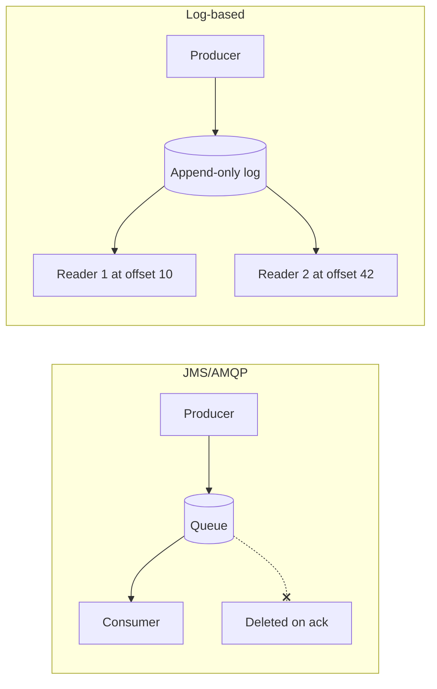
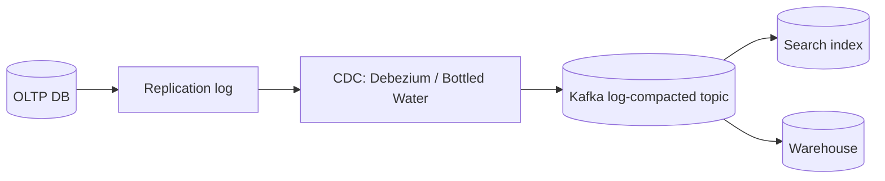

# Chapter 11: Stream Processing

## Introduction
Batch waits for bounded input to finish; stream processes unbounded events as they arrive — sub-second latency vs days. Event = small immutable record with timestamp, grouped into topic/stream. Polling a DB for new events is expensive → messaging systems notify consumers.

---

## Section 1: Transmitting Event Streams

Two questions per pub/sub design:
1. Producers faster than consumers? Drop, buffer/queue, or **backpressure** (block producer).
2. Node crash? Lose messages or pay durability cost (disk + replication, lower throughput, higher latency).

- **Direct:** UDP multicast, ZeroMQ, StatsD/Brubeck metrics, webhooks (HTTP/RPC push). No intermediary, but app handles loss; offline consumer misses data; crashed producer loses buffer.
- **Broker/queue:** server both sides connect to (RabbitMQ, ActiveMQ, HornetQ, JMS/AMQP, TIBCO, IBM MQ, Pub/Sub). Producer waits only for broker-buffer ack (**asynchronous** consumers). Broker deletes on successful delivery (no long storage), assumes small working set, supports topic-pattern subscription + change notifications. Patterns: **load balancing** (each message → one consumer) vs **fan-out** (each → all). **Acknowledgements** drive redelivery (crashed consumer's message → another), but load-balance + redelivery reorders — use per-consumer queues to preserve order.

### Partitioned (Log-Based) Logs
AMQP/JMS delete on consume — new consumer can't replay history. Fix: **append-only log** on disk (like `tail -f`). Producer appends; consumer reads sequentially + waits for new tail. Partition for scale; topic = group of partitions; each partition assigns monotonic **offset** per message.

Kafka, Kinesis, DistributedLog work this way. Fan-out free (independent readers, no deletion); load balance by assigning whole partitions to consumer-group members (limits: consumers ≤ partitions, slow message blocks its partition). Prefer JMS/AMQP when per-message cost high + order unimportant (fine-grained parallelism); prefer logs when throughput high + messages cheap + order matters. Offsets mirror DB log sequence numbers (broker = leader, consumer = follower); restart resumes at recorded offset (unrecorded tail replays). Retention by time/size — lagging past deleted segment loses data. Offset is consumer-controlled → replay by rewinding.

---

## Section 2: Databases and Streams

Replication log = stream of write events. **Dual writes** (app writes DB + index + cache) race (DB: A→B, index: B→A order flipped) and lack atomic commit (one succeeds, other fails). Better: **Change Data Capture (CDC)** — observe DB changes, replay in order to followers. Log-based broker preserves order. Impl: parse replication log (Databus, Wormhole, Sherpa, Bottled Water/Postgres WAL, Maxwell/Debezium MySQL binlog, Mongoriver oplog, GoldenGate/Oracle) + snapshot at known offset + **log compaction** (keep latest per key, tombstone = delete) for rebuilds. Kafka log compaction + Kafka Connect generalize this. RethinkDB/Firebase/CouchDB changefeeds similar.

### Event Sourcing
CDC extracts mutable-DB changes at storage layer; event sourcing writes **immutable command events** at app layer (append-only event store, updates discouraged). Store intent ("student cancelled enrollment"), not side effects — new features chain off old events, debugging explains why, bugs don't destroy history. Transform log → read views deterministically; snapshot to truncate replay.

CQRS insight: write form need not equal read form (Druid/Kafka, Pistachio/Kafka commit log, Connect sinks). Costs: async consumers break read-your-writes (fix: sync view update for own writes, total-order broadcast, or same-partition single-threaded consumer needing no locks); immutable history fragments under heavy update/delete (compaction/GC cost) + admin deletes hard (Datomic excision).

---

## Section 3: Processing Streams

Per event, three sinks: write to store (DB/cache/index), push to user (alerts/dashboards), emit to another stream (operator job — never ends, unlike batch).

Uses: fraud, trading rules, factory monitoring, intel/attack detection.

- **CEP (Esper, InfoSphere, Apama, StreamBase, SQLstream):** long-lived declarative/SQL-pattern queries; input flows past; match emits **complex event**.
- **Analytics (Storm, Spark Streaming, Flink, Concord, Samza, Kafka Streams, Dataflow, Azure Stream Analytics):** rates, rolling averages, week-over-week comparisons — less sequence-matching, more aggregation.
- **Search streams:** invert engine — store + index **queries**, stream events past them (vs index data, query once).
- **RPC crossover:** Storm distributed RPC.

### Time and Windows
Batch time ≠ event time. Frameworks defaulting to **processing time** (local clock) break under queue/restart lag. Log three stamps (occur/device-send/server-receive) to estimate clock offset. Windows never provably complete — timeout after silence, then ignore stragglers (count drops) or publish correction (retract prior). Types: **tumbling** (fixed, disjoint, e.g. 1-min), **hopping** (fixed, overlapping for smoothing, e.g. 5-min/1-min hop), **sliding** (event-anchored interval), **session** (activity burst until 30-min idle; web analytics).

### Joins
- **Stream-stream:** keep hour-indexed state per session ID; on search or click, probe other index, emit matched pair.
- **Stream-table (enrich):** per activity event, need profile — remote lookup slow/risky; replicate table locally via CDC.
- **Table-table:** maintain follower sets to know which timelines update per tweet.
- **Time-dependence (SCD):** joining against changing state is nondeterministic unless versioned (embed tax-rate ID in invoice → deterministic, but kills log compaction).

### Fault Tolerance
Batch retries task → **exactly-once** appearance. Streams can't hide output until end (infinite). Fixes: **microbatching** (Spark Streaming ~1s blocks as mini-batches; small = overhead, large = latency) or **checkpointing** (Flink rolling state snapshots to HDFS). Once output leaves processor, redelivery duplicates side effects → need atomic commit across systems (Dataflow, VoltDB, Kafka plans amortize 2PC over many messages) or **idempotence** (same effect once or many times; add metadata/operation IDs). State recovery: remote replicated store (slow) vs local + periodic replication (Flink snapshots, Samza/Kafka Streams changelog topics with compaction, VoltDB redundant multi-node execution).

---

## Diagrams and Code

### Broker vs partitioned log



### CDC pipeline



### Code: windows and idempotent sink

```python
from datetime import datetime, timedelta

def tumbling_window(ts, size_minutes=1):
    epoch = datetime(1970, 1, 1)
    n = int((ts - epoch).total_seconds() // (size_minutes * 60))
    start = epoch + timedelta(minutes=n * size_minutes)
    return start, start + timedelta(minutes=size_minutes)

def hopping_window(ts, size_minutes=5, hop_minutes=1):
    epoch = datetime(1970, 1, 1)
    secs = int((ts - epoch).total_seconds())
    latest = (secs // (hop_minutes * 60)) * hop_minutes
    return [(epoch + timedelta(minutes=s),
             epoch + timedelta(minutes=s + size_minutes))
            for s in range(latest - size_minutes + hop_minutes, latest + 1, hop_minutes)
            if s >= 0]

now = datetime(2024, 1, 1, 10, 3, 30)
print(tumbling_window(now))
print(hopping_window(now)[-1])
```

```sql
SELECT window_start, count(*) AS events
FROM TABLE(TUMBLE(TABLE events, DESCRIPTOR(event_time), INTERVAL '1' MINUTE));
```

```python
seen = set()

def sink(event_id, apply):
    if event_id in seen:
        return False
    apply()
    seen.add(event_id)
    return True

sink("req-1", lambda: print("applied"))
print(sink("req-1", lambda: print("applied")))
```

## Conclusion
### Key Takeaways
1. Broker vs log: delete-on-read + per-message parallelism vs replayable offsets + order.
2. CDC/event sourcing replace dual writes; compaction + snapshots bound history.
3. Event time over processing time; tumbling/hopping/sliding/session; version IDs for deterministic joins.
4. Microbatch vs checkpoint; atomic commit or idempotence for exactly-once.
