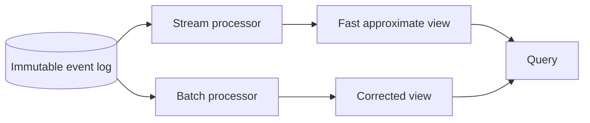
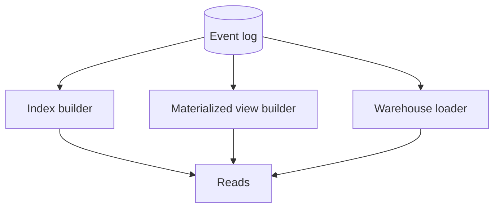

# Chapter 12: The Future of Data Systems

## Introduction
No single tool fits all patterns. This chapter combines specialized tools via derived data, unbundles the database, aims for correctness without heavy coordination, and closes with ethics.

---

## Section 1: Data Integration

Every product — even "general-purpose" DB — targets a usage pattern. Real apps compose many: OLTP for requests, search index for keywords, warehouse/batch/stream for analytics, caches/denormalized views, ML/ranking, notifications. Keeping copies in sync is the hard part.

Distributed transactions order writes with locks (2PL) + atomic commit — linearizable but poor fault tolerance/performance (XA). CDC/event sourcing order with log + ensure once via deterministic retry + idempotence — async, robust. Without good distributed-txn protocol, **log-based derived data** is most promising; keep read-your-writes where needed.

Open problems: total order needs single leader (throughput cap); cross-DC / cross-service event order undefined; client-side state sees different order than server. Total-order broadcast beyond single node still research.

### Batch and Stream Processing
Both have functional flavor (output depends only on input, managed state) — good for fault tolerance + reasoning as pipelines. Spark = streaming atop batch (microbatches); Flink = batch atop streaming.

- Stream: low-delay view updates.
- Batch: reprocess history for new views.
- **Gradual evolution:** keep old + new schema as side-by-side derived views, drop old when safe — no flag-day migration.
- **Lambda architecture:** immutable event log + both engines in parallel; stream gives approximate fast view, batch corrects later. Cost: run/debug two systems.

---

## Section 2: Unbundling Databases

One DB bundles secondary indexes, materialized views, replication logs, full-text indexes — synchronously maintained via distributed txns. Async event log + idempotent writers unbundles this into loosely coupled components that act like a database together. Advantage: outage in one part doesn't take all; teams evolve pieces independently. Only do it when no single product covers needs.

### Designing Applications Around Dataflow
Run app code on Mesos/YARN/Docker/Kubernetes (does it better than in-DB UDFs). Keep stateless logic separate from state (no logic in DB, no state in app — "separation of Church and state"). SOA wins via loose coupling + independent deploys.

Dataflow vs microservices: one-way async stream joins vs sync RPC. Example — currency conversion on purchase: microservice queries rate service per purchase (network per request); dataflow subscribes to rate stream, caches locally, joins on read (no network on hot path — fastest request is none).

Push to edge: Server-Sent Events/WebSockets + Elm/React-Redux event streams extend dataflow to browsers (chat, games, live dashboards). Materialized views/caches = precomputed common queries (write pays, read fast). Even reads can be events through the processor (reconstruct what user saw, track causality).

---

## Section 3: Aiming for Correctness

Transactions aren't leaving, but correctness works in dataflow too. Serializability doesn't prevent bugs — favor immutable append-only (don't let bad code destroy good data) + **idempotence** + end-to-end operation IDs.

2PC doesn't guarantee once: browser double-POST after timeout commits twice. Fix: UUID/request hash from client through all layers (`UNIQUE(request_id)` + conditional balance updates), immutable messages, deterministic derivations, duplicate suppression. TCP covers low level; remaining faults rare but need app-level IDs.

Constraints without coordination:
- **Uniqueness needs consensus** (single leader or partitioned log). Partition by constrained value (hash username) to scale; async multi-master can't reject immediately.
- Log approach: client appends request to ID-partitioned log; single-threaded processor per partition decides first-wins deterministically; emits success/reject. Money transfer: request log → debit stream (payer partition) + credit stream (payee partition) → dedup by request ID. Same as linearizable-log algorithm, scales with partitions.

**Timeliness vs integrity:** consistency conflates both. Timeliness violation = eventual consistency (stale bank lag OK). Integrity violation = perpetual inconsistency (wrong sums, disappearing money — catastrophic). ACID gives both; dataflow guarantees integrity (single-message atomic writes, deterministic fns, request IDs, immutability) without timeliness. Many domains accept temporary constraint breach + apology (oversell → refund) to avoid sync cost. Run serializable only in small scopes needing it; skip XA everywhere.

**Trust but verify (auditing):** never blindly trust guarantees — continually check integrity end-to-end (restore backups, checksums, Merkle trees, certificate transparency, blockchains). Event sourcing audits better (why, not just what); deterministic pipelines trace easily. Auditing lets you ship faster, like tests.

---

## Section 4: Doing the Right Thing

Systems have intended + unintended consequences — ethics is ours to bear (ACM Code). Predictive analytics amplifies input bias (past behavior → stereotype, feedback loops, echo chambers). Needs systems thinking + moral imagination — data as tool, not master; humans accountable.

**Privacy/tracking:** storing explicit user input = service (user is customer). Side-effect logging for advertisers = surveillance (advertisers are customers). Privacy = freedom to choose what to reveal, not total secrecy. Collection transfers that right to company; consent meaningless without understanding + network-effect lock-in; future regimes may abuse retained data ("poor civic hygiene to build police-state-ready tech"). Don't treat users as metrics; self-regulate collection, educate users, purge when unneeded. Like industrial pollution controls, constraints benefit society long-term.

---

## Diagrams and Code

### Lambda architecture



### Unbundled database



### Code: request IDs and event-sourced fold

```sql
ALTER TABLE requests ADD UNIQUE (request_id);

BEGIN;
INSERT INTO requests (request_id, from_account, to_account, amount)
VALUES ('0286FDB8-D7E1-423F-B40B-792B3608036C', 4321, 1234, 11.00);
UPDATE accounts SET balance = balance + 11.00 WHERE account_id = 1234;
UPDATE accounts SET balance = balance - 11.00 WHERE account_id = 4321;
COMMIT;
```

```python
def fold(events, state):
    for e in events:
        t = e["type"]
        if t == "credited":
            state["balance"] += e["amount"]
        elif t == "debited":
            state["balance"] -= e["amount"]
    return state

ledger = [
    {"type": "credited", "amount": 100},
    {"type": "debited", "amount": 11},
]
print(fold(ledger, {"balance": 0}))

processed = set()

def handle(request_id, effect):
    if request_id in processed:
        return False
    effect()
    processed.add(request_id)
    return True
```

## Conclusion
### Key Takeaways
1. Compose via log-based derived data; lambda when need fast-approx + correct-late.
2. Unbundle with async idempotent logs; dataflow joins beat RPC on hot paths.
3. Integrity via immutability + request IDs + deterministic replay; audit continuously.
4. Bias amplifies; surveillance ≠ service — purge, consent, dignity by design.
