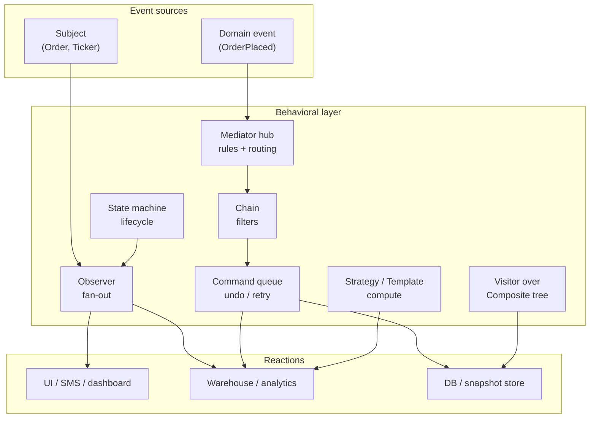

# Behavioral Design Patterns — Family Overview

> Youtube: [41. All Behavioral Design Patterns | Strategy, Observer, State, Template, Command, Visitor, Memento](https://www.youtube.com/watch?v=DBDnUkToba)

Behavioral patterns govern **how objects collaborate**: who talks to whom, who decides what runs next, and how responsibilities shift at runtime. If creational patterns control birth and structural patterns control shape, behavioral patterns control **conversation and control flow**.

This page is the family index: what each of the 11 patterns does, how they differ, how they combine, and which one to reach for. Deep mechanics live in the per-pattern pages.

## Pattern Catalog (with links)

| Pattern | Page | Intent in one line | Reach for it when |
|---|---|---|---|
| Chain of Responsibility | [chain-of-responsibility.md](chain-of-responsibility.md) | Pass a request along handlers until one acts | Middleware, filters, approval ladders |
| Command | [command.md](command.md) | Encapsulate a request as an object | Undo, queues, macros, job scheduling |
| Interpreter | [interpreter.md](interpreter.md) | Grammar plus evaluator for a mini-language | Rules engines, expressions, DSLs |
| Iterator | [iterator.md](iterator.md) | Sequential access without exposing internals | Custom collections, lazy traversal |
| Mediator | [mediator.md](mediator.md) | Central hub for many-to-many talk | Chat rooms, dialogs, coordination |
| Memento | [memento.md](memento.md) | Snapshot and restore state | Undo checkpoints, drafts, rollback |
| Observer | [observer.md](observer.md) | Notify dependents on state change | Events, pub-sub, model-view sync |
| State | [state.md](state.md) | Behavior follows internal stage | Workflows, connections, order lifecycle |
| Strategy | [strategy.md](strategy.md) | Interchangeable algorithms, runtime pick | Payments, routing, pricing, sorting |
| Template Method | [template.md](template.md) | Fixed skeleton, varying steps | ETL, test lifecycles, reports |
| Visitor | [visitor.md](visitor.md) | New operations over a stable structure | Compilers, ASTs, exporters, tax |

*Part-2 deep-dives (Observer, State, Strategy, Template, Visitor) follow the full 12-section reference format; the remaining pages keep their existing depth.*

## What Makes a Pattern "Behavioral"

- **Subject is collaboration**, not construction or wrapping: message paths, algorithm choice, lifecycle stages, traversal.
- **Mechanism is delegation**: contexts delegate to strategies, states, commands, or visitors instead of branching.
- **Volatility decides the pattern**: encapsulate what changes — varying algorithms become Strategies, varying reactions become Observers, varying stages become States.
- **Composition over inheritance** (except Template Method, which deliberately uses inheritance for a fixed skeleton).
- **Runtime flexibility**: most behavioral patterns let behavior change without recompiling callers — swap a strategy, attach an observer, push a command.

## Communication Styles at a Glance

| Style | Patterns | Topology | Example |
|---|---|---|---|
| Broadcast | Observer | One subject → many dependents | Order status → SMS, dashboard, warehouse |
| Centralized | Mediator | Many peers ↔ one hub | Chat room, dialog controller, ATC |
| Pipeline | Chain of Responsibility | Request → handler → handler | Auth → validation → execution filters |
| Encapsulated request | Command, Memento | Invoker → command → receiver; caretaker → memento | Undo stack, transactional jobs |
| Traversal | Iterator, Visitor | Walk structure; compute per element | Collection cursors; AST tax/export passes |
| Algorithm selection | Strategy, State, Template | Delegate to strategy / state / skeleton | Payments; order lifecycle; ETL pipeline |
| Interpretation | Interpreter | Parse tree → evaluate | Regex, rule expressions, query DSLs |

## Design Principles Behind the Family

1. **Encapsulate what varies** — Strategy/State hide varying behavior; Template hides varying steps inside a fixed order.
2. **Program to an interface** — every pattern introduces an abstraction (`Observer`, `RouteStrategy`, `OrderState`, `CartVisitor`) that decouples callers.
3. **Favor composition** — Strategy/Command/Bridge-style wiring beats subclass explosions; Template is the principled exception.
4. **Loose coupling** — Mediator/Observer cut direct references; Chain decouples senders from handlers.
5. **Single Responsibility** — one class per reaction, algorithm, stage, or operation.
6. **Open/Closed** — new strategies, commands, observers, and visitors arrive as new types, not edited branches.
7. **Hollywood Principle** — Template and Observer call application code ("don't call us, we'll call you").

## Decision Guide

Ask in this order:

1. **Many objects must stay consistent with one source?** → [Observer](observer.md). Graduate to a broker (Kafka/SNS) across services.
2. **Peers need two-way coordination with rules?** → [Mediator](mediator.md). Split hub per bounded context.
3. **Request flows through handlers until one acts?** → [Chain of Responsibility](chain-of-responsibility.md). Keep chains short and visible.
4. **Requests must be queued, logged, or undone?** → [Command](command.md) (+ [Memento](memento.md) for snapshots).
5. **Caller picks among peer algorithms?** → [Strategy](strategy.md). Hide the catalog in a factory.
6. **Behavior depends on lifecycle stage?** → [State](state.md). Reject illegal (state, event) pairs loudly.
7. **Step order fixed, step bodies vary?** → [Template Method](template.md). Lock order with `final`; hooks for options.
8. **Operations multiply over a stable hierarchy?** → [Visitor](visitor.md). Accept that new element types break all visitors.
9. **Uniform traversal hiding storage?** → [Iterator](iterator.md). Pair with Composite for trees.
10. **Save/restore checkpoints?** → [Memento](memento.md). Bound history depth; prefer incremental snapshots.
11. **Evaluate a small language?** → [Interpreter](interpreter.md). Keep grammars tiny or graduate to a parser generator.

```text
One source, many reactions ............ OBSERVER (broker if cross-service)
Peers negotiate with rules ............ MEDIATOR
Request passes handler to handler ..... CHAIN
Defer / queue / undo work ............. COMMAND (+ MEMENTO for state)
Caller chooses algorithm .............. STRATEGY
Lifecycle chooses behavior ............ STATE
Fixed order, varying steps ............ TEMPLATE METHOD
Stable types, growing operations ...... VISITOR
Hide traversal ........................ ITERATOR
Snapshot / restore .................... MEMENTO
```

## Lookalike Pairs (Interview Favorites)

| Pair | Distinguisher | One-line rule |
|---|---|---|
| State vs Strategy | Who switches? | Lifecycle → State; caller → Strategy |
| Template vs Strategy | What varies? | Fixed skeleton + steps → Template; whole algorithm → Strategy |
| Observer vs Mediator | Direction? | One-way broadcast → Observer; two-way hub rules → Mediator |
| Observer vs pub/sub | Distance? | In-process fan-out → Observer; durable cross-service → broker |
| Command vs Strategy | Encapsulates what? | Request to run later → Command; algorithm to run now → Strategy |
| Visitor vs Iterator | Question? | Per-type operations → Visitor; uniform walking → Iterator |
| Memento vs Command | Stores what? | State snapshot → Memento; executable request → Command |
| Chain vs Decorator | Flow? | First-match handling → Chain; always-delegate stacking → Decorator |

## Patterns Often Combined

- **Command + Memento** — history stack for undo; memento snapshots state before each command.
- **Observer + Mediator** — mediator uses observer fan-out; MVC hubs notify views.
- **State + Strategy** — same UML, complementary intent; templates may inject strategies per stage.
- **Iterator + Composite** — traverse file trees, UI trees, org charts uniformly.
- **Chain + Command** — middleware pipelines carry command objects (auth → validate → execute).
- **Visitor + Composite** — operations walk trees (lint, export, codegen over ASTs).
- **Template + Strategy** — fixed skeleton with runtime-swappable stages (ETL transform as strategy).
- **Observer + Command** — domain events (observer) trigger queued commands (async handlers).

## Performance and Cost Map

| Pattern | Memory | Runtime | Scales to | Watch out |
|---|---|---|---|---|
| Chain | Low | Medium (traversal) | Medium | Long chains; invisible handler |
| Command | Medium (objects) | Low | High | Trivial commands; missing undo |
| Interpreter | Medium | High (interpret) | Low | Hot-path parsing; cache ASTs |
| Iterator | Low | Low | High | Lazy infinite sequences |
| Mediator | Low | Low | High | God-object hub |
| Memento | High (snapshots) | Medium | Medium | Unbounded history |
| Observer | Medium (list) | Medium (fan-out) | Medium-High | Leaks; storms; ordering |
| State | Low | Low | High | State explosion |
| Strategy | Low | Low | High | Catalog confusion |
| Template | Low | Low | High | Fragile base class |
| Visitor | Low | Low-Med | High | New types break all visitors |

Optimization habits: batch Observer notifications; bound Memento history; cache Interpreter parses; keep Chains short; metric per-Strategy latency; log every State transition.

## Behavioral Patterns in Modern Stacks

- **Microservices** — Chain in gateway filters; Command in CQRS; Observer in Kafka/EventBridge; Mediator in orchestrators; State in Step Functions.
- **Reactive** — Observer underlies RxJS/Reactor; Iterator underlies async streams; Command models Redux actions.
- **Frontend** — Observer in hooks/signals; State in XState; Strategy in render/validation selection; Mediator in stores/event buses.
- **DDD** — Command for write-side intents; Observer for domain events; Strategy for domain-service variants; Memento for event-sourced snapshots.
- **Cloud-native** — Chain in function compositions; Observer in SNS/SQS fan-out; State in workflow engines; Command in serverless handlers.

## Anti-Patterns to Avoid

1. **Observer leaks** — subscriptions without teardown; deep cascading chains. Fix: lifecycle unsubscribe, weak refs, batching.
2. **God Mediator** — hub absorbs all logic. Fix: one mediator per bounded context, routing only.
3. **State explosion** — dozens of ad-hoc states. Fix: transition table or workflow engine past ~8 states.
4. **Strategy for constants** — one class per value. Fix: config/enum unless logic truly varies.
5. **Template rigidity** — base edits break children; ten hooks nobody understands. Fix: composition/Strategy for moving parts.
6. **Visitor overkill** — double dispatch for two cases on a churning hierarchy. Fix: switch or polymorphism until operations outnumber types.
7. **Command ceremony** — classes for trivial calls with no queue/undo need. Fix: functions until deferral matters.

## Framework Sightings

- **Spring** — Template (`JdbcTemplate`), Observer (`ApplicationEvent`), Strategy (transaction managers), Chain (security filters).
- **React/Redux** — Observer (hooks), Command (actions), Mediator (store), State (component machines).
- **Express/ASP.NET** — Chain (middleware pipelines), Observer (emitters), Template (action filters).
- **Android** — Observer (`LiveData`/`Flow`), Command (intents), Mediator (`EventBus`), State (lifecycle).

## Interview Preparation (Family-Level)

**Q1: How do you pick among State, Strategy, and Template on the spot?**
Ask what varies and who chooses. Caller-picked peer algorithms → Strategy. Lifecycle-dictated validity → State. Fixed order with varying steps → Template. Name one example of each.

**Q2: Observer vs Mediator vs pub/sub?**
Observer wires subjects directly to dependents in-process. Mediator routes peer-to-peer rules through a hub. Pub/sub decouples via broker topics across processes with durability. Move outward as distance and durability grow.

**Q3: When does Visitor pay off — and when is it overkill?**
Pays off for stable element types with many growing operations (ASTs, documents). Overkill for two cases on a shifting hierarchy — a switch or virtual method wins until operations clearly outnumber types.

**Q4: How do you keep Observer from leaking or storming?**
Snapshot iteration, per-observer isolation, explicit unsubscribe, re-entrancy guards, batching, and idempotent observers. Graduate to a broker for cross-service durability.

**Q5: Design a notification system with email/SMS/push plus new channels.**
Strategy senders behind a Factory, Decorators for retry/rate-limit, Observer or queue for fan-out, Chain/Template for multi-step campaigns. New channels arrive as Strategies; policy changes touch Decorators only.

**LLD scenario — Order platform using four patterns together.**
*Expectation:* State drives order lifecycle; Observer fans status to SMS/warehouse/analytics; Strategy picks payment/shipping algorithms; Template fixes the fulfillment skeleton with per-channel steps. Narrate which force each pattern resolves and where they touch.

## Pattern Spotlights: Part-2 Deep Dives

Five patterns now ship as full 12-section references (overview → theory → mermaid UML → Java/Python/Go → industry uses → scenarios → when/when-not → do's → comparisons → interviews → testing → summary). Each spotlight below gives intent, the canonical example used on its page, and the trade-off to quote; click through for trilingual code, diagrams, and drills.

### Observer — broadcast without coupling ([observer.md](observer.md))

One `Order` subject pushes status changes to customer SMS, seller dashboard, and warehouse observers. Adding a fraud scorer is one `subscribe` call — `Order` never changes. The price is discipline: snapshot iteration, per-observer failure isolation, and explicit `unsubscribe`, or leaks and notification storms follow.

### State — lifecycle-driven behavior ([state.md](state.md))

An `Order` delegates `pay/ship/deliver/cancel` to its current state object (Pending → Paid → Shipped → Delivered). Illegal moves are rejected by type instead of nested `if status == X`. New stages arrive as new classes. Graduate from an enum switch once conditionals duplicate across methods.

### Strategy — caller-chosen algorithms ([strategy.md](strategy.md))

A `Navigator` delegates `route(from, to)` to driving/walking/transit engines picked by mode string through a factory map. Same context, swappable engines, independently testable. Hide the catalog behind a factory with a default; keep strategies stateless and never hand them the whole context.

### Template Method — fixed skeleton, varying steps ([template.md](template.md))

A `DataImporter.importData()` template locks `extract → transform → load → onComplete`; CSV and API importers fill only the varying steps. Order enforced by `final` (or a template function in Go). Reach for composition/Strategy when the order itself starts varying.

### Visitor — operations over a stable structure ([visitor.md](visitor.md))

`Book` and `Electronics` items accept `TaxCalculator` and `DiscountApplier` visitors via `accept → visit(this)` double dispatch. New operations are one class; new element types break every visitor. Commit only to stable hierarchies with growing operations (ASTs, documents, carts).

## Collaboration Topology (Visual Map)



*How to read it:* state changes enter from the left (subjects, domain events). The behavioral layer routes them — broadcast via Observer, negotiate via Mediator, filter via Chain, defer via Command, gate via State, compute via Strategy/Template/Visitor. Reactions exit on the right. A single order placement can traverse four boxes: State validates the transition, Observer fans out, a Command queues the SMS with retry, and a Memento snapshots pre-charge state for rollback.

## How to Read This Family

1. Start with Observer → Strategy → State — the three highest-yield interviews.
2. Then Template → Command → Mediator — skeletons, requests, and hubs.
3. Finish with Visitor → Iterator → Memento → Chain → Interpreter — traversal, snapshots, pipelines, languages.
4. For each page: intent → structure → Java idiom → when/not-when → one comparison → one interview answer. The 12-section part-2 pages follow exactly that rhythm.

## Family Cheat Sheet (Quote in Reviews)

| If you hear … | Answer with … | And add the cost |
|---|---|---|
| "Update everything when this changes" | Observer (or broker across services) | Unsubscribe + isolation discipline |
| "These peers keep referencing each other" | Mediator hub per bounded context | Keep the hub to routing only |
| "This request needs filters/approvals" | Chain of Responsibility | Short, visible chains |
| "We need undo / retry / queue" | Command (+ Memento snapshot) | One class per action; bound history |
| "User picks the algorithm" | Strategy behind a factory | Catalog docs + default |
| "Stage decides what is legal" | State with rejecting transitions | One class per stage; log moves |
| "Same order, different steps" | Template Method, `final` skeleton | Few hooks; composition if order moves |
| "New reports over the same model" | Visitor over stable types | New types break all visitors |
| "Walk this without exposing it" | Iterator (Composite for trees) | Lazy vs eager traversal choice |
| "Parse and run this mini-language" | Interpreter, kept tiny | Cache ASTs; graduate to real parser |

## Version Notes

- Part-2 refresh: Observer, State, Strategy, Template, Visitor expanded to the full 12-section reference format (mermaid `classDiagram` + `sequenceDiagram`, Java/Python/Go examples with I/O, comparison tables, 8+ Q&A with LLD scenarios each).
- Youtube links preserved at the top of every deep-dive page and in this overview.
- No new files added; filenames and sibling pages untouched.

Behavioral mastery is not memorizing 11 diagrams — it is naming the collaboration force (broadcast, coordination, selection, lifecycle, traversal) and paying the matching cost on purpose.
