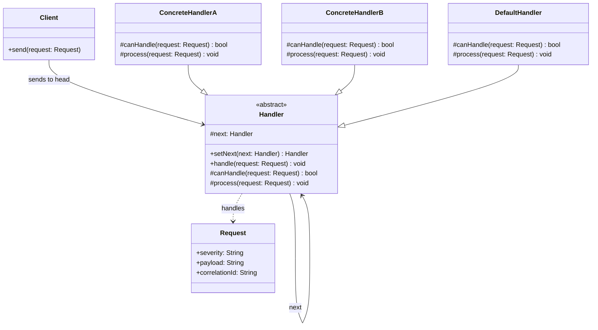
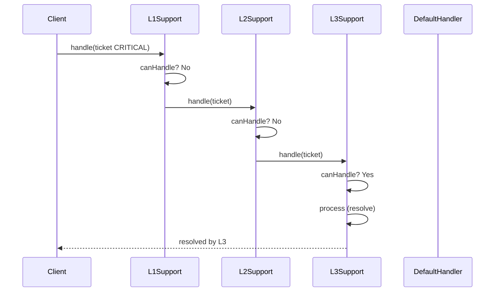

# Chain of Responsibility Design Pattern

> Youtube: [10. Design Logging System (Hindi) | Chain of Responsibility Design Pattern | System Design interview](https://www.youtube.com/watch?v=gvIn5QBdGDk)

## 1. Overview and Fundamentals

**Chain of Responsibility** is a behavioral design pattern that lets a request travel along a chain of potential handlers until one of them handles it. The sender knows only the head of the chain, not which object will ultimately process the request.

- **GoF classification:** Behavioral — concerned with how objects communicate and distribute responsibility.
- **Intent (GoF):** "Avoid coupling the sender of a request to its receiver by giving more than one object a chance to handle the request. Chain the receiving objects and pass the request along the chain until an object handles it."
- **Core idea:** Decouple `Client → Receiver` into `Client → Chain Head → … → Handler N`. Each handler either processes the request or forwards it.
- **Everyday analogy:** A customer support escalation: L1 → L2 → L3. You submit one ticket; you do not choose who resolves it. Each level handles what it can and escalates the rest.
- **Key participants:**
  - **Handler (abstract):** Defines `handle(request)` and holds a reference to `next`.
  - **ConcreteHandler:** Checks `canHandle(request)`; processes or forwards.
  - **Client:** Builds the chain once and sends requests to the head.
  - **Request:** Value object carrying data plus context (severity, headers, credentials).
- **Success conditions:** Handlers are ordered deliberately (cheap/specific first), the chain always terminates (default handler), and each handler has a single, testable responsibility.
- **What it is not:** It is not a broadcast (only one handler normally acts), not a decorator stack (not every layer acts), and not an if-else ladder hidden in one method (responsibilities are distributed objects).

## 2. Detailed Theory

### How the mechanism works

1. Client composes handlers: `h1.setNext(h2); h2.setNext(h3)`.
2. Client calls `h1.handle(request)`.
3. Each handler runs: `if canHandle → process + stop (or process + continue); else → next?.handle(request)`.
4. If the tail is reached with no match, a default handler logs, rejects, or raises an error — never silently drops.

### Pure vs impure chains

| Variant | Behavior | Example |
|---|---|---|
| **Pure chain** | Exactly one handler processes; request stops there | Support escalation, approval workflow |
| **Impure / filtering chain** | Every handler gets a chance; each may enrich, log, or veto | Servlet filters, Express middleware, logging pipeline |
| **Short-circuit chain** | Any handler can abort the chain early | Auth filter rejecting unauthenticated requests |

Most production chains are impure: logging + auth + validation + business handler + audit.

### Design dynamics

- **Ordering is semantics.** Put cheap, high-volume handlers first (cache, validation) and expensive, rare handlers last (expert team, DB fallback). Reordering changes behavior — document and test the order.
- **Request object design matters.** Make it immutable where possible, carry a correlation ID, and allow handlers to attach diagnostics (`handledBy`, `attempts`) without mutating core fields.
- **Dynamic reconfiguration.** Chains can be rebuilt at runtime from config: add/remove handlers, reorder by feature flag, or build per-tenant chains. This is the main advantage over static if-else.
- **Termination guarantees.** Always install a catch-all tail handler (`UnhandledRequestHandler`, `DefaultLogger`, `404Handler`). Validate non-empty chain at startup and fail fast if misconfigured.
- **SOLID alignment:** Single Responsibility (one reason to change per handler), Open/Closed (new handler = new class, no client edit), Dependency Inversion (client depends on `Handler` abstraction).
- **Failure modes:** Unhandled requests, over-long chains (latency, stack depth), implicit control flow that is hard to trace, and handlers with hidden side effects that make order fragile.

### Variants and extensions

- **Builder-assembled chains:** A `ChainBuilder` reads YAML/config and wires handlers — common in API gateways.
- **Composite + Chain:** A handler that fans out to a sub-chain (e.g., fraud checks running risk rules).
- **Chain + Command:** Each link executes a Command object, giving queueing + undo per step.
- **Async chains:** Handlers return futures/promises; forwarding becomes `await next.handle(req)`. Requires timeout and cancellation policy.

## 3. UML and Architecture Diagrams

### 3.1 Static structure — who holds whom



**Explanation:** `Client` depends only on the `Handler` abstraction. Each `Handler` holds at most one `next` reference, forming a singly linked list. `ConcreteHandlerA/B` implement the guard (`canHandle`) and action (`process`). `DefaultHandler` always returns true from `canHandle` so the chain provably terminates. `Request` is a dumb data carrier shared by all links.

### 3.2 Dynamic flow — how a request travels



**Explanation:** The sender makes one call. Responsibility propagates until a guard matches. Note the two self-checks that miss before the hit — this is why per-handler logging (`handler=L2 decision=pass`) and a correlation ID are essential for observability. If `L3` also missed, the call would continue to `DefaultHandler`, which logs `unhandled ticket` and alerts instead of dropping silently. A second scenario worth tracing is an impure filter chain where every participant runs (auth → validation → business logic) rather than stopping at the first match.

## 4. Implementation Examples in Java, Python, and Go

> All three examples model a support-escalation chain (LOW → MEDIUM → CRITICAL → default). Build the chain once, send requests to the head, observe which handler acts.

### 4.1 Java (OOP, classic GoF style)

**Explanation:** Abstract `SupportHandler` owns the `next` link and the template method `handle()`. Subclasses implement only `canHandle`/`process`. `HelpdeskDemo` wires L1 → L2 → L3 → Default and sends four tickets.

```java
abstract class SupportHandler {
    protected SupportHandler next;

    SupportHandler setNext(SupportHandler next) {
        this.next = next;
        return next;
    }

    void handle(Ticket ticket) {
        if (canHandle(ticket)) {
            process(ticket);
        } else if (next != null) {
            next.handle(ticket);
        } else {
            System.out.println("[unhandled] " + ticket);
        }
    }

    protected abstract boolean canHandle(Ticket ticket);
    protected abstract void process(Ticket ticket);
}

final class Ticket {
    final String severity;
    final String description;
    Ticket(String severity, String description) {
        this.severity = severity;
        this.description = description;
    }
    @Override public String toString() { return severity + ": " + description; }
}

final class Level1Support extends SupportHandler {
    @Override protected boolean canHandle(Ticket t) { return "LOW".equals(t.severity); }
    @Override protected void process(Ticket t) { System.out.println("[L1 resolved] " + t.description); }
}

final class Level2Support extends SupportHandler {
    @Override protected boolean canHandle(Ticket t) { return "MEDIUM".equals(t.severity); }
    @Override protected void process(Ticket t) { System.out.println("[L2 resolved] " + t.description); }
}

final class Level3Support extends SupportHandler {
    @Override protected boolean canHandle(Ticket t) { return "CRITICAL".equals(t.severity); }
    @Override protected void process(Ticket t) { System.out.println("[L3 expert resolved] " + t.description); }
}

final class DefaultHandler extends SupportHandler {
    @Override protected boolean canHandle(Ticket t) { return true; }
    @Override protected void process(Ticket t) { System.out.println("[default] escalated to on-call: " + t.description); }
}

public class HelpdeskDemo {
    public static void main(String[] args) {
        SupportHandler chain = new Level1Support();
        chain.setNext(new Level2Support())
             .setNext(new Level3Support())
             .setNext(new DefaultHandler());
        chain.handle(new Ticket("LOW", "Password reset"));
        chain.handle(new Ticket("MEDIUM", "VPN flaky"));
        chain.handle(new Ticket("CRITICAL", "Prod DB down"));
        chain.handle(new Ticket("UNKNOWN", "Mystery bug"));
    }
}
```

**Sample I/O:**

```text
[L1 resolved] Password reset
[L2 resolved] VPN flaky
[L3 expert resolved] Prod DB down
[default] escalated to on-call: Mystery bug
```

### 4.2 Python (pythonic, PEP 8)

**Explanation:** Uses `abc.ABC` for the handler contract, `@dataclass` for the immutable request, and fluent `set_next` returning the next link for one-line chain building. Follows PEP 8 naming and type hints.

```python
from __future__ import annotations
from abc import ABC, abstractmethod
from dataclasses import dataclass


@dataclass(frozen=True)
class Ticket:
    severity: str
    description: str


class SupportHandler(ABC):
    def __init__(self) -> None:
        self._next: SupportHandler | None = None

    def set_next(self, nxt: SupportHandler) -> SupportHandler:
        self._next = nxt
        return nxt

    def handle(self, ticket: Ticket) -> str:
        if self.can_handle(ticket):
            return self.process(ticket)
        if self._next is not None:
            return self._next.handle(ticket)
        return f"[unhandled] {ticket.description}"

    @abstractmethod
    def can_handle(self, ticket: Ticket) -> bool: ...

    @abstractmethod
    def process(self, ticket: Ticket) -> str: ...


class Level1Support(SupportHandler):
    def can_handle(self, ticket: Ticket) -> bool:
        return ticket.severity == "LOW"

    def process(self, ticket: Ticket) -> str:
        return f"[L1 resolved] {ticket.description}"


class Level2Support(SupportHandler):
    def can_handle(self, ticket: Ticket) -> bool:
        return ticket.severity == "MEDIUM"

    def process(self, ticket: Ticket) -> str:
        return f"[L2 resolved] {ticket.description}"


class Level3Support(SupportHandler):
    def can_handle(self, ticket: Ticket) -> bool:
        return ticket.severity == "CRITICAL"

    def process(self, ticket: Ticket) -> str:
        return f"[L3 expert resolved] {ticket.description}"


class DefaultHandler(SupportHandler):
    def can_handle(self, ticket: Ticket) -> bool:
        return True

    def process(self, ticket: Ticket) -> str:
        return f"[default] escalated to on-call: {ticket.description}"


def build_chain() -> SupportHandler:
    head = Level1Support()
    head.set_next(Level2Support()).set_next(Level3Support()).set_next(DefaultHandler())
    return head


if __name__ == "__main__":
    chain = build_chain()
    for ticket in [
        Ticket("LOW", "Password reset"),
        Ticket("MEDIUM", "VPN flaky"),
        Ticket("CRITICAL", "Prod DB down"),
        Ticket("UNKNOWN", "Mystery bug"),
    ]:
        print(chain.handle(ticket))
```

**Sample I/O:**

```text
[L1 resolved] Password reset
[L2 resolved] VPN flaky
[L3 expert resolved] Prod DB down
[default] escalated to on-call: Mystery bug
```

### 4.3 Go (idiomatic)

**Explanation:** `Handler` is a small interface; `baseHandler` embeds the `next` pointer to avoid repetition. Each level is a struct embedding `baseHandler`. Chain is wired with setters; `Handle` returns a string so it is trivially testable.

```go
package main

import "fmt"

type Ticket struct {
	Severity    string
	Description string
}

type Handler interface {
	SetNext(next Handler) Handler
	Handle(t Ticket) string
}

type baseHandler struct{ next Handler }

func (b *baseHandler) SetNext(next Handler) Handler {
	b.next = next
	return next
}

func forward(b *baseHandler, t Ticket) string {
	if b.next != nil {
		return b.next.Handle(t)
	}
	return "[unhandled] " + t.Description
}

type Level1 struct{ baseHandler }

func (h *Level1) Handle(t Ticket) string {
	if t.Severity == "LOW" {
		return "[L1 resolved] " + t.Description
	}
	return forward(&h.baseHandler, t)
}

type Level2 struct{ baseHandler }

func (h *Level2) Handle(t Ticket) string {
	if t.Severity == "MEDIUM" {
		return "[L2 resolved] " + t.Description
	}
	return forward(&h.baseHandler, t)
}

type Level3 struct{ baseHandler }

func (h *Level3) Handle(t Ticket) string {
	if t.Severity == "CRITICAL" {
		return "[L3 expert resolved] " + t.Description
	}
	return forward(&h.baseHandler, t)
}

type DefaultHandler struct{ baseHandler }

func (h *DefaultHandler) Handle(t Ticket) string {
	return "[default] escalated to on-call: " + t.Description
}

func main() {
	head := &Level1{}
	head.SetNext(&Level2{}).SetNext(&Level3{}).SetNext(&DefaultHandler{})
	tickets := []Ticket{
		{"LOW", "Password reset"},
		{"MEDIUM", "VPN flaky"},
		{"CRITICAL", "Prod DB down"},
		{"UNKNOWN", "Mystery bug"},
	}
	for _, t := range tickets {
		fmt.Println(head.Handle(t))
	}
}
```

**Sample I/O:**

```text
[L1 resolved] Password reset
[L2 resolved] VPN flaky
[L3 expert resolved] Prod DB down
[default] escalated to on-call: Mystery bug
```

## 5. Real-World Industry Applications

- **Logging frameworks (Log4j, SLF4J, Python logging):** Loggers form a level-filtered chain (DEBUG → INFO → WARN → ERROR). Each appender decides to record or forward; a root logger acts as the default handler.
- **Servlet / web filter chains (Jakarta Filters, Django middleware, Express):** Authentication → rate limiting → validation → routing. Each filter may short-circuit (401) or enrich the request and call `chain.doFilter()`.
- **API gateways (Kong, AWS API Gateway, Envoy):** Request passes through auth, quota, transformation, and routing handlers assembled from config per route.
- **Customer support platforms (Zendesk, Freshdesk, Intercom):** Ticket triage rules escalate L1 → L2 → L3 based on keywords, SLA, and sentiment; unmatched tickets hit an on-call default queue.
- **Approval workflows (Workday, SAP, ServiceNow):** Expense or access requests flow Manager → Director → VP → Finance, each with an approval limit; amounts above the limit auto-forward.
- **Payment fraud screening (Stripe Radar, Adyen):** Transactions traverse velocity checks → geolocation → ML risk score → manual review; any link can approve, flag, or block.
- **Exception handling in layered backends:** Controller → Service → DAO catch blocks each handle what they understand and rethrow the rest, ending in a global exception handler (the default tail).
- **Game input pipelines (Unity, Unreal):** Key events propagate UI → player controller → camera → debug console until consumed, mirroring a pure chain.

## 6. Practical Use Cases and Scenarios

- **Logging pipeline:** `ConsoleHandler(INFO) → FileHandler(WARN) → PagerDutyHandler(ERROR)`. An INFO record stops at console; an ERROR traverses all three and pages. Adding a Slack handler means one insertion, zero client changes.
- **HTTP middleware:** `Auth → RateLimit → Validation → Controller`. Unauthenticated requests stop at Auth with 401; valid requests accumulate `request.user` and `request.id` as they travel. Order matters: rate-limit after auth so you can key by user.
- **Helpdesk escalation (Section 4):** Cheap generalists first, experts last. Metrics per link (`l1_resolved_total`, `escalated_to_l2_total`) reveal staffing needs.
- **Document approval:** Amounts ≤ $1k stop at manager; ≤ $10k stop at director; above that reach CFO. Each approver stamps `approvedBy`; auditors replay the chain from the stamps.
- **Chat moderation:** Profanity filter → spam detector → hate-speech model → human review. Fast regexes run first; expensive ML models run only on survivors, saving cost.
- **IoT sensor pipeline:** Calibrate → debounce → threshold-alert → cloud-upload. Faulty readings are dropped early; only meaningful events pay the network cost.

## 7. When to Use and When Not to Use

**Use Chain of Responsibility when:**

- More than one object may handle a request and the handler is not known at compile time.
- You want to decouple sender from receivers and rewire handlers from config.
- Requests naturally form a pipeline: validate → authenticate → authorize → execute → audit.
- Handling priority matters and can be expressed as chain order.

**Do NOT use when:**

| Situation | Prefer instead |
|---|---|
| Every layer must run (enrichment, not selection) | Decorator or explicit pipeline stages |
| Exactly one receiver is known statically | Direct call or Strategy/Map dispatch |
| Deterministic audit trail is mandatory and implicit routing is risky | Explicit router with logged switch + metrics |
| Chain would be 1–2 trivial branches | Simple if-else / polymorphism |
| Ultra-low-latency path where traversal cost matters | Indexed dispatch (map, jump table) |

## 8. Do's and Don'ts

**Do:**

- Always terminate with a default handler that logs, metrics, and alerts on unhandled requests.
- Keep handlers stateless or request-scoped; never stash mutable conversation state in the link.
- Log `handler name + decision (handled/passed)` with a correlation ID at each step.
- Keep chains short (3–5 links); extract sub-chains when a handler grows its own pipeline.
- Validate chain construction at startup (non-empty, tail is default, no cycles).
- Make the request object carry everything handlers need — avoid hidden service-locator calls.

**Don't:**

- Don't let handlers secretly depend on execution order beyond their guard (fragile coupling).
- Don't swallow requests silently when nothing matches — that is a production incident waiting to happen.
- Don't put heavy I/O in early links that run for every request; defer cost to later links.
- Don't share one handler instance across threads if it holds mutable per-request fields.
- Don't use a chain to hide business rules that belong in an explicit, reviewable policy table.
- Don't recurse without bound — deep chains over large inputs risk stack overflow; iterate instead.

## 9. Comparison with Other Design Patterns

### 9.1 Chain of Responsibility vs Decorator vs Command

| Aspect | Chain of Responsibility | Decorator | Command |
|---|---|---|---|
| Purpose | Route one request to one anonymous handler | Add behavior by wrapping every layer | Encapsulate a request as an object for queuing/undo |
| Flow | Stops at first matching handler (pure) or filters through (impure) | Always passes through all wrappers | Invoker executes a stored command later |
| Link knowledge | Knows only `next` | Wraps an inner component | Knows receiver + parameters + inverse |
| Undo | No built-in undo | No undo | First-class undo/redo via history stacks |
| Typical use | Filters, escalation, middleware | `BufferedInputStream`, UI borders, enrichment | Job queues, macros, editor undo |

**Rule of thumb:** One handler should act → Chain. Every layer should contribute → Decorator. The request itself must be stored, queued, or undone → Command (a chain link can *hold* a Command).

### 9.2 Chain vs Mediator vs Observer

| Aspect | Chain | Mediator | Observer |
|---|---|---|---|
| Topology | Linear pipeline | Star (peers via hub) | Fan-out (subject → many listeners) |
| Who talks to whom | Each link calls only `next` | Peers call hub, hub coordinates | Subject broadcasts, listeners react |
| Decision | Handler decides handle-or-forward | Hub decides routing/rules | Each observer decides its own reaction |
| Use when | Ordered selection/filtering | Complex many-to-many coordination | One-to-many state notification |

## 10. Interview Preparation

### Q&A

**Q1. What is Chain of Responsibility in one sentence?**
A: A request travels down an ordered list of handlers until one handles it, so the sender knows only the chain head, not the final receiver.

**Q2. What happens if no handler matches?**
A: Without a tail guard the request is silently dropped. Always install a default handler that logs with correlation ID, emits a metric, and either rejects gracefully or pages on-call.

**Q3. How is it different from if-else or switch dispatch?**
A: Behaviorally similar for pure selection, but the chain distributes each branch into its own class (SRP), allows runtime reordering/insertion, and decouples the sender. If-else concentrates all branches in one method that must be edited per new case.

**Q4. Chain vs Decorator — how do you choose on the spot?**
A: Ask "should exactly one link act, or every layer contribute?" One actor → Chain (auth chain stops at first failure). Every layer contributes → Decorator (compression + encryption + buffering all apply).

**Q5. How do you debug "which handler processed my request"?**
A: Structured log per link (`handler`, `decision`, `correlationId`), a `handledBy` field stamped on the request, per-handler counters, and short chains. Add integration tests asserting order and handler identity.

**Q6. How do you make chains configurable at runtime?**
A: A builder/factory reads handler names + order from config or DI container and wires `setNext`. Validate at startup; support per-tenant chains by building once per tenant and caching.

**Q7. What are the performance and reliability risks?**
A: Traversal overhead per request, worst case O(n) with I/O in early links, no compile-time guarantee of handling, and implicit flow that complicates tracing. Mitigate with short chains, cheap guards first, tail defaults, timeouts, and metrics.

**Q8. How do you test a chain thoroughly?**
A: Unit-test each handler's guard + action in isolation (mock `next`); integration-test full order including tail; test empty chain, no-match, multi-match (first wins), exception in a middle link, and concurrent requests for shared handler instances.

**Q9. Can handlers run in parallel or async?**
A: Yes with care: fan out to sub-chains and join, or `await next.handle()`. You then need timeout, cancellation, and a deterministic merge policy (first match wins vs collect-all). Keep the common case sequential for readability.

### LLD scenarios

**S1. Design a logging system (classic interview prompt).** Requirements: levels DEBUG/INFO/WARN/ERROR, destinations console/file/pager, runtime reconfiguration. Solution: `AbstractLogger(level, next)` chain ordered by severity; each link writes if `record.level >= ownLevel` then forwards (impure chain). Tail `NullLogger` drops below-threshold noise with a counter. Discuss fallback when file handler fails (forward vs buffer-and-retry) and bounding I/O cost.

**S2. Design an expense-approval workflow.** Requirements: manager ≤ $1k, director ≤ $10k, CFO above, audit trail, delegation when approver is OOO. Solution: `Approver(limit, next)` pure chain; request carries `amount + approvedBy[]`; each link stamps or forwards. OOO handled by decorator around a link or temporary rewiring. Discuss persistence of approvals and exactly-once semantics on retry.

**S3. Design API gateway middleware.** Requirements: auth → rate limit → schema validation → routing → audit, per-route chains, short-circuit with proper status codes. Solution: filter-style chain where each link returns `CONTINUE` or a response; builder assembles per-route chains from config. Discuss ordering (auth before rate-limit for user-keyed quotas), timeouts, and how to unit-test each filter with a fake `next`.

## 11. Testing and Best Practices

- **Unit tests per handler:** Table-drive `canHandle` true/false cases; verify `process` side effects; mock `next` to assert forward-vs-stop. Example (Python/pytest): `assert Level2().can_handle(Ticket("MEDIUM","x")) is True`.
- **Order tests:** Build the real chain and assert `handledBy` for representative requests, including tail fallback. Any reorder should break exactly one intentional test.
- **Edge cases:** Empty chain (constructor should reject), null request, unknown severity, exception thrown mid-chain (wrap with try/finally that logs handler name), extremely long chain (depth guard).
- **Concurrency:** Handlers must be stateless or use request-scoped state only; stress-test shared chain instances with parallel requests; use immutable `Ticket` to avoid races.
- **Observability:** Correlation ID from ingress propagated through every link; per-handler latency histogram; `unhandled_total` alert. In interviews, mention OpenTelemetry spans per handler.
- **Best practices:** Builder/factory for assembly; fail-fast startup validation; default tail; keep `handle()` template method final/non-overridable so subclasses cannot break forwarding; document ordering rationale next to wiring code; bound chain length and per-link timeouts for I/O links.

## 12. Summary and Key Takeaways

- Chain of Responsibility routes **one request to one anonymous handler** through an ordered pipeline, decoupling sender from receiver.
- Prefer it for **filters, middleware, escalation, and approval workflows** where handlers are dynamic and ordered.
- Distinguish from **Decorator** (every layer acts) and **Command** (requests become storable objects); chains and commands compose well.
- Always provide a **default tail handler**, keep chains **short and stateless**, log every **decision with correlation ID**, and test **guards, order, and tail** explicitly.
- In LLD interviews, reach for it when you hear *"multiple handlers, unknown at compile time, dynamic ordering, pass-or-process"* — then immediately discuss termination, ordering, and observability to show production maturity.
