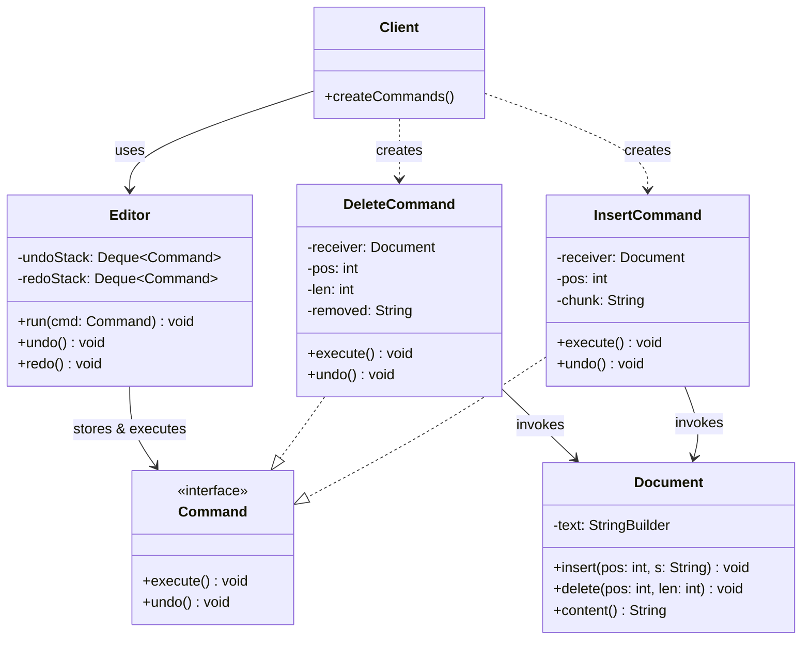

# Command Design Pattern

> Youtube: [31. Design Undo, Redo feature with Command Pattern | Command Design Pattern| Low Level System Design](https://www.youtube.com/watch?v=E1lce5CWhE0)

## 1. Overview and Fundamentals

**Command** is a behavioral design pattern that turns a request into a standalone object containing everything needed to execute it: the receiver, the method, and the parameters. The sender (invoker) triggers commands without knowing what they do or what they operate on.

- **GoF classification:** Behavioral — encapsulates interaction between invoking and performing objects.
- **Intent (GoF):** "Encapsulate a request as an object, thereby letting you parameterize clients with different requests, queue or log requests, and support undoable operations."
- **Core idea:** Replace a direct method call `light.on()` with an object `new LightOnCommand(light)` that can be stored, passed, queued, logged, and undone.
- **Everyday analogy:** A restaurant order slip. The customer (client) writes the order (command), the waiter (invoker) carries it, and the kitchen (receiver) executes it. The waiter never cooks; the slip decouples who asks from who acts, and slips can be queued, reordered, or cancelled.
- **Key participants:**
  - **Command (interface):** Declares `execute()` and usually `undo()`.
  - **ConcreteCommand:** Binds a receiver, parameters, and the inverse operation.
  - **Receiver:** The domain object that does the real work (`Light`, `Document`).
  - **Invoker:** Holds/executes commands (button, scheduler, editor history) without knowing receivers.
  - **Client:** Creates commands and assigns them to invokers.
- **Success conditions:** Commands are self-contained (receiver + args + undo state), invokers depend only on the `Command` interface, and history is bounded.
- **What it is not:** It is not just a callback — commands carry state and support undo, persistence, and composition (macros). It is not Strategy — Strategy swaps *how* something is computed; Command defers and records *a request to do something*.

## 2. Detailed Theory

### How the mechanism works

1. Client creates a receiver (`Document doc = new Document()`).
2. Client wraps each action in a command (`new InsertCommand(doc, 5, " world")`).
3. Client hands commands to an invoker (`editor.run(cmd)`, `button.setCommand(cmd)`, `queue.submit(cmd)`).
4. Invoker calls `execute()` now or later; for undoable commands it pushes them onto a history stack.
5. `undo()` reverses the effect using state captured at execute time; `redo()` re-executes.

### Command lifecycle and state

- **Parameter capture:** Commands snapshot everything needed at creation (positions, payloads). Never let a command read mutable global state at execute time — that breaks replay and remote execution.
- **Undo models:** (a) *Inverse operation* — store minimal delta (insert ↔ delete); memory-light but each command must implement a correct inverse. (b) *State snapshot* — store a Memento before executing; simpler but heavier. Most editors use (a); most game checkpoints use (b).
- **Redo invalidation:** Any new command after undo clears the redo stack — otherwise history branches ambiguously. This single rule prevents an entire class of bugs.
- **Composition (Macro/CompositeCommand):** A `MacroCommand` holds a list of commands and executes/undoes them in order/reverse order. Enables one-click "format + save + commit" actions.
- **Queueing and persistence:** Because commands are objects, they can be serialized to a queue (Celery, RabbitMQ), a write-ahead log, or a network socket. The receiver may live on another machine entirely.
- **SOLID alignment:** Single Responsibility (one action per class), Open/Closed (new command = new class), Dependency Inversion (invoker depends on abstraction).
- **Costs:** Class proliferation (one class per action), memory for history, and the discipline to implement correct inverses (off-by-one in `DeleteCommand` undo is the classic bug).

### Variants and extensions

- **Lambda commands:** For one-shot, non-undoable actions, a lambda/`Runnable`/`Callable` is a sufficient command — avoid ceremony.
- **Transactional commands:** `execute()` returns success/failure; a transaction manager rolls back completed commands in reverse on failure (Saga pattern).
- **Two-phase commands:** `validate()` then `execute()`; the invoker rejects invalid commands before mutating anything.
- **Command + Memento:** Command stores a Memento instead of hand-rolled inverse state — cleaner when receiver state is complex.

## 3. UML and Architecture Diagrams

### 3.1 Static structure — who holds whom



**Explanation:** `Client` wires receivers into commands but never executes domain logic directly. `InsertCommand`/`DeleteCommand` each hold a `Document` reference plus the parameters and undo state. `Editor` (invoker) depends only on the `Command` interface and owns both history stacks — this is what decouples toolbar buttons and shortcuts from the text buffer. Adding a `ReplaceCommand` touches nothing except the new class.

### 3.2 Dynamic flow — execute, undo, redo

```mermaid
sequenceDiagram
    participant Client
    participant Editor as Editor (Invoker)
    participant Insert as InsertCommand
    participant Doc as Document (Receiver)
    Client->>Insert: new InsertCommand(doc, 5, " world")
    Client->>Editor: run(insert)
    Editor->>Insert: execute()
    Insert->>Doc: insert(5, " world")
    Editor->>Editor: undoStack.push(insert); redoStack.clear()
    Client->>Editor: undo()
    Editor->>Insert: undo()
    Insert->>Doc: delete(5, 6)
    Editor->>Editor: redoStack.push(insert)
    Client->>Editor: redo()
    Editor->>Insert: execute()
    Insert->>Doc: insert(5, " world")
```

**Explanation:** Execution and inversion both flow through the command, never directly to the receiver. Note the `redoStack.clear()` on every fresh `run()` — this enforces linear history. The receiver (`Document`) is deliberately dumb: it knows insert/delete but nothing about undo, stacks, or buttons. All orchestration intelligence lives in the command + invoker pair.

## 4. Implementation Examples in Java, Python, and Go

> All three examples model a text editor with undo/redo. Each keystroke is a command; the editor keeps undo/redo stacks.

### 4.1 Java (OOP, classic GoF style)

**Explanation:** `EditCommand` declares `execute()`/`undo()`. `Document` is the receiver. `InsertCommand` stores position + chunk; `DeleteCommand` snapshots removed text so undo can restore it. `Editor` is the invoker owning both stacks.

```java
import java.util.ArrayDeque;
import java.util.Deque;

interface EditCommand {
    void execute();
    void undo();
}

class Document {
    private final StringBuilder text = new StringBuilder();
    void insert(int pos, String s) { text.insert(pos, s); }
    void delete(int pos, int len) { text.delete(pos, pos + len); }
    String content() { return text.toString(); }
}

class InsertCommand implements EditCommand {
    private final Document doc;
    private final int pos;
    private final String chunk;
    InsertCommand(Document doc, int pos, String chunk) {
        this.doc = doc; this.pos = pos; this.chunk = chunk;
    }
    public void execute() { doc.insert(pos, chunk); }
    public void undo() { doc.delete(pos, chunk.length()); }
}

class DeleteCommand implements EditCommand {
    private final Document doc;
    private final int pos;
    private final int len;
    private String removed = "";
    DeleteCommand(Document doc, int pos, int len) {
        this.doc = doc; this.pos = pos; this.len = len;
    }
    public void execute() {
        removed = doc.content().substring(pos, pos + len);
        doc.delete(pos, len);
    }
    public void undo() { doc.insert(pos, removed); }
}

class Editor {
    private final Deque<EditCommand> undo = new ArrayDeque<>();
    private final Deque<EditCommand> redo = new ArrayDeque<>();
    void run(EditCommand cmd) {
        cmd.execute();
        undo.push(cmd);
        redo.clear();
    }
    void undo() {
        if (!undo.isEmpty()) {
            EditCommand cmd = undo.pop();
            cmd.undo();
            redo.push(cmd);
        }
    }
    void redo() {
        if (!redo.isEmpty()) {
            EditCommand cmd = redo.pop();
            cmd.execute();
            undo.push(cmd);
        }
    }
}

public class EditorDemo {
    public static void main(String[] args) {
        Document doc = new Document();
        Editor editor = new Editor();
        editor.run(new InsertCommand(doc, 0, "hello"));
        System.out.println(doc.content());
        editor.run(new InsertCommand(doc, 5, " world"));
        System.out.println(doc.content());
        editor.undo();
        System.out.println(doc.content());
        editor.redo();
        System.out.println(doc.content());
        editor.run(new DeleteCommand(doc, 5, 6));
        System.out.println(doc.content());
        editor.undo();
        System.out.println(doc.content());
    }
}
```

**Sample I/O:**

```text
hello
hello world
hello
hello world
hello
hello world
```

### 4.2 Python (pythonic, PEP 8)

**Explanation:** `EditCommand` is an ABC; `Document` wraps a list of characters; `Editor` owns `deque` stacks. Type hints + snake_case throughout. A `MacroCommand` bonus shows composition.

```python
from __future__ import annotations
from abc import ABC, abstractmethod
from collections import deque


class Document:
    """Receiver: the text buffer. Knows nothing about undo."""

    def __init__(self) -> None:
        self._chars: list[str] = []

    def insert(self, pos: int, chunk: str) -> None:
        self._chars[pos:pos] = list(chunk)

    def delete(self, pos: int, length: int) -> None:
        del self._chars[pos:pos + length]

    @property
    def content(self) -> str:
        return "".join(self._chars)


class EditCommand(ABC):
    @abstractmethod
    def execute(self) -> None: ...

    @abstractmethod
    def undo(self) -> None: ...


class InsertCommand(EditCommand):
    def __init__(self, doc: Document, pos: int, chunk: str) -> None:
        self._doc = doc
        self._pos = pos
        self._chunk = chunk

    def execute(self) -> None:
        self._doc.insert(self._pos, self._chunk)

    def undo(self) -> None:
        self._doc.delete(self._pos, len(self._chunk))


class DeleteCommand(EditCommand):
    def __init__(self, doc: Document, pos: int, length: int) -> None:
        self._doc = doc
        self._pos = pos
        self._length = length
        self._removed = ""

    def execute(self) -> None:
        self._removed = self._doc.content[self._pos:self._pos + self._length]
        self._doc.delete(self._pos, self._length)

    def undo(self) -> None:
        self._doc.insert(self._pos, self._removed)


class MacroCommand(EditCommand):
    """Composite: run/undo a batch of commands as one unit."""

    def __init__(self, commands: list[EditCommand]) -> None:
        self._commands = commands

    def execute(self) -> None:
        for cmd in self._commands:
            cmd.execute()

    def undo(self) -> None:
        for cmd in reversed(self._commands):
            cmd.undo()


class Editor:
    """Invoker: owns history, knows nothing about document internals."""

    def __init__(self) -> None:
        self._undo: deque[EditCommand] = deque()
        self._redo: deque[EditCommand] = deque()

    def run(self, cmd: EditCommand) -> None:
        cmd.execute()
        self._undo.append(cmd)
        self._redo.clear()

    def undo(self) -> None:
        if self._undo:
            cmd = self._undo.pop()
            cmd.undo()
            self._redo.append(cmd)

    def redo(self) -> None:
        if self._redo:
            cmd = self._redo.pop()
            cmd.execute()
            self._undo.append(cmd)


if __name__ == "__main__":
    doc = Document()
    editor = Editor()
    editor.run(InsertCommand(doc, 0, "hello"))
    print(doc.content)
    editor.run(InsertCommand(doc, 5, " world"))
    print(doc.content)
    editor.undo()
    print(doc.content)
    editor.redo()
    print(doc.content)
    editor.run(DeleteCommand(doc, 5, 6))
    print(doc.content)
    editor.undo()
    print(doc.content)
```

**Sample I/O:**

```text
hello
hello world
hello
hello world
hello
hello world
```

### 4.3 Go (idiomatic)

**Explanation:** `Command` is a two-method interface. Receivers are passed as pointers. `Editor` uses slices as stacks. Constructors (`NewInsertCommand`) keep wiring explicit — idiomatic Go.

```go
package main

import "fmt"

type Document struct{ text []rune }

func (d *Document) Insert(pos int, s string) {
	r := []rune(s)
	d.text = append(d.text[:pos], append(r, d.text[pos:]...)...)
}

func (d *Document) Delete(pos, length int) {
	d.text = append(d.text[:pos], d.text[pos+length:]...)
}

func (d *Document) Content() string { return string(d.text) }

type Command interface {
	Execute()
	Undo()
}

type InsertCommand struct {
	doc   *Document
	pos   int
	chunk string
}

func NewInsertCommand(doc *Document, pos int, chunk string) *InsertCommand {
	return &InsertCommand{doc: doc, pos: pos, chunk: chunk}
}

func (c *InsertCommand) Execute() { c.doc.Insert(c.pos, c.chunk) }
func (c *InsertCommand) Undo()    { c.doc.Delete(c.pos, len([]rune(c.chunk))) }

type DeleteCommand struct {
	doc     *Document
	pos     int
	length  int
	removed string
}

func NewDeleteCommand(doc *Document, pos, length int) *DeleteCommand {
	return &DeleteCommand{doc: doc, pos: pos, length: length}
}

func (c *DeleteCommand) Execute() {
	c.removed = string([]rune(c.doc.Content())[c.pos : c.pos+c.length])
	c.doc.Delete(c.pos, c.length)
}

func (c *DeleteCommand) Undo() { c.doc.Insert(c.pos, c.removed) }

type Editor struct {
	undo []Command
	redo []Command
}

func (e *Editor) Run(cmd Command) {
	cmd.Execute()
	e.undo = append(e.undo, cmd)
	e.redo = nil // new branch invalidates redo
}

func (e *Editor) Undo() {
	if len(e.undo) == 0 {
		return
	}
	cmd := e.undo[len(e.undo)-1]
	e.undo = e.undo[:len(e.undo)-1]
	cmd.Undo()
	e.redo = append(e.redo, cmd)
}

func (e *Editor) Redo() {
	if len(e.redo) == 0 {
		return
	}
	cmd := e.redo[len(e.redo)-1]
	e.redo = e.redo[:len(e.redo)-1]
	cmd.Execute()
	e.undo = append(e.undo, cmd)
}

func main() {
	doc := &Document{}
	editor := &Editor{}
	editor.Run(NewInsertCommand(doc, 0, "hello"))
	fmt.Println(doc.Content())
	editor.Run(NewInsertCommand(doc, 5, " world"))
	fmt.Println(doc.Content())
	editor.Undo()
	fmt.Println(doc.Content())
	editor.Redo()
	fmt.Println(doc.Content())
	editor.Run(NewDeleteCommand(doc, 5, 6))
	fmt.Println(doc.Content())
	editor.Undo()
	fmt.Println(doc.Content())
}
```

**Sample I/O:**

```text
hello
hello world
hello
hello world
hello
hello world
```

## 5. Real-World Industry Applications

- **Text and design editors (VS Code, Google Docs, Figma, Photoshop):** Every keystroke, stroke, or layer op is a command on undo/redo stacks; collaborative editing replays remote commands in order.
- **GUI toolkits (Qt, Swing, JavaFX, web menus):** Buttons and menu items hold command objects, enabling shortcuts, rebindable keys, and disabled-state logic without touching receivers.
- **Job queues and schedulers (Celery, Sidekiq, RabbitMQ, cron):** Tasks are serialized commands with parameters, retries, and dead-letter handling; workers execute without knowing producers.
- **Database transactions and Sagas:** Each step is a command with a compensating action; orchestrators roll back completed steps in reverse on failure (booking: reserve flight → hotel → car).
- **Remote controls and IoT (TV remotes, Home Assistant):** Physical buttons map to command objects; macros ("movie night" dims lights + lowers screen) compose them.
- **API gateways and CLI frameworks (kubectl, git):** Each subcommand is a Command object with `validate + execute + undo/dry-run`, giving uniform help, logging, and audit.
- **Game engines (Unity, Unreal):** Player inputs become commands for replay systems, netcode prediction/rollback, and AI action queues.
- **Financial ledgers:** Postings are immutable commands; reversals are new compensating commands, never edits — yielding a complete audit trail.

## 6. Practical Use Cases and Scenarios

- **Undo/redo editor (Section 4):** Toolbar, shortcuts, and scripts all call `editor.run(cmd)`. Bounded stacks (e.g., last 100) cap memory; `MacroCommand` implements "repeat last action".
- **Smart-home remote:** `LightOnCommand`, `ThermostatSetCommand`, `LockDoorCommand` assigned to buttons and schedules. A `PartyModeMacro` composes five commands; undo restores prior state.
- **Background job queue:** `SendEmailCommand(to, template)`, `ResizeImageCommand(path)` serialized to Redis. Workers pop, execute with retries, and move failures to a dead-letter queue — producers never block.
- **Bank transfer saga:** `DebitCommand` + `CreditCommand` each with compensating inverses. Coordinator executes in order; on credit failure it undoes debit. Every step is logged for audit.
- **Collaborative drawing:** Local strokes execute immediately and broadcast as commands; remote clients replay them in sequence-number order, giving eventual consistency without shared memory.
- **CLI with dry-run:** Each subcommand implements `plan()` (print what would happen) plus `execute()`. `--dry-run` runs only `plan()`, reusing validation and making dangerous ops reviewable.

## 7. When to Use and When Not to Use

**Use Command when:**

- You need to parameterize invokers with actions (buttons, shortcuts, scheduled jobs).
- You need to queue, log, serialize, retry, or send requests across processes/machines.
- You need undo/redo, macros, or transactional compensation.
- Senders and receivers must evolve independently (UI vs domain logic).

**Do NOT use when:**

| Situation | Prefer instead |
|---|---|
| Single immediate call, never queued/logged/undone | Direct method call or function |
| Swapping algorithms at runtime with no history | Strategy pattern |
| One handler must be selected from a chain | Chain of Responsibility |
| State snapshots are simpler than inverses | Memento (whole-state restore) |
| Fire-and-forget events to many listeners | Observer / event bus |

## 8. Do's and Don'ts

**Do:**

- Make commands self-contained: capture receiver + all parameters at construction; no hidden globals at execute time.
- Implement `undo()` alongside `execute()` from day one — retrofitting inverses is error-prone.
- Clear redo on every new command and bound history size (count or bytes) with a documented eviction policy.
- Validate before mutating: `validate()` first, then `execute()`, so failed commands leave no partial state.
- Log command name + parameters + result for audit; assign each command a stable ID for tracing across queues.
- Compose with `MacroCommand` instead of writing mega-commands; keep each command focused on one action.

**Don't:**

- Don't let commands reach into each other's state or into invoker internals — they should know only their receiver.
- Don't store unbounded history (memory leak); don't keep `removed` snapshots larger than needed (store diffs).
- Don't execute partially and report success — make `execute()` atomic or return explicit failure for saga rollback.
- Don't create a full class for trivial one-shot actions; a lambda is a legitimate command.
- Don't share a stateful command instance across threads; create one command per request.
- Don't forget idempotency for queued/retried commands — workers may execute twice after a crash.

## 9. Comparison with Other Design Patterns

### 9.1 Command vs Strategy vs Memento

| Aspect | Command | Strategy | Memento (+ Serialization) |
|---|---|---|---|
| Purpose | Encapsulate a request + receiver for deferral/undo | Encapsulate interchangeable algorithms | Capture and restore whole object state |
| Carries | Receiver reference, args, inverse state | Algorithm only (usually stateless) | Opaque state snapshot, no behavior |
| Invoker | Stores, queues, logs, undoes commands | Delegates immediately to chosen algorithm | Caretaker stores; only originator restores |
| Undo | First-class via `undo()` / compensating action | Not applicable | Restore prior snapshot wholesale |
| Typical use | Undo stacks, job queues, macros, sagas | Payment methods, sorting, pricing rules | Game saves, checkpoints, form restore |

**Rule of thumb:** Defer/queue/undo a *request* → Command. Swap *how* something is computed → Strategy. Restore *whole state* without inverting → Memento. In practice Command + Memento pair well: the command holds a memento as its undo state.

### 9.2 Command vs Chain of Responsibility vs Observer

| Aspect | Command | Chain of Responsibility | Observer |
|---|---|---|---|
| Direction | Invoker → one command → one receiver | Request travels link to link until handled | Subject broadcasts → many observers |
| Selection | Client picks the exact command | Chain picks handler dynamically | All subscribers react |
| Time | Execution can be deferred/stored | Handling is immediate traversal | Notification is immediate fan-out |
| Use when | Actions must be objects | Handler unknown at compile time | Many parties need the same event |

## 10. Interview Preparation

### Q&A

**Q1. What is the Command pattern in one sentence?**
A: It turns a request (receiver + method + args) into an object so invokers can store, queue, log, and undo requests without knowing the receiver.

**Q2. How does Command enable undo/redo?**
A: Each command captures enough state to invert itself. The invoker pushes executed commands onto an undo stack; `undo()` pops and inverts, `redo()` re-executes. New commands clear redo to keep history linear.

**Q3. Why not just call receiver methods directly?**
A: Direct calls hardwire sender to receiver and lose queuing, logging, batching, retries, macros, and undo. Commands make calls first-class: serializable, schedulable, auditable, and composable.

**Q4. How do you avoid an explosion of tiny command classes?**
A: Use lambdas for one-shot non-undoable actions, share an abstract base for related commands, and compose via `MacroCommand`. Reserve full classes for commands with state, undo, or reuse.

**Q5. Command vs Strategy — how do you distinguish in an interview?**
A: Command encapsulates a *request* bound to a receiver (with history/undo); Strategy encapsulates an *algorithm* swapped at runtime (stateless). Commands are triggered by invokers and stored; strategies are delegated to immediately by a context.

**Q6. How do you make queued commands reliable?**
A: Serialize commands with IDs, make `execute()` idempotent (dedupe by ID), persist before ack, retry with backoff, and route poison messages to a dead-letter queue after N attempts. Log every state transition.

**Q7. How do you implement macros and transactions?**
A: `MacroCommand` executes children in order and undoes in reverse. For sagas, each step defines a compensating command; the coordinator runs forward and compensates backward on failure. Validate all steps before starting when possible.

**Q8. What are the memory and complexity costs?**
A: One class per action plus history retention. Bound stacks (e.g., 100 entries or 10 MB), store deltas not full copies, compress/archive old entries, and measure snapshot size early for media-heavy receivers.

**Q9. How do you test commands?**
A: Test `execute()` and `undo()` round-trip against a real receiver (assert state restored exactly), test invoker stacks (undo/redo/clear-on-new), and test macro ordering. Mock the receiver only for invoker-level tests.

### LLD scenarios

**S1. Design undo/redo for a text editor.** Requirements: insert/delete, unlimited undo with bounded memory, redo invalidation, macro replay. Solution: `EditCommand` + `Document` receiver + `Editor` invoker as in Section 4; bound stacks to 100; `MacroCommand` for replay. Discuss snapshot-vs-inverse tradeoff and how collaborative editing orders remote commands.

**S2. Design a job queue with retries.** Requirements: producers submit email/resize jobs, workers execute async, at-least-once delivery, poison-message handling. Solution: serializable command DTOs with IDs + idempotent `execute()`; broker persists; worker acks after success; exponential backoff; DLQ after 5 failures. Discuss deduplication and exactly-once illusions.

**S3. Design a smart-home remote with scenes.** Requirements: rebindable buttons, "movie night" scene, undo last action. Solution: buttons hold `Command` slots; scenes are `MacroCommand`s; remote keeps one-level (or stacked) undo history. Discuss persistence of bindings and handling offline devices (queue + sync).

## 11. Testing and Best Practices

- **Round-trip tests:** For every command, assert `execute(); undo()` restores exact prior state, and `undo(); redo()` reproduces the post-execute state. Table-drive positions (0, middle, end) and empty-document edges.
- **Invoker tests:** Assert undo on empty stack is a no-op, redo cleared after new command, macro executes in order and undoes in reverse, and history bound evicts oldest (not newest).
- **Isolation:** Test command logic against a real receiver; test invoker with stub commands (no receiver). Never test both layers in one case — failures become ambiguous.
- **Concurrency:** One command instance per request; stress shared invoker with parallel `run()` calls behind a lock or concurrent queue; assert history order under contention.
- **Reliability:** For queued commands, test serialization round-trip, double-execution idempotency, and DLQ routing. Include command ID + version in every payload for forward compatibility.
- **Best practices:** Keep `execute()` atomic (validate-then-mutate); name commands as verbs (`InsertCommand`, `ChargeCardCommand`); document the inverse next to each `execute()`; cap history by both count and bytes; never expose receiver mutators that bypass commands in undoable flows.

## 12. Summary and Key Takeaways

- Command turns **requests into objects** — decoupling invokers from receivers and unlocking queues, macros, audit logs, and undo/redo.
- Reach for it when actions must be **stored, scheduled, retried, or reversed**; prefer direct calls or Strategy when none of those apply.
- Pair with **Memento** when inverses are complex (store snapshots) and with **Chain** when commands travel through handler pipelines.
- Correctness hinges on **self-contained commands, exact inverses, redo invalidation, and bounded history** — test all four explicitly.
- In LLD interviews, the editor-undo, job-queue, and remote-control scenarios are the canonical wins: draw the four roles (Command, ConcreteCommand, Receiver, Invoker) and immediately discuss undo state, idempotency, and history bounds to signal production experience.
