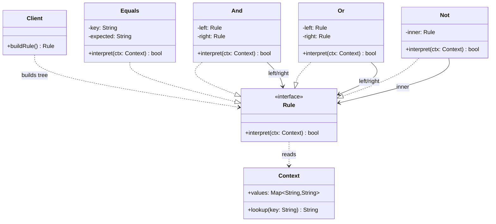
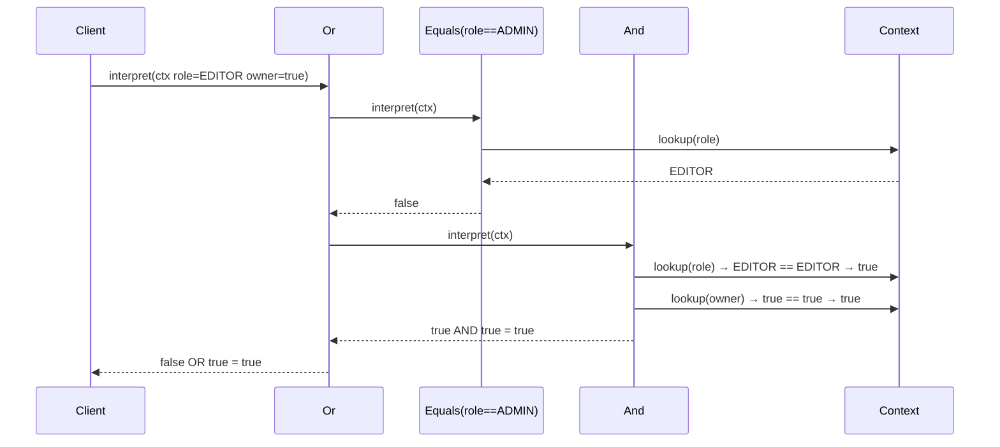

# Interpreter Design Pattern

> Youtube: [40. Interpreter Design Pattern | LLD System Design | Design pattern explanation in Java](https://www.youtube.com/watch?v=fFlPm0pzQYI)

## 1. Overview and Fundamentals

**Interpreter** is a behavioral design pattern that defines a grammatical representation for a simple language and an interpreter that evaluates sentences in that language. Each grammar rule becomes a class; composing instances builds a parse tree that can be evaluated, printed, or translated.

- **GoF classification:** Behavioral — models how sentences (composite requests) are evaluated.
- **Intent (GoF):** "Given a language, define a representation for its grammar along with an interpreter that uses the representation to interpret sentences in the language."
- **Core idea:** Map grammar productions to classes: *terminal expressions* hold values (`Number`, `Equals`), *non-terminal expressions* combine children (`Add`, `And`, `Or`). A sentence is just an object tree; `interpret(context)` walks it.
- **Everyday analogy:** A recipe card system. Terminal cards say "200g flour" (values); non-terminal cards say "mix A with B" or "bake for 30 min" (combinations). Any recipe is a tree of cards, and any cook (interpreter) can execute it — or a translator could convert it to another language.
- **Key participants:**
  - **AbstractExpression:** Declares `interpret(context)`.
  - **TerminalExpression:** Leaf with no children (literal, variable lookup).
  - **NonTerminalExpression:** Holds child expressions and combines their results.
  - **Context:** Shared input state (variable map, environment, input string position).
  - **Client:** Builds (or parses into) the expression tree, then calls `interpret`.
- **Success conditions:** Grammar is small, stable, and hierarchical; one tree serves multiple interpreters (evaluate, pretty-print, compile to SQL).
- **What it is not:** It is not a full parser/compiler toolchain, not a regex engine, and not a business-rules UI — those may *use* an interpreter internally, but the pattern itself is only the expression-tree + evaluation discipline.

## 2. Detailed Theory

### How the mechanism works

1. Define the grammar: e.g., `rule := rule AND rule | rule OR rule | NOT rule | key == value`.
2. Create one class per production (`And`, `Or`, `Not`, `Equals`).
3. Parse input text into a tree (hand-rolled for tiny grammars; parser generators for larger ones).
4. Call `root.interpret(context)`; recursion evaluates leaves first, then combines.
5. Reuse the same tree with different contexts, or different interpreters (evaluator vs SQL generator).

### Grammar-to-class mapping

- **Terminals** answer directly from context: `Number(5).interpret() → 5`; `Equals("role","ADMIN").interpret(ctx) → ctx["role"] == "ADMIN"`.
- **Non-terminals** delegate: `And(l, r).interpret(ctx) → l.interpret(ctx) && r.interpret(ctx)`.
- **Shared nodes** reduce class count: one `BinaryOp(op, left, right)` with an enum instead of `Add`/`Subtract`/`Multiply` classes; one `Comparison(op, key, value)` instead of per-operator classes.
- **Context design** decides flexibility: a `Map<String,String>` suffices for equality rules; richer contexts carry types, scopes, and error collectors.

### Design dynamics

- **Extensibility axis:** Adding a *new rule* is easy (new class). Adding a *new operation* over all rules (type-check, optimize, pretty-print) requires touching every class — the classic Expression Problem. If you add operations often, pair with **Visitor**.
- **Performance profile:** Tree interpretation is O(nodes) per evaluation with recursion overhead. Mitigations: parse once and cache the tree, short-circuit `And`/`Or`, share immutable subtrees (Flyweight), and compile hot paths to lambdas or bytecode.
- **Error handling:** Fail at *parse* time with positions (`ParseException: expected value at col 12`), not at interpret time. At interpret time decide fail-open vs fail-closed for missing variables and document it.
- **SOLID alignment:** Open/Closed for new rules (additive classes), Single Responsibility per production, but Interface Segregation suffers if one fat `interpret` must serve evaluation + printing + compilation — prefer separate interpreter interfaces per concern.
- **Scaling ceiling:** Beyond ~20 productions, or once you need precedence, loops, functions, or good syntax errors, hand-rolled interpreters collapse under maintenance. Graduate to ANTLR, parser combinators, or an embedded script engine (GraalVM, Lua, Drools).

### Variants and extensions

- **Parser + Interpreter split:** A parser builds the tree; the pattern only evaluates it. Keep these separate so grammars can evolve without touching evaluation.
- **Compiling interpreter:** Instead of walking the tree per evaluation, generate SQL, a predicate lambda, or bytecode once — same tree, faster repeated use.
- **Validating interpreter:** A second pass that type-checks or authorizes rules before they run in production.
- **Musical notation, regex, SpEL:** All classic GoF examples — small, stable, hierarchical languages where tree evaluation is the natural model.

## 3. UML and Architecture Diagrams

### 3.1 Static structure — grammar as classes



**Explanation:** Each grammar production is a class implementing `Rule`. Terminal `Equals` holds data and reads the `Context`; non-terminals `And`/`Or`/`Not` hold child `Rule` references and combine results. `Client` assembles the tree once (manually or via a parser) and re-evaluates it against many contexts. Adding `GreaterThan` means adding one leaf class — no existing code changes.

### 3.2 Dynamic flow — evaluating one sentence



**Explanation:** Evaluation is depth-first recursion with short-circuit potential (`Or` could skip the right side if the left were true). Every leaf read goes through the `Context`, which is why missing-key policy (return false vs throw) must be decided up front. The same tree evaluated against `{role: VIEWER}` takes the identical path but returns false — parse once, interpret many times.

## 4. Implementation Examples in Java, Python, and Go

> All three examples model an access-control rule engine: `ADMIN, or (EDITOR who owns the document)`. The rule tree is built once and evaluated against multiple user contexts.

### 4.1 Java (OOP, classic GoF style)

**Explanation:** `Rule` is the abstract expression; `Equals` is terminal; `And`/`Or`/`Not` are non-terminal. Context is a `Map<String,String>`. `AccessDemo` builds the tree and interprets it twice.

```java
import java.util.Map;

interface Rule {
    boolean interpret(Map<String, String> ctx);
}

final class Equals implements Rule {
    private final String key;
    private final String expected;
    Equals(String key, String expected) {
        this.key = key;
        this.expected = expected;
    }
    public boolean interpret(Map<String, String> ctx) {
        return expected.equals(ctx.get(key));
    }
}

final class And implements Rule {
    private final Rule left;
    private final Rule right;
    And(Rule left, Rule right) { this.left = left; this.right = right; }
    public boolean interpret(Map<String, String> ctx) {
        return left.interpret(ctx) && right.interpret(ctx);
    }
}

final class Or implements Rule {
    private final Rule left;
    private final Rule right;
    Or(Rule left, Rule right) { this.left = left; this.right = right; }
    public boolean interpret(Map<String, String> ctx) {
        return left.interpret(ctx) || right.interpret(ctx);
    }
}

final class Not implements Rule {
    private final Rule inner;
    Not(Rule inner) { this.inner = inner; }
    public boolean interpret(Map<String, String> ctx) {
        return !inner.interpret(ctx);
    }
}

public class AccessDemo {
    public static void main(String[] args) {
        Rule canEdit = new Or(
            new Equals("role", "ADMIN"),
            new And(new Equals("role", "EDITOR"), new Equals("owner", "true"))
        );
        System.out.println(canEdit.interpret(Map.of("role", "EDITOR", "owner", "true")));
        System.out.println(canEdit.interpret(Map.of("role", "VIEWER", "owner", "false")));
        System.out.println(new Not(new Equals("role", "BANNED"))
            .interpret(Map.of("role", "EDITOR")));
    }
}
```

**Sample I/O:**

```text
true
false
true
```

### 4.2 Python (pythonic, PEP 8)

**Explanation:** ABC `Rule` with `interpret(ctx)`; frozen dataclasses for terminals; short-circuit `and`/`or`. Includes a tiny `parse_equals` helper hinting at the parser/interpreter split.

```python
from __future__ import annotations
from abc import ABC, abstractmethod
from dataclasses import dataclass
from typing import Mapping


class Rule(ABC):
    @abstractmethod
    def interpret(self, ctx: Mapping[str, str]) -> bool: ...


@dataclass(frozen=True)
class Equals(Rule):
    """Terminal: leaf comparison against the context."""

    key: str
    expected: str

    def interpret(self, ctx: Mapping[str, str]) -> bool:
        return ctx.get(self.key) == self.expected


@dataclass(frozen=True)
class And(Rule):
    """Non-terminal: both sides must hold (short-circuits)."""

    left: Rule
    right: Rule

    def interpret(self, ctx: Mapping[str, str]) -> bool:
        return self.left.interpret(ctx) and self.right.interpret(ctx)


@dataclass(frozen=True)
class Or(Rule):
    """Non-terminal: either side holds (short-circuits)."""

    left: Rule
    right: Rule

    def interpret(self, ctx: Mapping[str, str]) -> bool:
        return self.left.interpret(ctx) or self.right.interpret(ctx)


@dataclass(frozen=True)
class Not(Rule):
    """Non-terminal: negation of one child."""

    inner: Rule

    def interpret(self, ctx: Mapping[str, str]) -> bool:
        return not self.inner.interpret(ctx)


def can_edit_rule() -> Rule:
    return Or(
        Equals("role", "ADMIN"),
        And(Equals("role", "EDITOR"), Equals("owner", "true")),
    )


if __name__ == "__main__":
    rule = can_edit_rule()
    print(rule.interpret({"role": "EDITOR", "owner": "true"}))
    print(rule.interpret({"role": "VIEWER", "owner": "false"}))
    print(Not(Equals("role", "BANNED")).interpret({"role": "EDITOR"}))
```

**Sample I/O:**

```text
True
False
True
```

### 4.3 Go (idiomatic)

**Explanation:** `Rule` interface with `Interpret(ctx map[string]string) bool`. Structs per production; value receivers since expressions are immutable. `main` builds the tree once and evaluates three contexts.

```go
package main

import "fmt"

type Context map[string]string

type Rule interface {
	Interpret(ctx Context) bool
}

type Equals struct {
	Key      string
	Expected string
}

func (e Equals) Interpret(ctx Context) bool { return ctx[e.Key] == e.Expected }

type And struct {
	Left  Rule
	Right Rule
}

func (a And) Interpret(ctx Context) bool {
	return a.Left.Interpret(ctx) && a.Right.Interpret(ctx)
}

type Or struct {
	Left  Rule
	Right Rule
}

func (o Or) Interpret(ctx Context) bool {
	return o.Left.Interpret(ctx) || o.Right.Interpret(ctx)
}

type Not struct{ Inner Rule }

func (n Not) Interpret(ctx Context) bool { return !n.Inner.Interpret(ctx) }

func main() {
	canEdit := Or{
		Left: Equals{Key: "role", Expected: "ADMIN"},
		Right: And{
			Left:  Equals{Key: "role", Expected: "EDITOR"},
			Right: Equals{Key: "owner", Expected: "true"},
		},
	}
	fmt.Println(canEdit.Interpret(Context{"role": "EDITOR", "owner": "true"}))
	fmt.Println(canEdit.Interpret(Context{"role": "VIEWER", "owner": "false"}))
	fmt.Println(Not{Inner: Equals{Key: "role", Expected: "BANNED"}}.Interpret(
		Context{"role": "EDITOR"}))
}
```

**Sample I/O:**

```text
true
false
true
```

## 5. Real-World Industry Applications

- **Expression languages (Spring SpEL, JSP EL, Jakarta EL):** `#{user.role == 'ADMIN'}` in configs and templates is parsed into an expression tree and interpreted per request.
- **SQL and query planners (Postgres, MySQL):** `WHERE` clauses become expression trees; the same tree is interpreted (row filter), optimized (predicate pushdown), and compiled — the multi-interpreter payoff.
- **Regex engines (Java `Pattern`, RE2):** Patterns compile to state machines / expression trees; matching is interpretation against input strings.
- **Infrastructure as code (Terraform, OPA/Rego):** Policy rules (`allow if input.role == "admin"`) are interpreted against plan JSON on every apply.
- **Spreadsheet engines (Excel, Google Sheets):** Formulas parse to ASTs re-interpreted on cell change, with dependency-ordered re-evaluation.
- **Feature-flag and targeting platforms (LaunchDarkly, Unleash):** Targeting rules (`country == US AND plan != free`) are small DSLs interpreted per evaluation context.
- **Monitoring alerts (Prometheus, Datadog):** Alert expressions and threshold rules are parsed once and interpreted against each scrape.
- **Search and filters (Elasticsearch, Jira JQL, Gmail):** User filter strings compile to trees interpreted per document/ticket/email.

## 6. Practical Use Cases and Scenarios

- **Access-control rules (Section 4):** Product teams edit `role == ADMIN OR (role == EDITOR AND owner == true)` in a dashboard; backend parses to a `Rule` tree once and evaluates per request. New operators ship as new classes; audit logs print the tree.
- **Calculator / formula bar:** `3 + 4 * (2 - 1)` parses to `Add(3, Multiply(4, Subtract(2,1)))`. Same tree powers evaluate, pretty-print, and "show steps" modes.
- **Email inbox filters:** `from:boss AND has:attachment OR subject:urgent` becomes `Or(And(...), ...)`. Users compose rules in plain text; the client parses and the server interprets per message.
- **Discount engine:** `cart.total > 100 AND coupon == SAVE10 AND NOT member.excluded` decides checkout discounts. Marketing edits rules without deploys; finance replays the same tree to audit past orders.
- **Home automation:** `IF motion AND time AFTER 22:00 THEN dim lights` — sensor contexts flow through small condition trees evaluated on every event.
- **Validation DSL:** `age >= 18 AND (country == US OR guardian == true)` for signup forms. One tree drives server validation, client error messages (via a message-rendering interpreter), and generated documentation.

## 7. When to Use and When Not to Use

**Use Interpreter when:**

- The language/grammar is small (a handful of productions), stable, and hierarchical.
- Non-technical users or configs must express rules without code changes.
- The same sentences need multiple treatments: evaluate, print, optimize, compile to SQL.
- Efficiency is not critical and expressions evaluate frequently against varying contexts.

**Do NOT use when:**

| Situation | Prefer instead |
|---|---|
| Full programming language, loops, functions, precedence | Parser generator (ANTLR), parser combinators, embedded engine (Lua, GraalVM) |
| Grammar changes weekly or has 20+ productions | Rule engine (Drools), decision tables, scripting |
| Hot-path parsing (regex, protocol decoders) | Hand-optimized parsers, regex libraries, codegen |
| One-off boolean logic with 2–3 conditions | Plain predicates / Specification pattern |
| Rules need versioning, audit, and UI at scale | Dedicated policy engine (OPA) with storage and tooling |

## 8. Do's and Don'ts

**Do:**

- Separate parsing from interpretation: parser builds the tree (and reports syntax errors with positions); interpreter only evaluates.
- Keep the grammar minimal; prefer generic nodes (`BinaryOp`, `Comparison`) over per-operator classes.
- Parse once, interpret many times — cache trees keyed by rule text with invalidation on edit.
- Short-circuit `And`/`Or` and order cheap checks first (equality before regex).
- Decide and document missing-variable policy (fail-closed for auth, fail-open only with explicit reason).
- Share immutable subtrees freely; expressions should be value objects safe for concurrent interpretation.

**Don't:**

- Don't hand-roll precedence climbing, loops, or function calls — that is a compiler project, not a pattern.
- Don't interpret untrusted rule text without sandboxing, timeouts, and resource limits (ReDoS-style blowups apply to trees too).
- Don't let `interpret()` mutate the context or perform I/O; side effects make rules untestable and non-replayable.
- Don't grow past ~20 productions without re-evaluating: class explosion and recursive debugging will dominate.
- Don't return cryptic `false` for malformed input — throw typed parse errors at build time.
- Don't conflate evaluation with rendering; write a second interpreter (printer/SQL emitter) instead of stuffing `toSQL()` into evaluation classes.

## 9. Comparison with Other Design Patterns

### 9.1 Interpreter vs Visitor vs Composite

| Aspect | Interpreter | Visitor | Composite |
|---|---|---|---|
| Purpose | Evaluate sentences of a small grammar | Add operations over a stable object structure | Treat part-whole hierarchies uniformly |
| Tree meaning | Tree *is* the language (productions) | Tree is domain data; visitor carries the operation | Tree is containment (folders, org charts) |
| Adding rules/nodes | Easy: new expression class | Painful: every visitor breaks | Easy: new leaf/composite |
| Adding operations | Painful: touch every expression class | Easy: new visitor class | Depends on design |
| Typical use | Filters, rules, calculators, SpEL | AST linting, export, reporting | File systems, UI trees, menus |

**Rule of thumb:** Grammar evaluation is the goal and grammar is small → Interpreter. Structure is stable but operations keep coming → put a Visitor over the tree. Hierarchy is about containment, not language → Composite.

### 9.2 Interpreter vs Strategy vs Command

| Aspect | Interpreter | Strategy | Command |
|---|---|---|---|
| Encapsulates | Grammar productions composed into sentences | One interchangeable algorithm | A request + receiver + undo |
| Composition | Trees of arbitrary depth | Single selection, no composition | Macros compose sequentially |
| Input | Sentence + context evaluated recursively | Data passed to chosen algorithm | Self-contained, executable anytime |
| Use when | Users write rule-like expressions | Swapping *how* to compute | Deferring/undoing *a request* |

## 10. Interview Preparation

### Q&A

**Q1. What is the Interpreter pattern in one sentence?**
A: Each grammar rule becomes a class; sentences are object trees whose `interpret(context)` recursively evaluates to a result.

**Q2. When is Interpreter better than ANTLR or a script engine?**
A: For tiny, stable grammars (filters, permissions, calculators) where each rule maps to a class and trees are parsed once and evaluated often. Once you need precedence, loops, functions, or quality errors, a generator or engine wins on correctness and maintenance.

**Q3. How do you avoid class explosion as the grammar grows?**
A: Generic nodes (`BinaryOp` with operator enum, `Comparison` with operator), Flyweight-shared terminals, and refusing to model non-essential syntax. Cap productions and graduate to a real parser past ~20 rules.

**Q4. How do you handle invalid input and missing variables?**
A: Parse-time validation with position-aware errors (`ParseException`); interpret-time policy for missing keys — fail-closed (`false` or throw) for authorization, explicit default otherwise. Never silently coerce.

**Q5. How do you make repeated evaluation fast?**
A: Cache parsed trees, short-circuit boolean nodes, order cheap predicates first, share immutable subtrees, and for hot rules compile the tree once to a lambda/predicate or SQL instead of re-walking.

**Q6. Terminal vs non-terminal — give a concrete example.**
A: In `role == ADMIN OR owner == true`, the `Equals` comparisons are terminals (leaves reading context); `Or` is non-terminal (combines two children). Terminals answer; non-terminals combine.

**Q7. How does Interpreter relate to Composite and Visitor?**
A: The tree is a Composite (uniform `interpret` across leaves and groups). Adding *operations* (print, type-check, compile) across all node types is exactly what Visitor solves — the two patterns are commonly layered.

**Q8. How do you test an interpreter?**
A: Unit-test each production in isolation (truth tables for `And`/`Or`/`Not`, boundary values for comparisons); test parsing separately from evaluation; property-test with generated trees; fuzz invalid syntax for clean errors; benchmark deep trees for stack/recursion limits.

**Q9. What are the security concerns?**
A: Untrusted rule text can DoS (deep nesting → stack overflow; expensive regex leaves). Enforce max tree depth, evaluation timeout, allowlisted operators, and context scoping so rules cannot reach unintended data.

### LLD scenarios

**S1. Design a discount / promotion engine.** Requirements: marketers author `IF cart.total > 100 AND coupon == SAVE10 THEN 10% off`, versioned rules, audit of past orders. Solution: rule DSL → parser → `Rule` tree stored with version; checkout interprets against cart context; a second interpreter renders human-readable descriptions for audit. Discuss rule versioning, staged rollout, and compiling hot rules to predicates.

**S2. Design a feature-flag targeting system.** Requirements: `country == US AND (plan == pro OR beta == true)`, per-request evaluation at scale, no deploys for new flags. Solution: flag conditions as cached expression trees; evaluation service interprets against request context in microseconds; short-circuit ordering by selectivity. Discuss caching, fail-open vs fail-closed defaults, and observability per flag.

**S3. Design spreadsheet formula evaluation.** Requirements: `=A1 + B2 * 3`, dependency ordering, cycle detection. Solution: formulas parse to expression trees referencing cell contexts; topological evaluation with memoization; cycle → typed error, not infinite recursion. Discuss lazy vs eager recompute and how Visitor could add "list dependents" over the same trees.

## 11. Testing and Best Practices

- **Per-production tests:** Truth tables for boolean combinators; boundary/empty-string/unicode cases for comparisons; missing-key behavior per policy. Keep them as living grammar documentation.
- **Parser vs evaluator split:** Test parsing (valid trees, precise syntax errors) independently from interpretation (tree + context → result). A parsing bug should never masquerade as an evaluation bug.
- **Round-trip tests:** Parse → pretty-print → re-parse should yield an equivalent tree; catches printer/parser drift.
- **Fuzzing and limits:** Feed malformed and deeply nested input; assert typed errors, depth caps, and timeouts — never hangs or stack overflows.
- **Performance:** Benchmark representative rules at expected QPS; profile before optimizing; prefer tree caching and compile-to-predicate over micro-tuning recursion.
- **Best practices:** Immutable expression nodes; context as read-only view; typed errors with positions; versioned rule storage; audit logging of rule text + version + outcome; depth/time budgets for untrusted input.

## 12. Summary and Key Takeaways

- Interpreter turns **grammar into composable expression objects** — parse once, interpret many times, against many contexts.
- It shines for **small, stable DSLs**: access rules, filters, formulas, alert conditions, feature flags.
- Its axes are clear: **new rules are cheap, new operations are expensive** (pair with Visitor when operations multiply); past ~20 productions or real language features, **graduate to a parser generator or engine**.
- Production-readiness means **parse/interpret separation, cached trees, short-circuiting, typed errors, depth/timeout budgets, and multi-interpreter reuse** (evaluate today, SQL/print tomorrow).
- In LLD interviews, propose it when you hear *"users write simple rules, grammar is tiny and stable"* — then immediately discuss the scaling ceiling and error policy to show judgment, not just pattern recall.
