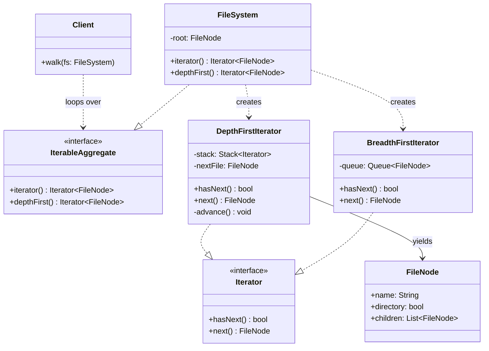
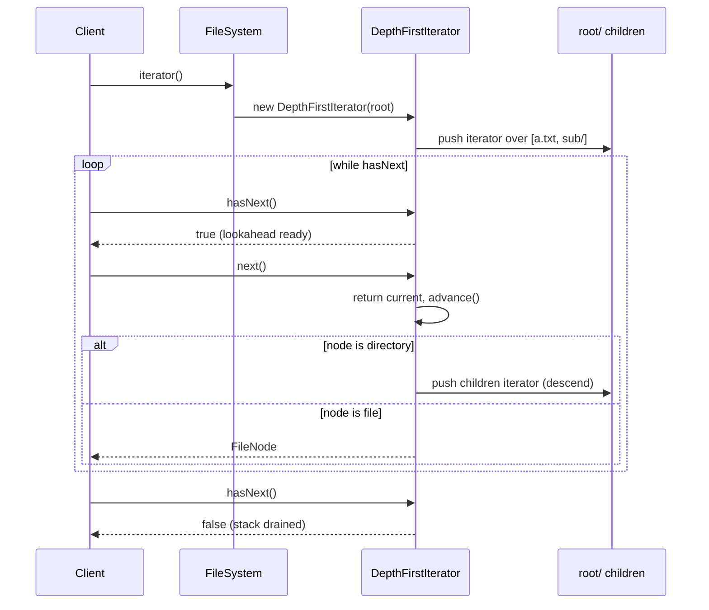

# Iterator Design Pattern

> Youtube: [33. Iterator Design Pattern Explained with Example | Low Level Design](https://www.youtube.com/watch?v=X7shKHOaYtU)

## 1. Overview and Fundamentals

**Iterator** is a behavioral design pattern that provides sequential access to elements of an aggregate (collection, tree, stream, paged API) without exposing its internal representation. Clients loop with a uniform interface while each iterator owns traversal state and order.

- **GoF classification:** Behavioral — decouples traversal algorithms from aggregate structure.
- **Intent (GoF):** "Provide a way to access the elements of an aggregate object sequentially without exposing its underlying representation."
- **Core idea:** Move the cursor out of the collection. The aggregate knows *what* it stores; the iterator knows *how to walk it* (`hasNext`/`next`, or `__iter__`/`__next__`, or `Next() bool`).
- **Everyday analogy:** A TV remote. Channels may come from cable, satellite, or streaming (different internals), but up/down buttons walk them identically. Multiple remotes (iterators) can browse independently without rewiring the TV.
- **Key participants:**
  - **Iterator (interface):** `hasNext()`, `next()`, often `remove()`/fail-fast semantics.
  - **ConcreteIterator:** Holds cursor/stack/page token for one traversal.
  - **Aggregate (interface):** Declares `iterator()` / factory methods per order.
  - **ConcreteAggregate:** Stores elements; creates iterators on demand.
  - **Client:** Loops uniformly, owns per-element logic.
- **Success conditions:** One aggregate supports many simultaneous, independent traversals; traversal order can change without touching client loops; lazy iterators handle infinite or huge sequences.
- **What it is not:** It is not the traversal logic inlined in the collection, not a Visitor (which carries the *operation* into the structure), and not just syntactic sugar for indexed loops — it is the cursor abstraction that enables laziness, uniformity, and multiple orders.

## 2. Detailed Theory

### How the mechanism works

1. Aggregate exposes a factory: `iterator()`, `depthFirst()`, `breadthFirst()`, `pages()`.
2. Factory returns a fresh iterator holding its own cursor (index, stack, page token).
3. Client calls `hasNext()` then `next()` until exhausted; each iterator advances independently.
4. Iterator may be *eager* (snapshot) or *lazy* (compute-on-demand for trees, streams, paged APIs).

### Internal vs external iterators

| Style | Control | Example | Tradeoff |
|---|---|---|---|
| **External** | Client drives `hasNext`/`next` | Java `Iterator`, Go placeholder style | Flexible (break/skip/merge); more boilerplate |
| **Internal** | Aggregate drives, client supplies function | `forEach`, Python `for x in xs`, JS `map` | Concise; harder to pause, merge, or short-circuit across two collections |

Most languages offer both: external iterators for control, internal iteration (streams, generators) for brevity.

### Design dynamics

- **Cursor ownership:** Each iterator must hold independent state. Sharing a cursor between loops is the classic bug that makes nested iteration skip elements.
- **Fail-fast vs weakly consistent:** Fail-fast iterators snapshot `modCount` and throw on concurrent modification (Java collections). Snapshot iterators copy-on-create (safe but memory-heavy). Weakly consistent iterators tolerate changes (concurrent queues). Document the guarantee — callers must know it.
- **Laziness:** Tree, graph, file, and paged-API iterators compute the next element on demand, enabling infinite sequences and constant-memory streaming. Lookahead (`nextFile` in Section 4) is the standard technique for `hasNext` over filtered/lazy sources.
- **Multiple orders, one aggregate:** `depthFirst()`, `breadthFirst()`, `reverse()`, `filtered(predicate)` are all iterators over the same storage. Clients pick order; storage never changes.
- **SOLID alignment:** Single Responsibility (traversal leaves the aggregate), Open/Closed (new order = new iterator class), Liskov (all iterators honor the `hasNext`/`next` contract, including throwing `NoSuchElementException` when exhausted).
- **Cursor invalidation:** Structural modification during iteration invalidates index/stack/page assumptions. Solutions: fail-fast detection, version stamps, copy-on-write, or explicit invalidation docs.

### Variants and extensions

- **Null/empty iterator:** Returns `hasNext() == false` immediately — removes null checks in clients.
- **Filtering/transforming iterators:** Decorate a base iterator with predicate/projection (the bridge to streams and lazy pipelines).
- **Composite + Iterator:** Tree traversal where `next()` transparently descends into children (Section 4 file-tree example).
- **Paged/cursor iterators:** Page tokens replace indexes; `next()` fetches the next page on demand (GraphQL connections, DynamoDB `LastEvaluatedKey`).

## 3. UML and Architecture Diagrams

### 3.1 Static structure — aggregate creates iterators



**Explanation:** `FileSystem` (aggregate) never exposes its tree; it manufactures iterators. Each iterator encapsulates a different traversal strategy and cursor (`stack` vs `queue`). `Client` depends only on the `Iterator` interface, so switching `depthFirst()` to breadth-first is a one-line change. Two iterators over the same `FileSystem` advance independently because each owns its cursor.

### 3.2 Dynamic flow — lazy depth-first walk



**Explanation:** Construction primes a one-element lookahead so `hasNext()` is O(1) and side-effect-free — calling it twice never skips. `next()` returns the primed file and advances past any directories. Directories are descended into but never yielded (filtering + traversal fused). When the stack drains, the iterator is exhausted; further `next()` calls throw rather than returning null.

## 4. Implementation Examples in Java, Python, and Go

> All three examples model a music playlist with two traversal orders (sequential and shuffled/reversed), showing how one aggregate serves multiple iterators. Java additionally sketches the depth-first tree iterator from the UML.

### 4.1 Java (OOP, classic GoF style)

**Explanation:** `Playlist` is the aggregate with `iterator()` (sequential) and `shuffled()` (alternate order) factories. `SequentialIterator` holds an index; `ShuffledIterator` holds a pre-shuffled index list. Fail-fast via `modCount` sketch.

```java
import java.util.ArrayList;
import java.util.Collections;
import java.util.Iterator;
import java.util.List;
import java.util.NoSuchElementException;

class Playlist implements Iterable<String> {
    private final List<String> songs = new ArrayList<>();
    private int modCount = 0;

    void add(String song) { songs.add(song); modCount++; }

    @Override
    public Iterator<String> iterator() {
        return new SequentialIterator();
    }

    public Iterator<String> shuffled() {
        return new ShuffledIterator();
    }

    private class SequentialIterator implements Iterator<String> {
        private final int expectedMod = modCount;
        private int cursor = 0;

        public boolean hasNext() { return cursor < songs.size(); }

        public String next() {
            if (expectedMod != modCount) {
                throw new java.util.ConcurrentModificationException("playlist modified");
            }
            if (!hasNext()) throw new NoSuchElementException();
            return songs.get(cursor++);
        }
    }

    private class ShuffledIterator implements Iterator<String> {
        private final List<Integer> order = new ArrayList<>();
        private int cursor = 0;

        ShuffledIterator() {
            for (int i = 0; i < songs.size(); i++) order.add(i);
            Collections.shuffle(order);
        }

        public boolean hasNext() { return cursor < order.size(); }

        public String next() {
            if (!hasNext()) throw new NoSuchElementException();
            return songs.get(order.get(cursor++));
        }
    }
}

public class PlaylistDemo {
    public static void main(String[] args) {
        Playlist playlist = new Playlist();
        playlist.add("song-A");
        playlist.add("song-B");
        playlist.add("song-C");
        System.out.print("sequential: ");
        for (String s : playlist) System.out.print(s + " ");
        System.out.println();
        System.out.print("shuffled:   ");
        Iterator<String> it = playlist.shuffled();
        while (it.hasNext()) System.out.print(it.next() + " ");
        System.out.println();
    }
}
```

**Sample I/O:**

```text
sequential: song-A song-B song-C
shuffled:   song-B song-C song-A   (order varies)
```

### 4.2 Python (pythonic, PEP 8)

**Explanation:** Python's protocol *is* the pattern: `__iter__` on the aggregate, `__next__` on iterators. `Playlist` supports sequential iteration plus `reversed()` and a lazy `matching()` generator — generators are the idiomatic lazy iterator.

```python
from __future__ import annotations
import random
from typing import Iterator


class Playlist:
    """Aggregate: owns songs, manufactures iterators."""

    def __init__(self, songs: list[str] | None = None) -> None:
        self._songs: list[str] = list(songs or [])

    def add(self, song: str) -> None:
        self._songs.append(song)

    def __iter__(self) -> Iterator[str]:
        return iter(self._songs)  # sequential external iterator

    def __reversed__(self) -> Iterator[str]:
        return reversed(self._songs)  # alternate order, same storage

    def shuffled(self) -> Iterator[str]:
        order = self._songs[:]
        random.shuffle(order)
        return iter(order)

    def matching(self, keyword: str) -> Iterator[str]:
        """Lazy filtering iterator: yields on demand via generator."""
        for song in self._songs:
            if keyword.lower() in song.lower():
                yield song


if __name__ == "__main__":
    playlist = Playlist(["song-A", "song-B", "love-song-C"])
    print("sequential:", " ".join(playlist))
    print("reversed:  ", " ".join(reversed(playlist)))
    print("filtered:  ", " ".join(playlist.matching("love")))
    it_a = iter(playlist)
    it_b = iter(playlist)  # independent cursor
    print("independent:", next(it_a), "+ " + next(it_b), "(separate cursors)")
```

**Sample I/O:**

```text
sequential: song-A song-B love-song-C
reversed:   love-song-C song-B song-A
filtered:   love-song-C
independent: song-A + song-A (separate cursors)
```

### 4.3 Go (idiomatic)

**Explanation:** Go 1.23+ ranges over `iter.Seq[T]`; pre-1.23 code uses closure or index iterators. This example shows both: a pull-style `Iterator` struct and a push-style `All()` yielding an `iter.Seq`, plus a filtered view.

```go
package main

import (
	"fmt"
	"iter"
	"strings"
)

type Playlist struct{ songs []string }

func (p *Playlist) Add(song string) { p.songs = append(p.songs, song) }

// All returns a push (range-over-func) iterator: for s := range p.All().
func (p *Playlist) All() iter.Seq[string] {
	return func(yield func(string) bool) {
		for _, s := range p.songs {
			if !yield(s) {
				return
			}
		}
	}
}

// Matching returns a lazy filtered sequence.
func (p *Playlist) Matching(keyword string) iter.Seq[string] {
	return func(yield func(string) bool) {
		for _, s := range p.songs {
			if strings.Contains(strings.ToLower(s), strings.ToLower(keyword)) {
				if !yield(s) {
					return
				}
			}
		}
	}
}

// SongIterator is a classic pull-style external iterator.
type SongIterator struct {
	songs []string
	pos   int
}

func (p *Playlist) Iterator() *SongIterator { return &SongIterator{songs: p.songs} }

func (it *SongIterator) HasNext() bool { return it.pos < len(it.songs) }

func (it *SongIterator) Next() (string, bool) {
	if !it.HasNext() {
		return "", false
	}
	s := it.songs[it.pos]
	it.pos++
	return s, true
}

func main() {
	p := &Playlist{}
	p.Add("song-A")
	p.Add("song-B")
	p.Add("love-song-C")

	fmt.Print("sequential: ")
	for s := range p.All() {
		fmt.Print(s + " ")
	}
	fmt.Println()

	fmt.Print("filtered:   ")
	for s := range p.Matching("love") {
		fmt.Print(s + " ")
	}
	fmt.Println()

	a, b := p.Iterator(), p.Iterator() // independent cursors
	sa, _ := a.Next()
	sb, _ := b.Next()
	fmt.Println("independent:", sa, "+", sb, "(separate cursors)")
}
```

**Sample I/O:**

```text
sequential: song-A song-B love-song-C
filtered:   love-song-C
independent: song-A + song-A (separate cursors)
```

## 5. Real-World Industry Applications

- **Language collections (Java `Iterator`/`Iterable`, C# `IEnumerable`, Python iterables, Go `iter.Seq`):** The canonical implementation — every for-each loop runs on this pattern.
- **Database cursors (JDBC `ResultSet`, MongoDB cursors, Postgres portals):** Rows stream one at a time; the cursor holds position, fetch size, and server-side state so billion-row tables never load fully into memory.
- **Paginated APIs (GitHub, Stripe, GraphQL connections, DynamoDB):** Page tokens are serialized cursors; each `next()` transparently fetches the following page with backoff and retry.
- **Streaming frameworks (Kafka consumers, Flink, Java Streams, RxJS):** Potentially infinite sequences with lazy operators (`map`/`filter` fuse onto the iterator chain).
- **File systems and IDEs (VS Code search, `find`, `TreeWalker`):** Directory trees walked depth- or breadth-first without materializing the whole tree.
- **Game engines (Unity `IEnumerator` coroutines, Unreal iterators):** Frame-by-frame traversal of scene graphs and scripted sequences.
- **Spreadsheet and DOM traversal (POI row iterators, `NodeIterator`):** Uniform walking over heterogeneous node types with filtering built in.
- **ML data loaders (PyTorch `DataLoader`, TF `tf.data`):** Batched, shuffled, prefetched iteration over datasets larger than RAM — iterators plus background prefetch.

## 6. Practical Use Cases and Scenarios

- **Playlist with multiple orders (Section 4):** One song list, three traversals (sequential, shuffled, reversed). Shuffle state lives in the iterator, so replaying the same playlist twice yields different orders without mutating storage.
- **Paginated user directory:** `UserPager(pageSize)` holds `nextToken`; `next()` returns one user, fetching pages lazily. Clients write a plain loop; retries and rate limits hide inside the iterator.
- **Log-file tail:** Iterator over a growing file yields lines as appended (like `tail -f`). Lookahead buffers partial lines; `hasNext()` blocks or returns false on timeout — same interface, streaming semantics.
- **Tree search in an org chart:** `depthFirst()` finds the first matching employee; `breadthFirst()` finds the closest to the CEO. Same nodes, different iterators, no duplicated traversal code.
- **Merging sorted feeds:** Two iterators (news, notifications) merged by timestamp in client code — possible only because iteration is external and pausable. Internal `forEach` cannot express this.
- **Batch export with resume:** Iterator checkpoints its cursor (offset/page token) to disk every N items; on crash, reconstruction resumes exactly where it stopped — cursors as durable progress markers.

## 7. When to Use and When Not to Use

**Use Iterator when:**

- Clients need sequential access without seeing storage (lists today, trees/pages tomorrow).
- Multiple simultaneous or alternative traversals must coexist over one aggregate.
- Sequences are large, lazy, paged, or infinite — materializing them is impossible or wasteful.
- Traversal order varies independently from the collection (DFS vs BFS, forward vs reverse, filtered views).

**Do NOT use when:**

| Situation | Prefer instead |
|---|---|
| Simple fixed-size array with index access and no alternative orders | Plain indexed loop |
| The operation should travel into the structure (export, type-check) | Visitor |
| Random access / search by key dominates | Map/index structures, not linear traversal |
| One-shot pipeline with map/filter/reduce and no custom order | Streams / comprehensions / generators |
| Traversal and element logic are trivially fused | Internal `forEach` for brevity |

## 8. Do's and Don'ts

**Do:**

- Give every iterator independent cursor state; nested loops over the same aggregate must never interfere.
- Honor the contract exactly: `hasNext()` side-effect-free, `next()` throws/returns-false when exhausted (never null-silently).
- Document the modification policy (fail-fast, snapshot, weakly consistent) on every public aggregate.
- Prefer lookahead for lazy/filtered sources so `hasNext()` stays O(1) and repeatable.
- Expose factory methods per order (`depthFirst()`, `pages()`, `reversed()`) rather than boolean flags on one iterator.
- Checkpoint long-running cursors (page tokens, offsets) so batch jobs resume after crashes.

**Don't:**

- Don't expose internal arrays/lists/nodes to "simplify" iteration — it leaks representation and invites mutation bugs.
- Don't share cursors across threads; iterators are single-threaded by default — synchronize or copy for concurrent use.
- Don't mutate the aggregate inside `next()` except for the defined removal operation; keep traversal pure.
- Don't make `hasNext()` perform expensive I/O repeatedly — prefetch once and cache the lookahead.
- Don't write a custom iterator when stdlib covers it (`list.iterator()`, generators, `iter.Seq`) — custom cursors pay off for trees, pages, and lazy streams.
- Don't swallow exhaustion: returning null/empty instead of throwing (or `false, ok`) hides client bugs.

## 9. Comparison with Other Design Patterns

### 9.1 Iterator vs Visitor vs Composite

| Aspect | Iterator | Visitor | Composite |
|---|---|---|---|
| Purpose | Walk elements one by one; client owns per-element logic | Carry an operation into every element of a structure | Unify part-whole hierarchies behind one interface |
| Control flow | Client drives the loop (pull) | Elements call back into visitor (push/double-dispatch) | Recursive structure; traversal often manual |
| Knows | Traversal order + cursor | Element types + operation | Parent/child containment |
| Adding behavior | New iterator = new order | New visitor = new operation, zero element changes | New node type ripples to visitors/iterators |
| Typical use | Collections, cursors, pages, trees | AST checks, export, pricing over carts | File systems, org charts, UI trees |

**Rule of thumb:** Clients need sequential access with their own logic → Iterator. The operation itself should travel across heterogeneous elements → Visitor. The hierarchy is about containment → Composite (iterators then walk it).

### 9.2 External vs Internal iteration (streams/generators)

| Aspect | External Iterator | Internal (forEach / Stream / generator consumer) |
|---|---|---|
| Pause/merge/zip two sequences | Natural (two cursors) | Awkward or impossible |
| Boilerplate | More (`while hasNext`) | Minimal (`for x in xs`, `.map().filter()`) |
| Laziness | Explicit lookahead/prefetch | Built into streams/generators |
| Early exit with resources | Client controls `break` + close | Needs short-circuiting terminal ops |

Modern guidance: expose external iterators from libraries (maximum client control), consume via internal syntax at call sites (maximum readability).

## 10. Interview Preparation

### Q&A

**Q1. What is the Iterator pattern in one sentence?**
A: It moves traversal state into a cursor object so clients walk any aggregate uniformly via `hasNext`/`next` without seeing its internals.

**Q2. Why not just expose the internal list?**
A: Exposure leaks representation (ArrayList today, tree tomorrow), permits uncontrolled mutation, and spreads traversal logic across callers. Iterators hide storage, allow multiple simultaneous traversals, and let order/laziness change without breaking clients.

**Q3. How do you handle modification during iteration?**
A: Three policies: fail-fast (`modCount` check → `ConcurrentModificationException`), snapshot (copy-on-create, safe but heavy), weakly consistent (tolerate, e.g., concurrent queues). Choose per use case and document it; never leave it ambiguous.

**Q4. External vs internal iterators — when does it matter?**
A: External (client-driven) is required for merging/zippping two sequences, manual pause/resume, and interleaved traversal. Internal (`forEach`, streams) is terser for single-pass transforms. Libraries should expose external; call sites may wrap them internally.

**Q5. How do you support multiple traversal orders?**
A: One aggregate, many factories: `iterator()` (default), `depthFirst()`, `breadthFirst()`, `reverse()`, `pages()`. Each returns an independent iterator; the collection is untouched and each cursor is isolated.

**Q6. How do you implement a lazy iterator over a tree or paged API?**
A: Hold minimal resume state (stack of child iterators, or page token + buffer) plus a one-element lookahead primed at construction. `hasNext()` reports the lookahead; `next()` returns it and advances. Fetch/block only inside `advance()`.

**Q7. What makes a good `hasNext`/`next` contract?**
A: `hasNext()` is idempotent and cheap; `next()` throws (`NoSuchElementException`) or returns `(value, false)` when exhausted; neither returns stale data after modification (fail-fast or documented tolerance).

**Q8. How do iterators relate to generators and streams?**
A: Generators (`yield`) and streams are lazy iterator implementations with internal-consumption syntax. The pattern is the same cursor abstraction; the syntax differs. Know when to drop to external iterators (merge/zip, manual control).

**Q9. How do you test iterators?**
A: Empty/single/multi-element cases; double-`hasNext()` idempotence; exhaustion behavior; independent cursors (interleaved loops); traversal-order assertions on trees; concurrent-modification policy; and resume-from-checkpoint for paged iterators.

### LLD scenarios

**S1. Design a paginated API client.** Requirements: millions of users, page tokens, retries, resume after crash. Solution: `UserIterator(pageSize)` encapsulating token + buffer + backoff; `next()` fetches lazily; checkpoint token to disk every page. Discuss page-size tuning, duplicate/missing rows on concurrent writes, and rate-limit handling inside `advance()`.

**S2. Design file-system search.** Requirements: find all `*.log` over 10 MB, huge trees, cancellable. Solution: `DepthFirstIterator` with extension/size filter fused into `advance()`; `BreadthFirstIterator` alternative for shallow-first results; cancellation flag checked per node. Discuss symlink cycles (visited-set), permission errors (skip + log vs abort), and memory bounds.

**S3. Design a merged notification feed.** Requirements: interleave posts, ads, and alerts by timestamp; each source paged. Solution: one external iterator per source; k-way merge in client comparing lookaheads. Discuss why internal `forEach` cannot express this, clock skew across sources, and stable tie-breaking.

## 11. Testing and Best Practices

- **Contract tests:** `hasNext` idempotence (call twice, same result), exhaustion (expect throw/`ok=false`), single-element, empty-aggregate, and interleaved-cursor independence. Run the same suite against every iterator implementation.
- **Order tests:** Fixture trees with known DFS/BFS sequences; shuffled iterators assert permutation (same multiset, any order); filtered iterators assert exactly the matching subset in stable order.
- **Mutation tests:** Modify aggregate mid-iteration and assert the documented policy (exception, snapshot stability, or documented tolerance) — never undefined behavior.
- **Resource tests:** Paged/file iterators must close handles on exhaustion and on early `break`; test with forced GC/file-handle counting. Lazy iterators must not prefetch the entire source (assert fetch count).
- **Concurrency:** Stress shared aggregates with parallel iterators; assert no cross-talk. Document iterators as not-thread-safe unless explicitly designed otherwise.
- **Best practices:** Factories per order, not flags; immutable snapshots for elements when traversal outlives mutations; checkpoint tokens for resumable jobs; lookahead for lazy sources; never expose internals; prefer stdlib iteration at call sites and custom iterators only for trees/pages/streams.

## 12. Summary and Key Takeaways

- Iterator decouples **what is stored from how it is walked**: aggregates own storage, iterators own cursors and order, clients own per-element logic.
- It enables **uniform loops, multiple simultaneous traversals, alternative orders, and lazy/infinite sequences** — from collections to DB cursors to paged APIs.
- Distinguish from **Visitor** (operation travels inward) and **Composite** (containment hierarchy); iterators typically *walk* composites and are *consumed* via streams/generators syntax.
- Production correctness rests on **contract discipline** (`hasNext` purity, exhaustion behavior), **documented modification policy**, **independent cursors**, and **resumable checkpoints** for long jobs.
- In LLD interviews, reach for it when you hear *"traverse without exposing internals, multiple orders, lazy/paged/infinite"* — then immediately discuss fail-fast policy, laziness technique, and cursor independence to show depth.
