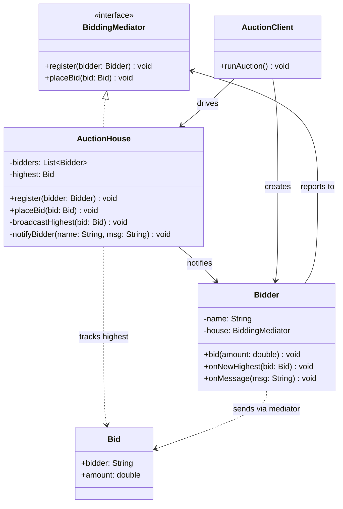
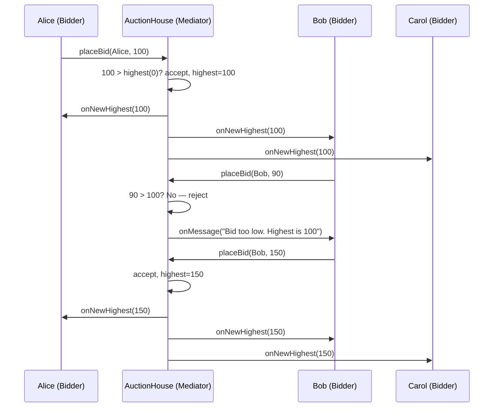

# Mediator Design Pattern

> Youtube: [34. Design Online Auction System with Mediator Design Pattern | Low Level Design](https://www.youtube.com/watch?v=bKM2lFPPmmY)

## 1. Overview and Fundamentals

**Mediator** is a behavioral design pattern that centralizes complex many-to-many communication between objects into a single hub. Colleagues never reference each other directly; they talk only to the mediator, which routes messages, enforces shared rules, and owns interaction state.

- **GoF classification:** Behavioral — encapsulates how a set of objects interact.
- **Intent (GoF):** "Define an object that encapsulates how a set of objects interact. Mediator promotes loose coupling by keeping objects from referring to each other explicitly, and it lets you vary their interaction independently."
- **Core idea:** Replace an N×N mesh of references with a star: N colleagues × 1 mediator reference. Interaction complexity moves from scattered peer code into one coordinator.
- **Everyday analogy:** An air-traffic-control tower. Pilots never negotiate with each other mid-air; each talks only to the tower, which sequences takeoffs, landings, and holds. Add a runway and only the tower's rules change — aircraft procedures stay identical.
- **Key participants:**
  - **Mediator (interface):** Declares `send`/`placeBid`/`notify` coordination operations.
  - **ConcreteMediator:** Holds colleague registry, routing logic, and shared rules (highest bid, turn order, validation).
  - **Colleague (abstract/base):** Holds a mediator reference; reports events and receives callbacks.
  - **ConcreteColleague:** Domain participant (`Bidder`, `ChatUser`, `DialogField`) with no peer references.
- **Success conditions:** Colleagues are independently reusable (only depend on the mediator interface); all cross-object rules live in one reviewable place; message flow is traceable.
- **What it is not:** It is not a Facade (one-way simplified front door), not an Observer broadcast (one-to-many notification), and not a message queue (though a broker can *implement* mediation) — it is the coordination object that owns peer-to-peer interaction logic.

## 2. Detailed Theory

### How the mechanism works

1. Colleagues register with the mediator (`house.register(bidder)`) or receive it at construction.
2. A colleague reports an event to the mediator (`house.placeBid(new Bid(...))`) instead of calling peers.
3. The mediator applies shared rules (minimum increment, turn validation, closing time) and decides who to notify.
4. The mediator invokes callbacks on affected colleagues (`onNewHighest`, `onMessage`) — peers never call each other.
5. Colleagues remain thin: local UI/state plus event reporting; all cross-cutting decisions live centrally.

### Centralization dynamics

- **Coupling math:** N peers with direct links need up to N×(N−1) references; with a mediator they need N. This is the entire economic argument — it compounds with every added participant.
- **God-object risk:** The mediator naturally attracts logic. Containment strategy: mediator owns *coordination* (routing, ordering, shared rules); *domain behavior* stays in colleagues; complex rules extract into Strategy/Policy objects the mediator consults.
- **Reusability payoff:** A `Bidder` written against `AuctionHouse` works in English, Dutch, and sealed-bid auctions by swapping mediators — impossible if it imported sibling bidders.
- **Testability payoff:** Colleagues test against a fake mediator; mediator tests against stub colleagues. The interaction matrix becomes a unit-testable table instead of emergent peer behavior.
- **Ordering and state:** Mediators often own turn order, session state, and sequencing (whose move, whose bid is highest, which field is focused). Make that state explicit and queryable for debugging.
- **SOLID alignment:** Single Responsibility per colleague, Open/Closed for new participant types (register, no rewiring), Dependency Inversion (everyone depends on abstractions).
- **Failure modes:** Mediator as single point of failure/coupling, hidden call flows (who notified whom requires reading the hub), and over-centralization where two peers could simply talk directly.

### Variants and extensions

- **Interface-per-role:** Colleagues depend on a narrow mediator interface (`Bidding`, `Messaging`) rather than a fat hub — limits blast radius.
- **Multiple mediators:** One hub per concern (bidding vs payment vs shipping) instead of one global coordinator; composes better at scale.
- **Event-bus mediator:** A typed pub/sub bus acts as a generic mediator; routing rules become subscriptions. Flexible but less explicit — prefer explicit mediators for auditable flows.
- **Mediator + Observer:** Colleagues observe the mediator's state (highest bid) while reporting events to it — common in UI dialogs (fields observe form validity owned by the dialog mediator).
- **Saga orchestrator:** A mediator variant coordinating distributed transaction steps (reserve → pay → ship) with compensation on failure.

## 3. UML and Architecture Diagrams

### 3.1 Static structure — star topology



**Explanation:** The dependency arrows tell the whole story: `Bidder` points only at the `BiddingMediator` interface, never at another `Bidder`. `AuctionHouse` is the only class with fan-out (registry + highest-bid state + routing methods). `Bid` is a dumb message object. Swapping `AuctionHouse` for a `SealedBidHouse` reuses `Bidder` untouched — the reusability payoff made structural.

### 3.2 Dynamic flow — one bid through the hub



**Explanation:** Every cross-bidder effect passes through the hub: acceptance, broadcast, and private rejection. Note the two notification shapes — broadcast (`onNewHighest` to all) and unicast (`onMessage` to one) — both owned by the mediator. Bidders never learn each other's identities; Bob's rejection is invisible to Alice and Carol. The bidding rule (must exceed highest) is enforced exactly once, so auditing the rule means reading one method.

## 4. Implementation Examples in Java, Python, and Go

> All three examples model an online auction house: bidders register once, place bids through the house, and receive broadcasts — never contacting each other.

### 4.1 Java (OOP, classic GoF style)

**Explanation:** `AuctionHouse` is the concrete mediator (registry + highest-bid rule + routing). `Bidder` colleagues hold only the mediator reference. `AuctionDemo` drives the exact scenario from the sequence diagram.

```java
import java.util.ArrayList;
import java.util.List;

final class Bid {
    final String bidder;
    final double amount;
    Bid(String bidder, double amount) {
        this.bidder = bidder;
        this.amount = amount;
    }
}

class AuctionHouse {
    private final List<Bidder> bidders = new ArrayList<>();
    private Bid highest = new Bid("none", 0);

    void register(Bidder bidder) { bidders.add(bidder); }

    void placeBid(Bid bid) {
        if (bid.amount <= highest.amount) {
            notifyBidder(bid.bidder, "Bid too low. Highest is " + highest.amount);
            return;
        }
        highest = bid;
        for (Bidder b : bidders) {
            b.onNewHighest(bid);
        }
    }

    private void notifyBidder(String name, String msg) {
        for (Bidder b : bidders) {
            if (b.name().equals(name)) b.onMessage(msg);
        }
    }

    Bid highest() { return highest; }
}

class Bidder {
    private final String name;
    private final AuctionHouse house;
    Bidder(String name, AuctionHouse house) {
        this.name = name;
        this.house = house;
        house.register(this);
    }
    String name() { return name; }
    void bid(double amount) { house.placeBid(new Bid(name, amount)); }
    void onNewHighest(Bid bid) {
        System.out.println(name + " sees new highest: " + bid.amount + " by " + bid.bidder);
    }
    void onMessage(String msg) { System.out.println(name + " <- " + msg); }
}

public class AuctionDemo {
    public static void main(String[] args) {
        AuctionHouse house = new AuctionHouse();
        Bidder alice = new Bidder("Alice", house);
        Bidder bob = new Bidder("Bob", house);
        new Bidder("Carol", house);
        alice.bid(100);
        bob.bid(90);
        bob.bid(150);
        System.out.println("winner amount: " + house.highest().amount);
    }
}
```

**Sample I/O:**

```text
Alice sees new highest: 100.0 by Alice
Bob sees new highest: 100.0 by Alice
Carol sees new highest: 100.0 by Alice
Bob <- Bid too low. Highest is 100.0
Alice sees new highest: 150.0 by Bob
Bob sees new highest: 150.0 by Bob
Carol sees new highest: 150.0 by Bob
winner amount: 150.0
```

### 4.2 Python (pythonic, PEP 8)

**Explanation:** `AuctionHouse` mediator with `register`/`place_bid`; `Bidder` dataclass holding the mediator; `Bid` frozen message. Private `_notify` mirrors the Java unicast path.

```python
from __future__ import annotations
from dataclasses import dataclass, field


@dataclass(frozen=True)
class Bid:
    bidder: str
    amount: float


class AuctionHouse:
    """Mediator: central bidding rules + routing. Peers never meet."""

    def __init__(self) -> None:
        self._bidders: list[Bidder] = []
        self.highest = Bid("none", 0.0)

    def register(self, bidder: Bidder) -> None:
        self._bidders.append(bidder)

    def place_bid(self, bid: Bid) -> None:
        if bid.amount <= self.highest.amount:
            self._notify(bid.bidder, f"Bid too low. Highest is {self.highest.amount}")
            return
        self.highest = bid
        for bidder in self._bidders:
            bidder.on_new_highest(bid)

    def _notify(self, name: str, msg: str) -> None:
        for bidder in self._bidders:
            if bidder.name == name:
                bidder.on_message(msg)


@dataclass
class Bidder:
    """Colleague: knows only the mediator."""

    name: str
    house: AuctionHouse = field(repr=False)

    def __post_init__(self) -> None:
        self.house.register(self)

    def bid(self, amount: float) -> None:
        self.house.place_bid(Bid(self.name, amount))

    def on_new_highest(self, bid: Bid) -> None:
        print(f"{self.name} sees new highest: {bid.amount} by {bid.bidder}")

    def on_message(self, msg: str) -> None:
        print(f"{self.name} <- {msg}")


if __name__ == "__main__":
    house = AuctionHouse()
    alice = Bidder("Alice", house)
    bob = Bidder("Bob", house)
    Bidder("Carol", house)
    alice.bid(100)
    bob.bid(90)
    bob.bid(150)
    print(f"winner amount: {house.highest.amount}")
```

**Sample I/O:**

```text
Alice sees new highest: 100 by Alice
Bob sees new highest: 100 by Alice
Carol sees new highest: 100 by Alice
Bob <- Bid too low. Highest is 100
Alice sees new highest: 150 by Bob
Bob sees new highest: 150 by Bob
Carol sees new highest: 150 by Bob
winner amount: 150
```

### 4.3 Go (idiomatic)

**Explanation:** `Mediator` interface keeps colleagues decoupled; `AuctionHouse` implements routing; `Bidder` holds the interface (not the concrete house), enabling test fakes and variant houses.

```go
package main

import "fmt"

type Bid struct {
	Bidder string
	Amount float64
}

type Mediator interface {
	Register(b *Bidder)
	PlaceBid(bid Bid)
}

type AuctionHouse struct {
	bidders []*Bidder
	highest Bid
}

func NewAuctionHouse() *AuctionHouse {
	return &AuctionHouse{highest: Bid{Bidder: "none", Amount: 0}}
}

func (h *AuctionHouse) Register(b *Bidder) { h.bidders = append(h.bidders, b) }

func (h *AuctionHouse) PlaceBid(bid Bid) {
	if bid.Amount <= h.highest.Amount {
		h.notify(bid.Bidder, fmt.Sprintf("Bid too low. Highest is %.0f", h.highest.Amount))
		return
	}
	h.highest = bid
	for _, b := range h.bidders {
		b.OnNewHighest(bid)
	}
}

func (h *AuctionHouse) notify(name, msg string) {
	for _, b := range h.bidders {
		if b.Name == name {
			b.OnMessage(msg)
		}
	}
}

type Bidder struct {
	Name  string
	house Mediator
}

func NewBidder(name string, house Mediator) *Bidder {
	b := &Bidder{Name: name, house: house}
	house.Register(b)
	return b
}

func (b *Bidder) Bid(amount float64) { b.house.PlaceBid(Bid{Bidder: b.Name, Amount: amount}) }

func (b *Bidder) OnNewHighest(bid Bid) {
	fmt.Printf("%s sees new highest: %.0f by %s\n", b.Name, bid.Amount, bid.Bidder)
}

func (b *Bidder) OnMessage(msg string) { fmt.Printf("%s <- %s\n", b.Name, msg) }

func main() {
	house := NewAuctionHouse()
	alice := NewBidder("Alice", house)
	bob := NewBidder("Bob", house)
	NewBidder("Carol", house)
	alice.Bid(100)
	bob.Bid(90)
	bob.Bid(150)
	fmt.Printf("winner amount: %.0f\n", house.highest.Amount)
}
```

**Sample I/O:**

```text
Alice sees new highest: 100 by Alice
Bob sees new highest: 100 by Alice
Carol sees new highest: 100 by Alice
Bob <- Bid too low. Highest is 100
Alice sees new highest: 150 by Bob
Bob sees new highest: 150 by Bob
Carol sees new highest: 150 by Bob
winner amount: 150
```

## 5. Real-World Industry Applications

- **Chat systems (Slack, Discord, WhatsApp groups):** The room/channel object is the mediator — members send to the room; the room fans out, enforces moderation, and stores history. Members hold no peer references.
- **Air traffic control:** Controllers sequence takeoffs/landings/holds; aircraft report position and obey clearances. The canonical textbook example, still accurate.
- **UI dialogs and forms (flight booking, checkout):** A dialog controller enables/disables fields based on cross-field rules (dates valid → search enabled). Fields emit events; the controller decides.
- **Message brokers (Kafka, RabbitMQ, SQS):** Producers and consumers never meet; topics/exchanges route, persist, and apply retention and ordering rules.
- **Backend mediators (MediatR in .NET, CQRS dispatchers):** Controllers send `IRequest`s to a mediator that routes to handlers plus cross-cutting pipelines (validation, logging, transactions).
- **Multiplayer game servers:** The server/sim loop mediates player actions, physics, and broadcasts — clients never trust each other directly.
- **Microservice saga orchestrators:** An orchestrator service drives reserve → pay → ship across services and compensates on failure — mediation at architecture scale.
- **Smart-home hubs (Home Assistant, HomeKit):** Motion sensor triggers hub; hub evaluates rules and commands lights/locks — devices never address each other.

## 6. Practical Use Cases and Scenarios

- **Online auction (Section 4):** Bids, minimum increments, reserve prices, closing-time extensions, and winner notifications all live in `AuctionHouse`. Adding proxy bidding touches one class; bidders stay thin.
- **Team chat room:** `send(user, text)` fans out to members, filters profanity, threads replies, and persists history. Moderation (mute/kick) is a mediator rule, not peer logic.
- **Flight-booking dialog:** Date pickers, airport selectors, and passenger counts report to a `BookingDialog` mediator; it validates combinations (return after departure → error) and enables Search only when the whole form is coherent.
- **Multiplayer lobby:** Players ready-up through the `Lobby` mediator; it starts the match at full capacity, balances teams, and broadcasts countdowns. Dropouts re-trigger balancing centrally.
- **Order saga:** `OrderOrchestrator` mediates inventory → payment → shipment services; on payment failure it triggers inventory release. Services expose actions; only the orchestrator knows the sequence.
- **Smart home evening scene:** Motion + sunset + presence flow into the `Hub`; it decides light levels and lock state. Devices expose capabilities; the hub owns the *combination* logic users actually experience.

## 7. When to Use and When Not to Use

**Use Mediator when:**

- Many objects communicate in complex, many-to-many ways that are hard to follow or change.
- Reusing a class is difficult because it references many peers directly.
- Interaction rules are centralized business logic (bidding, turn-taking, validation) that should live in one auditable place.
- You want to vary interaction independently from the participants (new auction type, new dialog flow, new orchestration).

**Do NOT use when:**

| Situation | Prefer instead |
|---|---|
| Simple one-to-one or one-to-many notification | Direct call or Observer / pub-sub |
| Interaction graph is sparse and stable (2–3 objects) | Direct references — a mediator hides the flow for no gain |
| You only need a simplified entry point to a subsystem | Facade |
| Throughput-critical paths where hub latency dominates | Choreography (events) or direct dispatch with care |
| Colleagues need rich peer APIs, not just events | Reconsider boundaries — mediator fits event-style coordination |

## 8. Do's and Don'ts

**Do:**

- Keep the mediator to coordination: routing, ordering, shared rules. Push domain behavior into colleagues or extracted Policy/Strategy objects.
- Depend on narrow mediator interfaces per role so colleagues cannot reach unrelated hub powers.
- Split by concern as you grow: one mediator per workflow (bidding, payment, shipping), not one global hub.
- Make routing observable: log/event every decision (`bid accepted/rejected + reason`) with correlation IDs.
- Design registration explicitly (constructor vs `register`, deregistration for leaving members) to avoid ghost callbacks and leaks.
- Guard shared mediator state for concurrency (highest bid, turn) — serialize mutations or use atomics/channels.

**Don't:**

- Don't let the mediator become a god object absorbing every feature — extract rules early and review hub size as a metric.
- Don't let colleagues bypass the hub with secret peer references; one backdoor re-tangles the graph.
- Don't hide complex flows without documentation: keep a sequence diagram of hub interactions next to the code.
- Don't use a single mediator for unrelated workflows; unrelated rules in one class is accidental coupling.
- Don't forget deregistration: chat members, game players, and dialog listeners must unregister or the hub leaks.
- Don't make the hub a single point of failure without a plan — replicate, persist critical state, or scope blast radius per workflow.

## 9. Comparison with Other Design Patterns

### 9.1 Mediator vs Facade vs Observer

| Aspect | Mediator | Facade | Observer |
|---|---|---|---|
| Purpose | Coordinate many-to-many peer interaction through a hub | Simplify one-way access to a subsystem | Broadcast one-to-many state changes |
| Direction | Multi-directional: peers ↔ hub ↔ peers | One-directional: client → facade → subsystem | One-directional: subject → observers |
| Knowledge | Colleagues know only the mediator; mediator knows all | Client knows facade; facade knows subsystem | Observers know subject; subject knows only the interface |
| Typical use | Chat rooms, auctions, ATC, dialogs, saga orchestrator | SDK entry points, subsystem wrappers | Event listeners, stock tickers, MVC model→view |
| Risk | God object; hidden flows | Leaky abstraction hiding needed power | Notification storms; ordering surprises |

**Rule of thumb:** Peers must interact richly → Mediator. Clients need a simpler front door → Facade. One source notifies many passive listeners → Observer. Mediator and Observer compose: colleagues often observe hub state while reporting events to it.

### 9.2 Mediator vs Chain of Responsibility

| Aspect | Mediator | Chain of Responsibility |
|---|---|---|
| Topology | Star (all through hub) | Line (link to link) |
| Decision locus | Hub applies global rules | Each link decides handle-or-forward |
| Reuse story | Colleagues reusable across hubs | Handlers reorderable within a chain |
| Use when | Interaction rules span many peers | Requests need ordered selection/filtering |

## 10. Interview Preparation

### Q&A

**Q1. What is the Mediator pattern in one sentence?**
A: Colleagues communicate only through a central hub that owns routing and shared rules, replacing an N×N peer mesh with a star.

**Q2. How does it reduce coupling, concretely?**
A: Without it N components need up to N-squared links and each imports its peers. With it each holds one mediator reference, and interaction logic moves into the hub — components become independently reusable and the graph becomes a reviewable star.

**Q3. Mediator vs Facade — are they the same?**
A: No. Facade simplifies one direction (client → subsystem) as a static front door. Mediator manages two-way traffic between peers that know the mediator. Facade hides complexity; Mediator coordinates colleagues that would otherwise be tangled.

**Q4. Mediator vs Observer — when does each win?**
A: Observer fits one-to-many notification where listeners are passive (price ticks, model→view). Mediator fits many-to-many interaction where peers affect each other through shared rules (chat, auctions, dialogs). If listeners start influencing each other, you have outgrown Observer.

**Q5. How do you stop the mediator from becoming a god object?**
A: Restrict it to coordination; push domain logic to colleagues; extract rules into Strategy/Policy objects; split hubs per workflow; depend on narrow role interfaces; and treat hub line-count as a reviewed metric.

**Q6. How do you test mediated interactions?**
A: Test colleagues against a fake mediator (record received callbacks); test the mediator against stub colleagues with scripted events; then add thin integration tests for key flows (bid-accept, bid-reject, broadcast). Assert routing tables, not emergent peer behavior.

**Q7. What about thread safety and failure?**
A: Serialize hub mutations (highest bid, turn) — the hub is a contention point. Persist critical state if the hub is a single point of failure, scope one hub per workflow/room to bound blast radius, and define deregistration so departed colleagues stop receiving callbacks.

**Q8. When should you avoid Mediator?**
A: For 1:1 or 1:many notifications (Observer suffices), sparse stable graphs (direct calls are clearer), or latency-critical paths where hub hops cost too much. Introduce it when the interaction mesh actually hurts.

**Q9. How does MediatR relate to this pattern?**
A: MediatR is a mediator implementation: controllers send requests/notifications to `IMediator`, which routes through pipelines (validation, logging) to handlers. It demonstrates the pattern's value — thin senders, centralized cross-cutting behavior, independently testable handlers.

### LLD scenarios

**S1. Design an online auction system.** Requirements: register bidders, place bids with minimum increment, broadcast highest, reject low bids privately, close at deadline. Solution: `AuctionHouse` mediator exactly as in Section 4 plus closing timer and reserve-price policy object. Discuss proxy bidding (hub-side), bid-history audit, and horizontal scaling (one hub per auction room).

**S2. Design a team chat with moderation.** Requirements: rooms, join/leave, broadcast, profanity filter, mute. Solution: `ChatRoom` mediator with member registry, message pipeline (filter → persist → fan-out), and moderation rules. Discuss deregistration leaks, history pagination (Iterator!), and backpressure on large rooms.

**S3. Design a flight-booking dialog.** Requirements: interdependent fields (dates, airports, passengers), coherent validation, enabled Search. Solution: `BookingDialog` mediator observing field events and pushing validity state back (Mediator + Observer). Discuss test matrix for field combinations and extracting date/airport rules into testable policies.

## 11. Testing and Best Practices

- **Colleague tests:** Fake the mediator; assert the colleague reports the right events and reacts correctly to callbacks. No real hub needed — fast and focused.
- **Mediator tests:** Stub colleagues (record `onNewHighest`/`onMessage`); script event sequences (accept, reject, broadcast, member leaves mid-auction); assert routing and rule outcomes. Table-drive bid scenarios including ties and reserve prices.
- **Integration tests:** A few end-to-end flows (full auction, chat session, dialog happy-path + one invalid combination) to lock the wiring that unit tests intentionally isolate.
- **Edge cases:** Duplicate registration, bidding after close, empty room broadcast, deregistered member receiving callbacks (must not), concurrent bids (highest-bid atomicity), and hub restart (state recovery).
- **Observability:** Structured hub logs per decision with correlation IDs; metrics per route (`bids_accepted`, `bids_rejected`, `broadcast_fanout`); trace the hub as a span in distributed flows.
- **Best practices:** Narrow role interfaces; one hub per workflow; explicit register/deregister lifecycle; extracted policy objects for complex rules; sequence diagram checked in beside the hub; concurrency guard on shared hub state.

## 12. Summary and Key Takeaways

- Mediator replaces a **tangled peer mesh with a star**: colleagues stay thin and reusable; one coordinator owns routing and shared rules.
- Reach for it when **many objects interact in complex, evolving ways** — chat, auctions, dialogs, game servers, saga orchestrators, smart hubs.
- Distinguish from **Facade** (one-way simplification) and **Observer** (one-to-many broadcast); expect to **combine** Mediator with Observer (state pushes) and Strategy (extracted rules).
- The central discipline is **containing the hub**: coordination only, narrow interfaces, per-workflow splits, explicit lifecycles, and observable routing.
- In LLD interviews, the auction house and chat room are canonical: draw the star, state the N×N → N argument, then immediately discuss god-object containment, deregistration, and concurrency to show production maturity.
