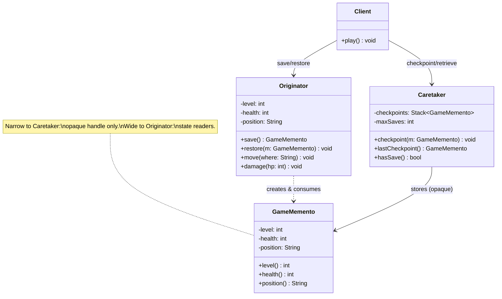
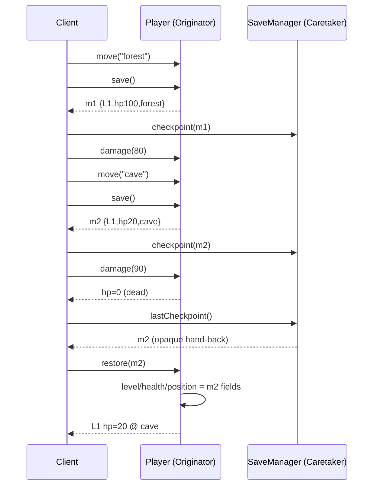

# Memento Design Pattern

> Youtube: [38. Memento Design Pattern explanation | LLD System Design | Design pattern explanation in Java](https://www.youtube.com/watch?v=nTo7e2lpGZ4)

## 1. Overview and Fundamentals

**Memento** is a behavioral design pattern that captures and externalizes an object's internal state without violating encapsulation, so the object can be restored to that state later. A caretaker stores opaque snapshots; only the originator can create or consume them.

- **GoF classification:** Behavioral — manages state history and restoration.
- **Intent (GoF):** "Without violating encapsulation, capture and externalize an object's internal state so that the object can be restored to this state later."
- **Core idea:** Split responsibilities three ways — `Originator` owns live state and knows how to snapshot/restore; `Memento` is the opaque, immutable snapshot; `Caretaker` stores and returns mementos without ever inspecting them.
- **Everyday analogy:** A game checkpoint. The player (originator) keeps playing; the save system (caretaker) holds checkpoint files (mementos) it cannot meaningfully read. Dying restores the last checkpoint — the save system never needs to understand health, ammo, or position.
- **Key participants:**
  - **Originator:** Holds state; `save()` creates a memento, `restore(m)` reverts to it.
  - **Memento:** Immutable snapshot exposing (at most) a narrow interface to the caretaker and a wide interface to the originator.
  - **Caretaker:** Owns history (stack with bound, timeline, named slots); never reads snapshot contents.
  - **Client:** Decides *when* to checkpoint and restore, never *how* state is stored.
- **Success conditions:** Snapshots are opaque to everyone but the originator, history is bounded, and save/restore round-trips are exact.
- **What it is not:** It is not `clone()` alone (cloning is a mechanism; Memento is the custody discipline), not Command (which stores *actions + inverses* rather than *state*), and not event sourcing (which stores the *log of changes*, not snapshots).

## 2. Detailed Theory

### How the mechanism works

1. Client calls `originator.save()` at a meaningful moment (checkpoint, before risky edit, transaction savepoint).
2. Originator copies its essential state into a new immutable `Memento` and hands it out as an opaque object.
3. Caretaker pushes it onto history (stack, list, or named slots) with a size/eviction policy.
4. To undo, client pops a memento and calls `originator.restore(m)`; the originator copies snapshot fields back into live state.
5. The caretaker never calls getters on the snapshot — in strict designs it *cannot*, because access is package-private or inner-class scoped.

### Encapsulation discipline (narrow vs wide interfaces)

- **Wide interface (originator only):** Full read access to restore state — implemented via private/package-private accessors, inner classes, or friendship.
- **Narrow interface (caretaker):** Opaque handle — `push`, `peek`, `pop`, maybe a timestamp or label. No state visibility.
- **Java enforcement:** Memento as a private inner class or with package-private getters; caretaker in the same package sees only `Object`-like opacity.
- **Python enforcement:** Convention + `@property`-less snapshots, or `__slots__` with name-mangled privates; true enforcement needs discipline since privacy is by convention.
- **Go enforcement:** Unexported struct fields with methods only on the originator type; caretaker in another package literally cannot read them.

### Design dynamics

- **Memory economics:** Full snapshots cost O(state) each. Controls: bound history (count + bytes), store diffs/deltas for large state, compress or spill old snapshots to disk, drop redo branches on new edits.
- **Granularity choice:** Snapshot the *document*, not the *application*: exclude caches, derived data, and UI selection where possible. Restoring derived state causes subtle staleness bugs.
- **Identity vs value:** Decide whether `restore` mutates the originator in place (usual) or returns a new instance (functional style, easier reasoning, harder integration).
- **Cascade scope:** For object graphs, a memento may need deep copies of referenced objects; shallow copies alias live state and corrupt history when the original mutates. Prefer immutable state or explicit deep-copy at save time.
- **Durability boundary:** In-memory stacks vanish on restart. If history must survive crashes, serialize mementos (JSON/protobuf) — at which point versioning and schema migration enter the picture.
- **SOLID alignment:** Single Responsibility (originator = behavior, caretaker = history custody), Encapsulation preserved by construction, Open/Closed (new checkpoint policies = new caretakers, originator untouched).
- **Failure modes:** Memory bloat, stale derived state after restore, aliasing from shallow copies, and unbounded caretakers that never evict.

### Variants and extensions

- **Stack caretaker:** Classic undo (push/pop, redo cleared on new edit).
- **Timeline caretaker:** Named checkpoints with jump-to-version (git-style, game save slots).
- **Transactional savepoints:** Nested save/restore with partial rollback (DB `SAVEPOINT` semantics).
- **Memento + Command:** Command stores a memento as its undo state — whole-state restore without hand-rolled inverses.
- **Memento + Prototype:** Snapshots created via `clone()` of internal state aggregates.

## 3. UML and Architecture Diagrams

### 3.1 Static structure — custody of opaque snapshots



**Explanation:** The two arrows into `GameMemento` carry different meanings: the originator's is a *wide* dependency (creates and reads), the caretaker's is *custody only* (stores and returns, never reads). Access modifiers enforce this: in Java the readers are package-private; in Go the fields are unexported outside the originator's package. `Client` orchestrates timing but never touches snapshot contents. `maxSaves` on the caretaker is the memory bound made structural.

### 3.2 Dynamic flow — checkpoint, damage, respawn



**Explanation:** The caretaker handles `m1`/`m2` as black boxes — it never reads level or health, only stores and evicts (oldest dropped past `maxSaves`). Restoration is a single `restore()` call that copies all fields atomically, so the player never sits in a half-restored state. Note the client decides *policy* (when to checkpoint, when to respawn from which slot) while originator and caretaker supply *mechanism* — a clean separation that keeps save-slot UI simple.

## 4. Implementation Examples in Java, Python, and Go

> All three examples model a game checkpoint system: the player snapshots position/health/level, the save manager stores bounded history, and death restores the last checkpoint.

### 4.1 Java (OOP, classic GoF style)

**Explanation:** `GameMemento` exposes state only via package-private readers (caretaker cannot meaningfully use them outside discipline). `Player` is the originator; `SaveManager` is the bounded caretaker; `GameDemo` checkpoints, dies, and respawns.

```java
import java.util.ArrayDeque;
import java.util.Deque;

final class GameMemento {
    private final int level;
    private final int health;
    private final String position;
    GameMemento(int level, int health, String position) {
        this.level = level;
        this.health = health;
        this.position = position;
    }
    int level() { return level; }       // wide interface: originator (same package)
    int health() { return health; }
    String position() { return position; }
}

class Player {
    private int level = 1;
    private int health = 100;
    private String position = "spawn";

    void move(String where) { position = where; }
    void damage(int hp) { health = Math.max(0, health - hp); }
    void levelUp() { level++; health = 100; }

    GameMemento save() { return new GameMemento(level, health, position); }

    void restore(GameMemento m) {
        level = m.level();
        health = m.health();
        position = m.position();
    }

    @Override public String toString() { return "L" + level + " hp=" + health + " @ " + position; }
}

class SaveManager {
    private final Deque<GameMemento> checkpoints = new ArrayDeque<>();
    private final int maxSaves;
    SaveManager(int maxSaves) { this.maxSaves = maxSaves; }

    void checkpoint(GameMemento m) {
        checkpoints.push(m);
        while (checkpoints.size() > maxSaves) checkpoints.removeLast();
    }
    GameMemento lastCheckpoint() { return checkpoints.peek(); }
    boolean hasSave() { return !checkpoints.isEmpty(); }
}

public class GameDemo {
    public static void main(String[] args) {
        Player player = new Player();
        SaveManager saves = new SaveManager(3);
        player.move("forest");
        saves.checkpoint(player.save());
        System.out.println("checkpoint: " + player);
        player.damage(80);
        player.move("cave");
        saves.checkpoint(player.save());
        System.out.println("checkpoint: " + player);
        player.damage(90);
        System.out.println("after fatal hit: " + player);
        if (saves.hasSave()) player.restore(saves.lastCheckpoint());
        System.out.println("respawned: " + player);
    }
}
```

**Sample I/O:**

```text
checkpoint: L1 hp=100 @ forest
checkpoint: L1 hp=20 @ cave
after fatal hit: L1 hp=0 @ cave
respawned: L1 hp=20 @ cave
```

### 4.2 Python (pythonic, PEP 8)

**Explanation:** Frozen dataclass memento (immutable snapshot); name-mangled privates are unnecessary — immutability + no readers for the caretaker is the discipline. `SaveManager` bounds history with `deque(maxlen=...)`, the idiomatic bounded stack.

```python
from __future__ import annotations
from collections import deque
from dataclasses import dataclass


@dataclass(frozen=True)
class GameMemento:
    """Opaque snapshot. Caretaker stores it; only Player reads it."""

    level: int
    health: int
    position: str


class Player:
    """Originator: owns live state, creates/consumes snapshots."""

    def __init__(self) -> None:
        self.level = 1
        self.health = 100
        self.position = "spawn"

    def move(self, where: str) -> None:
        self.position = where

    def damage(self, hp: int) -> None:
        self.health = max(0, self.health - hp)

    def level_up(self) -> None:
        self.level += 1
        self.health = 100

    def save(self) -> GameMemento:
        return GameMemento(self.level, self.health, self.position)

    def restore(self, memento: GameMemento) -> None:
        self.level, self.health, self.position = (
            memento.level,
            memento.health,
            memento.position,
        )

    def __str__(self) -> str:
        return f"L{self.level} hp={self.health} @ {self.position}"


class SaveManager:
    """Caretaker: bounded custody, never inspects snapshots."""

    def __init__(self, max_saves: int = 3) -> None:
        self._checkpoints: deque[GameMemento] = deque(maxlen=max_saves)

    def checkpoint(self, memento: GameMemento) -> None:
        self._checkpoints.append(memento)

    def last_checkpoint(self) -> GameMemento | None:
        return self._checkpoints[-1] if self._checkpoints else None


if __name__ == "__main__":
    player = Player()
    saves = SaveManager(max_saves=3)
    player.move("forest")
    saves.checkpoint(player.save())
    print(f"checkpoint: {player}")
    player.damage(80)
    player.move("cave")
    saves.checkpoint(player.save())
    print(f"checkpoint: {player}")
    player.damage(90)
    print(f"after fatal hit: {player}")
    last = saves.last_checkpoint()
    if last is not None:
        player.restore(last)
    print(f"respawned: {player}")
```

**Sample I/O:**

```text
checkpoint: L1 hp=100 @ forest
checkpoint: L1 hp=20 @ cave
after fatal hit: L1 hp=0 @ cave
respawned: L1 hp=20 @ cave
```

### 4.3 Go (idiomatic)

**Explanation:** Unexported memento fields (`level`, `health`, `position`) readable only via originator methods in the same package — real encapsulation enforced by the compiler. Slice-based bounded stack with oldest-eviction.

```go
package main

import "fmt"

type gameMemento struct {
	level    int
	health   int
	position string
}

type Player struct {
	level    int
	health   int
	position string
}

func NewPlayer() *Player { return &Player{level: 1, health: 100, position: "spawn"} }

func (p *Player) Move(where string) { p.position = where }

func (p *Player) Damage(hp int) {
	p.health -= hp
	if p.health < 0 {
		p.health = 0
	}
}

func (p *Player) Save() gameMemento {
	return gameMemento{level: p.level, health: p.health, position: p.position}
}

func (p *Player) Restore(m gameMemento) {
	p.level, p.health, p.position = m.level, m.health, m.position
}

func (p *Player) String() string {
	return fmt.Sprintf("L%d hp=%d @ %s", p.level, p.health, p.position)
}

type SaveManager struct {
	checkpoints []gameMemento
	maxSaves    int
}

func NewSaveManager(maxSaves int) *SaveManager { return &SaveManager{maxSaves: maxSaves} }

func (s *SaveManager) Checkpoint(m gameMemento) {
	s.checkpoints = append(s.checkpoints, m)
	if len(s.checkpoints) > s.maxSaves {
		s.checkpoints = s.checkpoints[len(s.checkpoints)-s.maxSaves:]
	}
}

func (s *SaveManager) LastCheckpoint() (gameMemento, bool) {
	if len(s.checkpoints) == 0 {
		return gameMemento{}, false
	}
	return s.checkpoints[len(s.checkpoints)-1], true
}

func main() {
	player := NewPlayer()
	saves := NewSaveManager(3)
	player.Move("forest")
	saves.Checkpoint(player.Save())
	fmt.Println("checkpoint:", player)
	player.Damage(80)
	player.Move("cave")
	saves.Checkpoint(player.Save())
	fmt.Println("checkpoint:", player)
	player.Damage(90)
	fmt.Println("after fatal hit:", player)
	if m, ok := saves.LastCheckpoint(); ok {
		player.Restore(m)
	}
	fmt.Println("respawned:", player)
}
```

**Sample I/O:**

```text
checkpoint: L1 hp=100 @ forest
checkpoint: L1 hp=20 @ cave
after fatal hit: L1 hp=0 @ cave
respawned: L1 hp=20 @ cave
```

## 5. Real-World Industry Applications

- **Editors and IDEs (VS Code, Word, Figma):** Document snapshots before risky operations (find-replace-all, refactorings); undo restores whole-state where inverse commands are impractical.
- **Games (save slots, checkpoints, quicksave):** Player/world snapshots persisted to disk with versioning; respawn, time-rewind (Braid, Prince of Persia), and difficulty rollback all restore mementos.
- **Databases (savepoints, MVCC snapshots):** `SAVEPOINT sp1; ... ROLLBACK TO sp1` is caretaker-managed memento semantics over transaction state; MVCC snapshot isolation gives each transaction a consistent snapshot.
- **Version control (Git):** Commits are immutable snapshots (mementos) of tree state; branches/tags are caretaker indexes; checkout is restore. Content-addressing makes the snapshot store efficient.
- **Browsers (history, session restore):** Back/forward entries snapshot scroll + form + DOM state; crash recovery restores the session's memento list.
- **Infrastructure (Terraform state, VM snapshots, container layers):** `terraform.tfstate`, VM snapshots, and image layers are restorable snapshots with explicit custody and retention.
- **Finance (ledger corrections):** End-of-day snapshots enable restatement and audit replay without mutating posted entries.
- **Mobile (Android `onSaveInstanceState`, iOS state restoration):** OS asks the originator (activity/view controller) for a snapshot bundle; the system (caretaker) holds it across process death and hands it back on relaunch.

## 6. Practical Use Cases and Scenarios

- **Game checkpoints (Section 4):** Autosave every 60s plus manual slots; bounded to last 3 autosaves + named boss-fight slots. Death restores last autosave; "load slot 2" jumps the timeline. Old snapshots spill to disk with compression.
- **Editor with whole-state undo:** Before "replace all", snapshot the buffer; undo restores it wholesale — simpler and safer than inverting thousands of edits. Cap at 50 snapshots or 10 MB.
- **Form auto-save and recovery:** Draft snapshots on every keystroke pause; browser crash restores the draft; "discard draft" clears the caretaker. Snapshots exclude transient UI state (focus, scroll).
- **DB transaction savepoints:** `BEGIN; SAVEPOINT sp1; risky_batch(); ROLLBACK TO sp1 ON ERROR; COMMIT` — partial rollback without aborting the whole transaction. Caretaker is the DB engine; mementos are page-level snapshots.
- **Config rollback:** Network-device or feature-flag changes snapshot prior config; failed health checks auto-restore. Named mementos ("before deploy v42") make rollback one click.
- **Drawing app history:** Each stroke completion snapshots the canvas layer stack (or stores stroke-diffs for memory). Scrubbing the history slider restores arbitrary points — a timeline caretaker over immutable snapshots.

## 7. When to Use and When Not to Use

**Use Memento when:**

- You must save and restore state without exposing internals (encapsulation is non-negotiable).
- Restoring whole state is simpler or safer than computing inverse operations.
- You need checkpoints, savepoints, snapshots, or bounded undo history.
- Snapshot timing is client-driven (before risky ops, on schedule, on demand).

**Do NOT use when:**

| Situation | Prefer instead |
|---|---|
| Inverse operation is cheap and exact (insert ↔ delete) | Command with `undo()` — lighter than snapshots |
| State is huge and changes constantly (video frames, large datasets) | Event sourcing / deltas / persistent data structures |
| History must be queryable ("all changes by Alice") | Event log / audit trail, not opaque snapshots |
| Snapshots must be human-readable or cross-service | Serialization with schema (protobuf/JSON) + versioning |
| Simple value rollback in one method | Local variable save/restore — no pattern needed |

## 8. Do's and Don'ts

**Do:**

- Keep mementos immutable and opaque to the caretaker (language-enforced where possible: unexported fields, inner classes, frozen dataclasses).
- Bound history by count *and* bytes; define eviction (drop oldest, spill to disk) and document it.
- Snapshot the *essential* state only — exclude caches, derived data, listeners, and handles; rebuild those on restore.
- Deep-copy mutable referenced state at save time, or use immutable structures, to prevent history corruption by aliasing.
- Make `restore()` atomic: copy all fields together so the originator never sits half-restored; validate the memento belongs to this originator.
- Version serialized mementos (schema id + migration) if snapshots persist or cross process boundaries.

**Don't:**

- Don't let the caretaker read, filter, or branch on snapshot contents — that collapses the narrow interface and leaks encapsulation.
- Don't snapshot on every frame/keystroke without throttling — throttle (debounce, on-pause, every N ops) and diff where possible.
- Don't store listeners, locks, file handles, or sockets in mementos — they are not restorable state.
- Don't restore derived/cached state blindly — recompute or invalidate it to avoid staleness.
- Don't grow an unbounded in-memory stack; unbounded history is a memory leak with a design-pattern name.
- Don't use Memento where an audit log is required — opaque snapshots cannot answer "who changed what, when".

## 9. Comparison with Other Design Patterns

### 9.1 Memento vs Command (for undo) vs Serialization

| Aspect | Memento | Command | Serialization (snapshot mechanism) |
|---|---|---|---|
| What is stored | Opaque whole-state snapshot | Request + parameters + inverse operation | Byte representation of state (JSON, protobuf, clone) |
| Undo mechanism | Restore prior snapshot wholesale | Execute inverse action | Deserialize and swap in |
| Encapsulation | Caretaker cannot inspect at all | Command often needs receiver internals | Whoever holds bytes can read them (unless encrypted) |
| Memory profile | Heavy for large state; needs bounding/diffs | Light when inverse is small | Depends on format; versioning cost |
| Typical use | Game saves, checkpoints, savepoints, form restore | Editor undo stacks, job queues, macros, sagas | Persistence, network transfer, crash recovery |

**Rule of thumb:** Whole-state restore simpler than inversion → Memento. Cheap exact inverse + queueing/macros → Command. Snapshots must persist or travel → serialize the memento (mechanism inside the pattern's custody discipline).

### 9.2 Memento vs Prototype vs State

| Aspect | Memento | Prototype | State |
|---|---|---|---|
| Purpose | Time-travel: restore *past* state | Create new objects by copying a template | Change behavior when internal state changes |
| Copy direction | Originator → snapshot → originator | Prototype → new sibling object | Context delegates to current state object |
| History | Caretaker keeps many versions | No history; one-off cloning | Only current state matters |
| Use when | Undo/checkpoints/savepoints | Cheap instantiation from examples | State machines (TCP, orders, player modes) |

## 10. Interview Preparation

### Q&A

**Q1. What is the Memento pattern in one sentence?**
A: The originator snapshots its state into opaque mementos that a caretaker stores and returns, so past states can be restored without exposing internals.

**Q2. How does Memento preserve encapsulation if the caretaker holds the state?**
A: Through narrow/wide interfaces: the caretaker sees an opaque handle (no getters), while only the originator can create and read the snapshot — enforced via inner classes, package-private accessors, unexported fields, or frozen types plus discipline.

**Q3. How do you prevent memory bloat?**
A: Bound history (count + bytes), snapshot essential state only, store diffs for large objects, compress/spill old entries to disk, throttle snapshot frequency, and drop redo branches on new edits. Measure snapshot size early.

**Q4. Memento vs serialization — when is a snapshot just `clone()` or JSON?**
A: Cloning/serializing is the *mechanism*; Memento is the *custody discipline* (who creates, who stores, who restores, with what visibility). Use in-memory mementos for session-local undo; serialize when snapshots persist, cross processes, or need versioning.

**Q5. Memento vs Command for undo — how do you choose?**
A: If the inverse is cheap and exact (insert/delete), Command is lighter and adds queueing/macros. If inversion is complex, error-prone, or touches many fields, Memento's whole-state restore is safer. Hybrids are common: a Command holding a Memento as undo state.

**Q6. What goes wrong with shallow copies?**
A: The snapshot aliases live mutable objects; later mutations corrupt history, and restore resurrects already-mutated data. Fix with deep copies at save time or immutable state throughout.

**Q7. How do you handle derived state (caches, indexes, UI) on restore?**
A: Exclude it from snapshots and rebuild/invalidate on restore. Restoring stale derived data is a classic bug — snapshot sources of truth, recompute the rest.

**Q8. How do you test Memento thoroughly?**
A: Round-trip (save → mutate → restore → assert exact equality), multi-cycle save/restore sequences, encapsulation (caretaker cannot read state — assert via API surface), eviction policy (oldest dropped, newest kept), deep-copy isolation (mutate original, snapshot unaffected), and serialized-version migration if persisted.

**Q9. When should you avoid Memento?**
A: Huge/fast-changing state (prefer deltas/event sourcing), cheap Command inverses, queryable history needs (prefer event logs), or cross-service snapshots without a versioning story.

### LLD scenarios

**S1. Design game save/checkpoint system.** Requirements: autosave + named slots, bounded memory, death respawn, version upgrades. Solution: `Player.save()/restore()` + `SaveManager(maxSaves)` as in Section 4; slots as named timeline caretaker; old autosaves spill to compressed disk; save schema versioned with migrations. Discuss what to exclude (particle caches, RNG handles) and respawn atomicity.

**S2. Design undo for a drawing app.** Requirements: stroke-level undo/redo, memory-bounded, history scrubber. Solution: snapshot-per-stroke for small canvases, stroke-diff mementos for large ones; timeline caretaker backing the scrubber; redo cleared on new stroke. Discuss layer compositing on restore and thumbnail caching for the scrubber UI.

**S3. Design database-style savepoints for a checkout flow.** Requirements: reserve → pay → confirm with partial rollback to savepoint on payment failure. Solution: caretaker-managed savepoint stack over order state; each step snapshots before mutating; failure restores to the labeled savepoint without aborting the session. Discuss nested savepoints, savepoint release, and interaction with external side effects (emails sent cannot be unsent — compensations, not snapshots).

## 11. Testing and Best Practices

- **Round-trip tests:** Save → mutate every field → restore → assert deep equality with the saved point. Table-drive across representative states (full/empty/boundary health, unicode positions).
- **Sequence tests:** Multiple checkpoints with interleaved mutations and out-of-order restores; assert each restore lands exactly; assert eviction drops oldest and keeps newest under the bound.
- **Encapsulation tests:** Assert caretaker API exposes no state readers (review + compile-level checks: unexported fields, package-private access); attempt reflection/field access in tests where the language permits to prove opacity.
- **Isolation tests:** Mutate the originator after saving; assert the stored memento is unaffected (catches shallow-copy aliasing). Restore twice from one memento; assert identical results.
- **Resource tests:** Snapshot size measurement per save; sustained checkpoint loops with memory assertions; serialization round-trip and version-migration tests for persisted snapshots.
- **Best practices:** Immutable mementos; bounded caretakers (count + bytes); essential-state-only snapshots; atomic restore; named slots for timelines; versioned persistence; never store handles/listeners/caches; document the eviction and missing-save (empty history) behavior.

## 12. Summary and Key Takeaways

- Memento externalizes **state snapshots without breaking encapsulation**: originator creates/consumes, memento stays opaque, caretaker only keeps custody.
- Reach for it for **checkpoints, savepoints, bounded undo, session restore, and config rollback** — anywhere whole-state restore beats hand-rolled inverses.
- Distinguish from **Command** (actions + inverses, queueable) and **Serialization** (the persistence mechanism mementos may use); the patterns compose (Command holding a Memento).
- Production safety rests on **opacity, immutability, bounded history, deep-copy isolation, essential-state-only snapshots, and atomic restore** — test each explicitly.
- In LLD interviews, the game-save and editor-undo scenarios are canonical: draw the three roles, state the narrow/wide interface split, then immediately discuss memory bounds, aliasing, and versioning to show production maturity.
