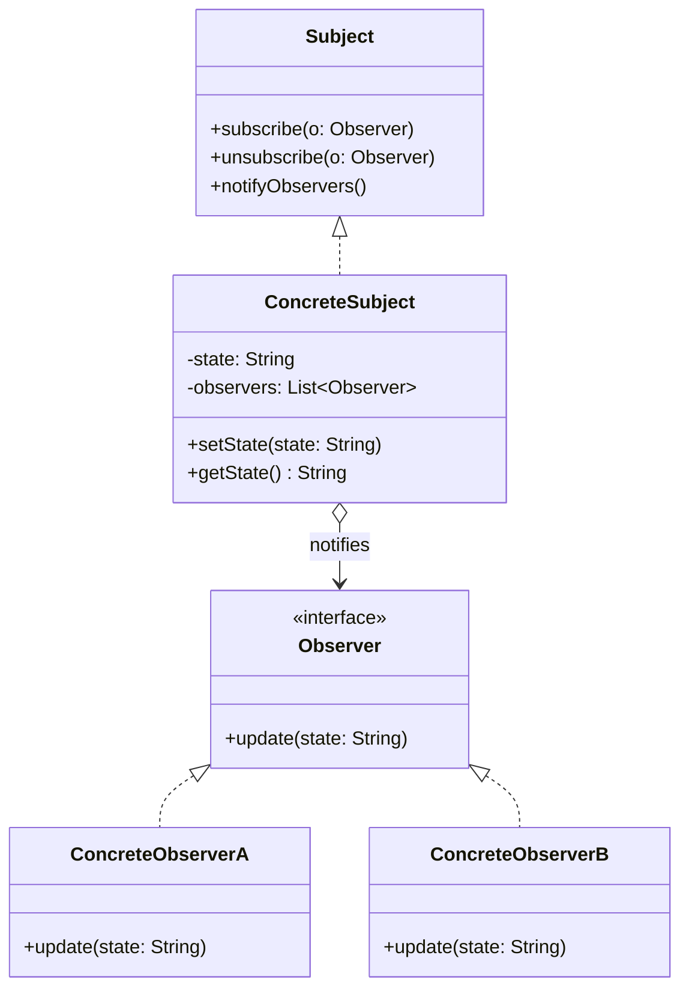
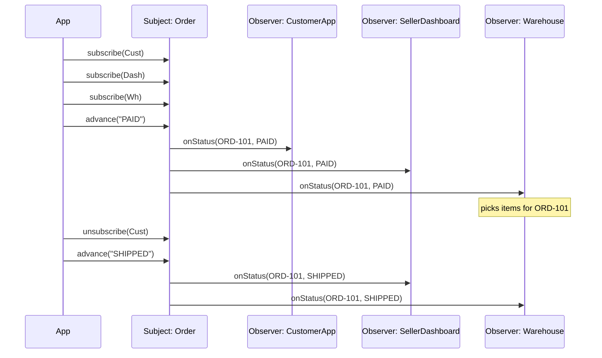

# Observer Design Pattern

> Youtube: [3. Observer Design Pattern Explanation (Hindi) | Design Interview Question | LLD System Design](https://www.youtube.com/watch?v=Ep9_Zcgst3U)

## 1. Overview and Fundamentals

The **Observer pattern** defines a one-to-many dependency between objects so that when one object (the **Subject**) changes state, all its dependents (**Observers**) are notified and updated automatically.

In one sentence: **one subject broadcasts; many observers react — without the subject knowing who they are.**

Core roles:

- **Subject (Observable):** holds state, maintains a list of observers, provides `subscribe()`, `unsubscribe()`, and `notify()`.
- **Observer:** declares an `update()` callback the subject calls on change.
- **ConcreteSubject:** stores real state (stock price, order status) and calls `notify()` after mutation.
- **ConcreteObserver:** implements `update()` with reaction logic (refresh UI, send SMS, trigger warehouse pick).

Fundamental properties:

- **Push vs pull:** subject can push the new data (`update(price)`) or push a "changed" hint and let observers pull (`getState()`).
- **Loose coupling:** subject knows only the `Observer` interface, never concrete classes.
- **Dynamic membership:** observers attach/detach at runtime.
- **Broadcast semantics:** a single state change fans out to N dependents in one call.
- **Category:** behavioral — it governs communication, not construction or structure.

Mental model: a YouTube channel (subject) with subscribers (observers). Uploading a video notifies every subscriber; the channel never hard-codes the subscriber list, and subscribers can join or leave freely.

Relationship to everyday code: DOM event listeners, `useEffect` on state change, Model→View updates in MVC, Redis Pub/Sub, Kafka consumers, and "follow" feeds are all Observer ideas at different scales.

## 2. Detailed Theory

### Intent and forces

Observer solves the **consistency + decoupling** tension: several objects must stay consistent with one source of truth, but the source should not be coupled to every consumer's type, count, or lifetime.

Without Observer, the subject either polls consumers (wasteful), hard-codes calls to each consumer (rigid, violates Open/Closed), or exposes state for everyone to poll (stale reads, chatty). Observer inverts this: consumers register interest once; the subject pushes changes.

### How it works

1. Observers call `subject.subscribe(this)` at startup (UI mount, service init).
2. Subject mutates state through a guarded method (e.g., `setPrice()`, `advance()`).
3. That method calls `notify()`, iterating over a snapshot of the observer list and invoking `observer.update(payload)`.
4. Observers react independently; failures in one must not break the loop.
5. On teardown, observers call `unsubscribe()` to avoid leaks and stale callbacks.

### Push, pull, and hybrid

| Model | Subject sends | Observer does | Best when |
|---|---|---|---|
| Push | Full new state (`price`, `status`) | Uses payload directly | Small, stable payloads; dashboards, tickers |
| Pull | `changed()` hint + subject ref | Queries `subject.getState()` for needed slice | Rich state; observers need different projections |
| Hybrid | Version/sequence + minimal delta | Pulls full state only on gap | High-frequency streams where drops matter |

### Design principles at play

- **Open/Closed:** add new observers without touching the subject.
- **Dependency Inversion:** both sides depend on abstractions (`Subject`/`Observer` interfaces).
- **Hollywood Principle:** "don't call us, we'll call you" — observers register and wait.
- **Single Responsibility:** subject owns state + fan-out; each observer owns one reaction.

### Variants

- **Synchronous in-process:** method call loop (simplest, this page's focus).
- **Async/event-bus:** notifications queued on an executor or bus.
- **Signal/reactive:** RxJS `Observable`, Java `Flow`, Kotlin `StateFlow` — Observer with operators.
- **Distributed pub/sub:** SNS/SQS/Kafka — durable Observer across processes.
- **Property-change:** JavaBeans `PropertyChangeSupport`, C# `INotifyPropertyChanged` — per-field observers.

### Consequences

Benefits: loose coupling, broadcast, dynamic membership, testable reactions in isolation. Costs: notification order is unspecified unless designed, cascading updates (A notifies B which notifies C), debugging fan-out, and leak risk if `unsubscribe` is forgotten.

## 3. UML and Architecture Diagrams

Static structure: one subject interface with many attached observers; concrete subjects hold state and concrete observers hold reaction logic.



*Explanation:* `ConcreteSubject` aggregates `Observer` references through the interface only. `setState()` mutates state then calls `notifyObservers()`, which fans out to every `update()`. Adding `ConcreteObserverC` requires no change to the subject — the Open/Closed payoff.

Runtime flow: subscribe once, then every mutation triggers a fan-out loop. Observers may pull extra detail after the push hint.



*Explanation:* subscription is explicit setup; each `advance()` produces one fan-out pass. After `unsubscribe`, the departed observer stops receiving events. In production, each arrow may be a queued task with try-catch isolation so one slow observer never blocks the rest.

Architecture note: keep `notify()` re-entrancy safe — iterate over a **copy** of the list so an observer that unsubscribes mid-loop does not cause `ConcurrentModificationException`. Never hold a lock while calling `update()`; a re-entrant `subscribe` from inside `update` would deadlock.

## 4. Implementation Examples in Java, Python, and Go

The domain is **order tracking**: an `Order` subject pushes status changes; customer app, seller dashboard, and warehouse observe.

### Java (interface + ArrayList, unsubscribe discipline)

```java
import java.util.ArrayList;
import java.util.List;

interface OrderObserver {
    void onStatus(String orderId, String status);
}

class Order {
    private final String orderId;
    private String status = "PLACED";
    private final List<OrderObserver> observers = new ArrayList<>();

    Order(String orderId) { this.orderId = orderId; }

    void subscribe(OrderObserver o) { observers.add(o); }
    void unsubscribe(OrderObserver o) { observers.remove(o); }

    void advance(String next) {
        status = next;
        // Snapshot + isolate: one bad observer cannot break the loop.
        for (OrderObserver o : List.copyOf(observers)) {
            try { o.onStatus(orderId, status); }
            catch (Exception e) { System.err.println("observer failed: " + e); }
        }
    }
    String status() { return status; }
}

class CustomerApp implements OrderObserver {
    public void onStatus(String id, String s) {
        System.out.println("SMS to customer: order " + id + " is " + s);
    }
}

class SellerDashboard implements OrderObserver {
    public void onStatus(String id, String s) {
        System.out.println("Dashboard refresh: " + id + " -> " + s);
    }
}

class WarehouseSystem implements OrderObserver {
    public void onStatus(String id, String s) {
        if ("PAID".equals(s)) System.out.println("Warehouse: pick items for " + id);
        if ("CANCELLED".equals(s)) System.out.println("Warehouse: restock " + id);
    }
}

public class OrderDemo {
    public static void main(String[] args) {
        Order order = new Order("ORD-101");
        CustomerApp app = new CustomerApp();
        order.subscribe(app);
        order.subscribe(new SellerDashboard());
        order.subscribe(new WarehouseSystem());
        order.advance("PAID");
        order.advance("SHIPPED");
        order.unsubscribe(app);
        order.advance("DELIVERED");
    }
}
```

*Explanation:* `List.copyOf` snapshot avoids concurrent-modification; try-catch per observer provides failure isolation. `unsubscribe` is explicit to prevent leaks.

Sample I/O:

```text
SMS to customer: order ORD-101 is PAID
Dashboard refresh: ORD-101 -> PAID
Warehouse: pick items for ORD-101
SMS to customer: order ORD-101 is SHIPPED
Dashboard refresh: ORD-101 -> SHIPPED
Dashboard refresh: ORD-101 -> DELIVERED
```

### Python (pythonic: protocol + weak-friendly list)

```python
from __future__ import annotations
from typing import Protocol

class OrderObserver(Protocol):
    def on_status(self, order_id: str, status: str) -> None: ...

class Order:
    """Subject: pushes status changes to registered observers."""

    def __init__(self, order_id: str) -> None:
        self.order_id = order_id
        self.status = "PLACED"
        self._observers: list[OrderObserver] = []

    def subscribe(self, observer: OrderObserver) -> None:
        self._observers.append(observer)

    def unsubscribe(self, observer: OrderObserver) -> None:
        try:
            self._observers.remove(observer)
        except ValueError:
            pass

    def advance(self, status: str) -> None:
        self.status = status
        for observer in list(self._observers):  # snapshot: safe detach mid-loop
            try:
                observer.on_status(self.order_id, self.status)
            except Exception as exc:  # isolate one bad listener
                print(f"observer failed: {exc!r}")

class CustomerApp:
    def on_status(self, order_id: str, status: str) -> None:
        print(f"SMS to customer: order {order_id} is {status}")

class SellerDashboard:
    def on_status(self, order_id: str, status: str) -> None:
        print(f"Dashboard refresh: {order_id} -> {status}")

class WarehouseSystem:
    def on_status(self, order_id: str, status: str) -> None:
        if status == "PAID":
            print(f"Warehouse: pick items for {order_id}")
        elif status == "CANCELLED":
            print(f"Warehouse: restock {order_id}")

if __name__ == "__main__":
    order = Order("ORD-101")
    app = CustomerApp()
    order.subscribe(app)
    order.subscribe(SellerDashboard())
    order.subscribe(WarehouseSystem())
    order.advance("PAID")
    order.advance("SHIPPED")
    order.unsubscribe(app)
    order.advance("DELIVERED")
```

*Explanation:* `Protocol` gives structural typing without forcing inheritance; `list(...)` snapshot and per-observer try/except mirror the Java discipline. For UI observers with short lifetimes, store `weakref.ref` entries to avoid leaks.

Sample I/O: identical to the Java output above.

### Go (idiomatic: interface + slice + mutex)

```go
package main

import (
	"fmt"
	"sync"
)

// Observer is the subscriber contract.
type Observer interface {
	OnStatus(orderID, status string)
}

// Order is the subject.
type Order struct {
	mu        sync.RWMutex
	id        string
	status    string
	observers []Observer
}

func NewOrder(id string) *Order { return &Order{id: id, status: "PLACED"} }

func (o *Order) Subscribe(obs Observer) {
	o.mu.Lock()
	defer o.mu.Unlock()
	o.observers = append(o.observers, obs)
}

func (o *Order) Unsubscribe(target Observer) {
	o.mu.Lock()
	defer o.mu.Unlock()
	kept := o.observers[:0]
	for _, obs := range o.observers {
		if obs != target {
			kept = append(kept, obs)
		}
	}
	o.observers = kept
}

func (o *Order) Advance(status string) {
	o.mu.Lock()
	o.status = status
	snapshot := append([]Observer(nil), o.observers...)
	id := o.id
	o.mu.Unlock() // never hold the lock while notifying

	for _, obs := range snapshot {
		func() {
			defer func() {
				if r := recover(); r != nil {
					fmt.Println("observer failed:", r)
				}
			}()
			obs.OnStatus(id, status)
		}()
	}
}

type CustomerApp struct{}

func (CustomerApp) OnStatus(id, status string) {
	fmt.Println("SMS to customer: order " + id + " is " + status)
}

type SellerDashboard struct{}

func (SellerDashboard) OnStatus(id, status string) {
	fmt.Println("Dashboard refresh: " + id + " -> " + status)
}

type Warehouse struct{}

func (Warehouse) OnStatus(id, status string) {
	if status == "PAID" {
		fmt.Println("Warehouse: pick items for " + id)
	}
	if status == "CANCELLED" {
		fmt.Println("Warehouse: restock " + id)
	}
}

func main() {
	order := NewOrder("ORD-101")
	app := CustomerApp{}
	order.Subscribe(app)
	order.Subscribe(SellerDashboard{})
	order.Subscribe(Warehouse{})
	order.Advance("PAID")
	order.Advance("SHIPPED")
	order.Unsubscribe(app)
	order.Advance("DELIVERED")
}
```

*Explanation:* `RWMutex` guards subscribe/unsubscribe; `Advance` snapshots under lock then notifies **without** holding it, so an observer that re-subscribes cannot deadlock. Panic recovery per observer provides Go-idiomatic isolation.

Sample I/O: identical to the Java output above.

## 5. Real-World Industry Applications

- **Frontend reactivity:** React `useState`/`useEffect`, Vue refs, Angular `Observable` — view observers re-render on model change.
- **Spring Framework:** `ApplicationEvent` + `ApplicationListener` for order-created, payment-succeeded domain events.
- **Android:** `LiveData`/`StateFlow` observers bound to lifecycle owners; auto-unsubscribe on destroy.
- **Messaging:** Redis Pub/Sub for cache invalidation, AWS SNS fan-out to SQS queues, Kafka consumer groups tailing order topics.
- **Stock/market data:** one ticker subject fans price ticks to chart, alert, and portfolio observers (the classic interview example).
- **Social feeds:** follow graph — a post notifies follower timelines, push service, and search indexer.
- **IoT:** sensor subject notifies threshold-alert, dashboard, and persistence observers.
- **Databases:** Postgres `LISTEN/NOTIFY`, Firebase realtime listeners, CDC outbox publishers.

## 6. Practical Use Cases and Scenarios

1. **Order tracking feed:** PLACED → PAID → SHIPPED → DELIVERED pushes to customer SMS, seller dashboard, warehouse, fraud scoring. New consumers subscribe without touching `Order`.
2. **Stock ticker:** exchange feed pushes ticks; chart, alert-rule, and P&L observers each keep their own projection.
3. **Form validation:** each keystroke notifies validators, character counters, and submit-button enablers.
4. **Build pipelines:** commit subject notifies test, lint, and deploy observers in parallel.
5. **Multiplayer lobby:** player-ready changes notify matchmaking, chat roster, and countdown timer.
6. **Feature flags:** flag-change subject pushes to every service instance holding a cached flag snapshot.
7. **Caching:** write-through subject invalidates CDN, local, and query caches on entity change.

Scenario walkthrough (e-commerce): `Order.advance("CANCELLED")` notifies `CustomerApp` (refund SMS), `Warehouse` (restock), and `AnalyticsObserver` (funnel metric). Adding a `FraudObserver` later is one `subscribe` call — zero edits to `Order`.

## 7. When to Use and When Not to Use

**Use Observer when:**

- One state change must reach many unknown dependents (events, feeds, model-view sync).
- Dependents join/leave at runtime (UI mounts, plugin systems, feature subscriptions).
- You need broadcast without polling (tickers, order feeds, sensor streams).
- Cross-cutting reactions (logging, metrics, audit) must attach without touching core logic.

**Do NOT use Observer when:**

- There is exactly one dependent — a direct callback or return value is clearer.
- Publisher and subscribers span services with durability needs — use a queue/stream (SQS, Kafka) instead of in-memory fan-out.
- Ordering guarantees matter strictly — Observer is unordered by default; use a chain or ordered bus.
- The graph can cycle (A observes B observes A) — you will build an infinite notification storm; use a mediator or explicit orchestration.
- Observers need request/response — Observer is one-way; use Command, Future, or RPC.

Rule of thumb: one source, many passive reactions, same process → Observer. Cross-process, durable, or ordered → broker/chain.

## 8. Do's and Don'ts

**Do:**

- Provide `unsubscribe` (or scoped/auto-closeable subscriptions) and call it in lifecycle teardown.
- Iterate over a snapshot copy; never mutate the list mid-notify without copying.
- Isolate observer failures with per-observer try-catch so one crash cannot halt fan-out.
- Never hold locks while notifying; snapshot under lock, notify outside it.
- Document push payload versioning; treat the event shape as a public contract.
- Consider async dispatch or batching for high-frequency subjects (price ticks).

**Don't:**

- Don't notify from inside a constructor — half-built subjects leak `this` to observers.
- Don't assume notification order — label any priority scheme explicitly or use a priority bus.
- Don't let observers call back into mutating subject methods re-entrantly without a guard (storm risk).
- Don't store strong references to short-lived UI observers without weak refs or lifecycle unsubscription.
- Don't push huge object graphs — send IDs/deltas and let observers pull what they need.
- Don't use Observer for request-reply; it has no return channel by design.

## 9. Comparison with Other Design Patterns

| Aspect | Observer | Pub/Sub (broker) | Mediator |
|---|---|---|---|
| Topology | Subject → known interface list, direct refs | Publisher → topic → broker → subscribers | Colleagues ↔ hub, hub owns rules |
| Coupling | Subject knows observer interface | Neither side knows the other (topic only) | Colleagues know hub; hub knows all |
| Scope | Usually in-process, synchronous | Cross-process, durable, async | In-process coordination with back-talk |
| Ordering/durability | None by default | Ordered per partition, replayable | Hub-defined sequencing |
| Failure mode | One throw breaks loop (guard it) | Broker retries, DLQ | Hub becomes god object |
| Use when | UI events, model-view, order feed | Microservice events, Kafka/SNS fan-out | Chat rooms, dialogs, ATC with two-way rules |

| Aspect | Observer | Command | Callback (single) |
|---|---|---|---|
| Fan-out | One-to-many | One request object, one receiver (or queue) | One-to-one function ref |
| Reversibility | No undo channel | Supports undo/queue/replay | No |
| Lifetime | Long-lived subscription | One-shot execution | Scoped to call |
| Pick it when | Ongoing interest in state changes | Defer, queue, or undo work | Single notification suffices |

**Observer vs Mediator (the classic confusion):** Observer broadcasts one-way from a subject to passive listeners. Mediator orchestrates two-way conversations among peers with rules in the hub. If listeners never talk back, Observer wins. If peers negotiate (chat, auctions, dialog validation), Mediator wins.

## 10. Interview Preparation

**Q1: Push vs pull — which do you choose?**
Push (subject sends data) is simpler and avoids extra queries but couples observers to the payload shape. Pull (subject sends "changed") lets each observer fetch its own slice. Use push for small stable payloads, pull for rich state, hybrid (version + delta) for streams.

**Q2: How do you prevent memory leaks?**
Every `subscribe` needs a visible `unsubscribe` in lifecycle teardown; use weak references for UI listeners; scope subscriptions (try-with-resources, `takeUntil(destroy)`); bound the list and log its size. In review, grep for unmatched subscribes.

**Q3: What if an observer throws or blocks?**
Isolate: try-catch per observer, log and optionally auto-unsubscribe repeat offenders. Never let one observer veto the loop. For slow observers, dispatch async with a bounded queue; never block the subject thread on I/O inside `update()`.

**Q4: How do you handle ordering and duplicate delivery?**
Observer gives no order guarantee — add explicit priorities or sequence numbers if needed, make observers idempotent (dedupe by event ID), and document at-least-once semantics for async variants.

**Q5: Observer vs pub/sub vs mediator?**
Observer: direct in-process fan-out to an interface list. Pub/sub: decoupled via broker/topics across processes with durability. Mediator: hub with two-way rules among peers. Scale of distance and need for reply decide.

**Q6: How do you avoid notification storms / cycles?**
Guard re-entrancy (dirty flag, version check — ignore `setState` with same value), batch coalesce rapid changes, and forbid observers from mutating the same subject synchronously; route follow-on changes through a queue. Detect cycles with event lineage IDs.

**Q7: Is Observer thread-safe?**
Only if designed: guard the list with a mutex/RWMutex, snapshot before notifying, notify outside the lock, and make observers thread-safe or confine them to one executor. Test with concurrent subscribe/notify fuzz.

**Q8: When do you replace Observer with polling or a queue?**
Poll when change frequency is low and staleness is tolerable (simpler, no leak surface). Queue when crossing processes, needing durability/replay, or scaling consumers independently. Keep in-process Observer for live UI/model sync.

**LLD scenario 1 — Design a Stock Alert system.**
*Expectation:* `StockTicker` subject with `subscribe(symbol, observer)`; `PriceAlertObserver` (threshold rule), `DashboardObserver`, `AuditObserver`. Discuss push tick vs pull quote, snapshot iteration, async dispatch for slow SMS, idempotency keys, and when to graduate to Kafka for multi-service fan-out.

**LLD scenario 2 — Design an Order Tracking notification service.**
*Expectation:* `Order` subject, observers per channel (SMS, email, push) plus internal (warehouse, analytics). Show unsubscribe on delivery, per-observer try-catch, template-per-channel, rate limiting via decorator, and event versioning for out-of-order retries.

**LLD scenario 3 — Design MVC live search.**
*Expectation:* keystroke subject notifies `SuggestionObserver` (debounced API), `ResultCountObserver`, `HistoryObserver`. Discuss coalescing (300 ms debounce), cancellation of stale requests, and pull-model for observers needing different query slices.

## 11. Testing and Best Practices

- **Subscribe/unsubscribe:** register two mocks, unsubscribe one, assert only the survivor receives the next event.
- **Fan-out completeness:** attach N mocks, fire one change, verify all N `update()` calls with the exact payload.
- **Isolation:** make one observer throw; assert the rest still receive the event and the subject stays usable.
- **Re-entrancy:** observer that unsubscribes (or subscribes) inside `update()` must not throw `ConcurrentModificationException`.
- **No-op change:** setting the same state twice should notify once or zero times per documented policy.
- **Leak check:** destroy observer, force GC, assert subject list shrinks (weak-ref test) or explicit unsubscribe was called.
- **Concurrency:** hammer subscribe/notify from threads; assert no deadlock and every notification delivers a consistent snapshot.
- **Contract test:** payload schema versioned; old observers ignore unknown fields, new observers handle missing fields.
- Best practice: mock observers for subject tests; use a recording fake subject for observer tests; keep observers stateless or inject clocks/IDs for determinism.

## 12. Summary and Key Takeaways

- Observer = one subject, many loosely-coupled dependents, automatic push on change.
- Prefer snapshots + per-observer isolation + explicit unsubscribe — the three disciplines that prevent 90% of Observer bugs.
- Push for small payloads, pull for rich state, broker when crossing processes.
- New reactions arrive as new observer classes; the subject never changes (Open/Closed).
- Do not use it for request/reply, strict ordering, or durable cross-service events — reach for Command, Chain, or a queue.
- Interview one-liner: *"Observer keeps one source consistent with many dependents through interface-only fan-out; I snapshot the list, isolate failures, and unsubscribe on teardown — and graduate to pub/sub when delivery must cross processes."*
