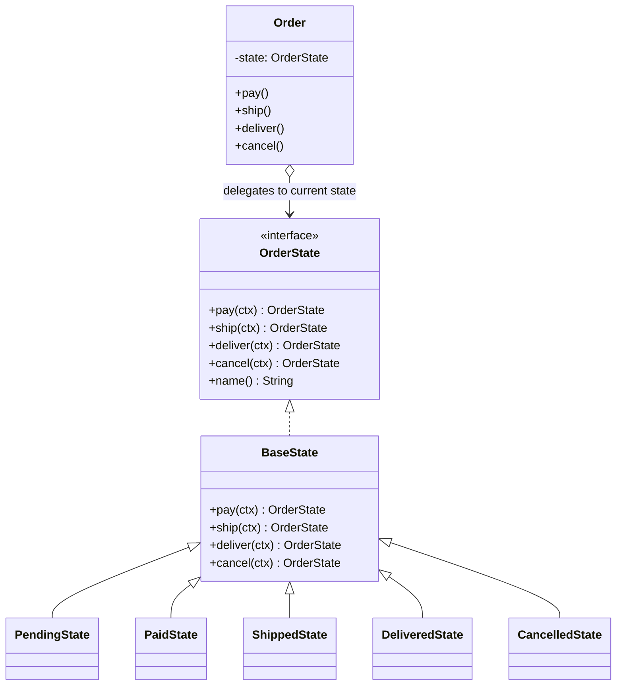
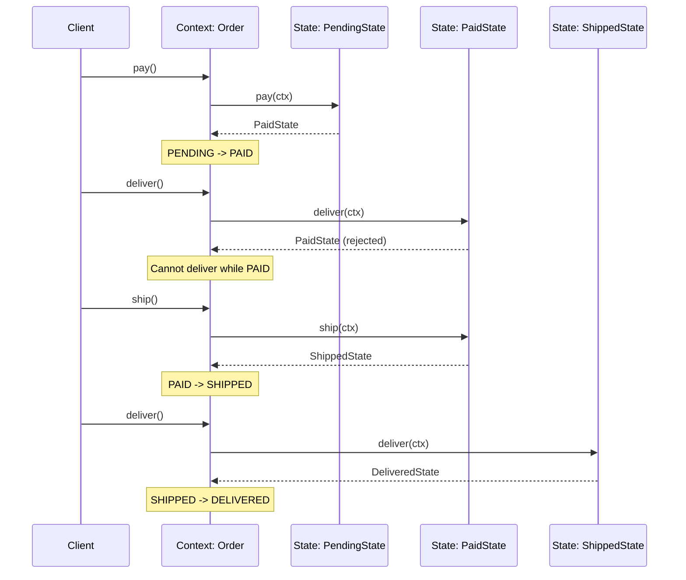

# State Design Pattern

> Youtube: [16. Design Vending Machine (Hindi) | LLD of Vending Machine | State Design Pattern | LLD question](https://www.youtube.com/watch?v=wOXs5Z_z0Ew)

## 1. Overview and Fundamentals

The **State pattern** lets an object alter its behavior when its internal state changes — the object appears to change its class.

In one sentence: **delegate every action to the current state object, and let state objects decide the next state.**

Core roles:

- **Context:** the stable facade clients call (`Order`, `VendingMachine`, `TCPConnection`). Holds a reference to the current `State` and delegates.
- **State interface:** declares one method per event (`pay()`, `ship()`, `insertCoin()`, `open()`).
- **ConcreteState:** implements valid events for that stage and rejects (or transitions) the rest (`PendingState`, `PaidState`, `HasMoneyState`).
- **Transition:** a state method returns (or installs) the next state object.

Fundamental properties:

- **Behavioral:** governs how behavior varies, not how objects are built.
- **Explicit machine:** every (state, event) pair has an owner — no hidden `if status == X` spread across methods.
- **Self-driven switching:** unlike Strategy, the state objects themselves trigger transitions.
- **Open/Closed:** new stages arrive as new classes; the context stays untouched.

Mental model: a vending machine. Pressing the same "buy" button does different things when idle (ask for coins), when paid (dispense), or when out of stock (refund) — the button is fixed, the active state object answers.

## 2. Detailed Theory

### Intent and forces

State solves the **conditional-explosion** tension: behavior depends on lifecycle stage, so every method accumulates `if/else` or `switch` on a status field. Branches duplicate, invalid transitions slip through, and adding a stage means editing every method.

State replaces the status flag with polymorphism: each stage becomes an object owning its rules. The context shrinks to `state = state.handle(event)`.

### How it works

1. Context starts in an initial state (`new PendingState()`).
2. Client calls `context.pay()` — context delegates to `state.pay(this)`.
3. The state either returns the next state (`PaidState`), returns `this` (no-op with log), or rejects (log / exception).
4. Context installs the returned state and optionally emits a transition event for audit.
5. Terminal states (`Delivered`, `Cancelled`) reject everything.

### Where transition logic lives

| Placement | How | Best when |
|---|---|---|
| In state objects | Each state returns the next | Default — keeps context thin, rules co-located |
| In context | States return enums; context maps to next | Auditors want one visible transition table |
| In table/config | `(state, event) → next` map or library | 8+ states, compliance needs a printable graph |

Prefer states-own-transitions until the graph needs centralized audit; then extract a transition table or a state-machine library (Spring StateMachine, XState, MassTransit sagas).

### Design principles at play

- **Single Responsibility:** each state class owns one stage's rules.
- **Open/Closed:** add `RefundedState` without editing `Order` or sibling states.
- **Liskov:** a shared base with default rejections keeps every state substitutable.
- **Explicitness:** illegal transitions fail loudly instead of silently corrupting data.

### Variants

- **Enum-state + behavior map:** lighter for 2–3 trivial states.
- **Hierarchical states:** nested machines (Payment sub-states inside `Paid`).
- **History states:** remember sub-state on re-entry (media player pause/resume).
- **Table-driven:** transition matrix data file for ops-visible workflows.

### Consequences

Benefits: no conditionals, illegal moves rejected, stages independently testable. Costs: more classes, transition logic can scatter, overkill for tiny machines — a 2-state toggle rarely earns the pattern.

## 3. UML and Architecture Diagrams

Static structure: context aggregates one state; every concrete state implements the same event interface.



*Explanation:* `BaseState` supplies default rejections so each concrete state overrides only its valid events. `Order` never branches on status strings — it delegates and installs whatever state comes back. New stages subclass `BaseState` with zero edits to `Order`.

Runtime flow: events walk the machine; invalid events bounce with a log while valid ones advance.



*Explanation:* valid events return the next state; invalid ones return `this` plus a rejection log, so the context visibly stays put. Emitting `OLD -> NEW` per move gives an audit trail for support and metrics on rejected transitions.

## 4. Implementation Examples in Java, Python, and Go

The domain is an **order lifecycle**: PENDING → PAID → SHIPPED → DELIVERED, with CANCELLED as an alternate terminal. Illegal moves are rejected loudly.

### Java (interface + rejecting base class)

```java
interface OrderState {
    OrderState pay(Order ctx);
    OrderState ship(Order ctx);
    OrderState deliver(Order ctx);
    OrderState cancel(Order ctx);
    String name();
}

abstract class BaseState implements OrderState {
    public OrderState pay(Order ctx) { return reject("pay"); }
    public OrderState ship(Order ctx) { return reject("ship"); }
    public OrderState deliver(Order ctx) { return reject("deliver"); }
    public OrderState cancel(Order ctx) { return reject("cancel"); }
    private OrderState reject(String action) {
        System.out.println("Cannot " + action + " while " + name());
        return this;
    }
}

class PendingState extends BaseState {
    public String name() { return "PENDING"; }
    public OrderState pay(Order ctx) { return new PaidState(); }
    public OrderState cancel(Order ctx) { return new CancelledState(); }
}

class PaidState extends BaseState {
    public String name() { return "PAID"; }
    public OrderState ship(Order ctx) { return new ShippedState(); }
    public OrderState cancel(Order ctx) { return new CancelledState(); }
}

class ShippedState extends BaseState {
    public String name() { return "SHIPPED"; }
    public OrderState deliver(Order ctx) { return new DeliveredState(); }
}

class DeliveredState extends BaseState {
    public String name() { return "DELIVERED"; }
}

class CancelledState extends BaseState {
    public String name() { return "CANCELLED"; }
}

class Order {
    private OrderState state = new PendingState();
    private void move(OrderState next) {
        System.out.println(state.name() + " -> " + next.name());
        state = next;
    }
    void pay() { move(state.pay(this)); }
    void ship() { move(state.ship(this)); }
    void deliver() { move(state.deliver(this)); }
    void cancel() { move(state.cancel(this)); }
    String status() { return state.name(); }
}

class OrderDemo {
    public static void main(String[] args) {
        Order order = new Order();
        order.pay();      // PENDING -> PAID
        order.deliver();  // rejected
        order.ship();     // PAID -> SHIPPED
        order.deliver();  // SHIPPED -> DELIVERED
        order.cancel();   // rejected: terminal
        System.out.println("Final: " + order.status());
    }
}
```

*Explanation:* `BaseState` centralizes rejection so concrete states declare only legal moves. The context logs every `OLD -> NEW` pair for audit.

Sample I/O:

```text
PENDING -> PAID
Cannot deliver while PAID
PAID -> PAID
PAID -> SHIPPED
SHIPPED -> DELIVERED
Cannot cancel while DELIVERED
DELIVERED -> DELIVERED
Final: DELIVERED
```

### Python (pythonic: ABC + default rejections)

```python
from __future__ import annotations
from abc import ABC, abstractmethod

class OrderState(ABC):
    """One method per event; default is loud rejection."""

    @abstractmethod
    def name(self) -> str: ...

    def _reject(self, action: str) -> OrderState:
        print(f"Cannot {action} while {self.name()}")
        return self

    def pay(self, ctx: Order) -> OrderState: return self._reject("pay")
    def ship(self, ctx: Order) -> OrderState: return self._reject("ship")
    def deliver(self, ctx: Order) -> OrderState: return self._reject("deliver")
    def cancel(self, ctx: Order) -> OrderState: return self._reject("cancel")

class PendingState(OrderState):
    def name(self) -> str: return "PENDING"
    def pay(self, ctx: Order) -> OrderState: return PaidState()
    def cancel(self, ctx: Order) -> OrderState: return CancelledState()

class PaidState(OrderState):
    def name(self) -> str: return "PAID"
    def ship(self, ctx: Order) -> OrderState: return ShippedState()
    def cancel(self, ctx: Order) -> OrderState: return CancelledState()

class ShippedState(OrderState):
    def name(self) -> str: return "SHIPPED"
    def deliver(self, ctx: Order) -> OrderState: return DeliveredState()

class DeliveredState(OrderState):
    def name(self) -> str: return "DELIVERED"

class CancelledState(OrderState):
    def name(self) -> str: return "CANCELLED"

class Order:
    """Context: delegates every event to the current state."""

    def __init__(self) -> None:
        self._state: OrderState = PendingState()

    def _move(self, nxt: OrderState) -> None:
        print(f"{self._state.name()} -> {nxt.name()}")
        self._state = nxt

    def pay(self) -> None: self._move(self._state.pay(self))
    def ship(self) -> None: self._move(self._state.ship(self))
    def deliver(self) -> None: self._move(self._state.deliver(self))
    def cancel(self) -> None: self._move(self._state.cancel(self))

    @property
    def status(self) -> str: return self._state.name()

if __name__ == "__main__":
    order = Order()
    order.pay()
    order.deliver()   # rejected
    order.ship()
    order.deliver()
    order.cancel()    # rejected: terminal
    print("Final:", order.status)
```

*Explanation:* the ABC supplies inherited rejections, so each state class stays tiny. Type hints + `property` keep the Python idiomatic; swapping in `enum`-keyed singletons is trivial if allocation matters.

Sample I/O: identical to the Java output above.

### Go (idiomatic: interface + small structs)

```go
package main

import "fmt"

// OrderState declares one method per lifecycle event.
type OrderState interface {
	Name() string
	Pay(*Order) OrderState
	Ship(*Order) OrderState
	Deliver(*Order) OrderState
	Cancel(*Order) OrderState
}

func reject(s OrderState, action string) OrderState {
	fmt.Println("Cannot " + action + " while " + s.Name())
	return s
}

type Pending struct{}

func (Pending) Name() string                          { return "PENDING" }
func (s Pending) Pay(*Order) OrderState               { return Paid{} }
func (s Pending) Ship(*Order) OrderState              { return reject(s, "ship") }
func (s Pending) Deliver(*Order) OrderState           { return reject(s, "deliver") }
func (s Pending) Cancel(*Order) OrderState            { return Cancelled{} }

type Paid struct{}

func (Paid) Name() string                          { return "PAID" }
func (s Paid) Pay(*Order) OrderState               { return reject(s, "pay") }
func (s Paid) Ship(*Order) OrderState             { return Shipped{} }
func (s Paid) Deliver(*Order) OrderState          { return reject(s, "deliver") }
func (s Paid) Cancel(*Order) OrderState            { return Cancelled{} }

type Shipped struct{}

func (Shipped) Name() string                        { return "SHIPPED" }
func (s Shipped) Pay(*Order) OrderState             { return reject(s, "pay") }
func (s Shipped) Ship(*Order) OrderState            { return reject(s, "ship") }
func (s Shipped) Deliver(*Order) OrderState         { return Delivered{} }
func (s Shipped) Cancel(*Order) OrderState          { return reject(s, "cancel") }

type Delivered struct{}

func (Delivered) Name() string                    { return "DELIVERED" }
func (s Delivered) Pay(*Order) OrderState         { return reject(s, "pay") }
func (s Delivered) Ship(*Order) OrderState        { return reject(s, "ship") }
func (s Delivered) Deliver(*Order) OrderState     { return reject(s, "deliver") }
func (s Delivered) Cancel(*Order) OrderState      { return reject(s, "cancel") }

type Cancelled struct{}

func (Cancelled) Name() string                    { return "CANCELLED" }
func (s Cancelled) Pay(*Order) OrderState         { return reject(s, "pay") }
func (s Cancelled) Ship(*Order) OrderState        { return reject(s, "ship") }
func (s Cancelled) Deliver(*Order) OrderState     { return reject(s, "deliver") }
func (s Cancelled) Cancel(*Order) OrderState      { return reject(s, "cancel") }

// Order is the context.
type Order struct{ state OrderState }

func NewOrder() *Order { return &Order{state: Pending{}} }

func (o *Order) move(next OrderState) {
	fmt.Println(o.state.Name() + " -> " + next.Name())
	o.state = next
}

func (o *Order) Pay()     { o.move(o.state.Pay(o)) }
func (o *Order) Ship()    { o.move(o.state.Ship(o)) }
func (o *Order) Deliver() { o.move(o.state.Deliver(o)) }
func (o *Order) Cancel()  { o.move(o.state.Cancel(o)) }
func (o *Order) Status() string { return o.state.Name() }

func main() {
	order := NewOrder()
	order.Pay()
	order.Deliver() // rejected
	order.Ship()
	order.Deliver()
	order.Cancel() // rejected: terminal
	fmt.Println("Final:", order.Status())
}
```

*Explanation:* stateless struct states keep allocation trivial; the `reject` helper mirrors the Java/Python base class. Context methods are one-liners, and `Status()` exposes the current stage.

Sample I/O: identical to the Java output above.

## 5. Real-World Industry Applications

- **E-commerce orders:** PENDING → PAID → SHIPPED → DELIVERED / CANCELLED / RETURNED drives payment, warehouse, and refund logic.
- **Vending / parking machines:** Idle → HasMoney → Dispensing → OutOfService, the textbook embedded use.
- **TCP connections:** CLOSED → LISTEN → ESTABLISHED → FIN_WAIT → CLOSED in every network stack.
- **Media players:** Playing / Paused / Stopped / Buffering gate which buttons are valid.
- **Auth sessions:** Anonymous → Authenticated → Expired → Locked, with refresh and lockout transitions.
- **Document workflows:** Draft → Review → Approved → Published in CMS and approval tools.
- **Game AI:** Idle → Patrol → Chase → Attack finite-state machines for NPCs.
- **Cloud orchestration:** Step Functions / Temporal workflows where each activity's valid next steps depend on execution state.

## 6. Practical Use Cases and Scenarios

1. **Order lifecycle API:** `POST /orders/{id}/ship` delegates to state; shipping a PENDING order returns 409 with "Cannot ship while PENDING".
2. **Vending machine firmware:** coin, select, dispense, and refund buttons each route through the active state; out-of-stock transitions to a service state.
3. **Support tickets:** Open → InProgress → WaitingOnCustomer → Resolved; SLA timers attach per state.
4. **Subscription billing:** Trial → Active → PastDue → Cancelled, with dunning retries only valid in PastDue.
5. **Elevator control:** Idle / MovingUp / MovingDown / Maintenance gate door and motor commands.
6. **Parser/lexer:** start, in-string, escaped, comment states consume characters differently.
7. **Hiring pipeline:** Applied → Screen → Interview → Offer → Hired, each stage owning its valid moves and emails.

Scenario walkthrough (vending): `insertCoin()` in `IdleState` returns `HasMoneyState`; `select()` in `HasMoneyState` returns `DispensingState` which dispenses then returns `IdleState`; `select()` in `IdleState` is rejected with "insert coins first". No controller `if` chain exists.

## 7. When to Use and When Not to Use

**Use State when:**

- Behavior and valid actions depend on lifecycle stage (orders, connections, sessions).
- Methods share large `switch(status)` blocks that must stay in sync.
- Transitions are explicit and auditable (compliance, support tooling).
- New stages arrive over time (returns, refunds, chargebacks) and should not ripple through old code.

**Do NOT use State when:**

- There are 2–3 states with one-line behavior — an enum + switch is clearer and fewer files.
- Transitions are ad-hoc with no rules — a status field plus validation may suffice.
- State data differs wildly per stage with no shared protocol — consider separate types or a workflow engine.
- You need caller-chosen algorithms with no lifecycle — that is Strategy, not State.
- The graph exceeds ~8 states with cross-cutting guards — reach for a state-machine library or table instead of hand-rolled classes.

Rule of thumb: lifecycle drives validity → State. Caller picks among peers → Strategy. Two trivial stages → enum.

## 8. Do's and Don'ts

**Do:**

- Give every (state, event) pair an explicit answer: transition, no-op with log, or typed exception.
- Log `OLD -> NEW` on every move; emit metrics on rejections to catch client bugs.
- Keep states focused; push shared helpers into a base class, not into the context.
- Document the machine as a diagram in the class or README — code alone hides the graph.
- Make states immutable/stateless where possible; park per-order data in the context.
- Test the full transition matrix, including every illegal pair.

**Don't:**

- Don't scatter status-string comparisons across services — the state objects are the single source of truth.
- Don't let the context mutate state directly; all moves go through state methods.
- Don't share mutable state objects across contexts unless they are truly stateless.
- Don't silently swallow invalid events in user-facing flows — return 409/validation errors.
- Don't add a new state by editing five siblings — if that happens, extract a transition table.
- Don't confuse "mode" flags (dark mode, sort order) with lifecycle states — flags are Strategy/config, not State.

## 9. Comparison with Other Design Patterns

| Aspect | State | Strategy | Template Method |
|---|---|---|---|
| Question answered | What is valid **now**, given lifecycle? | Which **algorithm** should run? | What is the **fixed order** of steps? |
| Who switches | Current state object returns next | Client/context sets explicitly | Nobody — skeleton fixed at compile time |
| Transitions | Core concern, explicit graph | None — peers are independent | None — hooks only |
| Client knowledge | Sends events, states decide | Must know options to choose | Picks subclass, inherits order |
| Typical use | Orders, TCP, vending, sessions | Payments, sorting, routing | ETL, JUnit lifecycle, reports |
| Risk | Class + transition sprawl | Client must choose wisely | Rigid hierarchy |

| Aspect | State | Status enum + switch |
|---|---|---|
| Rules location | One class per stage | Spread across every method |
| New stage cost | One new class | Edit every switch |
| Illegal moves | Rejected by type | Discovered at runtime (or missed) |
| Readability | Graph visible via classes/diagram | Compact for ≤3 trivial stages |

**State vs Strategy (the classic confusion):** identical UML, opposite intent. Ask *"who triggers the switch?"* Lifecycle → State. Caller → Strategy. An order ships because payment completed (State); a checkout pays by card because the user picked it (Strategy).

## 10. Interview Preparation

**Q1: State and Strategy look identical — how do you distinguish them?**
By intent and switching authority. State: the current state object decides the next state; clients just send events. Strategy: the client picks and injects the algorithm. Probe with "who triggers the switch — lifecycle or caller?"

**Q2: Where should transition logic live?**
Default to state objects (co-located, thin context). Centralize into the context or a transition table when auditors need the whole graph in one place, or past ~8 states when scattering becomes unreviewable.

**Q3: How do you handle invalid transitions?**
Reject explicitly: default methods log + return `this` for user errors, or throw `IllegalStateException` for programming errors. Map to 409/422 in APIs, test every illegal pair, and metric rejections.

**Q4: Enum switch vs State — when do you graduate?**
Stay with enum for ≤3 stages with trivial behavior. Graduate when conditionals duplicate across methods, stages carry different data, or transitions need logging/audit. Extract a table/library past ~8 states.

**Q5: How do you persist and restore state?**
Persist the state *name* (not the object) plus context data; rehydrate via factory `State.of(name)`. Version the names; handle unknown persisted values with a migration or dead-letter. Never serialize behavior objects directly.

**Q6: Are state objects shared or per-context?**
Share when stateless (flyweight singletons); allocate per context when states carry stage data (retry counts, timers). Document the choice — shared mutable states are a classic concurrency bug.

**Q7: How do you model hierarchical or parallel states?**
Nest machines (Payment sub-machine inside `Paid`) or compose orthogonal regions (connection + subscription states side by side). Beyond two levels, prefer a statechart library over hand-rolled nesting.

**Q8: How do you debug a misbehaving machine?**
Log every transition with (from, event, to, timestamp), expose current state in health/debug endpoints, and add a transition-matrix test that enumerates all pairs. Rejected-transition metrics usually pinpoint the bad caller.

**LLD scenario 1 — Design a Vending Machine.**
*Expectation:* states Idle / HasMoney / Dispensing / OutOfStock; events coin, select, dispense, refund, restock. Show `select()` rejected in Idle, change returned in HasMoney, and restock resetting to Idle. Discuss coin inventory and concurrency on dispense.

**LLD scenario 2 — Design Order Management with returns.**
*Expectation:* extend PENDING → PAID → SHIPPED → DELIVERED with RETURN_REQUESTED → REFUNDED; only Delivered accepts returns. Show terminal-state rejections, refund hook, and persisted state-name rehydration.

**LLD scenario 3 — Design a TCP-like connection.**
*Expectation:* CLOSED → SYN_SENT → ESTABLISHED → FIN_WAIT → CLOSED with timeout events. Discuss timeout as an event like any other, retransmit counters in state data, and why a table-driven machine fits protocol work.

## 11. Testing and Best Practices

- **Matrix test:** enumerate every (state, event) pair; assert each lands on the expected next state or a rejection.
- **Isolation test:** unit-test each state with a stub context; verify it returns the right successor without touching real I/O.
- **Rejection test:** illegal events log/throw and leave state unchanged; assert no side effects fired.
- **Sequence test:** replay golden paths (pay→ship→deliver) and assert the emitted `OLD -> NEW` log matches.
- **Rehydration test:** persist each state name, rebuild, and assert behavior resumes correctly; include unknown-name migration.
- **Concurrency test:** concurrent events on one context serialize correctly (synchronized delegate or actor mailbox).
- Best practice: keep states deterministic and side-effect-light; push I/O (charge, ship label) into context hooks invoked *after* the transition commits, so retries stay safe.

## 12. Summary and Key Takeaways

- State replaces status-flag conditionals with explicit state objects that own their transitions.
- Contexts delegate; states decide — that inversion is the whole pattern.
- Default-reject base classes make illegal moves loud and new stages cheap.
- Log every transition; metric every rejection — machines are debugged through their trails.
- Enum for tiny machines, State for lifecycle-driven behavior, tables/libraries for large graphs.
- Interview one-liner: *"State turns each lifecycle stage into an object owning its valid events, so the context just delegates and installs the next state — illegal moves are rejected by type, and new stages arrive as new classes."*
