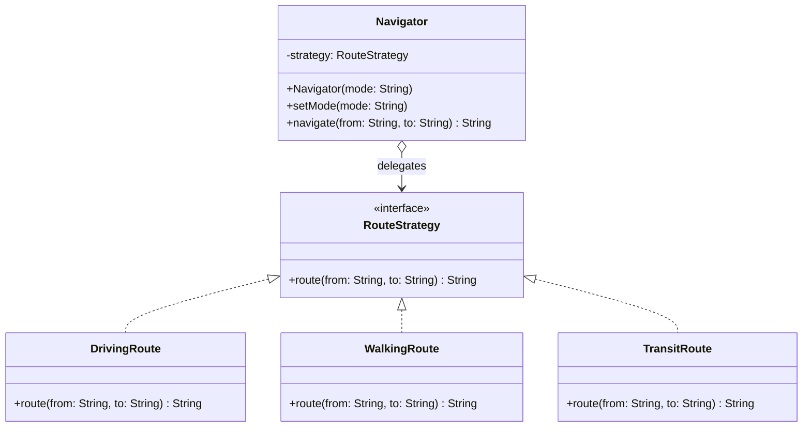
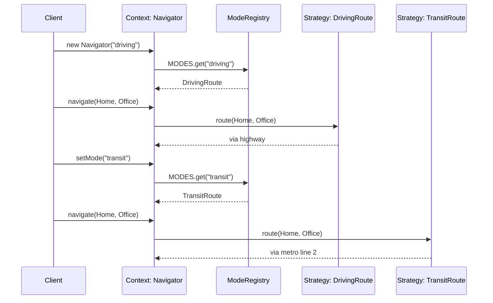

# Strategy Design Pattern

> Youtube: [2. Strategy Design Pattern explanation (Hindi) | LLD System Design | Design pattern in Java](https://www.youtube.com/watch?v=u8DttUrXtEw)

## 1. Overview and Fundamentals

The **Strategy pattern** defines a family of algorithms, encapsulates each one, and makes them interchangeable — the algorithm varies independently from the clients that use it.

In one sentence: **the context delegates work to a swappable strategy object chosen at runtime.**

Core roles:

- **Strategy interface:** declares the algorithm contract (`pay()`, `route()`, `sort()`, `price()`).
- **ConcreteStrategy:** one implementation per variant (`CardPayment`, `DrivingRoute`, `QuickSort`).
- **Context:** holds a strategy reference, exposes `setStrategy()`, and delegates calls to it (`Navigator`, `Checkout`, `Sorter`).
- **Client/Factory:** picks which strategy to inject, often via key, config, or user choice.

Fundamental properties:

- **Composition over inheritance:** behavior varies by object wiring, not subclass trees.
- **Runtime swapping:** `setMode("transit")` changes behavior without rebuilding the context.
- **Isolation:** each algorithm lives in its own class with its own data and tests.
- **Behavioral:** governs how behavior varies, not how objects are created or assembled.

Mental model: navigation app travel modes. The navigator UI is fixed; driving, walking, and transit are plug-in route engines behind one `route(from, to)` interface. Adding cycling means adding one engine, never editing the navigator.

## 2. Detailed Theory

### Intent and forces

Strategy solves the **algorithm-explosion** tension: one class accumulates `if (mode == X)` branches for every variant, mixing selection logic with algorithm logic. Branches duplicate, testing requires the whole context, and adding a variant edits a method everyone depends on.

Strategy splits the two concerns: the context owns *delegation*, each strategy owns *one algorithm*, and a factory owns *selection*.

### How it works

1. Define `Strategy` with the narrowest parameter list the algorithms need.
2. Implement one class per variant; keep them stateless where possible.
3. Context stores `Strategy current` (constructor default + `setStrategy()` for swaps).
4. Client resolves a strategy via factory/map/DI (`MODES.get(mode)`) and injects it.
5. Context calls `strategy.execute(...)` and returns the result untouched.

### Selection patterns

| Selector | How | Best when |
|---|---|---|
| Client passes object | `new Checkout(card)` | Caller legitimately knows the variant |
| Key + factory map | `MODES.get("transit")` | UI/config supplies strings, code hides classes |
| DI container | Inject by profile/qualifier | Environment decides (prod vs test gateway) |
| Auto-selection | Factory inspects payload size/type | Thresholds pick algorithm (insertion vs quick sort) |

### Sharing data with strategies

Pass only what the algorithm needs as parameters (`amount`, `from/to`). Inject shared services (HTTP client, config) via constructor. Avoid handing the whole context back-reference — it re-couples what the pattern decoupled. Keep strategies stateless; park session data in the context.

### Design principles at play

- **Open/Closed:** new algorithms arrive as new classes.
- **Single Responsibility:** one algorithm per class, one delegation job per context.
- **Composition over inheritance:** no subclass per variant.
- **Dependency Inversion:** context depends on the interface, never concretes.

### Variants

- **Lambda/functional strategies:** single-method strategies as lambdas (Java `Comparator`, Python callables, Go funcs).
- **Parameterized strategy:** one class with enum-tuned behavior when variants differ by value, not logic.
- **Strategy + Factory:** the dominant production pairing — factory hides the catalog.
- **Strategy + Decorator:** wrap strategies with retry/rate-limit/metrics without touching algorithms.

### Consequences

Benefits: runtime flexibility, isolated testing, no conditionals, independent evolution. Costs: more classes, clients must understand options (mitigate with factory + defaults), and overkill when variants rarely change or differ by a constant.

## 3. UML and Architecture Diagrams

Static structure: context aggregates one strategy; all variants implement the same interface so they are freely swappable.



*Explanation:* the open diamond marks aggregation — `Navigator` *has a* strategy it can re-point at runtime. All route engines share `route(from, to)`, so `navigate()` never branches on mode strings. A `CyclingRoute` joins by implementing the interface; `Navigator` is untouched.

Runtime flow: resolve once via factory, delegate per call, swap whenever the caller decides.



*Explanation:* selection (factory lookup) happens separately from execution (delegation). Swapping mid-session only re-points the reference — in-flight calls finish on the old strategy, new calls use the new one. No context branching exists at either step.

## 4. Implementation Examples in Java, Python, and Go

The domain is **route planning**: a `Navigator` context delegates to driving / walking / transit strategies selected by mode string.

### Java (interface + factory map)

```java
import java.util.Map;

interface RouteStrategy {
    String route(String from, String to);
}

class DrivingRoute implements RouteStrategy {
    public String route(String from, String to) {
        return "Driving " + from + " -> " + to + " via highway";
    }
}

class WalkingRoute implements RouteStrategy {
    public String route(String from, String to) {
        return "Walking " + from + " -> " + to + " via parks";
    }
}

class TransitRoute implements RouteStrategy {
    public String route(String from, String to) {
        return "Transit " + from + " -> " + to + " via metro line 2";
    }
}

class Navigator {
    private RouteStrategy strategy;
    private static final Map<String, RouteStrategy> MODES = Map.of(
        "driving", new DrivingRoute(),
        "walking", new WalkingRoute(),
        "transit", new TransitRoute()
    );
    Navigator(String mode) { setMode(mode); }
    void setMode(String mode) {
        strategy = MODES.getOrDefault(mode.toLowerCase(), MODES.get("driving"));
    }
    String navigate(String from, String to) { return strategy.route(from, to); }
}

class MapsDemo {
    public static void main(String[] args) {
        Navigator nav = new Navigator("driving");
        System.out.println(nav.navigate("Home", "Office"));
        nav.setMode("transit");
        System.out.println(nav.navigate("Home", "Office"));
        nav.setMode("walking");
        System.out.println(nav.navigate("Home", "Park"));
    }
}
```

*Explanation:* the static `MODES` map is the factory — UI code passes strings, never classes. `getOrDefault` supplies a safe default. Each engine is independently testable with fixed origin/destination pairs.

Sample I/O:

```text
Driving Home -> Office via highway
Transit Home -> Office via metro line 2
Walking Home -> Park via parks
```

### Python (pythonic: Protocol + dict registry, lambdas welcome)

```python
from __future__ import annotations
from typing import Protocol

class RouteStrategy(Protocol):
    def route(self, origin: str, dest: str) -> str: ...

class DrivingRoute:
    def route(self, origin: str, dest: str) -> str:
        return f"Driving {origin} -> {dest} via highway"

class WalkingRoute:
    def route(self, origin: str, dest: str) -> str:
        return f"Walking {origin} -> {dest} via parks"

class TransitRoute:
    def route(self, origin: str, dest: str) -> str:
        return f"Transit {origin} -> {dest} via metro line 2"

class Navigator:
    """Context: delegates route computation to the selected strategy."""

    MODES: dict[str, RouteStrategy] = {
        "driving": DrivingRoute(),
        "walking": WalkingRoute(),
        "transit": TransitRoute(),
    }

    def __init__(self, mode: str = "driving") -> None:
        self.set_mode(mode)

    def set_mode(self, mode: str) -> None:
        self._strategy = self.MODES.get(mode.lower(), self.MODES["driving"])

    def navigate(self, origin: str, dest: str) -> str:
        return self._strategy.route(origin, dest)

if __name__ == "__main__":
    nav = Navigator("driving")
    print(nav.navigate("Home", "Office"))
    nav.set_mode("transit")  # rush hour: swap algorithm
    print(nav.navigate("Home", "Office"))
    nav.set_mode("walking")  # weekend stroll
    print(nav.navigate("Home", "Park"))
```

*Explanation:* `Protocol` enables duck-typed strategies — even a plain function or lambda registers in `MODES`. Shared stateless instances are reused; the dict acts as the factory so callers never import concrete engines.

Sample I/O: identical to the Java output above.

### Go (idiomatic: interface + map registry)

```go
package main

import (
	"fmt"
	"strings"
)

// RouteStrategy is the algorithm contract.
type RouteStrategy interface {
	Route(from, to string) string
}

type DrivingRoute struct{}

func (DrivingRoute) Route(from, to string) string {
	return "Driving " + from + " -> " + to + " via highway"
}

type WalkingRoute struct{}

func (WalkingRoute) Route(from, to string) string {
	return "Walking " + from + " -> " + to + " via parks"
}

type TransitRoute struct{}

func (TransitRoute) Route(from, to string) string {
	return "Transit " + from + " -> " + to + " via metro line 2"
}

// Navigator is the context.
type Navigator struct{ strategy RouteStrategy }

var modes = map[string]RouteStrategy{
	"driving": DrivingRoute{},
	"walking": WalkingRoute{},
	"transit": TransitRoute{},
}

func NewNavigator(mode string) *Navigator {
	n := &Navigator{}
	n.SetMode(mode)
	return n
}

// SetMode swaps the algorithm at runtime; unknown modes fall back to driving.
func (n *Navigator) SetMode(mode string) {
	s, ok := modes[strings.ToLower(mode)]
	if !ok {
		s = modes["driving"]
	}
	n.strategy = s
}

func (n *Navigator) Navigate(from, to string) string {
	return n.strategy.Route(from, to)
}

func main() {
	nav := NewNavigator("driving")
	fmt.Println(nav.Navigate("Home", "Office"))
	nav.SetMode("transit")
	fmt.Println(nav.Navigate("Home", "Office"))
	nav.SetMode("walking")
	fmt.Println(nav.Navigate("Home", "Park"))
}
```

*Explanation:* zero-size structs mean strategies cost nothing to share; the package-level `modes` map is the registry. `SetMode` normalizes and defaults, so bad input degrades gracefully instead of nil-panicking.

Sample I/O: identical to the Java output above.

## 5. Real-World Industry Applications

- **Payments:** Stripe/Adyen route charges through card, UPI, wallet, BNPL strategy objects per user choice.
- **Spring:** `PlatformTransactionManager` implementations, `PasswordEncoder` variants, `ResourceLoader` handlers selected by profile.
- **Sorting/search:** `Collections.sort` with `Comparator` strategies; database query planners picking scan vs index strategies.
- **Compression/encoding:** GZIP vs Snappy vs Zstd strategies negotiated by content type.
- **Maps:** Google Maps travel-mode engines — same navigator, different cost functions.
- **Pricing:** regular / holiday / clearance / surge strategies behind one `price()` interface.
- **Auth:** OAuth2, JWT, API-key verification strategies per route.
- **Validation:** per-tenant or per-role validation rule sets injected into one form pipeline.

## 6. Practical Use Cases and Scenarios

1. **Checkout payments:** `Checkout.setStrategy(card|upi|wallet)`; adding BNPL is one class plus one factory entry.
2. **Route planning:** driving/walking/transit/cycling engines behind `route(from, to)`; ETA experiments A/B test new engines.
3. **Discount engine:** percentage, flat, BOGO, loyalty strategies composed per campaign without touching cart code.
4. **Export formats:** CSV / JSON / Parquet writers behind one `export(rows)` strategy.
5. **Notification channels:** email / SMS / push senders chosen by user preference at send time.
6. **Image pipelines:** resize algorithms (bilinear, bicubic, Lanczos) swapped by quality setting.
7. **Log routing:** console / file / remote strategies chosen by environment profile.

Scenario walkthrough (checkout): user picks UPI at 10:00 and card at 10:05. Same `Checkout` instance calls `setStrategy(upI)` then `setStrategy(card)`; each `pay(amount)` delegates to the current engine. Refund logic stays in the context; gateway specifics stay in engines.

## 7. When to Use and When Not to Use

**Use Strategy when:**

- Multiple variants of one algorithm exist and must swap at runtime (payments, routes, pricing).
- Conditionals on "which algorithm" spread across methods or classes.
- Each variant needs independent testing, tuning, or ownership.
- New variants arrive over time (new payment rail, new codec) and should not touch callers.

**Do NOT use Strategy when:**

- Variants rarely change and number one or two — a parameter or `if-else` is clearer.
- The choice is driven by object lifecycle, not the caller — that is State.
- The skeleton is fixed and only steps vary — that is Template Method.
- Variants differ only by a value (rate = 0.05 vs 0.18) — use config/enum, not a class hierarchy.
- The caller should not choose (server policy) — hide selection server-side or use a rule engine.

Rule of thumb: caller chooses among peer algorithms → Strategy. Lifecycle dictates validity → State. Fixed order with hook steps → Template Method.

## 8. Do's and Don'ts

**Do:**

- Hide the catalog behind a factory/registry with a documented default.
- Keep the strategy interface narrow — pass values, not the whole context.
- Prefer stateless strategies; inject shared dependencies via constructor.
- Document each variant's trade-offs (cost, latency, accuracy) so callers choose by intent.
- Name strategies by algorithm (`DrivingRoute`), not by position (`Strategy1`).
- Consider lambdas for single-method strategies in Java/Python/Go funcs.

**Don't:**

- Don't leak selection strings through every layer — resolve once at the boundary, inject the object after.
- Don't give strategies back-references to the context's privates.
- Don't create a strategy per constant — values belong in config.
- Don't let strategies accumulate cross-call mutable state unless synchronized and documented.
- Don't force callers to catch per-strategy checked exceptions — normalize to one domain error.
- Don't use Strategy to paper over a missing State machine (validity rules belong in states).

## 9. Comparison with Other Design Patterns

| Aspect | Strategy | State | Template Method |
|---|---|---|---|
| Mechanism | Composition: context holds swappable algorithm | Composition: context holds current stage | Inheritance: base fixes skeleton |
| Who picks | Client/factory explicitly | Current state object (lifecycle) | Fixed at compile time (subclass) |
| Swappable at runtime | Yes — the point | Yes — but driven by events | No — new subclass per variant |
| Use when | Peer algorithms chosen per call | Validity depends on stage | Order fixed, steps vary |
| Example | Payments, routing, sorting | Orders, TCP, vending | ETL, JUnit lifecycle |

| Aspect | Strategy | Command | Factory |
|---|---|---|---|
| Encapsulates | How to compute | A request to run later/undo | Which class to create |
| Executed | Immediately by context | Later, queued, or undone | Creation only |
| Pairs with | Factory picks it | Queue/invoker runs it | Factory often returns a Strategy |

**Strategy vs State (the classic confusion):** same UML, opposite driver. Strategy = caller selects peers (`setMode("transit")`). State = lifecycle advances itself (`pay()` returns `PaidState`). Ask who triggers the switch.

**Strategy vs Template Method:** Strategy swaps the *whole* algorithm via composition; Template fixes the *skeleton* via inheritance and varies steps. Need runtime engine swaps → Strategy. Need enforced order with extension points → Template.

## 10. Interview Preparation

**Q1: How do you stop clients from needing to know every strategy?**
Hide selection behind a factory/registry: client passes a key (`"upi"`, `"transit"`) and gets an object, with a sensible default. Document trade-offs per variant so callers choose by intent, and resolve at the boundary so inner code only sees the interface.

**Q2: Strategy vs if-else — when does it pay off?**
At three or more algorithms, when algorithms evolve independently, when runtime swapping or isolated testing is needed. For one or two stable branches, if-else wins — refactor once conditionals spread or violate Open/Closed.

**Q3: How do strategies share data without leaking internals?**
Pass needed values as method args, keep strategies stateless, inject shared services via constructor. Never hand the full mutable context to a strategy — it reintroduces the coupling the pattern removed.

**Q4: How do you handle a strategy that needs configuration?**
Inject config at construction (thresholds, keys, clients) so `execute()` stays pure. Validate config in the factory; fail fast on unknown keys with the default + a warning metric.

**Q5: Stateful vs stateless strategies?**
Prefer stateless (thread-safe, reusable singletons). If state is unavoidable (circuit breaker counters), scope one instance per context, synchronize access, and document lifetime clearly.

**Q6: How do you test strategies?**
Table-driven tests per strategy with fixed inputs/outputs; contract tests asserting every registered strategy satisfies the interface (same edge cases); context tests with stub strategies verifying delegation and swapping.

**Q7: Strategy vs polymorphism — isn't it just an interface?**
An interface is the mechanism; Strategy is the *policy*: a named family of interchangeable algorithms with explicit selection and swapping. The discipline (factory, defaults, documented trade-offs) is what interviewers probe.

**Q8: When do lambdas beat strategy classes?**
When the algorithm is a few lines with no dependencies — `Comparator.comparing(...)`, Python key funcs, Go `sort.Slice` closures. Graduate to classes when the algorithm needs config, state, or independent tests.

**LLD scenario 1 — Design a Payment Gateway router.**
*Expectation:* `PayStrategy` (card/UPI/wallet/BNPL) + `GatewayFactory` keyed by user choice + region; `Checkout` delegates. Discuss idempotency keys per attempt, per-strategy timeouts, fallback strategy on failure, and adding a rail without touching checkout.

**LLD scenario 2 — Design a Sort service.**
*Expectation:* strategies for insertion (small), quick (general), external (huge); auto-selecting factory by input size. Show benchmark-driven thresholds and contract tests proving identical output ordering.

**LLD scenario 3 — Design a Pricing engine.**
*Expectation:* regular/holiday/surge strategies behind `price(cart, context)`; factory reads campaign calendar. Discuss stacking with Decorator (coupon on top of campaign) vs baking stacking into strategies.

## 11. Testing and Best Practices

- **Per-strategy tables:** fixed inputs → exact outputs, including edge cases (zero amount, same origin/destination, empty list).
- **Contract test:** iterate the registry; every strategy handles null/empty/large inputs per the documented policy.
- **Swap test:** set A, execute, set B, execute; assert behavior follows the current strategy and prior calls are unaffected.
- **Factory test:** every documented key resolves; unknown keys return the default (and log); keys are case-insensitive if specified.
- **Default test:** context constructed with no explicit strategy still executes via the default.
- **Isolation test:** stub strategies verify the context adds no logic (no branching, no transformation) beyond delegation.
- **Concurrency test:** concurrent `setMode` + `navigate` never nil-derefs; consider copy-on-write or per-request strategy binding.
- Best practice: stateless singletons, constructor-injected config, and metrics per strategy (`strategy=rides.transit latency`) to compare variants in production.

## 12. Summary and Key Takeaways

- Strategy = one interface, many encapsulated algorithms, runtime selection via composition.
- Factory + default hides the catalog; narrow interfaces keep strategies decoupled.
- Prefer stateless strategies; pass values, inject services, never the whole context.
- Three-plus evolving variants earn the pattern; one value difference earns config, not classes.
- Don't confuse with State (lifecycle-driven) or Template (fixed skeleton) — ask who chooses and what varies.
- Interview one-liner: *"Strategy encapsulates each algorithm behind one interface so the context delegates and callers swap behavior at runtime — I hide selection in a factory, keep strategies stateless, and graduate from if-else once variants evolve independently."*
