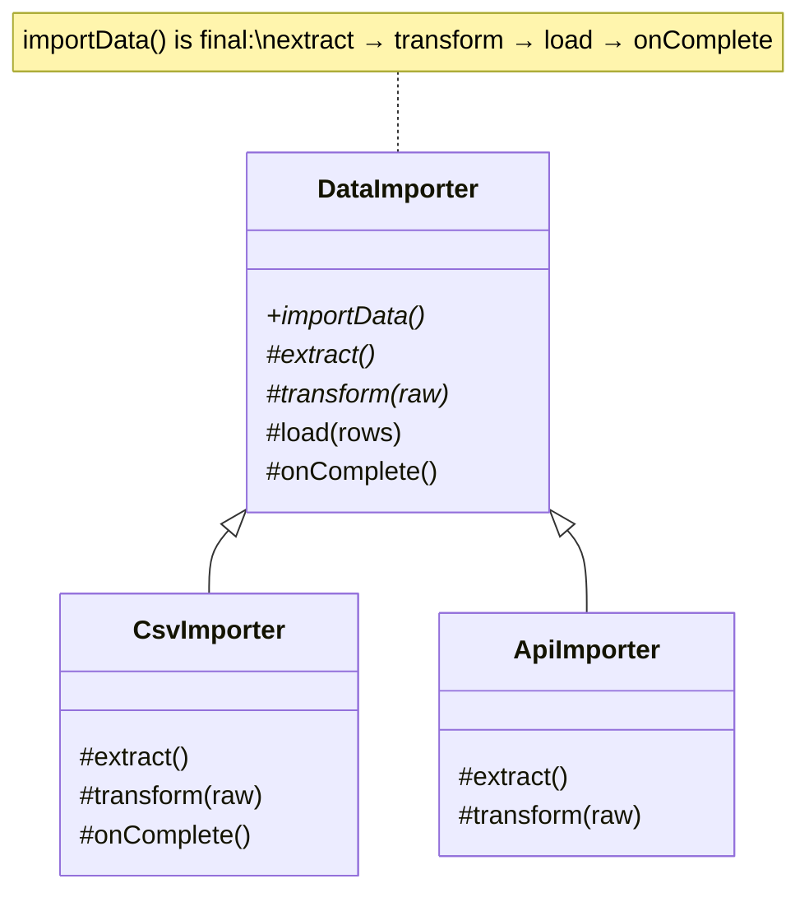
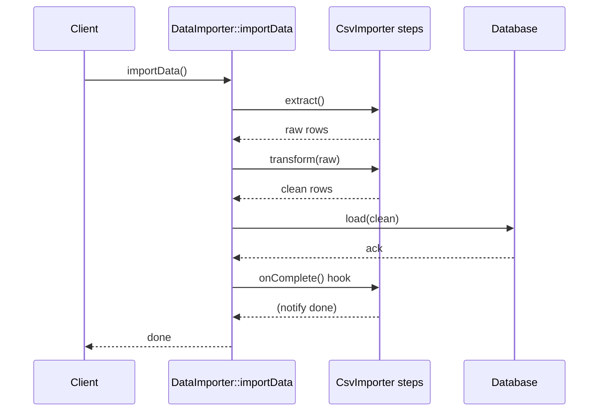

# Template Method Design Pattern

> Youtube: [39. Template Method Design Pattern Explanation in Java | Concept and Coding LLD | Low Level Design](https://www.youtube.com/watch?v=kwy-G1DEm0M)

## 1. Overview and Fundamentals

The **Template Method pattern** defines the skeleton of an algorithm in a method, deferring some steps to subclasses — subclasses redefine certain steps without changing the algorithm's structure.

In one sentence: **the base class fixes the order; subclasses fill in the varying steps.**

Core roles:

- **AbstractClass:** declares the `final` template method plus abstract primitive steps and optional hooks.
- **Template method:** the fixed skeleton (`importData()`, `generate()`, `run()`) — usually `final` so order cannot be broken.
- **Primitive steps:** abstract methods subclasses must implement (`extract()`, `transform()`).
- **Hooks:** concrete methods with defaults subclasses *may* override (`onComplete()`, `shouldRetry()`).
- **ConcreteClass:** one subclass per variant (`CsvImporter`, `ApiImporter`, `PdfReport`).

Fundamental properties:

- **Inheritance-based:** the one behavioral pattern that deliberately uses subclassing over composition.
- **Inversion of control:** the framework calls application code ("Hollywood Principle").
- **Order guarantee:** sequencing and invariants enforced once, in one place.
- **Behavioral:** governs algorithm structure, not object creation or assembly.

Mental model: a recipe. "Prep → cook → plate" order is fixed by the cookbook; each dish fills in its own cooking step and may optionally garnish (hook). No dish is allowed to plate before cooking.

## 2. Detailed Theory

### Intent and forces

Template Method solves the **duplicated-skeleton** tension: several algorithms share the same step order but differ in individual steps. Copy-pasting the sequence into each variant invites drift — one variant skips validation, another reorders load before transform, and fixes must be applied N times.

The pattern extracts the invariant sequence into a `final` method and quarantines variation into overridable steps. The order is written once and enforced by the compiler.

### How it works

1. Identify the invariant order (`extract → transform → load → onComplete`).
2. Write it as a `final` method in the abstract base.
3. Declare varying steps `abstract` (or `protected` in Python/Go-embedding equivalents).
4. Provide shared steps concretely (`load()` writes to DB the same way for all sources).
5. Add hooks with harmless defaults for optional extension (`onComplete()` no-op).
6. Subclasses implement only the abstract steps and opt into hooks.

### Primitive steps vs hooks

| Kind | Must override? | Purpose | Example |
|---|---|---|---|
| Abstract primitive | Yes | Required variation | `extract()`, `transform()`, `body()` |
| Concrete shared | No (can) | Reused invariant | `load()`, `header()`, `footer()` |
| Hook | No (opt-in) | Optional extension point | `onComplete()`, `validate()` default-true |

Keep hooks few and documented. A base class with ten hooks is a skeleton nobody understands — that pressure means the order is not actually fixed and Strategy/composition fits better.

### Design principles at play

- **DRY:** the sequence lives in exactly one method.
- **Hollywood Principle:** base calls subclass code, not vice versa.
- **Open/Closed (narrow):** new variants via new subclasses — but base edits ripple to all children.
- **Liskov risk:** subclasses must honor the step contracts (no surprising side effects, no skipped writes).

### Variants

- **Classic inheritance** (this page): abstract base + final template.
- **Compositional template:** skeleton function takes step lambdas — same order guarantee without subclassing (preferred in Go/Python).
- **Framework lifecycle:** JUnit `setUp/test/tearDown`, servlet `init/service/destroy`, Spring `JdbcTemplate` callbacks.
- **Template + Strategy:** a template step delegates to an injected Strategy for runtime-swappable variation inside a fixed order.

### Consequences

Benefits: order enforced, duplication removed, extension points explicit. Costs: inheritance coupling (base change affects every child), rigid order, deep hierarchies when variants multiply, and Liskov violations when a subclass "overrides" by breaking the contract.

## 3. UML and Architecture Diagrams

Static structure: one abstract base owns the template; each concrete class supplies the varying primitives.



*Explanation:* `importData()` is the only public entry; its `final` modifier is the enforcement mechanism. `CsvImporter` customizes extraction, transformation, and the completion hook; `ApiImporter` reuses default loading and skips the hook. New sources subclass — they cannot reorder steps even if they try.

Runtime flow: the base orchestrates; control dips into subclass code per step and returns.



*Explanation:* sequencing lives entirely in the base — the client sees one call, the subclass sees per-step callbacks. Shared steps (`load`) never touch subclass code; hooks (`onComplete`) are the only optional dips. Recording this order in a test with a stub subclass is the canonical verification.

## 4. Implementation Examples in Java, Python, and Go

The domain is a **data-import (ETL) pipeline**: fixed `extract → transform → load → onComplete` order; CSV and API importers vary the first two steps.

### Java (abstract class, final template)

```java
import java.util.List;

abstract class DataImporter {
    final void importData() {                       // Template: fixed skeleton
        List<String> raw = extract();
        List<String> clean = transform(raw);
        load(clean);
        onComplete();                               // Hook
    }
    protected abstract List<String> extract();
    protected abstract List<String> transform(List<String> raw);
    protected void load(List<String> rows) {
        System.out.println("Loading " + rows.size() + " rows into DB");
    }
    protected void onComplete() { }                 // Hook default: no-op
}

class CsvImporter extends DataImporter {
    private final String path;
    CsvImporter(String path) { this.path = path; }
    protected List<String> extract() {
        System.out.println("Reading CSV: " + path);
        return List.of(" a,1 ", " b,2 ");
    }
    protected List<String> transform(List<String> raw) {
        return raw.stream().map(s -> s.trim().toUpperCase()).toList();
    }
    protected void onComplete() {
        System.out.println("CSV import finished");
    }
}

class ApiImporter extends DataImporter {
    private final String endpoint;
    ApiImporter(String endpoint) { this.endpoint = endpoint; }
    protected List<String> extract() {
        System.out.println("GET " + endpoint);
        return List.of("{\"id\":1}", "{\"id\":2}");
    }
    protected List<String> transform(List<String> raw) {
        return raw.stream().map(s -> s.replaceAll("[^0-9]", "")).toList();
    }
}

class EtlDemo {
    public static void main(String[] args) {
        new CsvImporter("users.csv").importData();
        new ApiImporter("https://api/users").importData();
    }
}
```

*Explanation:* `final` locks the order; `abstract` forces variant steps; the no-op hook keeps `ApiImporter` lean. New sources (S3, Kafka) add one subclass.

Sample I/O:

```text
Reading CSV: users.csv
Loading 2 rows into DB
CSV import finished
GET https://api/users
Loading 2 rows into DB
```

### Python (pythonic: ABC + final-by-convention template)

```python
from __future__ import annotations
from abc import ABC, abstractmethod

class DataImporter(ABC):
    """Skeleton importData() is fixed; subclasses fill extract/transform."""

    def import_data(self) -> None:  # template (do not override)
        raw = self.extract()
        clean = self.transform(raw)
        self.load(clean)
        self.on_complete()  # hook

    @abstractmethod
    def extract(self) -> list[str]: ...
    @abstractmethod
    def transform(self, raw: list[str]) -> list[str]: ...

    def load(self, rows: list[str]) -> None:  # shared step
        print(f"Loading {len(rows)} rows into DB")

    def on_complete(self) -> None:  # hook default: no-op
        pass

class CsvImporter(DataImporter):
    def __init__(self, path: str) -> None:
        self.path = path

    def extract(self) -> list[str]:
        print(f"Reading CSV: {self.path}")
        return [" a,1 ", " b,2 "]

    def transform(self, raw: list[str]) -> list[str]:
        return [s.strip().upper() for s in raw]

    def on_complete(self) -> None:
        print("CSV import finished")

class ApiImporter(DataImporter):
    def __init__(self, endpoint: str) -> None:
        self.endpoint = endpoint

    def extract(self) -> list[str]:
        print(f"GET {self.endpoint}")
        return ['{"id":1}', '{"id":2}']

    def transform(self, raw: list[str]) -> list[str]:
        import re
        return [re.sub(r"[^0-9]", "", s) for s in raw]

if __name__ == "__main__":
    CsvImporter("users.csv").import_data()
    ApiImporter("https://api/users").import_data()
```

*Explanation:* Python has no `final`, so convention + documentation ("do not override") plus a single template test guard the order. List comprehensions keep transforms idiomatic; the ABC enforces the required steps at instantiation.

Sample I/O: identical to the Java output above.

### Go (idiomatic: compositional template via interface + runner)

```go
package main

import (
	"fmt"
	"regexp"
	"strings"
)

// Steps is the variant contract: Go uses composition, not inheritance.
type Steps interface {
	Extract() []string
	Transform(raw []string) []string
	OnComplete()
}

// ImportData is the template function: fixed order for any Steps.
func ImportData(s Steps) {
	raw := s.Extract()
	clean := s.Transform(raw)
	fmt.Printf("Loading %d rows into DB\n", len(clean))
	s.OnComplete()
}

type CsvImporter struct{ Path string }

func (c CsvImporter) Extract() []string {
	fmt.Println("Reading CSV: " + c.Path)
	return []string{" a,1 ", " b,2 "}
}

func (c CsvImporter) Transform(raw []string) []string {
	out := make([]string, len(raw))
	for i, s := range raw {
		out[i] = strings.ToUpper(strings.TrimSpace(s))
	}
	return out
}

func (c CsvImporter) OnComplete() { fmt.Println("CSV import finished") }

type ApiImporter struct{ Endpoint string }

func (a ApiImporter) Extract() []string {
	fmt.Println("GET " + a.Endpoint)
	return []string{`{"id":1}`, `{"id":2}`}
}

var digits = regexp.MustCompile(`[^0-9]`)

func (a ApiImporter) Transform(raw []string) []string {
	out := make([]string, len(raw))
	for i, s := range raw {
		out[i] = digits.ReplaceAllString(s, "")
	}
	return out
}

func (a ApiImporter) OnComplete() {} // hook default: no-op

func main() {
	ImportData(CsvImporter{Path: "users.csv"})
	ImportData(ApiImporter{Endpoint: "https://api/users"})
}
```

*Explanation:* Go has no inheritance, so the template is a **function** parameterized by a `Steps` interface — same order guarantee, zero hierarchy. Each importer is a plain struct; the no-op `OnComplete` mirrors the hook default. This compositional style is the idiomatic Go translation reviewers expect.

Sample I/O: identical to the Java output above.

## 5. Real-World Industry Applications

- **JUnit/TestNG:** `setUp → test → tearDown` lifecycle; fixtures override hooks.
- **Spring:** `JdbcTemplate`/`RestTemplate` fix connect → execute → map → close; callbacks vary mapping.
- **Django:** class-based views fix `dispatch → get/post → render`; subclasses override handlers.
- **Maven/Gradle:** lifecycle phases (validate → compile → test → package) with plugin hook points.
- **ETL frameworks:** Airflow/Spark job templates fix extract → transform → load with per-job transforms.
- **Game engines:** `init → update → render` loop with per-game update/render.
- **HTTP middleware (template-flavored):** frameworks fixing authenticate → authorize → handle → log order.

## 6. Practical Use Cases and Scenarios

1. **CSV/API/S3 importers:** one pipeline order, per-source extract/transform — the worked example.
2. **Report generation:** `header → body → footer` with PDF/Excel/HTML bodies sharing chrome.
3. **Test fixtures:** shared setup/teardown with per-test body; hooks for optional seeding.
4. **Order fulfillment:** `validate → reserve → charge → ship → notify` with per-channel ship/notify steps.
5. **Build pipelines:** `checkout → build → test → publish` with per-language build/test commands.
6. **Document export:** `fetch → format → paginate → write` with per-format formatters.
7. **Onboarding flows:** `verify → provision → welcome` with per-plan provisioning.

Scenario walkthrough (reports): `PdfReport` and `HtmlReport` share `header()`/`footer()`; each implements `body()`. A compliance watermark added to `header()` propagates to every format with one edit — the DRY payoff — and no subclass can emit the body before the header.

## 7. When to Use and When Not to Use

**Use Template Method when:**

- Multiple variants share one step order with different step bodies (pipelines, reports, lifecycles).
- Step order is an invariant worth enforcing by construction (extract before load, setup before test).
- Framework code must call application code at defined points (hooks).
- Shared steps are substantial enough to merit one maintained copy.

**Do NOT use Template when:**

- Step order itself varies per variant — use Strategy or Builder.
- You need runtime behavior swaps — inheritance binds at compile time; use Strategy/composition.
- Variants override nearly every step — the "shared" skeleton is fiction; use composition.
- Hierarchies exceed 2–3 levels — prefer composition to avoid fragile-base-class pain.
- Language idiom favors functions (Go, modern Python) — use a template function with injected steps.

Rule of thumb: fixed order + varying steps → Template. Swappable whole algorithms → Strategy. Varying order → Builder/Strategy.

## 8. Do's and Don'ts

**Do:**

- Mark the template `final` (or document do-not-override) and test the order with a recording stub.
- Keep the skeleton short and readable — 4–7 named steps max.
- Give hooks harmless defaults and document when each fires.
- Make primitive steps `protected`, not public — clients call the template, not the pieces.
- Push cross-cutting steps (logging, metrics) into the base so variants inherit them.
- Prefer composition (template function + strategy steps) when the language or team favors it.

**Don't:**

- Don't add hooks speculatively — each unused hook is API surface and confusion.
- Don't let subclasses call the template recursively or skip steps via flags.
- Don't put variant-specific conditionals in the base (`if (this instanceof CsvImporter)`) — that defeats the pattern.
- Don't change shared-step semantics silently — every subclass inherits the blast radius.
- Don't deepen hierarchies to reuse one step — extract a helper or strategy instead.
- Don't violate Liskov: subclass steps must honor documented pre/post-conditions (e.g., `transform` never returns null).

## 9. Comparison with Other Design Patterns

| Aspect | Template Method | Strategy | Factory Method |
|---|---|---|---|
| Mechanism | Inheritance: base fixes order, children fill steps | Composition: context delegates whole algorithm | Inheritance: subclass picks created class |
| Binds | Compile time (subclass) | Runtime (setStrategy) | Compile time (subclass) |
| Varies | Individual steps | Entire algorithm | Instantiated type |
| Flexibility | Rigid order, designated steps only | Fully swappable | Creation only |
| Use when | Skeleton invariant (ETL, lifecycles) | Peer algorithms per call | Creator knows when, not which |

| Aspect | Template Method | Decorator | Hook (plain callback) |
|---|---|---|---|
| Extension style | Subclass override | Wrapper stacking | Injected function |
| Order control | Base enforces | Outermost-first, implicit | Caller enforces |
| Best for | Framework lifecycles | Optional stacked features | One-off customization |

**Template vs Strategy (the classic confusion):** Template fixes the *skeleton* and varies *steps* via inheritance. Strategy swaps the *entire algorithm* via composition at runtime. If callers must switch engines per request → Strategy. If the framework owns the order → Template. They compose well: a template step delegating to a strategy gives fixed order *and* runtime-swappable stages.

## 10. Interview Preparation

**Q1: Why is the template method usually final?**
To lock the skeleton so subclasses cannot reorder or skip steps. Subclasses override designated primitives/hooks only. Without `final`, a child could load before extracting and silently break invariants the base promised.

**Q2: What are hooks, and when do you add one?**
Hooks are optional overridable steps with safe defaults (`onComplete()` no-op). Add for discretionary extension; keep them few, named by timing (`beforeLoad`, `onComplete`), and documented. Many hooks signal the skeleton is unclear — reach for Strategy.

**Q3: How do you test a Template hierarchy?**
With a recording stub: assert `extract → transform → load → onComplete` call order once; unit-test each concrete step in isolation; test hooks both default and overridden; assert the template cannot be reordered (final + order test).

**Q4: Template vs Strategy — how do you choose on the spot?**
Ask "does the order stay fixed?" Fixed order + varying steps → Template. Whole algorithm swappable per call → Strategy. Varying order → Builder. Say it as one sentence and give one example each.

**Q5: What is the fragile-base-class problem?**
Base edits (new step, changed hook timing, new exception) silently break subclasses. Mitigate: version the base carefully, keep steps small with contracts, announce hook-timing changes, and prefer composition for fast-moving variation.

**Q6: How do you add a step without breaking subclasses?**
Add it as a hook with a no-op default (backward compatible), or as an optional strategy injection. Forcing a new abstract method breaks every existing subclass — acceptable only in a major version with migration.

**Q7: How does Go/Python express Template without inheritance?**
As a template *function* taking step interfaces/lambdas (shown in the Go example). Same order guarantee, no hierarchy. Python can also use ABCs classically; Go must compose.

**Q8: When do you reject Template outright?**
When order varies, when runtime swaps are needed, when subclasses override most steps, or past 2–3 hierarchy levels. Then Strategy, Builder, or plain composition wins on flexibility per unit of complexity.

**LLD scenario 1 — Design a File Import service (CSV/API/S3).**
*Expectation:* `DataImporter.importData()` template; per-source extract/transform; shared load with batching; `onComplete` hook for notifications. Discuss poison-row handling inside transform vs load, and adding Kafka source as one subclass.

**LLD scenario 2 — Design a Test Framework lifecycle.**
*Expectation:* `runTest()` = setup → execute → verify → teardown with hooks `beforeEach/afterEach`. Show a DB test overriding setup/teardown while reusing assertion steps; discuss hook ordering with nested suites.

**LLD scenario 3 — Design Order Fulfillment with per-channel shipping.**
*Expectation:* `fulfill()` = validate → reserve → charge → ship → notify; standard vs express override `ship()` only; notify hook per channel. Show how a compliance step inserts once in the base for all channels.

## 11. Testing and Best Practices

- **Order test:** stub subclass records calls; assert exact sequence `extract → transform → load → onComplete`.
- **Step isolation:** test each concrete `extract`/`transform` with fixture inputs; assert `load` batching and idempotency separately.
- **Hook coverage:** test default no-op path and overridden path; assert hook exceptions propagate per documented policy.
- **Liskov checks:** every subclass's steps satisfy base contracts (non-null returns, documented exceptions only).
- **Regression guard:** adding a shared-step change runs the full subclass matrix — one base edit, all variants re-verified.
- **Template-function variant (Go/Python lambdas):** test the runner with fake steps, including a failing step mid-sequence (assert later steps skipped, cleanup still runs).
- Best practice: keep templates small, steps pure where possible, and log step boundaries (`extract done: N rows`) for pipeline observability.

## 12. Summary and Key Takeaways

- Template Method fixes the algorithm skeleton once; subclasses supply only varying steps.
- `final` template + abstract primitives + defaulted hooks is the complete toolkit.
- One order, many fillings: pipelines, lifecycles, reports, frameworks.
- Watch the costs: inheritance coupling, rigid order, fragile base — graduate to Strategy/composition when order itself varies.
- Test the order once with a stub; test each step in isolation.
- Interview one-liner: *"Template Method puts the invariant step order in a final base method and lets subclasses implement only the varying primitives plus opt-in hooks — order enforced by construction, variants added as subclasses."*
