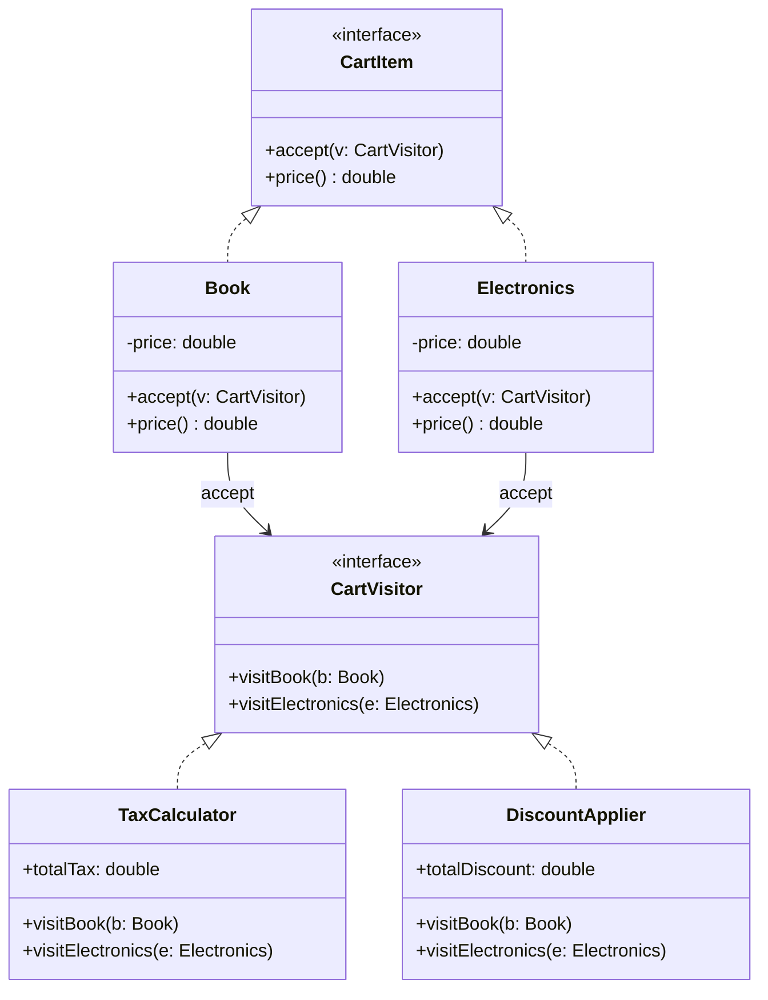
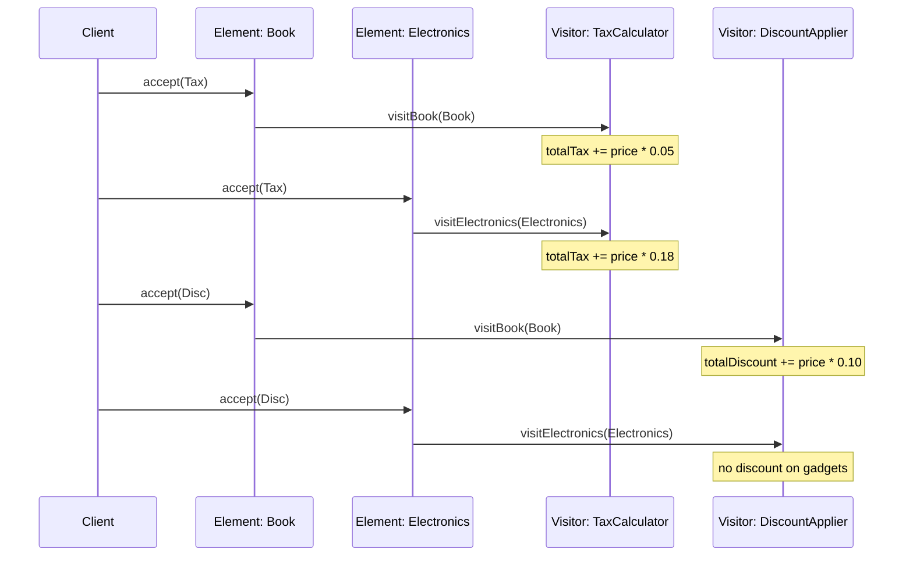

# Visitor Design Pattern

> Youtube: [36. Visitor Design Pattern | Double Dispatch | Low Level Design](https://www.youtube.com/watch?v=pDsz-AuFO0g)

## 1. Overview and Fundamentals

The **Visitor pattern** lets you define a new operation without changing the classes of the elements on which it operates — it separates algorithms from the object structure they run over.

In one sentence: **elements accept a visitor, and the visitor carries the operation across every element type.**

Core roles:

- **Element interface:** declares `accept(Visitor v)` (`CartItem`, `Shape`, `AstNode`).
- **ConcreteElement:** implements `accept` as `visitor.visit(this)` — the double-dispatch hook (`Book`, `Electronics`, `Circle`).
- **Visitor interface:** declares one `visit()` overload per element type (`visit(Book)`, `visit(Electronics)`).
- **ConcreteVisitor:** implements a whole operation across all types (`TaxCalculator`, `DiscountApplier`, `AreaCalculator`).
- **Object structure:** the collection or composite the visitor traverses (cart array, document, AST).

Fundamental properties:

- **Double dispatch:** `accept` dispatches on element type, then `visit` overload dispatches on visitor logic — two types pick the method.
- **Open for operations, closed for elements:** adding an operation is one new visitor class; element classes never change.
- **Behavioral:** governs how operations traverse structures, not how objects are built.
- **Stateful visitors:** a visitor accumulates results (`totalTax`) while walking, unlike a plain loop helper.

Mental model: a tax inspector visiting shops. Shops (elements) do not change how they operate; the inspector (visitor) brings the tax rulebook and applies the right page per shop type. A new discount inspector visits the same shops tomorrow with a different rulebook — no shop remodels.

## 2. Detailed Theory

### Intent and forces

Visitor solves the **operation-explosion** tension: an object hierarchy is stable (cart items, AST nodes, document blocks), but the operations over it multiply (tax, discount, shipping, export, validation, serialization). Baking each operation into every element class bloats elements, scatters one operation across N files, and forces editing all elements per new rule.

Visitor inverts this: each operation becomes one cohesive class with one method per element type. Elements shrink to `accept()` plus data accessors.

### How it works

1. Define `Element.accept(Visitor)` in every element type.
2. Implement each `accept` as exactly `visitor.visit(this)` — no logic, just the callback.
3. Define `Visitor` with one `visit(ConcreteElement)` overload per type.
4. Implement each operation as a `ConcreteVisitor` with all overloads.
5. Client walks the structure calling `element.accept(visitor)` per element (or via Composite traversal).
6. Visitor accumulates state (`totalTax`, report string, IR nodes) and exposes it after the walk.

### Why double dispatch matters

Single dispatch picks a method by the receiver type only (`element.accept(...)` picks `Book.accept`). Inside `accept`, the call `visitor.visit(this)` is statically typed as the *concrete* element (`Book`), so the overload resolves to `visit(Book)`. Together the two hops select by **both** types — operation × element — without `instanceof` chains or type switches.

### Design principles at play

- **Single Responsibility:** one visitor per operation; elements own data, visitors own logic.
- **Open/Closed (operations axis):** new operations are new classes, zero element edits.
- **Encapsulation trade-off:** visitors need element internals, so elements expose getters — the pattern's honest cost.
- **Cohesion:** all tax branches live together instead of one branch per element class.

### Variants

- **Classic overloaded visitor:** one `visit()` per type (this page; Java/C# idiom).
- **Reflective/switch visitor:** single `visit(Element)` with type switch — simpler for small hierarchies, loses compile-time safety.
- **Acyclic visitor:** per-type visitor interfaces so adding a type does not force all visitors to change (breaks the cycle at interface cost).
- **Visitor + Composite:** visitor walks tree structures (AST, file system, UI tree) recursively via composite `accept`.
- **Functional visitor:** pattern-match / sealed-type `when` (Kotlin, Python `match`, Java sealed + switch) as a lightweight visitor.

### Consequences

Benefits: operations added cheaply, related logic co-located, traversal state accumulates cleanly, no instanceof chains. Costs: adding an *element type* breaks every visitor (new overload + N implementations), encapsulation weakens, and small hierarchies pay ceremony for little gain.

## 3. UML and Architecture Diagrams

Static structure: elements know only the visitor interface; visitors know every concrete element — the intentional cycle that enables double dispatch.



*Explanation:* `Book.accept` and `Electronics.accept` each call back into the visitor with their concrete type, routing to the matching overload. Adding `ShippingCalculator` means one new class implementing two methods — `Book` and `Electronics` are untouched. Adding a `Grocery` element, by contrast, forces a new overload plus edits in both visitors — the pattern's known asymmetry.

Runtime flow: the client loops over the structure; each element double-dispatches into the visitor, which accumulates results.



*Explanation:* the first arrow picks the element (`Book.accept`), the second picks the operation branch (`visitBook`). The same two elements serve two full operations with no element edits. After the walk the client reads `tax.totalTax` and `discount.totalDiscount` — the visitor is both algorithm and accumulator.

## 4. Implementation Examples in Java, Python, and Go

The domain is a **shopping cart**: `Book` and `Electronics` items accept visitors; `TaxCalculator` and `DiscountApplier` carry the operations.

### Java (overloaded visitor, stateful accumulation)

```java
interface CartVisitor {
    void visit(Book b);
    void visit(Electronics e);
}

interface CartItem {
    void accept(CartVisitor v);
    double price();
}

class Book implements CartItem {
    private final double price;
    Book(double price) { this.price = price; }
    public double price() { return price; }
    public void accept(CartVisitor v) { v.visit(this); } // double dispatch
}

class Electronics implements CartItem {
    private final double price;
    Electronics(double price) { this.price = price; }
    public double price() { return price; }
    public void accept(CartVisitor v) { v.visit(this); }
}

class TaxCalculator implements CartVisitor {
    double totalTax = 0;
    public void visit(Book b) { totalTax += b.price() * 0.05; }
    public void visit(Electronics e) { totalTax += e.price() * 0.18; }
}

class DiscountApplier implements CartVisitor {
    double totalDiscount = 0;
    public void visit(Book b) { totalDiscount += b.price() * 0.10; }
    public void visit(Electronics e) { totalDiscount += 0; }
}

class CartDemo {
    public static void main(String[] args) {
        CartItem[] cart = { new Book(500), new Electronics(20000) };
        TaxCalculator tax = new TaxCalculator();
        DiscountApplier discount = new DiscountApplier();
        for (CartItem item : cart) {
            item.accept(tax);
            item.accept(discount);
        }
        System.out.println("Tax=" + tax.totalTax + " Discount=" + discount.totalDiscount);
        System.out.println("Payable=" + (20500 + tax.totalTax - discount.totalDiscount));
    }
}
```

*Explanation:* `accept` is one line per element — the whole tax table lives in `TaxCalculator`, the whole discount table in `DiscountApplier`. New operations (shipping, gift wrap) add visitors; elements stay frozen.

Sample I/O:

```text
Tax=3625.0 Discount=50.0
Payable=24075.0
```

### Python (pythonic: Protocol + single visitor class per operation)

```python
from __future__ import annotations
from typing import Protocol

class CartVisitor(Protocol):
    def visit_book(self, item: Book) -> None: ...
    def visit_electronics(self, item: Electronics) -> None: ...

class Book:
    def __init__(self, price: float) -> None:
        self._price = price

    @property
    def price(self) -> float:
        return self._price

    def accept(self, visitor: CartVisitor) -> None:
        visitor.visit_book(self)  # double dispatch

class Electronics:
    def __init__(self, price: float) -> None:
        self._price = price

    @property
    def price(self) -> float:
        return self._price

    def accept(self, visitor: CartVisitor) -> None:
        visitor.visit_electronics(self)

class TaxCalculator:
    """Concrete visitor: accumulates tax while walking the cart."""

    def __init__(self) -> None:
        self.total_tax = 0.0

    def visit_book(self, item: Book) -> None:
        self.total_tax += item.price * 0.05

    def visit_electronics(self, item: Electronics) -> None:
        self.total_tax += item.price * 0.18

class DiscountApplier:
    """Concrete visitor: accumulates discounts while walking the cart."""

    def __init__(self) -> None:
        self.total_discount = 0.0

    def visit_book(self, item: Book) -> None:
        self.total_discount += item.price * 0.10

    def visit_electronics(self, item: Electronics) -> None:
        self.total_discount += 0.0

if __name__ == "__main__":
    cart = [Book(500), Electronics(20000)]
    tax, discount = TaxCalculator(), DiscountApplier()
    for item in cart:
        item.accept(tax)
        item.accept(discount)
    print(f"Tax={tax.total_tax} Discount={discount.total_discount}")
    print(f"Payable={20500 + tax.total_tax - discount.total_discount}")
```

*Explanation:* `Protocol` gives structural visitor typing without inheritance ceremony; `accept` names the concrete hook (`visit_book`) since Python lacks overloads. Visitors stay stateful accumulators; the walk loop is plain iteration.

Sample I/O:

```text
Tax=3625.0 Discount=50.0
Payable=24075.0
```

### Go (idiomatic: explicit per-type visitor methods)

```go
package main

import "fmt"

// CartVisitor declares one method per element type (no overloading in Go).
type CartVisitor interface {
	VisitBook(b *Book)
	VisitElectronics(e *Electronics)
}

// CartItem is the element contract.
type CartItem interface {
	Accept(v CartVisitor)
	Price() float64
}

type Book struct{ price float64 }

func (b *Book) Price() float64      { return b.price }
func (b *Book) Accept(v CartVisitor) { v.VisitBook(b) } // double dispatch

type Electronics struct{ price float64 }

func (e *Electronics) Price() float64      { return e.price }
func (e *Electronics) Accept(v CartVisitor) { v.VisitElectronics(e) }

type TaxCalculator struct{ TotalTax float64 }

func (t *TaxCalculator) VisitBook(b *Book) { t.TotalTax += b.Price() * 0.05 }
func (t *TaxCalculator) VisitElectronics(e *Electronics) {
	t.TotalTax += e.Price() * 0.18
}

type DiscountApplier struct{ TotalDiscount float64 }

func (d *DiscountApplier) VisitBook(b *Book) { d.TotalDiscount += b.Price() * 0.10 }
func (d *DiscountApplier) VisitElectronics(e *Electronics) {}

func main() {
	cart := []CartItem{&Book{price: 500}, &Electronics{price: 20000}}
	tax := &TaxCalculator{}
	discount := &DiscountApplier{}
	for _, item := range cart {
		item.Accept(tax)
		item.Accept(discount)
	}
	fmt.Printf("Tax=%.1f Discount=%.1f\n", tax.TotalTax, discount.TotalDiscount)
	fmt.Printf("Payable=%.1f\n", 20500+tax.TotalTax-discount.TotalDiscount)
}
```

*Explanation:* Go spells overloads as `VisitBook`/`VisitElectronics` — same double-dispatch shape, explicit names. Pointer receivers let visitors mutate accumulation fields; the `Accept` one-liners are the entire element-side cost.

Sample I/O:

```text
Tax=3625.0 Discount=50.0
Payable=24075.0
```

## 5. Real-World Industry Applications

- **Compilers:** AST visitors for type-checking, optimization, and codegen (Eclipse JDT, Roslyn, Babel plugins walk nodes with visitors).
- **Tax and pricing engines:** per-region tax visitors over invoices, carts, and payroll lines.
- **Reporting/export:** PDF, Excel, HTML visitors over the same document model.
- **Serialization:** JSON/XML/Protobuf visitors over domain objects without polluting them with format code.
- **Static analysis:** lint, dead-code, and security visitors over parsed source trees.
- **File systems:** search, backup, antivirus-scan visitors over file/directory composites.
- **Game engines:** render, physics, and culling visitors over scene graphs.
- **Spring/Jakarta:** `BeanDefinitionVisitor`, visitor-style `RowMapper` traversals over result structures.

## 6. Practical Use Cases and Scenarios

1. **Cart totals:** tax, discount, shipping, loyalty visitors over book/electronics/grocery items — the worked example.
2. **Document export:** one `Document` of paragraphs/tables/images; `PdfExport`, `HtmlExport`, `MarkdownExport` visitors render each block type.
3. **AST lint + fix:** `UnusedVarVisitor` reports, `AutoFixVisitor` rewrites — same traversal, two operations.
4. **Org-chart reporting:** headcount-cost visitor vs diversity-metric visitor over employee/contractor nodes.
5. **Network inventory:** compliance-audit visitor vs firmware-upgrade visitor over router/switch/firewall elements.
6. **Insurance claims:** fraud-score visitor vs payout visitor over claim line types.
7. **UI testing:** screenshot visitor vs accessibility-check visitor over widget trees.

Scenario walkthrough (documents): adding Markdown export is one `MarkdownVisitor` with `visit(Paragraph)`, `visit(Table)`, `visit(Image)`. Paragraph, Table, and Image classes gain zero lines. Adding a new `Video` block, however, forces edits in all three exporters — plan element stability before committing to Visitor.

## 7. When to Use and When Not to Use

**Use Visitor when:**

- Element hierarchy is stable but operations multiply (ASTs, documents, carts, scene graphs).
- One operation's logic should live together (all tax rules in one class) instead of scattered per element.
- You need to accumulate traversal state (totals, reports, diagnostics) cleanly.
- `instanceof`/type-switch chains repeat in several places — Visitor replaces them with dispatch.

**Do NOT use Visitor when:**

- Element types change often — each new type breaks every visitor (the fatal asymmetry).
- The hierarchy is tiny (2 types, 1–2 operations) — polymorphic methods or a switch win.
- Traversal is trivial linear iteration with per-item caller logic — use Iterator.
- Visitors would need deep private internals — the getter sprawl destroys encapsulation; use Strategy or element methods.
- Operations need only one element type — a plain method call beats double dispatch.

Rule of thumb: stable types × growing operations → Visitor. Growing types × few operations → polymorphism. Simple sequential access → Iterator.

## 8. Do's and Don'ts

**Do:**

- Keep `accept()` to exactly `visitor.visit(this)` — no logic, no conditionals inside.
- Expose the minimal getters visitors need; prefer package-scoped access over public fields.
- Name visitors by operation (`TaxCalculator`) and methods by type (`visit(Book)`).
- Document the stable-hierarchy contract: adding elements is a breaking change for all visitors.
- Let visitors accumulate and expose results (`totalTax`) rather than mutating elements mid-walk.
- Combine with Composite/Iterator for tree traversal — visitor holds logic, traversal holds walking.

**Don't:**

- Don't hide business rules inside `accept` — operations belong in visitors, never elements.
- Don't add catch-all `visit(Object)` fallbacks that silently swallow new types; fail loudly so new elements surface.
- Don't mutate the structure while visiting without a documented protocol (snapshot first).
- Don't force every visitor to depend on every element — consider acyclic visitors for large hierarchies.
- Don't use Visitor to paper over missing polymorphism — if one operation varies per type and nothing else does, a virtual method is simpler.
- Don't share one stateful visitor across threads — clone per walk or synchronize accumulation.

## 9. Comparison with Other Design Patterns

| Aspect | Visitor | Iterator |
|---|---|---|
| Goal | Add operations over a stable hierarchy | Walk elements hiding storage |
| Who holds logic | Visitor object (`visit(Book)` per type) | Client loop body |
| Dispatch | Double: `accept` → `visit(this)` overload | Single: `next()` yields, client branches |
| State | Visitor accumulates across elements | Caller accumulates manually |
| Pain | New element breaks all visitors | No help structuring per-type operations |
| Use when | AST analysis, tax/export, reports | Collections, cursors, paginated APIs |

| Aspect | Visitor (double dispatch) | Single dispatch + instanceof |
|---|---|---|
| Routing | Compiler routes to `visit(Book)` via two hops | Manual `if (x instanceof Book)` chain |
| Safety | Missing overload is a compile error | Missing branch is a runtime bug |
| Cost | Cycle between element and visitor types | No cycle, but chains duplicate per operation |
| Use when | Many operations over stable types | One-off branch, small hierarchy |

| Aspect | Visitor | Strategy | Composite |
|---|---|---|---|
| Varies | Operations over many types | Algorithm for one job | Part-whole tree shape |
| Client picks | Which visitor to run | Which algorithm to inject | Nothing — uniform `Component` API |
| Pairs with | Composite for trees | Template step for swappable stages | Visitor for tree operations |

**Visitor vs Iterator (the classic confusion):** Iterator answers *"how do I walk this?"*; Visitor answers *"what do I compute per type while walking?"*. A cart loop with Iterator still needs per-type branches; Visitor moves those branches into typed methods. They compose: Iterator/Composite walks, Visitor computes.

## 10. Interview Preparation

**Q1: What is double dispatch and why does Visitor need it?**
Single dispatch picks by receiver type only. Visitor needs element × operation routing, so `accept` dispatches on the element, then `visit(this)` overloads on the concrete element type. The two hops together replace `instanceof` chains with compiler-checked routing.

**Q2: What is Visitor's biggest drawback?**
Adding an element type breaks every visitor — new overload plus N implementations. Hence Visitor suits stable hierarchies with evolving operations; invert to polymorphism or Strategy when types churn.

**Q3: How does Visitor affect encapsulation?**
Negatively: visitors need internals (price, children), forcing getters that expose representation. Mitigate with minimal, intention-revealing accessors, same-package visitors, or internal accessor interfaces instead of full public state.

**Q4: Visitor vs Strategy — when is each right?**
Strategy swaps one algorithm for one job at runtime (payments, routes). Visitor defines one operation across many element types via double dispatch. Strategy varies *which* computation; Visitor varies *what it computes per type*.

**Q5: How do you add a new element type with minimal damage?**
Add the overload to the visitor interface, implement it in each visitor (compiler lists them), and add regression tests per visitor. For large hierarchies, adopt acyclic visitors so only interested visitors implement the new hook.

**Q6: How do you traverse trees with Visitor?**
Combine with Composite: composite `accept` visits itself then forwards the same visitor to children. The visitor stays order-agnostic; traversal order (pre/post) lives in the composite, logic in the visitor.

**Q7: Are visitors stateful or stateless?**
Typically stateful accumulators (`totalTax`, report builder) created per walk and read after. Never share one accumulator across threads; for parallel walks, use per-shard visitors merged at the end.

**Q8: When do you reject Visitor for a switch or match?**
For small, fast-moving hierarchies with one or two operations — sealed-type switches (Java `switch`, Python `match`, Go type switch) are shorter and survive type additions locally. Graduate to Visitor when operations outnumber types and scattering hurts.

**LLD scenario 1 — Design a Document Export service.**
*Expectation:* elements Paragraph/Table/Image with `accept`; visitors `PdfExport`, `HtmlExport`, `MarkdownExport`. Show adding Markdown as one class, and the cost of adding a Video block. Discuss where pagination state lives (visitor) vs traversal (composite).

**LLD scenario 2 — Design a Tax engine for a cart.**
*Expectation:* `TaxCalculator` per region (IN/US/EU visitors) over book/electronics/grocery; show rate tables co-located per visitor, accumulation of `totalTax`, and unit tests per (visitor, item-type) pair including exempt categories.

**LLD scenario 3 — Design an AST lint + autofix pass.**
*Expectation:* nodes Function/Loop/Var; `UnusedVarVisitor` collects diagnostics, `AutoFixVisitor` rewrites. Discuss traversal order in composite `accept`, diagnostic accumulation, and why new node types are versioned carefully (all visitors break).

## 11. Testing and Best Practices

- **Per-pair tests:** every (visitor, element-type) overload gets a case with exact expected contribution (book tax 5%, gadgets 18%).
- **Acceptance test:** each element's `accept` calls exactly the matching overload — verify with a recording visitor.
- **Accumulation test:** multi-element walk yields the exact total; empty structure yields zero without errors.
- **New-operation test:** adding a visitor (shipping) requires no element edits — assert via diff/review checklist plus passing old suites.
- **New-type impact test:** adding a trial element fails compilation/tests in all visitors until handled — assert the breakage is loud, not silent.
- **Traversal test:** composite walk visits children in documented order; visitor sees each node exactly once.
- **Encapsulation test:** visitors use only approved getters; forbid reflection into privates in review.
- Best practice: stateless elements, per-walk stateful visitors, table-driven per-pair cases, and traversal/operation separation so ordering bugs and rule bugs are distinguishable.

## 12. Summary and Key Takeaways

- Visitor separates operations from structure via double dispatch: elements accept, visitors compute.
- Adding operations is cheap (one class); adding element types is expensive (all visitors change) — commit only to stable hierarchies.
- Keep `accept` trivial, co-locate each operation's branches, and accumulate results in the visitor.
- Prefer Visitor over instanceof chains once operations outnumber types; prefer switches/polymorphism for tiny or churning hierarchies.
- Compose with Composite/Iterator for trees; test every (visitor, type) pair.
- Interview one-liner: *"Visitor routes each element to the matching overload through accept-plus-visit double dispatch, so new operations arrive as new visitor classes while element types stay frozen — ideal for compilers, carts, and exporters over stable hierarchies."*
