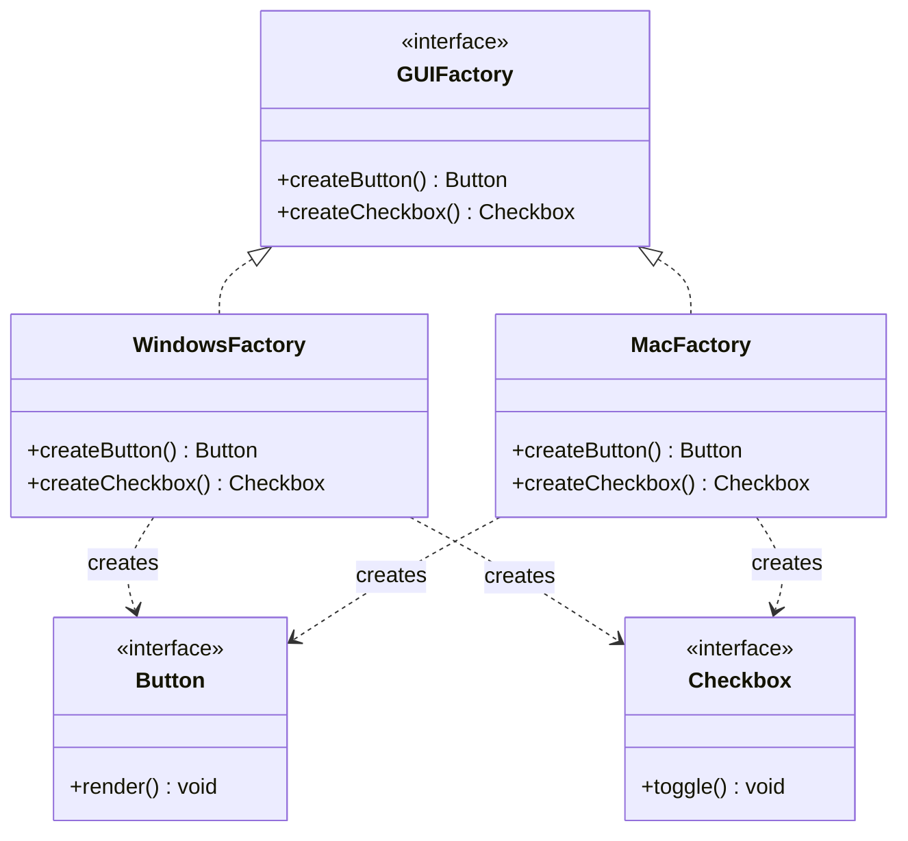

# Abstract Factory Design Pattern

## Blogs and websites

## Medium

## Youtube

---

## 1. Overview and Fundamentals

**Intent:** Provide an interface for creating families of related or dependent objects without specifying their concrete classes.

**Problem it solves:** Using a Windows button with a macOS checkbox, or an AWS compute client with a GCP bucket, produces incompatible combinations. Scattered `new` calls let mismatched products slip in.

**Solution in one line:** One factory per family exposes one creation method per product, so swapping the factory swaps the whole compatible set at once.

**GoF category:** Creational. Focus is on *consistent families* rather than a single product.

**Core characteristics:**

- `AbstractFactory` declares `createProductA()` and `createProductB()`.
- Each `ConcreteFactory` builds only its own family's products.
- Client depends solely on abstract factory and product interfaces.
- Often each creation method is itself a Factory Method.

**Mental model:** A themed furniture store. You pick "Scandinavian" or "Industrial" once, and every piece — chair, table, lamp — arrives in the matching style. You never mix collections.

## 2. Detailed Theory

**Mechanics:**

1. Define one product interface per kind: `Button`, `Checkbox`, `Compute`, `Storage`.
2. Implement one concrete product per kind per family: `WindowsButton`, `MacButton`, `AwsCompute`, `GcpCompute`.
3. Define `AbstractFactory` with one creation method per product kind.
4. Implement one `ConcreteFactory` per family.
5. Inject the factory into clients; clients never call concrete constructors.

**Adding families vs adding products:**

- Adding a *family* is easy: add one factory class implementing existing methods.
- Adding a *product kind* is hard: extend the factory interface and update every concrete factory. Keep product interfaces narrow and factories cohesive.

**Principles involved:**

- **Dependency Inversion:** Client, factory, and products all depend on abstractions.
- **Open/Closed:** Open for new families, closed for existing client code.
- **Interface Segregation:** Prefer small factories with few methods; split bloated ones.
- **Consistency by construction:** Compatibility is enforced because only one family can be built from a given factory.

**Consequences:**

- Guarantees that products used together are compatible.
- Makes switching families a one-line change at the composition root.
- Increases class count and upfront design cost.
- Wrong split (too many product kinds in one factory) creates painful interface churn.

**Implementation options:**

- Parameterized factories for small families versus one class per family for large ones.
- Prototype-backed factories that clone registered templates to reduce subclasses.
- DI containers wiring the right factory per environment or region.

## 3. UML and Architecture Diagrams



*The class diagram shows two factories each producing a complete matching widget family through abstract products.*

```mermaid
sequenceDiagram
    participant Client
    participant Factory as MacFactory
    participant Btn as MacButton
    participant Box as MacCheckbox
    Client->>Factory: createButton
    Factory->>Btn: new MacButton
    Btn-->>Client: Button
    Client->>Factory: createCheckbox
    Factory->>Box: new MacCheckbox
    Box-->>Client: Checkbox
    Client->>Btn: render
    Client->>Box: toggle
```

*The sequence diagram shows the client building both products from one factory so the pair stays compatible.*

**Architecture note:** Choose the factory once at startup from config (platform, cloud, region), inject it downward, and keep all downstream code family-agnostic.

## 4. Implementation Examples in Java, Python, and Go

### Java — Cloud family with matched compute plus storage

**Steps:** 1. Define `Compute` and `Storage` interfaces. 2. Implement AWS and GCP variants. 3. Define `CloudFactory`. 4. Implement one factory per cloud. 5. Inject factory into `BackupService`.

```java
interface Compute { void start(String name); }
interface Storage { void upload(String key, byte[] data); }
interface CloudFactory {
    Compute createCompute();
    Storage createStorage();
}

class AwsCompute implements Compute {
    public void start(String name) { System.out.println("EC2 starting: " + name); }
}
class AwsStorage implements Storage {
    public void upload(String key, byte[] data) {
        System.out.println("S3 upload: " + key + " (" + data.length + " bytes)");
    }
}
class GcpCompute implements Compute {
    public void start(String name) { System.out.println("GCE starting: " + name); }
}
class GcpStorage implements Storage {
    public void upload(String key, byte[] data) {
        System.out.println("GCS upload: " + key + " (" + data.length + " bytes)");
    }
}

class AwsFactory implements CloudFactory {
    public Compute createCompute() { return new AwsCompute(); }
    public Storage createStorage() { return new AwsStorage(); }
}
class GcpFactory implements CloudFactory {
    public Compute createCompute() { return new GcpCompute(); }
    public Storage createStorage() { return new GcpStorage(); }
}

class BackupService {
    private final Compute compute;
    private final Storage storage;
    BackupService(CloudFactory factory) {
        this.compute = factory.createCompute();
        this.storage = factory.createStorage();
    }
    void nightlyBackup(String job) {
        compute.start(job);
        storage.upload(job + ".snap", new byte[1024]);
    }
}

public class AbstractFactoryDemo {
    public static void main(String[] args) {
        CloudFactory factory = args.length > 0 && args[0].equals("gcp")
            ? new GcpFactory() : new AwsFactory();
        new BackupService(factory).nightlyBackup("orders-db");
    }
}
// Sample output with no args:
// EC2 starting: orders-db
// S3 upload: orders-db.snap (1024 bytes)
// Sample output with arg gcp:
// GCE starting: orders-db
// GCS upload: orders-db.snap (1024 bytes)
```

### Python — Theme family with registry selection, PEP8 style

**Steps:** 1. Define product classes per theme. 2. Define factory classes with matching methods. 3. Register families by key. 4. Resolve once from config.

```python
"""Abstract factory for light and dark theme widget families."""
from __future__ import annotations

from typing import Dict, Type


class LightButton:
    def render(self) -> str:
        return "light button"


class LightCheckbox:
    def toggle(self) -> str:
        return "light checkbox checked"


class DarkButton:
    def render(self) -> str:
        return "dark button"


class DarkCheckbox:
    def toggle(self) -> str:
        return "dark checkbox checked"


class LightThemeFactory:
    def create_button(self) -> LightButton:
        return LightButton()

    def create_checkbox(self) -> LightCheckbox:
        return LightCheckbox()


class DarkThemeFactory:
    def create_button(self) -> DarkButton:
        return DarkButton()

    def create_checkbox(self) -> DarkCheckbox:
        return DarkCheckbox()


_FAMILIES: Dict[str, Type[object]] = {
    "light": LightThemeFactory,
    "dark": DarkThemeFactory,
}


def factory_for(theme: str):
    try:
        return _FAMILIES[theme]()
    except KeyError as exc:
        raise ValueError(f"unknown theme: {theme}") from exc


def main() -> None:
    factory = factory_for("dark")
    print(factory.create_button().render())
    print(factory.create_checkbox().toggle())


if __name__ == "__main__":
    main()

# Sample output:
# dark button
# dark checkbox checked
```

### Go — Storage family with matched bucket plus queue

**Steps:** 1. Define `Bucket` and `Queue` interfaces. 2. Implement AWS and GCP pairs. 3. Define `CloudFactory`. 4. Select family in `main`.

```go
package main

import (
	"errors"
	"fmt"
)

// Bucket stores objects; Queue publishes jobs.
type Bucket interface{ Put(key string) string }
type Queue interface{ Publish(job string) string }

// CloudFactory builds one compatible family.
type CloudFactory interface {
	NewBucket() Bucket
	NewQueue() Queue
}

type awsBucket struct{}

func (awsBucket) Put(key string) string { return "s3 put " + key }

type awsQueue struct{}

func (awsQueue) Publish(job string) string { return "sqs publish " + job }

type gcpBucket struct{}

func (gcpBucket) Put(key string) string { return "gcs put " + key }

type gcpQueue struct{}

func (gcpQueue) Publish(job string) string { return "pubsub publish " + job }

type awsFactory struct{}

func (awsFactory) NewBucket() Bucket { return awsBucket{} }
func (awsFactory) NewQueue() Queue   { return awsQueue{} }

type gcpFactory struct{}

func (gcpFactory) NewBucket() Bucket { return gcpBucket{} }
func (gcpFactory) NewQueue() Queue   { return gcpQueue{} }

// FactoryFor selects the whole family from one key.
func FactoryFor(cloud string) (CloudFactory, error) {
	switch cloud {
	case "aws":
		return awsFactory{}, nil
	case "gcp":
		return gcpFactory{}, nil
	default:
		return nil, errors.New("unknown cloud: " + cloud)
	}
}

func main() {
	factory, _ := FactoryFor("aws")
	fmt.Println(factory.NewBucket().Put("orders.snap"))
	fmt.Println(factory.NewQueue().Publish("backup"))
}

// Sample output:
// s3 put orders.snap
// sqs publish backup
```

## 5. Real-World Industry Applications

- **UI toolkits:** Qt, Flutter, and native widget sets producing matching buttons, inputs, and dialogs per platform.
- **Cloud providers:** AWS, Azure, GCP factories for compute, storage, and queue clients.
- **Databases:** Connection plus dialect plus transaction triplets per engine (Postgres, MySQL).
- **Theme systems:** Light and dark palettes producing colors, fonts, and icons as a set.
- **Document generators:** PDF, HTML, Word exporters producing headers, tables, and footers.
- **E-commerce regions:** US, EU, Asia factories for currency, tax, and shipping rules.
- **Game engines:** Medieval versus sci-fi asset families with matched units and buildings.
- **Spring:** `FactoryBean` hierarchies and profile-specific `@Configuration` classes.

## 6. Practical Use Cases and Scenarios

| Scenario | Problem | Abstract Factory application |
|---|---|---|
| Cross-platform UI | Mixed widgets look and behave inconsistently | One factory per OS builds all widgets |
| Multi-cloud backup | Compute and storage must belong to one cloud | `CloudFactory` returns matched pair |
| Regional checkout | Tax plus currency plus shipping must agree | Region factory returns the legal triplet |
| Document export | PDF header with HTML table breaks layout | Format factory builds full document kit |
| Test environments | Integration tests mix fake DB with real queue | Environment factory swaps whole backend |
| Game themes | Sci-fi tank beside medieval castle | Theme factory builds matched asset set |
| Reporting | Chart plus table plus export must share dialect | Engine factory per output target |

## 7. When to Use and When Not to Use

**Use when:**

- Two or more product kinds must be used together and stay compatible.
- The system must run against multiple families (platforms, clouds, regions, themes).
- You want family switching to be a single configuration change.
- Product constraints should be enforced by construction, not documentation.

**Do not use when:**

- Only one product kind varies — prefer [Factory](factory.md).
- Products are independent and freely mixable — direct factories suffice.
- The family has one member and no second family is planned — YAGNI applies.
- Product kinds churn weekly — interface churn across every factory will hurt.

## 8. Do's and Don'ts

| Do | Don't |
|---|---|
| Inject the factory; select the family at the composition root | Instantiate concrete factories deep in domain code |
| Keep factories small and cohesive; split bloated ones | Put ten unrelated `create` methods in one factory |
| Design product interfaces narrowly upfront | Add product kinds casually and churn all factories |
| Reuse factories; they are often singletons | Create a new factory per request without reason |
| Test family compatibility explicitly | Test one product and assume the family works |
| Consider Prototype-backed factories for many variants | Subclass endlessly when cloning a template works |

## 9. Comparison with Other Design Patterns

| Aspect | Abstract Factory | Factory Method | Builder | Prototype |
|---|---|---|---|---|
| Scope | Family of related products | One product via subclass | One complex object stepwise | Copies of an existing object |
| Mechanism | Composition of creation methods | Inheritance and override | Fluent assembly plus `build` | Clone plus tweak |
| Compatibility | Guarantees family consistency | No cross-product guarantee | N/A: single product | Inherits template state |
| Add family or variant | Easy: add one factory | Easy: add one subclass | Easy: add builder step | Easy: register template |
| Add product kind | Hard: touches every factory | N/A | Medium: extend builder | Easy: clone new template |
| Best for | Platforms, clouds, themes | Extension hooks | Optional-heavy objects | Expensive or stateful templates |

**Rule of thumb:** one varying product points to Factory Method; two or more products that must ship together point to Abstract Factory; stepwise configuration points to Builder; reuse of prepared state points to Prototype.

## 10. Interview Preparation

**Q1 [Beginner]: What problem does Abstract Factory solve?**
It guarantees that related products come from the same family so incompatible combinations cannot be constructed by accident.

**Q2 [Beginner]: How is it a factory of factories?**
Each concrete factory bundles several Factory Methods — one per product kind — so choosing a factory chooses the whole product set.

**Q3 [Intermediate]: Factory Method vs Abstract Factory?**
Factory Method creates one product through inheritance; Abstract Factory creates a family through composition. Use the former for one hierarchy, the latter for matched sets.

**Q4 [Intermediate]: What is the main extension trade-off?**
Families are cheap to add (one class); product kinds are expensive (every factory plus the interface changes). Mitigate with narrow interfaces and cohesive splits.

**Q5 [Intermediate]: How do you select the family at runtime?**
Read one key (platform, cloud, region) at startup, resolve to a factory via map or DI profile, and inject that factory everywhere downstream.

**Q6 [Advanced]: How do you avoid interface explosion?**
Split by cohesion (compute-plus-storage versus UI widgets), provide default methods or adapters where the language allows, and consider Prototype-backed factories for variant-heavy families.

**Q7 [Advanced]: How do you test it?**
Unit-test clients against fake factories and fake products; add one integration test per real family proving the products interoperate with the real SDK.

**Q8 [Scenario]: EU checkout needs new tax rules without touching US — design it?**
Add `EuFactory` returning EU tax, currency, and shipping products behind existing interfaces. Wire by region key. US path and shared checkout code stay untouched.

**LLD scenario 1 — Cross-platform UI kit:** Design button, checkbox, and dialog per OS with native look. Expect factory per OS, program-to-interface clients, and snapshot tests per family.

**LLD scenario 2 — Multi-region payments:** Design gateway plus currency plus tax per region. Expect region factory, money value objects, and contract tests per region.

**LLD scenario 3 — Game world themes:** Design matched terrain, units, and buildings for two biomes. Expect theme factory plus Prototype prefabs and asset-budget tests.

## 11. Testing and Best Practices

- **Compatibility tests:** every factory must produce products that interoperate; assert pairs, not singles.
- **Switching tests:** same client scenario across all families with golden outputs.
- **Negative tests:** unknown family key raises a clear error; mixed factories are rejected by types or review.
- **Isolation:** fake factories for unit tests; real families only in integration tests with credentials.
- **Best practices:** stateless factories, constructor injection, one selection point, metrics on family resolution failures.

| Aspect | Detail |
|---|---|
| Memory impact | Low: factories are thin |
| Creation cost | Medium: dominated by real products and SDK clients |
| Scalability | High if factories shared and products thread-safe |
| Optimization | Reuse factory and heavyweight products; cache SDK clients; lazy-load families |

## 12. Summary and Key Takeaways

- Abstract Factory answers "which compatible set" — one factory per family, one method per product.
- Swapping a factory swaps the whole family; clients stay family-agnostic.
- Families are cheap to add, product kinds are expensive — design interfaces carefully.
- Test compatibility per family, select the family once, and inject it everywhere.
