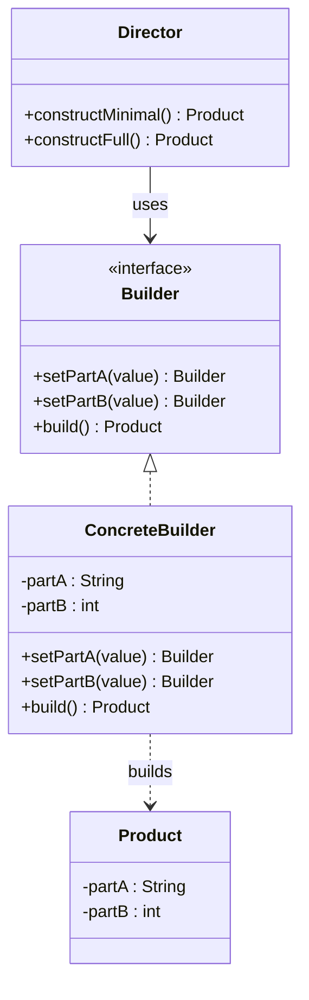
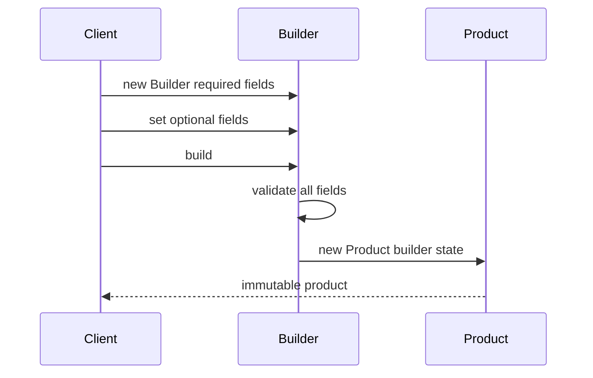

# Builder Design Pattern

## Blogs and websites

## Medium

## Youtube

- [23. Builder Design Pattern with Examples, LLD | Low Level Design Interview Question | System Design](https://www.youtube.com/watch?v=qOLRxN5eVC0)

## 1. Overview and Fundamentals

**Intent:** Separate the construction of a complex object from its representation so the same construction process can create different representations. Build complex objects step by step.

**Problem it solves:** Telescoping constructors (`new Request(a, b, c, d, e, f, g)`) are unreadable, error-prone, and break every caller when a field is added. JavaBeans setters fix readability but leave half-built mutable objects.

**Solution in one line:** Collect parameters in a mutable builder with fluent methods, validate once, then freeze into an immutable product via `build()`.

**GoF category:** Creational. Focus is on *stepwise assembly* of one complex type.

**Core characteristics:**

- Required fields via builder constructor; optional fields via chained methods with defaults.
- Single validation gate in `build()`.
- Immutable product with defensive copies of mutable inputs.
- Optional Director for standard construction recipes; optional Step Builder for compile-time ordering.

**Mental model:** Ordering a custom laptop. You pick CPU and RAM first (required), then add storage, warranty, and accessories (optional). The shop validates the full configuration once before sealing the box.

## 2. Detailed Theory

**Mechanics:**

1. Product holds final fields and a private constructor taking the builder.
2. Static nested `Builder` holds mutable staging fields with sensible defaults.
3. Builder constructor takes required fields so they cannot be forgotten.
4. Chained methods set optional fields and return `this`.
5. `build()` validates cross-field rules and returns the immutable product.

**Variants:**

- **Fluent Builder:** Plain chaining as in the examples below.
- **Step Builder:** Each step returns an interface exposing only the next legal call, enforcing order at compile time.
- **Director:** Encapsulates standard recipes (`buildMinimalReport`, `buildFullReport`) over the builder interface.
- **Lombok `@Builder` / record builders:** Generated builders for routine cases; hand-write when validation is non-trivial.
- **Hierarchical builders:** Self-type generics (`T extends Builder<T>`) for builder inheritance.

**Principles involved:**

- **Single Responsibility:** Construction logic leaves the product; validation lives in one gate.
- **Open/Closed:** New optional fields add a method plus default without breaking callers.
- **Encapsulation:** Product invariants are established once and never rechecked.
- **Immutability:** Frozen product is freely shareable across threads.

**Consequences:**

- Call sites name every argument (`timeoutMs(8000)`), ending boolean-and-int confusion.
- One extra class per product plus a short-lived builder allocation per build.
- Builders themselves are single-threaded staging objects — document as not thread-safe.
- Overkill for two-field value objects where a constructor suffices.

## 3. UML and Architecture Diagrams



*The class diagram shows the director driving the builder interface while the concrete builder assembles the immutable product.*



*The sequence diagram shows staged configuration followed by one validation gate before the frozen product is returned.*

**Architecture note:** Builders belong at API boundaries — HTTP requests, SDK calls, report specs, test fixtures. Domain entities receive the built value object; they never see the builder.

## 4. Implementation Examples in Java, Python, and Go

### Java — HTTP request builder with validation gate

**Steps:** 1. Make product fields final with private constructor. 2. Require method plus URL in builder constructor. 3. Chain optional fields with defaults. 4. Validate cross-field rules in `build()`. 5. Defensive-copy mutable state.

```java
import java.util.HashMap;
import java.util.Map;

class HttpRequest {
    private final String method;
    private final String url;
    private final Map<String, String> headers;
    private final int timeoutMs;
    private final int retries;
    private final String body;

    private HttpRequest(Builder builder) {
        this.method = builder.method;
        this.url = builder.url;
        this.headers = Map.copyOf(builder.headers);
        this.timeoutMs = builder.timeoutMs;
        this.retries = builder.retries;
        this.body = builder.body;
    }

    @Override
    public String toString() {
        return method + " " + url + " timeout=" + timeoutMs
            + " retries=" + retries + " headers=" + headers.size();
    }

    static class Builder {
        private final String method;
        private final String url;
        private final Map<String, String> headers = new HashMap<>();
        private int timeoutMs = 5_000;
        private int retries = 1;
        private String body = "";

        Builder(String method, String url) {
            this.method = method;
            this.url = url;
        }

        Builder header(String key, String value) {
            headers.put(key, value);
            return this;
        }

        Builder timeoutMs(int timeoutMs) {
            this.timeoutMs = timeoutMs;
            return this;
        }

        Builder retries(int retries) {
            this.retries = retries;
            return this;
        }

        Builder body(String body) {
            this.body = body;
            return this;
        }

        HttpRequest build() {
            if (method == null || method.isBlank()) {
                throw new IllegalStateException("method is required");
            }
            if (url == null || url.isBlank()) {
                throw new IllegalStateException("url is required");
            }
            if (timeoutMs <= 0) {
                throw new IllegalStateException("timeout must be positive");
            }
            if (!body.isEmpty() && method.equals("GET")) {
                throw new IllegalStateException("GET must not carry a body");
            }
            return new HttpRequest(this);
        }
    }
}

public class BuilderDemo {
    public static void main(String[] args) {
        HttpRequest req = new HttpRequest.Builder("POST", "https://api.shop/orders")
            .header("Authorization", "Bearer tok")
            .timeoutMs(8000).retries(3).body("{\"id\":7}")
            .build();
        System.out.println(req);
    }
}
// Sample output:
// POST https://api.shop/orders timeout=8000 retries=3 headers=1
```

### Python — Fluent dataclass builder, PEP8 style

**Steps:** 1. Model the product as a frozen dataclass. 2. Write a mutable builder with chaining. 3. Apply defaults centrally. 4. Validate in `build`.

```python
"""Fluent builder producing an immutable email message."""
from __future__ import annotations

from dataclasses import dataclass, field
from typing import Dict, List


@dataclass(frozen=True)
class Email:
    to: str
    subject: str
    body: str = ""
    cc: List[str] = field(default_factory=list)
    headers: Dict[str, str] = field(default_factory=dict)


class EmailBuilder:
    def __init__(self, to: str, subject: str) -> None:
        self._to = to
        self._subject = subject
        self._body = ""
        self._cc: List[str] = []
        self._headers: Dict[str, str] = {}

    def body(self, text: str) -> EmailBuilder:
        self._body = text
        return self

    def cc(self, *addresses: str) -> EmailBuilder:
        self._cc.extend(addresses)
        return self

    def header(self, key: str, value: str) -> EmailBuilder:
        self._headers[key] = value
        return self

    def build(self) -> Email:
        if "@" not in self._to:
            raise ValueError("valid recipient is required")
        if not self._subject.strip():
            raise ValueError("subject is required")
        return Email(
            to=self._to,
            subject=self._subject,
            body=self._body,
            cc=list(self._cc),
            headers=dict(self._headers),
        )


def main() -> None:
    email = (
        EmailBuilder("a@x.com", "Invoice ready")
        .body("Thanks for your order.")
        .cc("ops@x.com")
        .header("X-Priority", "1")
        .build()
    )
    print(email)


if __name__ == "__main__":
    main()

# Sample output:
# Email(to='a@x.com', subject='Invoice ready', body='Thanks...', cc=['ops@x.com'], ...)
```

### Go — Functional-options builder

**Steps:** 1. Keep the product struct simple. 2. Define `Option` functions. 3. Apply defaults first, then options. 4. Validate once before returning.

```go
package main

import (
	"errors"
	"fmt"
	"strings"
)

// Server is the immutable-ish product configured step by step.
type Server struct {
	Host string
	Port int
	TLS  bool
	Tags map[string]string
}

// Option mutates the staging config.
type Option func(*Server)

func WithPort(port int) Option {
	return func(s *Server) { s.Port = port }
}

func WithTLS(enabled bool) Option {
	return func(s *Server) { s.TLS = enabled }
}

func WithTag(key, value string) Option {
	return func(s *Server) { s.Tags[key] = value }
}

// NewServer applies defaults, then options, then validates once.
func NewServer(host string, opts ...Option) (Server, error) {
	s := Server{Host: host, Port: 8080, Tags: map[string]string{}}
	for _, opt := range opts {
		opt(&s)
	}
	if strings.TrimSpace(s.Host) == "" {
		return Server{}, errors.New("host is required")
	}
	if s.Port <= 0 || s.Port > 65535 {
		return Server{}, errors.New("port must be 1-65535")
	}
	tags := make(map[string]string, len(s.Tags))
	for k, v := range s.Tags {
		tags[k] = v
	}
	s.Tags = tags
	return s, nil
}

func main() {
	srv, err := NewServer("api.shop", WithPort(443), WithTLS(true), WithTag("env", "prod"))
	if err != nil {
		panic(err)
	}
	fmt.Printf("%s:%d tls=%v tags=%v\n", srv.Host, srv.Port, srv.TLS, srv.Tags)
}

// Sample output:
// api.shop:443 tls=true tags=map[env:prod]
```

## 5. Real-World Industry Applications

- **HTTP clients:** OkHttp `Request.Builder`, Apache HttpClient, Go `http.Request` construction.
- **Android:** `AlertDialog.Builder`, `Notification.Builder` with chained setters.
- **SQL builders:** jOOQ, QueryDSL, Hibernate Criteria, Knex.js, Django ORM chaining.
- **Cloud SDKs:** AWS SDK v2 builders for requests, S3 puts, and client configuration.
- **Documents:** HTML, XML, JSON, and PDF document builders.
- **Config objects:** Spring Boot builders, Kubernetes pod specs, Terraform providers.
- **Test fixtures:** Builder pattern for DTOs and aggregate roots in unit tests.

## 6. Practical Use Cases and Scenarios

| Scenario | Problem | Builder application |
|---|---|---|
| HTTP request | Two required plus six optional fields | Builder with `build()` validation |
| Report export | Same data as PDF, HTML, CSV | Director plus per-format builder |
| Test user | Dozens of nullable fields per test | Fixture builder with `but()` cloning |
| Email send | Recipients, CC, body, attachments | Fluent builder with size validation |
| Server config | Host required, ports and TLS optional | Functional options with defaults |
| Query filter | Optional predicates in any order | Builder accumulating clauses |
| Game character | Class required, gear optional | Step builder enforcing creation order |

## 7. When to Use and When Not to Use

**Use when:**

- An object has four or more parameters, several optional.
- Construction needs validation across fields, not per setter.
- You want immutable results with readable call sites.
- The same process should yield different representations (PDF vs HTML report).
- Test fixtures need expressive variations from a common base.

**Do not use when:**

- The object has two or three simple fields — use a constructor or static factory.
- All parameters are required and stable — telescoping is not a risk.
- Builder hierarchies would mirror product hierarchies — consider factories instead.
- Allocation of one staging object per build is genuinely unacceptable (rare).

## 8. Do's and Don'ts

| Do | Don't |
|---|---|
| Require mandatory fields in the builder constructor | Allow `build()` with missing required data |
| Validate everything once in `build()` with clear messages | Validate per setter so chaining order matters |
| Defensive-copy mutable inputs into the product | Share the builder's map or list with the product |
| Keep defaults in one place and document them | Scatter magic defaults across call sites |
| Prefer immutable products; mark builders not thread-safe | Share one builder across threads |
| Add `but()` or `copy()` for fixture variations | Clone products by hand in every test |

## 9. Comparison with Other Design Patterns

| Aspect | Builder | Factory Method | Abstract Factory | Telescoping constructor |
|---|---|---|---|---|
| Problem | Too many parameters, many optional | Subclass picks product type | Compatible product family | N/A: ad-hoc overloads |
| Call shape | One type configured stepwise | One call, hierarchy decides | Several `create` calls, one family | Positional args, easy to swap |
| Validation | Once in `build()` | Per product constructor | Per product constructor | Scattered or absent |
| Readability | High: named chained calls | Medium: type hidden | Medium: family hidden | Low: `new(a, b, c, d)` |
| Immutability | Natural: frozen product | Depends on product | Depends on products | Possible but painful |
| Cost | Extra builder class | Extra subclasses | Extra families | Combinatorial overloads |

**Rule of thumb:** many optional fields on one type point to Builder; subtype selection points to Factory; matched families point to Abstract Factory; two required fields point to a plain constructor.

## 10. Interview Preparation

**Q1 [Beginner]: What problem does Builder solve?**
Telescoping constructors and half-built setters. It names every argument, centralizes defaults, and validates the whole object once before freezing it.

**Q2 [Beginner]: Where does validation belong?**
In `build()`, not in setters. Setters stay order-independent; `build()` checks required fields plus cross-field rules like GET-must-not-carry-body.

**Q3 [Intermediate]: How do you enforce required fields?**
Pass them through the builder constructor so omission is a compile error. For stronger ordering use a Step Builder where each method returns the next legal step.

**Q4 [Intermediate]: Builder vs constructor with defaults?**
Constructors with defaults work for few stable fields. Builder wins once fields are numerous, optional, or cross-validated, because adding a field never breaks callers.

**Q5 [Intermediate]: How do you keep the product immutable?**
Final fields, private constructor, and defensive copies of collections. The builder stays mutable but is discarded after `build()`.

**Q6 [Advanced]: Director vs Step Builder — when?**
Director encodes reusable recipes over a builder interface (minimal versus full report). Step Builder encodes ordering in types (from plus to required before body). Use both when recipes and ordering matter.

**Q7 [Advanced]: Thread-safety story?**
Builders are single-threaded staging objects. Products are immutable and freely shared. Never publish the builder or reuse it concurrently without explicit reset.

**Q8 [Scenario]: Report API needs PDF, HTML, and CSV from one spec — design it?**
Define a `ReportBuilder` interface with section methods; write one concrete builder per format; add a Director with `minimal()` and `full()` recipes. The service picks the builder by `Accept` header.

**LLD scenario 1 — Pizza order:** Design size (required) plus crust, toppings, extras. Expect builder with price computation and validation in `build()` (vegan cheese versus meat rules).

**LLD scenario 2 — Query builder:** Design filter, sort, page, and projection for a search API. Expect immutable query object, method chaining, max-page-size guard, and SQL-injection-safe rendering.

**LLD scenario 3 — Test data factory:** Design user fixtures with admin, guest, and locked variants. Expect base builder plus `but()` overrides and deterministic faker seeds.

## 11. Testing and Best Practices

- **Combinatorial tests:** required-only, all-optional, boundary values, and each default.
- **Validation tests:** one failing case per rule with exact message assertions.
- **Immutability tests:** mutate builder inputs after `build()`; assert product unchanged.
- **Recipe tests:** Director outputs for minimal and full variants match golden snapshots.
- **Best practices:** fail fast with field names, document defaults, keep builders out of product APIs, reuse via `but()` not shared mutable builders.

| Aspect | Detail |
|---|---|
| Memory impact | Medium: one short-lived builder per product |
| Creation cost | Medium: staging plus one validation pass |
| Scalability | High: immutable products share freely |
| Optimization | Reuse builders only with explicit `clear()`; cache built templates via Prototype |

## 12. Summary and Key Takeaways

- Builder turns confusing positional construction into named, validated, stepwise assembly.
- Required fields ride the constructor; optional fields chain; `build()` validates once.
- Products are immutable snapshots; builders are disposable staging objects.
- Use Directors for recipes and Step Builders for ordering; avoid Builder for trivial objects.
