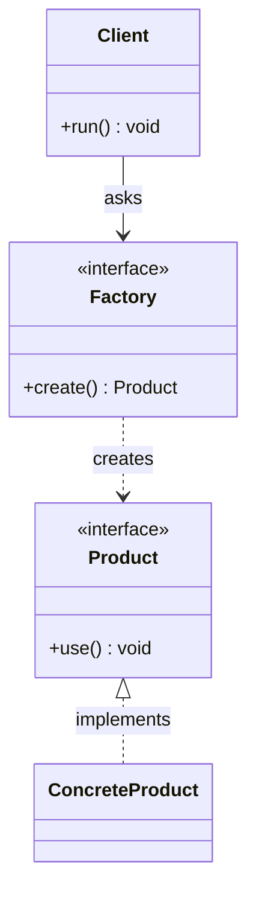
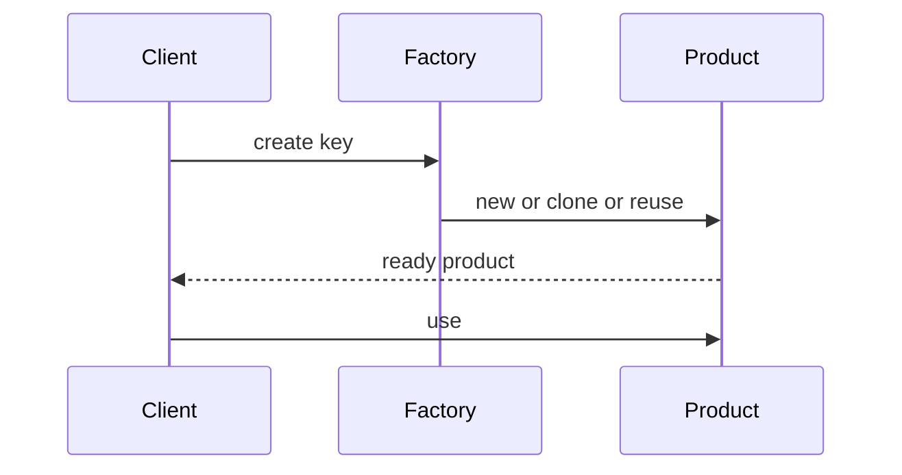

# Creational Design Patterns — Family Overview

## Blogs and websites

## Medium

## Youtube

- [27. All Creational Design Patterns | Prototype, Singleton, Factory, AbstractFactory, Builder Pattern](https://www.youtube.com/watch?v=OuNOyFg942)

## 1. Overview and Fundamentals

**What:** Creational patterns control how objects are created, hiding instantiation logic so clients depend on abstractions, not concrete classes.

**Family members:**

| Pattern | Answers | One-line use |
|---|---|---|
| Singleton | How many? One | Shared config, pool manager, registry |
| Factory Method | Which type? Via subclass | Gateway, parser, sender selection |
| Abstract Factory | Which family? Compatible set | Platform UI, cloud, region families |
| Builder | How assembled? Stepwise | Requests, queries, configs, fixtures |
| Prototype | From what? Copy template | Invoices, prefabs, pipeline configs |
| Object Pool | How reused? Bounded lending | Connections, threads, bullets, buffers |

**Shared goal:** Decouple use from creation, enforce constraints at construction, and make extension cheap.

## 2. Detailed Theory

**Core ideas:** Encapsulate what varies in creation; program to interfaces; let factories own knowledge of concrete classes.

**How they combine:** Abstract Factory is often built from Factory Methods; factories are often Singleton-scoped; Prototype backs factories to avoid subclass explosion; Builder constructs Composite products.

**Key trade-off:** Flexibility costs classes. Use a pattern only when creation varies, is expensive, or must enforce compatibility.

**Principles applied:** Open/Closed (add types without editing clients), Single Responsibility (creation leaves business logic), Dependency Inversion (depend on factory and product abstractions), DRY (centralize construction).

## 3. UML and Architecture Diagrams



*The class diagram shows the family-wide rule: clients use factories and products through interfaces only.*



*The sequence diagram shows the uniform flow: resolve, create or reuse, then use through abstraction.*

## 4. Implementation Examples in Java, Python, and Go

### Java — Simple factory selecting a product

**Steps:** 1. Define interface. 2. Implement two products. 3. Select by key in factory.

```java
interface Greeter { String greet(String name); }
class HiGreeter implements Greeter {
    public String greet(String n) { return "hi " + n; }
}
class HelloGreeter implements Greeter {
    public String greet(String n) { return "hello " + n; }
}
class GreeterFactory {
    static Greeter create(boolean formal) {
        return formal ? new HelloGreeter() : new HiGreeter();
    }
}
public class Demo {
    public static void main(String[] a) {
        System.out.println(GreeterFactory.create(true).greet("Asha"));
    }
}
// Sample output: hello Asha
```

### Python — Prototype-style clone from a template

**Steps:** 1. Define dataclass. 2. Copy template. 3. Customize the copy.

```python
import copy
from dataclasses import dataclass

@dataclass
class Report:
    title: str
    tags: list

template = Report("weekly", ["sales"])
clone = copy.deepcopy(template)
clone.title = "week-42"
print(clone)
# Sample output: Report(title='week-42', tags=['sales'])
```

### Go — Builder via functional options

**Steps:** 1. Defaults first. 2. Apply options. 3. Validate once.

```go
package main

import "fmt"

type Server struct{ Host string; Port int }
type Option func(*Server)
func WithPort(p int) Option { return func(s *Server) { s.Port = p } }
func NewServer(host string, opts ...Option) Server {
	s := Server{Host: host, Port: 8080}
	for _, o := range opts { o(&s) }
	return s
}
func main() { fmt.Println(NewServer("api.shop", WithPort(443))) }
// Sample output: {api.shop 443}
```

## 5. Real-World Industry Applications

- **Spring:** Singleton beans, FactoryBean, Builder for WebClient, Prototype scope.
- **JDK:** `Calendar.getInstance`, `StringBuilder`, `Object.clone`.
- **Android:** Application singleton, `AlertDialog.Builder`, LayoutInflater factory.
- **Python:** Django settings singleton, SQLAlchemy engine factory, ORM chained builder.
- **Go:** `http.Transport` pooling, functional-options APIs, `sync.Once` singletons.
- **Cloud and games:** Provider families, prefab cloning, connection and bullet pools.

## 6. Practical Use Cases and Scenarios

| Need | Pattern | Example |
|---|---|---|
| One shared resource | Singleton | Config, registry, pool manager |
| Runtime type choice | Factory | Gateway, parser, notifier |
| Compatible set | Abstract Factory | OS widgets, cloud pair, region triplet |
| Many optional fields | Builder | HTTP request, query, email |
| Expensive setup reuse | Prototype | Invoice, prefab, ML config |
| Bounded expensive reuse | Object Pool | DB connections, workers, buffers |

## 7. When to Use and When Not to Use

**Use when:** Creation varies by input, is expensive, must stay compatible, needs stepwise validation, or must be bounded.

**Do not use when:** Direct `new` is clear, the type set is fixed and tiny, products mix freely, or pooling cheap immutable objects. Prefer the simplest solution that satisfies the constraint.

## 8. Do's and Don'ts

| Do | Don't |
|---|---|
| Depend on factory and product interfaces | Scatter `new` for varying types |
| Validate once in Builder, reset in Pool, deep-copy in Prototype | Leave half-built, dirty, or aliased objects |
| Select family once at composition root | Mix families deep in domain code |
| Keep factories stateless and injectable | Build God factories for unrelated types |
| Document thread-safety and ownership | Share mutable products silently |

## 9. Comparison with Other Design Patterns

| Aspect | Creational | Structural | Behavioral |
|---|---|---|---|
| Answers | How objects come to be | How objects compose | How objects interact |
| Example | Factory, Builder, Pool | Adapter, Decorator, Flyweight | Strategy, Observer, Command |
| Client coupling | To factory interface | To component interface | To behavior interface |
| Reach for | Varying, expensive, or constrained creation | Interface mismatch or layering | Algorithm or workflow variation |

**Within family:** Factory picks one type; Abstract Factory picks a family; Builder assembles stepwise; Prototype clones; Singleton bounds count to one; Pool bounds reuse.

## 10. Interview Preparation

**Q1 [Beginner]: What unites creational patterns?** They hide how objects are created so clients depend on abstractions and constraints hold by construction.

**Q2 [Beginner]: Factory vs Abstract Factory?** One product versus a compatible family of products.

**Q3 [Intermediate]: Builder vs Factory?** Builder configures one complex type stepwise; Factory selects among subtypes.

**Q4 [Intermediate]: Prototype vs Factory?** Prototype copies prepared state; Factory constructs from defaults via a hierarchy.

**Q5 [Intermediate]: Singleton vs static class?** Singleton is an injectable object with lifecycle control; static utilities suit stateless helpers.

**Q6 [Advanced]: Object Pool vs Flyweight?** Pool lends mutable instances exclusively; Flyweight shares immutable state simultaneously.

**Q7 [Advanced]: Why is adding product kinds to Abstract Factory hard?** Every factory plus the interface changes. Keep interfaces narrow or split factories.

**Q8 [Scenario]: Checkout adds UPI without touching existing code?** Add `UpiProcessor` behind `Processor`, register under `upi`, resolve via factory from config.

**LLD scenario 1 — Multi-gateway payments:** Factory per gateway plus idempotency, retries, and webhook reconciliation.

**LLD scenario 2 — Cross-platform UI:** Abstract Factory per OS for button, dialog, and input with golden snapshot tests.

**LLD scenario 3 — Report service:** Builder for PDF/HTML/CSV from one spec plus Prototype templates and a bounded export worker pool.

## 11. Testing and Best Practices

- Test routing separately from products: unknown keys error, families stay compatible, builders reject invalid combos, clones stay independent, pools return clean instances.
- Prefer DI singleton scope over hand-rolled Singletons; fake factories in unit tests; integration-test each real family once.
- Track creation metrics: factory misses by key, pool waits and exhaustion, template versions.

| Aspect | Detail |
|---|---|
| Memory | Low except prewarmed pools and template stores |
| Cost | Dominated by real products, not dispatch |
| Scaling | Share stateless factories; make products thread-safe or exclusive |

## 12. Summary and Key Takeaways

- Singleton bounds count; Factory picks type; Abstract Factory picks family; Builder assembles; Prototype clones; Pool reuses.
- Choose by constraint: singularity, variation, compatibility, stepwise config, expensive setup, or bounded reuse.
- Keep creation explicit, injectable, and tested — and skip the pattern when `new` suffices.
