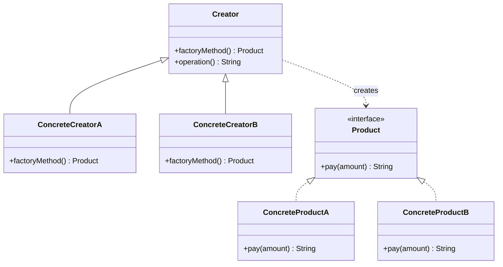
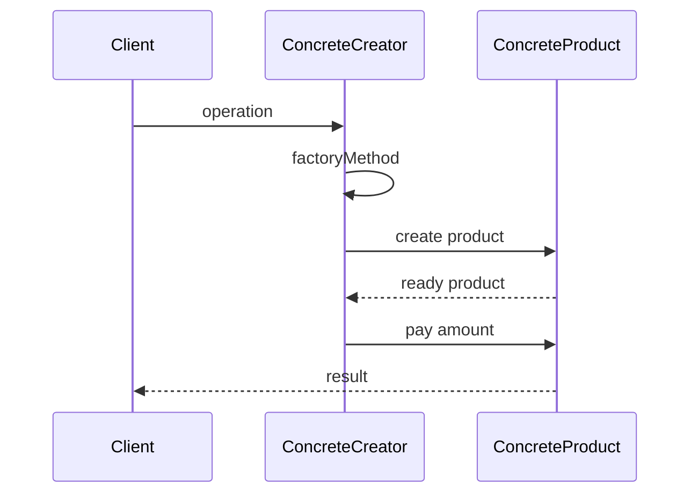

# Factory Design Pattern

## Blogs and websites

## Medium

## Youtube

- [5. Factory Pattern Vs Abstract Factory Pattern Explanation (Hindi) | Low Level System Design](https://www.youtube.com/watch?v=7g9S371qzwM)

## 1. Overview and Fundamentals

**Intent:** Define an interface for creating objects, but let subclasses decide which class to instantiate. The Factory Method lets a class defer instantiation to subclasses.

**Problem it solves:** Client code littered with `if type == "stripe": return StripeProcessor()` couples every caller to concrete classes. Adding a new type forces edits in many places and violates Open/Closed Principle.

**Solution in one line:** Move creation behind a factory method or factory class so clients ask for a product by abstraction and receive the right concrete type.

**GoF category:** Creational. Focus is on *which* single product type to create.

**Terminology to get right:**

- **Simple Factory:** A single method or class with a conditional that picks the product. Useful idiom, but not a GoF pattern.
- **Factory Method:** An abstract creation method overridden by subclasses; uses inheritance to vary the product.
- **Abstract Factory:** Creates families of related products; uses composition. Covered in [Abstract Factory](abstract-factory.md).

**Mental model:** A restaurant kitchen with an order chit. The waiter (client) writes "pizza" without knowing which chef cooks it. The head chef (factory) routes the order to the right station (concrete creator).

## 2. Detailed Theory

**Mechanics (Factory Method):**

1. Define a `Product` interface, e.g. `PaymentProcessor`.
2. Define a `Creator` with an abstract `factoryMethod()` plus a concrete `operation()` that uses the product.
3. Each `ConcreteCreator` overrides `factoryMethod()` to return its `ConcreteProduct`.
4. Client depends only on `Creator` and `Product`.

**Mechanics (Simple / Parameterized Factory):**

1. One `Factory` class exposes `create(type)` with a registry or switch.
2. Registry maps keys to constructors or supplier functions.
3. Unknown types raise a clear error; registration can be dynamic.

**Principles involved:**

- **Open/Closed:** Add products by adding creators, not editing clients.
- **Single Responsibility:** Creation logic leaves business classes.
- **Dependency Inversion:** Both creator and client depend on the product abstraction.
- **Liskov Substitution:** Any product must be usable through the product interface.

**Consequences:**

- Decouples client from concrete classes and construction details.
- Can explode into many small creator subclasses if every variant needs one.
- Parameterized factories trade subclass count for conditional complexity.
- Overkill when the product set is fixed and tiny — direct `new` is clearer.

**Design choices:**

- Key by enum or string constants, never magic strings scattered in callers.
- Prefer a registry map of `String -> Supplier<Product>` so plugins can self-register without editing the factory.
- Return interfaces, accept configuration objects, and fail fast on unknown keys.

## 3. UML and Architecture Diagrams



*The class diagram shows creators varying the product while the client uses only the abstract types.*



*The sequence diagram shows the template operation delegating creation to the factory method before using the product.*

**Architecture note:** Factories sit at composition roots and module boundaries: payment gateway selection, notification channel routing, parser selection by file type. Domain logic stays behind the product interface.

## 4. Implementation Examples in Java, Python, and Go

### Java — Factory Method with registry-based simple factory

**Steps:** 1. Define `Notification` product interface. 2. Implement email and SMS products. 3. Define abstract `NotifierCreator`. 4. Add concrete creators. 5. Drive via abstraction.

```java
import java.util.Map;
import java.util.function.Supplier;

interface Notification {
    String send(String to, String body);
}

class EmailNotification implements Notification {
    public String send(String to, String body) {
        return "email to " + to + ": " + body;
    }
}

class SmsNotification implements Notification {
    public String send(String to, String body) {
        return "sms to " + to + ": " + body;
    }
}

abstract class NotifierCreator {
    abstract Notification factoryMethod();

    String notify(String to, String body) {
        return factoryMethod().send(to, body);
    }
}

class EmailCreator extends NotifierCreator {
    Notification factoryMethod() { return new EmailNotification(); }
}

class SmsCreator extends NotifierCreator {
    Notification factoryMethod() { return new SmsNotification(); }
}

// Parameterized simple factory for config-driven selection.
class NotificationFactory {
    private static final Map<String, Supplier<Notification>> REGISTRY = Map.of(
        "email", EmailNotification::new,
        "sms", SmsNotification::new
    );

    static Notification create(String type) {
        Supplier<Notification> supplier = REGISTRY.get(type);
        if (supplier == null) throw new IllegalArgumentException("unknown: " + type);
        return supplier.get();
    }
}

public class FactoryDemo {
    public static void main(String[] args) {
        NotifierCreator creator = new EmailCreator();
        System.out.println(creator.notify("a@x.com", "hello"));
        System.out.println(NotificationFactory.create("sms").send("+91", "otp 4821"));
    }
}
// Sample output:
// email to a@x.com: hello
// sms to +91: otp 4821
```

### Python — Pythonic registry with duck typing, PEP8 style

**Steps:** 1. Define product classes with a shared method. 2. Register constructors in a dict. 3. Expose `create` plus `register` for plugins. 4. Keep client code type-agnostic.

```python
"""Factory with an explicit registry and duck-typed products."""
from __future__ import annotations

from typing import Callable, Dict


class EmailNotification:
    def send(self, to: str, body: str) -> str:
        return f"email to {to}: {body}"


class SmsNotification:
    def send(self, to: str, body: str) -> str:
        return f"sms to {to}: {body}"


class PushNotification:
    def send(self, to: str, body: str) -> str:
        return f"push to {to}: {body}"


ProductFactory = Callable[[], object]

_REGISTRY: Dict[str, ProductFactory] = {
    "email": EmailNotification,
    "sms": SmsNotification,
    "push": PushNotification,
}


def register(kind: str, factory: ProductFactory) -> None:
    """Allow plugins to add products without editing the factory."""
    _REGISTRY[kind] = factory


def create(kind: str):
    try:
        return _REGISTRY[kind]()
    except KeyError as exc:
        raise ValueError(f"unknown notification: {kind}") from exc


class Notifier:
    """Creator analogue: uses whatever product the factory returns."""

    def __init__(self, kind: str) -> None:
        self.kind = kind

    def notify(self, to: str, body: str) -> str:
        return create(self.kind).send(to, body)  # type: ignore[attr-defined]


def main() -> None:
    print(Notifier("email").notify("a@x.com", "hello"))
    print(Notifier("sms").notify("+91", "otp 4821"))
    print(create("push").send("device-7", "sale live"))


if __name__ == "__main__":
    main()

# Sample output:
# email to a@x.com: hello
# sms to +91: otp 4821
# push to device-7: sale live
```

### Go — Idiomatic factory returning interfaces

**Steps:** 1. Define `Processor` interface. 2. Keep structs unexported. 3. Switch in `NewProcessor`. 4. Return error on unknown type.

```go
package main

import (
	"errors"
	"fmt"
	"strings"
)

// Processor is the product interface.
type Processor interface {
	Pay(amount float64) string
}

type stripeProcessor struct{}

func (stripeProcessor) Pay(amount float64) string {
	return fmt.Sprintf("stripe charged %.2f", amount)
}

type razorpayProcessor struct{}

func (razorpayProcessor) Pay(amount float64) string {
	return fmt.Sprintf("razorpay charged %.2f", amount)
}

// NewProcessor is the factory function.
func NewProcessor(kind string) (Processor, error) {
	switch strings.ToLower(kind) {
	case "stripe":
		return stripeProcessor{}, nil
	case "razorpay":
		return razorpayProcessor{}, nil
	default:
		return nil, errors.New("unknown processor: " + kind)
	}
}

func checkout(kind string, amount float64) string {
	p, err := NewProcessor(kind)
	if err != nil {
		return err.Error()
	}
	return p.Pay(amount)
}

func main() {
	fmt.Println(checkout("stripe", 499.00))
	fmt.Println(checkout("razorpay", 999.50))
	fmt.Println(checkout("unknown", 10))
}

// Sample output:
// stripe charged 499.00
// razorpay charged 999.50
// unknown processor: unknown
```

## 5. Real-World Industry Applications

- **Payment gateways:** Stripe, PayPal, Razorpay processors selected by region or merchant config.
- **Logging frameworks:** SLF4J and Python `logging` handlers created per destination.
- **Serialization:** Jackson `ObjectMapper` variants for JSON, XML, YAML; Go `encoding/*` decoders.
- **JDBC:** `DriverManager.getConnection` returns vendor-specific connections.
- **UI frameworks:** Dialog and button creation per OS.
- **Document processing:** PDF, Word, Excel readers chosen by file extension.
- **Cloud SDKs:** Storage clients for S3 versus GCS versus Azure Blob.
- **ML pipelines:** Tokenizer or model loader selected by model ID.

## 6. Practical Use Cases and Scenarios

| Scenario | Problem | Factory application |
|---|---|---|
| Multi-gateway payments | Checkout must support new gateways without rewrites | Factory returns gateway by merchant config |
| Notification router | OTP via SMS, receipts via email | `create(channel)` picks sender |
| File import | CSV, Excel, Parquet uploads | Parser factory keyed by extension |
| DAO selection | Dev uses H2, prod uses Postgres | Factory returns dialect-specific DAO |
| Report export | PDF, HTML, CSV | Exporter factory per requested format |
| Auth providers | Google, GitHub, SSO | OAuth client factory per provider |
| Game spawns | Enemy type varies by level | Spawn factory per level config |

## 7. When to Use and When Not to Use

**Use when:**

- The exact product type depends on runtime input (config, request, file type).
- A class cannot anticipate which product subclass it needs.
- You want library users to extend internal components via subclasses.
- Creation involves non-trivial setup worth centralizing and reusing.

**Do not use when:**

- The product set is fixed at two types and never grows — a simple conditional is clearer.
- Direct construction already reads well and has no variation.
- You need compatible *families* of products — prefer [Abstract Factory](abstract-factory.md).
- You need step-by-step configuration of one complex object — prefer [Builder](builder.md).

## 8. Do's and Don'ts

| Do | Don't |
|---|---|
| Return interfaces and key by constants or enums | Return concrete types forcing downcasts |
| Keep a registry so new products register without edits | Edit a giant switch in five places per product |
| Fail fast with a clear unknown-type error | Return null and let callers NPE later |
| Name it honestly: `NewProcessor`, `createSender` | Call every static helper a Factory Method |
| Inject the factory where creation varies in tests | Hard-code the factory inside domain logic |
| Document thread-safety and ownership of products | Share mutable products across threads silently |

## 9. Comparison with Other Design Patterns

| Aspect | Simple Factory | Factory Method | Abstract Factory | Builder |
|---|---|---|---|---|
| Creates | One product via conditional | One product via subclass | Family of related products | One complex object step by step |
| Mechanism | Composition plus switch or map | Inheritance plus override | Composition of factory methods | Fluent stepwise assembly |
| Add new product | Edit factory or register key | Add creator subclass | Add method to every factory | Add builder method |
| Client knowledge | Knows key, not class | Knows creator abstraction | Knows factory interface only | Knows builder steps |
| Best for | Config-driven single-product choice | Framework hooks for extension | Compatible product families | Many optional parameters |
| Risk | God factory for unrelated types | Subclass explosion | Hard to add product kinds | Overkill for simple objects |

**Rule of thumb:** one product chosen by key points to Simple Factory; one product chosen by subclass points to Factory Method; matched families point to Abstract Factory; stepwise configuration points to Builder.

## 10. Interview Preparation

**Q1 [Beginner]: What is Factory Method in one sentence?**
An abstract creation method that subclasses override so the parent operation works with any product without naming concrete classes.

**Q2 [Beginner]: Simple Factory vs Factory Method?**
Simple Factory is one conditional behind a function; Factory Method uses inheritance so each subclass decides the product. Only the latter is a GoF pattern.

**Q3 [Intermediate]: How does Factory support Open/Closed?**
Clients depend on `Creator` and `Product`. A new product adds a creator plus product class; existing operation code and callers stay untouched.

**Q4 [Intermediate]: Where should the switch live?**
In exactly one factory backed by a registry map. Callers pass keys; plugins register themselves. Never duplicate the switch across services.

**Q5 [Intermediate]: How do you handle unknown types?**
Fail fast with a typed error naming the bad key and listing valid ones. Never return null or a default product that silently does the wrong thing.

**Q6 [Advanced]: How do you keep factories testable?**
Inject the factory or a supplier function. Unit tests pass fakes; only one integration test per real product hits external systems.

**Q7 [Advanced]: When does Factory become an anti-pattern?**
When a single God Factory creates unrelated types, or when two fixed branches get a full hierarchy. Split by domain and prefer direct construction for stable cases.

**Q8 [Scenario]: Payments must add UPI without touching checkout — design it?**
Define `Processor` with `pay`, `refund`, `supports`. Add `UpiProcessor` plus registration under `upi`. Checkout resolves via factory from merchant config. Existing gateways and tests stay green.

**LLD scenario 1 — Notification service:** Design `send(channel, to, body)` for email, SMS, push with retries. Expect factory plus Strategy for senders, template rendering, rate limits, and dead-letter handling.

**LLD scenario 2 — File parser:** Design import for CSV, JSON, Parquet by extension and MIME sniffing. Expect factory, streaming interface, validation errors with row numbers, and memory-bounded reads.

**LLD scenario 3 — Game enemy spawner:** Design level-driven spawns with difficulty scaling. Expect factory plus Prototype for prefabs, spawn budgets, and deterministic RNG for replays.

## 11. Testing and Best Practices

- **Test each product through the interface:** correct type, happy path, invalid input, and error mapping.
- **Test unknown keys:** assert the exact error and message for unsupported types.
- **Test registration:** plugin registers a fake and factory returns it without code changes.
- **Isolate creation:** mock the factory in client tests; verify the client calls `pay` or `send` exactly once.
- **Load/contract tests:** one integration test per real product; unit tests cover routing.
- **Best practices:** stateless factories, immutable keys, defensive copies of config, metrics on `create` failures by key.

| Aspect | Detail |
|---|---|
| Memory impact | Low: factories are thin, products owned by callers |
| Creation cost | Medium: dominated by product cost, not dispatch |
| Scalability | High if factories stateless and products thread-safe |
| Optimization | Cache immutable reusable products; pool only expensive ones; pre-size registry |

## 12. Summary and Key Takeaways

- Factory centralizes *which* product to create so clients depend on abstractions.
- Use inheritance-based Factory Method for framework extension points.
- Use registry-based Simple Factory for config-driven product choice.
- Fail fast on unknown keys, keep factories stateless, and test routing separately from products.
- Graduate to Abstract Factory for families and Builder for stepwise construction.
