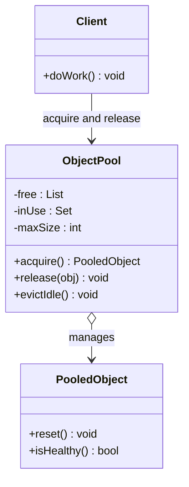
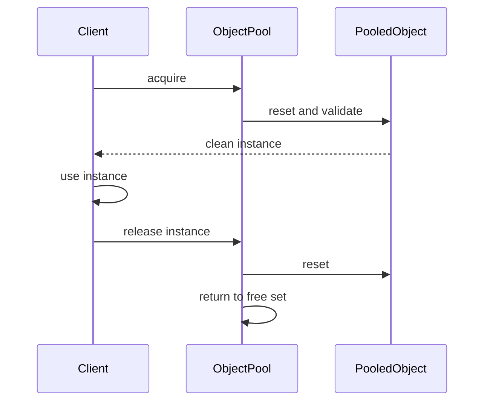

# Object Pool Design Pattern

## Blogs and websites

## Medium

## Youtube

- [43. LLD: Object Pool Design Pattern | Creational Design Pattern | Low Level Design](https://www.youtube.com/watch?v=obmc24IHqew)

## 1. Overview and Fundamentals

**Intent:** Maintain a set of initialized, reusable objects and lend them out on demand instead of creating and destroying them repeatedly.

**Problem it solves:** Expensive resources (DB connections, sockets, threads, large buffers) or extreme allocation rates (bullets, particles, network buffers) make per-use `new` plus GC too slow or too unpredictable.

**Solution in one line:** Pre-create a bounded set, `acquire()` a clean instance, use it briefly, then `release()` it back reset for the next borrower.

**GoF-adjacent category:** Creational resource-management pattern. Controls *reuse lifecycle*, not just creation.

**Core characteristics:**

- Bounded pool with `acquire` and `release` plus a reset contract.
- Tracks free versus in-use instances, often with prewarming.
- Defines an exhaustion policy: block, grow, or fail fast.
- Idle eviction keeps memory bounded during quiet periods.

**Mental model:** A library. Books (objects) are lent to one reader at a time, returned to the shelf, and must come back in good condition. The librarian (pool) enforces loan limits and removes damaged books.

## 2. Detailed Theory

**Mechanics:**

1. Initialize pool with `minIdle` instances (prewarm).
2. `acquire()` returns a free instance, creates one if under `max`, else applies exhaustion policy.
3. Borrower uses the instance exclusively — no sharing while checked out.
4. `release()` validates, resets, and returns it to the free set.
5. Background eviction removes idle or unhealthy instances past a timeout.

**Exhaustion policies:**

- **Block with timeout:** Wait for a return, then throw a clear timeout. Standard for connection pools.
- **Fail fast:** Return error or null immediately. Standard for games (skip the bullet, never stall the frame).
- **Grow temporarily:** Exceed max briefly under load, then shrink. Needs strict monitoring to avoid leaks.
- **Degrade:** Serve a fallback (cached response, reduced particles) instead of blocking.

**Principles involved:**

- **Resource bounding:** `max` caps memory, sockets, and DB load regardless of traffic spikes.
- **Fail fast vs backpressure:** Policy choice determines whether overload surfaces as latency or errors.
- **Single Responsibility:** Reset logic belongs to the pool contract, not each borrower.

**Consequences:**

- Removes allocation and handshake cost from the hot path.
- Adds bookkeeping: sizing, reset bugs, leak detection, contention on the pool itself.
- Wrongly applied to cheap POJOs it slows code down — GC beats pool accounting there.
- Unreturned objects leak silently unless timeouts and metrics exist.

**Sizing guidance:**

- Start from peak concurrency plus headroom, not average load.
- Prewarm the minimum to avoid cold-start latency.
- Cap the maximum from downstream limits (DB `max_connections`, socket budgets).
- Track in-use count, wait time, hit rate, and evictions; alert on sustained exhaustion.

## 3. UML and Architecture Diagrams



*The class diagram shows the pool owning lifecycle operations while pooled objects expose reset and health checks.*



*The sequence diagram shows exclusive checkout, use, and reset-on-return so the next borrower starts clean.*

**Architecture note:** Pools sit in the infrastructure layer behind interfaces (`DataSource`, channel pool, worker pool). Application code borrows briefly in `try-with-resources` style blocks and never holds instances across requests.

## 4. Implementation Examples in Java, Python, and Go

### Java — Generic bounded pool with reset contract

**Steps:** 1. Define `Resettable` contract. 2. Track free deque plus in-use set. 3. Enforce max with fail-fast. 4. Reset only inside `release`.

```java
import java.util.ArrayDeque;
import java.util.Deque;
import java.util.HashSet;
import java.util.Set;
import java.util.function.Supplier;

interface Resettable {
    void reset();
}

class ReusableBuffer implements Resettable {
    private final StringBuilder sb = new StringBuilder();

    void append(String s) { sb.append(s); }
    String content() { return sb.toString(); }

    @Override
    public void reset() { sb.setLength(0); }
}

class ObjectPool<T extends Resettable> {
    private final Deque<T> free = new ArrayDeque<>();
    private final Set<T> inUse = new HashSet<>();
    private final Supplier<T> factory;
    private final int max;

    ObjectPool(Supplier<T> factory, int max, int prewarm) {
        this.factory = factory;
        this.max = max;
        for (int i = 0; i < prewarm; i++) free.push(factory.get());
    }

    synchronized T acquire() {
        if (!free.isEmpty()) {
            T obj = free.pop();
            inUse.add(obj);
            return obj;
        }
        if (inUse.size() >= max) {
            throw new IllegalStateException("pool exhausted: max=" + max);
        }
        T obj = factory.get();
        inUse.add(obj);
        return obj;
    }

    synchronized void release(T obj) {
        if (inUse.remove(obj)) {
            obj.reset(); // Pool owns reset, not the borrower
            if (free.size() < max) free.push(obj);
        }
    }

    synchronized int inUseCount() { return inUse.size(); }
}

public class PoolDemo {
    public static void main(String[] args) {
        ObjectPool<ReusableBuffer> pool = new ObjectPool<>(ReusableBuffer::new, 4, 2);
        ReusableBuffer buf = pool.acquire();
        try {
            buf.append("order-7");
            System.out.println("content=" + buf.content() + " inUse=" + pool.inUseCount());
        } finally {
            pool.release(buf); // Always return in finally
        }
        System.out.println("after release inUse=" + pool.inUseCount());
    }
}
// Sample output:
// content=order-7 inUse=1
// after release inUse=0
```

### Python — Thread-safe queue-backed pool, PEP8 style

**Steps:** 1. Define resettable worker. 2. Back the pool with `queue.Queue`. 3. Prewarm minimum. 4. Use context manager for safe return.

```python
"""Bounded object pool with fail-fast exhaustion and safe return."""
from __future__ import annotations

import queue
from contextlib import contextmanager
from typing import Callable, Generator, Generic, TypeVar

T = TypeVar("T")


class Parser:
    """Expensive reusable worker: compiled patterns plus scratch buffer."""

    def __init__(self) -> None:
        self.scratch: list[str] = []

    def reset(self) -> None:
        self.scratch.clear()

    def parse(self, line: str) -> int:
        self.scratch.append(line.strip())
        return len(self.scratch[-1])


class ObjectPool(Generic[T]):
    def __init__(self, factory: Callable[[], T], max_size: int, prewarm: int) -> None:
        self._factory = factory
        self._max_size = max_size
        self._free: queue.Queue[T] = queue.Queue()
        for _ in range(prewarm):
            self._free.put(factory())
        self._created = prewarm

    def acquire(self) -> T:
        try:
            return self._free.get_nowait()
        except queue.Empty:
            if self._created >= self._max_size:
                raise RuntimeError(f"pool exhausted: max={self._max_size}")
            self._created += 1
            return self._factory()

    def release(self, obj: T) -> None:
        reset = getattr(obj, "reset", None)
        if callable(reset):
            reset()
        self._free.put(obj)

    @contextmanager
    def checkout(self) -> Generator[T, None, None]:
        obj = self.acquire()
        try:
            yield obj
        finally:
            self.release(obj)


def main() -> None:
    pool: ObjectPool[Parser] = ObjectPool(Parser, max_size=4, prewarm=2)
    with pool.checkout() as parser:
        print("parsed len:", parser.parse("  hello "))
    with pool.checkout() as parser:
        print("clean reuse, scratch:", parser.scratch)


if __name__ == "__main__":
    main()

# Sample output:
# parsed len: 5
# clean reuse, scratch: []
```

### Go — Channel-backed pool with health check

**Steps:** 1. Define pooled connection with `Reset`. 2. Buffer channel to max. 3. Non-blocking acquire for fail-fast. 4. Validate before reuse.

```go
package main

import (
	"errors"
	"fmt"
)

// Conn is an expensive reusable resource.
type Conn struct {
	ID     int
	dirty  bool
	closed bool
}

// Reset clears per-use state.
func (c *Conn) Reset() { c.dirty = false }

// Healthy reports whether the instance may be reused.
func (c *Conn) Healthy() bool { return !c.closed }

// Pool is a bounded channel-backed pool.
type Pool struct {
	free    chan *Conn
	factory func() *Conn
}

func NewPool(max, prewarm int, factory func() *Conn) *Pool {
	p := &Pool{free: make(chan *Conn, max), factory: factory}
	for i := 0; i < prewarm; i++ {
		p.free <- factory()
	}
	return p
}

// Acquire fails fast when exhausted so callers degrade explicitly.
func (p *Pool) Acquire() (*Conn, error) {
	select {
	case c := <-p.free:
		if !c.Healthy() {
			return p.factory(), nil
		}
		return c, nil
	default:
		if len(p.free) == 0 {
			return nil, errors.New("pool exhausted")
		}
		return p.factory(), nil
	}
}

// Release resets and returns the instance.
func (p *Pool) Release(c *Conn) {
	c.Reset()
	select {
	case p.free <- c:
	default:
		// Pool full: drop so memory stays bounded.
	}
}

var nextID int

func main() {
	pool := NewPool(2, 1, func() *Conn {
		nextID++
		return &Conn{ID: nextID}
	})
	a, _ := pool.Acquire()
	b, _ := pool.Acquire()
	fmt.Println("borrowed", a.ID, b.ID)
	pool.Release(a)
	c, _ := pool.Acquire()
	fmt.Println("reused", c.ID, "same-as-a:", c == a)
}

// Sample output:
// borrowed 1 2
// reused 1 same-as-a: true
```

## 5. Real-World Industry Applications

- **Databases:** HikariCP, C3P0, DBCP, SQLAlchemy pools bounding connections.
- **Threads:** Java `ExecutorService`, .NET ThreadPool, Go worker pools.
- **HTTP:** Apache HttpClient connection manager, Go `http.Transport` idle pools, gRPC channel pools.
- **Games:** Bullet, particle, and enemy pools avoiding per-frame allocation.
- **Messaging:** Kafka producer pools, AMQP channel pools.
- **Buffers:** Netty `ByteBuf` recycler, NumPy buffer reuse, thumbnail workers.

## 6. Practical Use Cases and Scenarios

| Scenario | Problem | Pool application |
|---|---|---|
| OLTP database | Connection handshake per query is slow | Bounded pool with blocking acquire |
| Game firefight | Hundreds of bullets per second trigger GC | Prewarmed bullet pool with fail-fast |
| Image service | Thumbnail buffers churn memory | Fixed buffer pool with reset |
| API gateway | TLS handshake per upstream call | Keep-alive connection pool |
| Log pipeline | Parser setup per line is costly | Worker pool with scratch reset |
| gRPC mesh | Channel creation per RPC is slow | Channel pool keyed by endpoint |
| Batch export | Thread per file exhausts CPU | Worker pool with bounded queue |

## 7. When to Use and When Not to Use

**Use when:**

- Creation holds an expensive resource (sockets, DB sessions, direct buffers).
- Allocation rate causes GC pauses or latency spikes.
- Concurrency must be bounded regardless of traffic (DB limits, file descriptors).
- Objects are short-lived, uniform, and safely resettable.

**Do not use when:**

- Objects are small, immutable POJOs — GC is faster than pool bookkeeping.
- State cannot be reliably reset (credentials, security context leak risk).
- Borrowers hold instances for unbounded time — the pool becomes a leak.
- Contention on one pool exceeds allocation cost — shard or avoid pooling.

## 8. Do's and Don'ts

| Do | Don't |
|---|---|
| Own reset inside `release()` with one `reset()` method | Trust borrowers to clean up manually |
| Always return in `finally` or context managers | Hold pooled objects across requests |
| Make min, max, timeouts, and eviction configurable | Hard-code sizes that fit only one environment |
| Validate health before reuse; destroy unhealthy instances | Recycle broken sockets silently |
| Emit metrics: in-use, waits, exhaustion, evictions | Run blind and discover saturation in prod |
| Test dirty-release plus reacquire asserts clean state | Test only the happy path |

## 9. Comparison with Other Design Patterns

| Aspect | Object Pool | Flyweight | Singleton | Prototype |
|---|---|---|---|---|
| Reuse unit | Mutable instance, exclusive checkout | Shared immutable intrinsic state | One shared instance | Cloned template copy |
| Sharing | One borrower at a time | Many clients simultaneously | Everyone simultaneously | Each clone independent |
| State handling | Must reset on release | Split intrinsic vs extrinsic state | Must synchronize shared state | Inherits template, then diverges |
| Size control | Bounded with min, max, eviction | Unbounded cache keyed by value | Exactly one | One template, many clones |
| Use when | Creation expensive or rate extreme | Millions of identical values | Singular shared resource | Setup expensive, variants needed |
| Key risk | Leaks and stale state | Extrinsic-state bookkeeping | Global coupling | Shallow-copy aliasing |

**Rule of thumb:** exclusive short-term checkout points to Object Pool; simultaneous sharing of identical state points to Flyweight; one global resource points to Singleton; divergent copies of a template point to Prototype.

## 10. Interview Preparation

**Q1 [Beginner]: What does Object Pool guarantee?**
Bounded reuse: borrowers get exclusive, reset instances without paying creation cost each time, and the pool caps total resource usage.

**Q2 [Beginner]: Acquire vs release contract?**
`acquire` returns a clean instance or applies the exhaustion policy; `release` validates, resets, and returns it. Borrowers must release in `finally` or equivalent.

**Q3 [Intermediate]: When does pooling actually help?**
Expensive resources (connections, sockets, buffers) or extreme allocation rates (game loops). For small POJOs the GC wins and pooling adds contention.

**Q4 [Intermediate]: How do you handle exhaustion?**
Choose explicitly: block with timeout (connections), fail fast (games), temporary growth, or degradation. Document the policy and metric it emits.

**Q5 [Intermediate]: What breaks if reset is forgotten?**
Stale position, credentials, or buffer contents leak to the next borrower — a correctness and security bug. Centralize reset in the pool and test dirty-release cycles.

**Q6 [Advanced]: How do you size and monitor?**
Peak concurrency plus headroom for max, prewarmed min, idle eviction for quiet periods. Track in-use, wait time, hit rate, exhaustion count, and evictions.

**Q7 [Advanced]: How do you handle unhealthy objects?**
Validate on acquire and release; destroy failures instead of recycling; probe idle instances. Never return a broken socket to the free set.

**Q8 [Scenario]: Pool wait times spike at deploy — diagnosis?**
Leaked checkouts (missing `finally`), too-small max versus new traffic, slow downstream inflating hold time, or eviction too aggressive. Check in-use growth, wait histograms, and release paths first.

**LLD scenario 1 — DB connection pool:** Design `acquire(timeout)`, max plus min idle, health checks, idle eviction. Expect exhaustion policy, leak detection via stack capture, and metrics.

**LLD scenario 2 — Thread pool:** Design fixed workers with bounded queue and rejection policy. Expect task ordering, graceful shutdown, and backpressure signals.

**LLD scenario 3 — Game particle pool:** Design prewarmed particles with fail-fast acquire. Expect frame-budget reasoning, reset contracts, and soak tests for leaks.

## 11. Testing and Best Practices

- **Reuse test:** acquire, dirty, release, reacquire — assert clean state and same identity where expected.
- **Exhaustion test:** fill to max; assert policy behavior (timeout, error, or growth) deterministically.
- **Concurrency test:** parallel borrowers never share one instance; no double-release corruption.
- **Eviction test:** idle instances shrink after timeout; unhealthy instances are destroyed.
- **Leak test:** checkout without release triggers detection or timeout in tests.
- **Best practices:** context-managed checkout, configurable bounds, health probes, per-pool dashboards, load tests at 2x peak.

| Aspect | Detail |
|---|---|
| Memory impact | Medium: preallocated free set |
| Creation cost | Low after warmup; amortized setup |
| Scalability | High with sharded pools; single lock can contend |
| Optimization | Prewarm min, evict idle, shard by core or endpoint, avoid pooling cheap objects |

## 12. Summary and Key Takeaways

- Object Pool trades bookkeeping for bounded, predictable reuse of expensive resources.
- Own the reset contract, pick an explicit exhaustion policy, and size from peaks.
- Always release in `finally`; monitor in-use, waits, and evictions.
- Pool resources, not plain data — and never share a checked-out instance.
