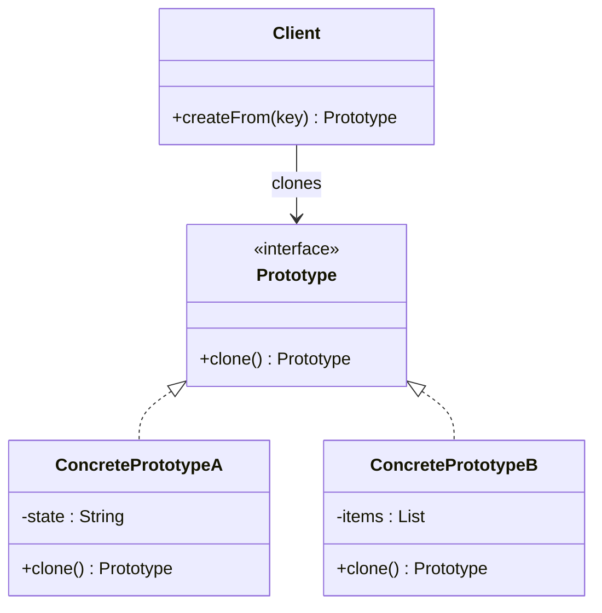
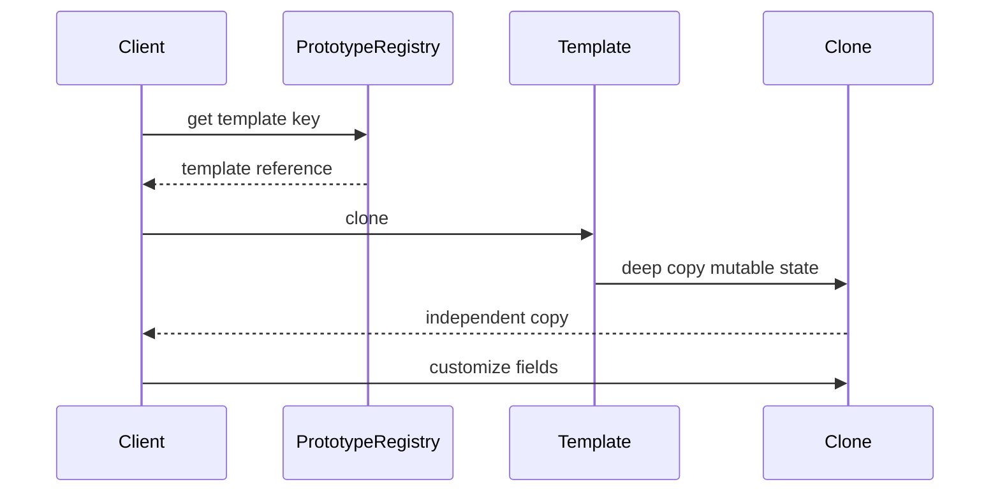

# Prototype Design Pattern

## Blogs and websites

## Medium

## Youtube

---

## 1. Overview and Fundamentals

**Intent:** Specify the kinds of objects to create using a prototypical instance, and create new objects by copying this prototype.

**Problem it solves:** Construction is expensive (DB lookups, parsing, permission checks, large graphs) or the exact type is known only at runtime. Rebuilding equivalent state from scratch on every request wastes time and duplicates setup logic.

**Solution in one line:** Keep a vetted template instance and clone it, then tweak the copy — inherit the expensive defaults instead of recomputing them.

**GoF category:** Creational. Focus is on *copying prepared state* rather than selecting a class.

**Core characteristics:**

- `clone()` or `copy()` produces an independent object with the template's state.
- Deep-copy mutable fields; share immutable ones.
- A prototype registry maps keys to templates (plan ID to invoice, enemy type to prefab).
- Client clones through an interface without knowing the concrete type.

**Mental model:** A rubber stamp plus ink pad. Carving the stamp (template setup) is slow; stamping each form (cloning) is fast. Each stamped form can then be filled in differently.

## 2. Detailed Theory

**Mechanics:**

1. Define a prototype interface with `clone()` returning the abstract type.
2. Each concrete prototype implements `clone()` with correct copy semantics.
3. Optionally maintain a `PrototypeRegistry: key -> template`.
4. Client asks for a key, clones the template, and customizes the copy.
5. Original template stays pristine for the next clone.

**Shallow vs deep copy:**

- **Shallow:** Copies field references. Fast, but clones share mutable objects — editing one corrupts the other.
- **Deep:** Recursively copies mutable fields (lists, maps, child objects). Safe, but costlier.
- **Hybrid (normal):** Deep-copy mutable state, share immutable state (strings, value objects, frozen configs).

**Principles involved:**

- **Polymorphism:** Client clones without naming concrete classes; runtime type follows the template.
- **DRY:** Setup logic lives in one template, not every construction site.
- **Encapsulation:** Copy semantics are owned by the prototype, not scattered in callers.

**Consequences:**

- Skips expensive initialization by reusing vetted state.
- Central risk is copy bugs: shared mutable references, missed fields, circular references.
- Clone hierarchies can be subtle — document exactly what `copy()` copies.
- Alternatives (copy constructors, `copyOf` factories, serialization round-trips) are simpler for single fixed types.

**Implementation options:**

- Copy constructors or static `copyOf` for explicit, type-safe copies.
- `Cloneable` in Java (fragile — prefer explicit `copy()`), `copy.copy/deepcopy` in Python, manual `Clone()` in Go.
- Serialization-based deep copy only when object graphs are large and performance is secondary.

## 3. UML and Architecture Diagrams



*The class diagram shows the client depending only on the clone interface while concrete prototypes define their own copy logic.*



*The sequence diagram shows lookup, cloning with deep copy, and per-use customization leaving the template untouched.*

**Architecture note:** Registries live near composition roots or repositories (billing templates, prefab stores, pipeline configs). Cloning happens per request; templates refresh on versioned updates.

## 4. Implementation Examples in Java, Python, and Go

### Java — Invoice template with deep copy

**Steps:** 1. Model mutable `LineItem` with explicit `copy()`. 2. Give `Invoice` a `copy()` that deep-copies the list. 3. Hold templates in a service. 4. Clone per customer.

```java
import java.util.ArrayList;
import java.util.List;

class LineItem {
    String sku;
    int qty;
    double unitPrice;

    LineItem(String sku, int qty, double unitPrice) {
        this.sku = sku;
        this.qty = qty;
        this.unitPrice = unitPrice;
    }

    LineItem copy() {
        return new LineItem(sku, qty, unitPrice); // Strings immutable: share safely
    }
}

class Invoice {
    String planId;
    double taxRate;
    String customerId;
    List<LineItem> items = new ArrayList<>();

    Invoice copy() {
        Invoice clone = new Invoice();
        clone.planId = this.planId;
        clone.taxRate = this.taxRate;
        for (LineItem item : this.items) {
            clone.items.add(item.copy()); // Deep-copy mutable list
        }
        return clone;
    }

    double total() {
        double sub = 0;
        for (LineItem item : items) sub += item.qty * item.unitPrice;
        return sub * (1 + taxRate);
    }
}

class BillingService {
    private final Invoice proTemplate;

    BillingService(Invoice proTemplate) { this.proTemplate = proTemplate; }

    Invoice bill(String customerId) {
        Invoice invoice = proTemplate.copy();
        invoice.customerId = customerId;
        return invoice;
    }
}

public class PrototypeDemo {
    public static void main(String[] args) {
        Invoice template = new Invoice();
        template.planId = "pro";
        template.taxRate = 0.18;
        template.items.add(new LineItem("seat", 5, 20.0));

        BillingService billing = new BillingService(template);
        Invoice inv = billing.bill("cust-42");
        inv.items.get(0).qty = 6; // Mutate only the copy

        System.out.println("copy total=" + inv.total());
        System.out.println("template qty=" + template.items.get(0).qty);
    }
}
// Sample output:
// copy total=141.6
// template qty=5
```

### Python — Prefab registry with `copy.deepcopy`, PEP8 style

**Steps:** 1. Define dataclass templates. 2. Register one per key. 3. `deepcopy` on checkout. 4. Customize the copy.

```python
"""Prototype registry for game enemy prefabs."""
from __future__ import annotations

import copy
from dataclasses import dataclass, field
from typing import Dict, List


@dataclass
class Enemy:
    kind: str
    hp: int
    loot: List[str] = field(default_factory=list)


class PrefabRegistry:
    def __init__(self) -> None:
        self._templates: Dict[str, Enemy] = {}

    def register(self, key: str, template: Enemy) -> None:
        self._templates[key] = template

    def spawn(self, key: str, hp_boost: int = 0) -> Enemy:
        try:
            template = self._templates[key]
        except KeyError as exc:
            raise ValueError(f"unknown prefab: {key}") from exc
        clone = copy.deepcopy(template)  # lists must not be shared
        clone.hp += hp_boost
        return clone


def main() -> None:
    registry = PrefabRegistry()
    registry.register("goblin", Enemy(kind="goblin", hp=30, loot=["coin"]))
    first = registry.spawn("goblin")
    first.loot.append("dagger")
    second = registry.spawn("goblin", hp_boost=10)
    print(first)
    print(second)
    print(registry.spawn("goblin").loot)  # template loot untouched


if __name__ == "__main__":
    main()

# Sample output:
# Enemy(kind='goblin', hp=30, loot=['coin', 'dagger'])
# Enemy(kind='goblin', hp=40, loot=['coin'])
# ['coin']
```

### Go — Manual `Clone` with deep-copied slice

**Steps:** 1. Define struct with slice field. 2. Write `Clone` copying the slice. 3. Store templates in a map. 4. Clone per use.

```go
package main

import "fmt"

// Report is the prototype: sections slice must be deep-copied.
type Report struct {
	Title    string
	Sections []string
}

// Clone returns an independent copy.
func (r Report) Clone() Report {
	sections := make([]string, len(r.Sections))
	copy(sections, r.Sections)
	r.Sections = sections
	return r
}

// Registry holds one vetted template per key.
type Registry map[string]Report

func (rg Registry) Build(key, title string) (Report, error) {
	tmpl, ok := rg[key]
	if !ok {
		return Report{}, fmt.Errorf("unknown template: %s", key)
	}
	clone := tmpl.Clone()
	clone.Title = title
	return clone, nil
}

func main() {
	registry := Registry{
		"weekly": {Title: "weekly", Sections: []string{"sales", "churn"}},
	}
	first, _ := registry.Build("weekly", "week-42")
	first.Sections[0] = "edited"
	second, _ := registry.Build("weekly", "week-43")
	fmt.Println(first.Sections)
	fmt.Println(second.Sections)
}

// Sample output:
// [edited churn]
// [sales churn]
```

## 5. Real-World Industry Applications

- **Game engines:** Unity prefabs, Unreal blueprints spawned by cloning.
- **Billing / ERP:** Invoice, contract, and report templates cloned per customer.
- **Document editors:** Styles, slide masters, and page layouts duplicated per document.
- **ML platforms:** Pipeline configs and experiment templates cloned per run.
- **JavaScript:** `Object.create(prototype)` delegation; React element cloning.
- **Java:** `Object.clone()`, prototype bean scope in Spring.
- **Compilers / IDEs:** AST node copying during transforms and refactorings.

## 6. Practical Use Cases and Scenarios

| Scenario | Problem | Prototype application |
|---|---|---|
| SaaS billing | Rebuilding tax rules per invoice is slow | Clone plan template, set customer |
| Game spawning | Constructing enemies per frame is costly | Clone prefab, tweak HP and position |
| Report generation | Layout lookup per export is expensive | Clone layout, fill data |
| ML experiments | Config assembly repeated per run | Clone base config, override hyperparams |
| Document editor | New docs need approved styles | Clone style master per document |
| Test fixtures | Setup repeated per test | Clone base fixture, vary one field |
| Network simulation | Topology build is heavy | Clone topology, perturb one link |

## 7. When to Use and When Not to Use

**Use when:**

- Construction costs more than copying (I/O, parsing, large graphs).
- Many instances share most state with small per-use differences.
- The concrete type is known only at runtime (registry key, plugin).
- You want to avoid parallel factory hierarchies for variants.

**Do not use when:**

- Objects are trivial POJOs — `new` plus setters is clearer.
- Copy semantics are unclear or circular references abound — prefer explicit builders.
- Templates change frequently without versioning — stale clones cause bugs.
- Immutability already lets you share safely — no cloning needed.

## 8. Do's and Don'ts

| Do | Don't |
|---|---|
| Deep-copy every mutable field; document what is shared | Ship shallow copies that alias template state |
| Keep a registry keyed by versioned template names | Scatter template instances across call sites |
| Prefer explicit `copy()` or copy constructors | Rely on fragile `Cloneable` plus `super.clone()` |
| Test that mutating the clone leaves the template pristine | Assume copying works without a mutation test |
| Version templates and refresh clones on update | Clone stale configs silently |
| Handle circular references explicitly or forbid them | Recurse infinitely on cyclic graphs |

## 9. Comparison with Other Design Patterns

| Aspect | Prototype | Factory Method | Builder | Object Pool |
|---|---|---|---|---|
| Object source | Copies an existing instance | Builds new via subclass | Assembles stepwise | Checks out a reusable instance |
| State inheritance | Full template state | Constructor defaults | Staged builder state | Previous borrower residue unless reset |
| Cost model | Cheap when setup is expensive | Cheap when construction is simple | Medium: staging plus validation | Cheap when allocation rate is extreme |
| Type flexibility | Runtime: whichever template is cloned | Compile-time: subclass hierarchy | Single type, many configs | Fixed pooled type |
| Key risk | Shallow-copy aliasing | Subclass explosion | Overkill for simple objects | Leaks and stale state |
| Best for | Templates with expensive defaults | Extension hooks | Optional-heavy objects | Short-lived high-frequency reuse |

**Rule of thumb:** clone when a vetted instance already holds the right state; construct via Factory when a hierarchy decides the type; assemble via Builder when configuration is stepwise; pool when allocation rate dominates.

## 10. Interview Preparation

**Q1 [Beginner]: What is Prototype in one sentence?**
Create new objects by copying a prepared template instead of building from scratch, then customize the copy.

**Q2 [Beginner]: Shallow vs deep copy?**
Shallow copies field references and shares mutable state; deep copies mutable fields recursively so the clone is independent. Share immutable fields, deep-copy mutable ones.

**Q3 [Intermediate]: When is Prototype faster than `new`?**
When construction involves DB lookups, parsing, permission checks, or large graphs. Cloning skips that work. For trivial objects `new` is clearer and equally fast.

**Q4 [Intermediate]: What is a prototype registry?**
A map from key to template. Clients request a key and clone the result, centralizing template management and versioning.

**Q5 [Intermediate]: Prototype vs copy constructor?**
Copy constructors are explicit and type-safe for one class. Prototype adds polymorphism — clone through an interface without knowing the concrete type.

**Q6 [Advanced]: How do you handle circular references?**
Track visited objects during deep copy (identity map), or forbid cycles in prototype graphs. Serialization-based copies handle cycles but cost more.

**Q7 [Advanced]: How do you version templates safely?**
Key templates by name plus version, make refresh atomic (swap registry reference), and stamp clones with the template version for traceability.

**Q8 [Scenario]: Invoice totals drift after template edits — why?**
Clones share the items list via shallow copy. Fix with deep copy plus a regression test that mutates the clone and asserts the template is unchanged.

**LLD scenario 1 — Game spawner:** Design prefab registry with per-level overrides. Expect deep-copy rules, spawn budgets, and deterministic reseeds.

**LLD scenario 2 — Report templating:** Design layout templates with per-tenant branding. Expect versioned registry, clone-then-fill flow, and golden-output tests.

**LLD scenario 3 — Config experiments:** Design base ML config with per-run overrides. Expect immutable snapshots, merge semantics, and lineage tracking.

## 11. Testing and Best Practices

- **Independence test:** mutate every mutable field of the clone; assert template unchanged.
- **Equality test:** clone equals template on creation, diverges after customization.
- **Registry tests:** known keys clone, unknown keys error, version upgrade swaps atomically.
- **Performance test:** benchmark clone versus fresh construction to justify the pattern.
- **Best practices:** document copy semantics per class, prefer explicit `copy()`, freeze shared state, and treat templates as versioned data.

| Aspect | Detail |
|---|---|
| Memory impact | Medium: templates plus per-use clones |
| Creation cost | Low per clone when setup is reused |
| Scalability | High for read-mostly templates; copy cost grows with graph size |
| Optimization | Share immutable subgraphs; copy-on-write for large fields; cache templates |

## 12. Summary and Key Takeaways

- Prototype reuses prepared state by cloning instead of reconstructing.
- Deep-copy mutable fields, share immutable ones, and document the split.
- Manage templates in a versioned registry; keep originals pristine.
- Prefer explicit copy methods over magic cloning; test independence on every prototype.
