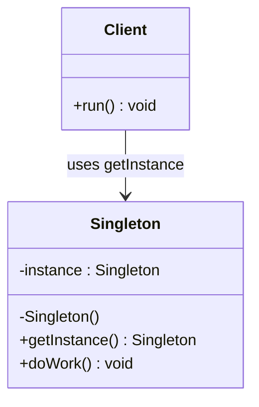
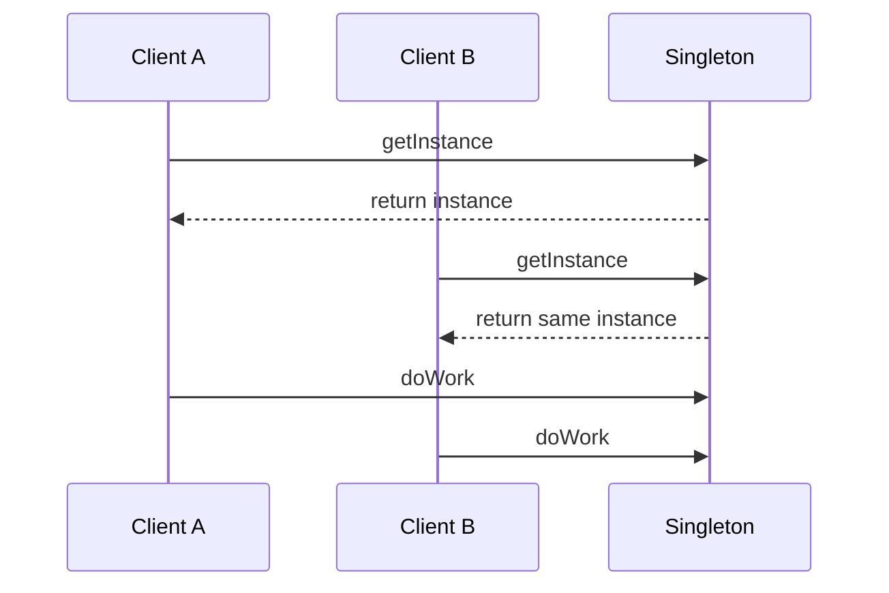

# Singleton Design Pattern

## Blogs and websites

## Medium

## Youtube

- [28. BUG in Double-Checked Locking of Singleton Pattern & its Fix | Low Level System Design Question](https://www.youtube.com/watch?v=upfrQvOgC24)

## 1. Overview and Fundamentals

**Intent:** Ensure a class has exactly one instance and provide a global point of access to it.

**Problem it solves:** Uncontrolled object creation leads to multiple instances of resources that must be singular — configuration, connection pools, registries. Direct `new` everywhere makes lifecycle, consistency, and access coordination impossible.

**Solution in one line:** Make the constructor private, hold one static instance, and expose it through a controlled static accessor.

**GoF category:** Creational. It controls *how many* instances exist, not *which* subclass is created.

**Core characteristics:**

- Single instance guarantee enforced by the class itself.
- Global access via `getInstance()`.
- Lazy or eager initialization.
- Often combined with thread-safety and serialization guards.

**Mental model:** Think of a building with one reception desk. Everyone enters through the same desk (`getInstance()`), and the building constructor (private) prevents anyone from building a second desk.

## 2. Detailed Theory

**Mechanics:**

1. Private constructor blocks external `new`.
2. Private static field holds the sole instance.
3. Public static method returns that instance, creating it on first call if lazy.
4. Guards against reflection, serialization, and cloning that could forge a second instance.

**Common variants:**

- **Eager initialization:** Instance created at class-load time. Simple, thread-safe by default, but pays startup cost even if unused.
- **Lazy with synchronization:** Instance created on first use. Needs locking to stay thread-safe.
- **Double-checked locking (DCL):** Checks null before and inside synchronized block with `volatile`. Fixes the classic Java bug where a half-constructed object leaks without `volatile`.
- **Bill Pugh / Initialization-on-demand holder:** Inner static class holds the instance. JVM loads it once, lazily, with no explicit locking.
- **Enum singleton:** `enum AppConfig { INSTANCE; }`. JVM guarantees one constant, with built-in thread safety, serialization safety, and reflection resistance.
- **DI-container singleton:** Framework scope (Spring `@Scope("singleton")`, .NET `AddSingleton`). The container enforces singularity; preferred in application code.

**Principles involved:**

- **Single Responsibility tension:** The class manages both its lifecycle and its business logic, which is why overuse violates SRP.
- **Encapsulation:** Creation knowledge is hidden behind the accessor.
- **Open/Closed:** Subclassing a singleton is awkward; prefer composition or DI scopes if extensibility matters.

**Consequences:**

- Controlled access and reduced namespace pollution versus raw globals.
- Hidden dependencies: callers secretly depend on global mutable state.
- Test coupling: tests share state unless the singleton is resettable or behind an interface.
- Concurrency risk: lazy singletons without correct locking publish partially constructed objects.

## 3. UML and Architecture Diagrams



*The class diagram shows the private constructor plus static accessor that forces all clients through one instance.*



*The sequence diagram shows two clients receiving the same instance and sharing its state.*

**Architecture note:** In layered systems the singleton typically lives in the infrastructure layer (config, logging, pool manager). Domain and application layers depend on its interface, not the concrete singleton class, so tests can substitute a fake.

## 4. Implementation Examples in Java, Python, and Go

### Java — Interface-backed enum singleton with lazy holder alternative

**Steps:** 1. Define `ConfigProvider` interface. 2. Implement it once. 3. Hide construction. 4. Expose via accessor. 5. Inject the interface into services.

```java
interface ConfigProvider {
    String get(String key);
}

// Enum form: thread-safe, serialization-safe, reflection-safe.
enum AppConfig implements ConfigProvider {
    INSTANCE;
    private final java.util.Map<String, String> values =
        java.util.Map.of("env", "prod", "region", "ap-south-1");

    @Override
    public String get(String key) {
        return values.get(key);
    }
}

// Lazy holder alternative for heavyweight resources.
class MetricsRegistry {
    private final java.util.concurrent.ConcurrentHashMap<String,
        java.util.concurrent.atomic.LongAdder> counters =
        new java.util.concurrent.ConcurrentHashMap<>();

    private MetricsRegistry() {}

    private static class Holder {
        static final MetricsRegistry INSTANCE = new MetricsRegistry();
    }

    static MetricsRegistry getInstance() {
        return Holder.INSTANCE;
    }

    void increment(String name) {
        counters.computeIfAbsent(name, k -> new java.util.concurrent.atomic.LongAdder())
            .increment();
    }

    long count(String name) {
        var adder = counters.get(name);
        return adder == null ? 0 : adder.sum();
    }
}

class OrderService {
    private final ConfigProvider config;
    OrderService(ConfigProvider config) { this.config = config; }
    void placeOrder() {
        System.out.println("order in env=" + config.get("env"));
        MetricsRegistry.getInstance().increment("orders.placed");
    }
}

public class SingletonDemo {
    public static void main(String[] args) {
        OrderService svc = new OrderService(AppConfig.INSTANCE);
        svc.placeOrder();
        svc.placeOrder();
        System.out.println("count=" + MetricsRegistry.getInstance().count("orders.placed"));
    }
}
// Sample output:
// order in env=prod
// order in env=prod
// count=2
```

### Python — Module-friendly Borg / metaclass singleton, PEP8 style

**Steps:** 1. Use a metaclass to enforce one instance. 2. Guard `__init__` against re-running. 3. Inject the instance where needed. 4. Provide `reset_for_tests` hook.

```python
"""Idiomatic singleton via metaclass with test reset hook."""
from __future__ import annotations

from typing import Any, Dict


class _SingletonMeta(type):
    _instances: Dict[type, Any] = {}

    def __call__(cls, *args: Any, **kwargs: Any) -> Any:
        if cls not in cls._instances:
            cls._instances[cls] = super().__call__(*args, **kwargs)
        return cls._instances[cls]


class AppConfig(metaclass=_SingletonMeta):
    """Application configuration loaded once."""

    def __init__(self) -> None:
        if getattr(self, "_loaded", False):
            return
        self.values = {"env": "prod", "region": "ap-south-1"}
        self._loaded = True

    def get(self, key: str, default: str = "") -> str:
        return self.values.get(key, default)

    @classmethod
    def reset_for_tests(cls) -> None:
        _SingletonMeta._instances.pop(cls, None)


class OrderService:
    def __init__(self, config: AppConfig) -> None:
        self.config = config

    def place_order(self) -> str:
        return f"order in env={self.config.get('env')}"


def main() -> None:
    first = AppConfig()
    second = AppConfig()
    print(first is second)  # True
    print(OrderService(first).place_order())


if __name__ == "__main__":
    main()

# Sample output:
# True
# order in env=prod
```

### Go — `sync.Once` singleton with interface

**Steps:** 1. Define `ConfigProvider` interface. 2. Keep struct unexported. 3. Guard creation with `sync.Once`. 4. Return interface from `GetConfig`.

```go
package main

import (
	"fmt"
	"sync"
)

// ConfigProvider is the abstraction callers depend on.
type ConfigProvider interface {
	Get(key string) string
}

type appConfig struct {
	values map[string]string
}

func (c *appConfig) Get(key string) string { return c.values[key] }

var (
	configOnce     sync.Once
	configInstance ConfigProvider
)

// GetConfig returns the single shared config.
func GetConfig() ConfigProvider {
	configOnce.Do(func() {
		configInstance = &appConfig{
			values: map[string]string{"env": "prod", "region": "ap-south-1"},
		}
	})
	return configInstance
}

type OrderService struct{ Config ConfigProvider }

func (s OrderService) PlaceOrder() string {
	return "order in env=" + s.Config.Get("env")
}

func main() {
	a := GetConfig()
	b := GetConfig()
	fmt.Println(a == b) // true: same pointer-backed instance
	fmt.Println(OrderService{Config: a}.PlaceOrder())
}

// Sample output:
// true
// order in env=prod
```

## 5. Real-World Industry Applications

- **Spring Framework:** Default bean scope is singleton. `ApplicationContext`, service beans share one instance per container.
- **Django / Flask:** Settings object loaded once per process; Flask `app` extensions often registered once.
- **Logging:** Log4j2, SLF4J, Python `logging` root logger — one hierarchy per process.
- **Connection pools:** HikariCP, C3P0, SQLAlchemy engine, Redis client — one pool manager shared by threads.
- **Observability:** Prometheus client registries, OpenTelemetry meter providers.
- **OS / platform:** File system abstraction, window manager, `DriverManager`, Android `Application` class.
- **Cloud SDKs:** AWS SDK default clients reused process-wide to share HTTP pools.

## 6. Practical Use Cases and Scenarios

| Scenario | Problem | Singleton application |
|---|---|---|
| App configuration | Config parsed in many places, must agree | One `AppConfig` loaded at startup |
| Structured logging | Scattered loggers with different formats | One logger hierarchy with shared handlers |
| DB connection pool | Too many connections exhaust the DB | One pool manager with bounded size |
| Metrics registry | Counters fragmented per service | One registry scraped by Prometheus |
| Feature flags | Inconsistent flag reads during rollout | One flag client with cached snapshot |
| Rate limiter | Per-instance limits too permissive | One token-bucket shared by handlers |
| ID generator | Duplicate Snowflake node IDs | One generator with claimed node ID |

## 7. When to Use and When Not to Use

**Use when:**

- Exactly one instance must exist system-wide (pool manager, registry, scheduler).
- A well-known global access point is genuinely required (bootstrap code without DI).
- Lazy startup cost is high and the resource may never be used.
- The guarantee must hold regardless of container configuration (libraries, agents).

**Do not use when:**

- The need is "convenient global access" rather than singularity — use DI or explicit parameters.
- The object holds request-scoped or user-scoped mutable state.
- You need subclass polymorphism per context — singletons resist extension.
- Test isolation matters and no seam exists to substitute the instance.
- A DI container already offers singleton scope with explicit constructor injection.

## 8. Do's and Don'ts

| Do | Don't |
|---|---|
| Program callers to an interface and inject it | Sprinkle `getInstance()` calls in every class |
| Prefer enum (Java), holder idiom, or `sync.Once` (Go) | Write broken DCL without `volatile` / mutex |
| Guard serialization with `readResolve` and block `clone()` | Assume private constructor alone is enough |
| Keep singletons stateless or carefully synchronized | Store request/user state in a singleton |
| Provide a test reset or injectable fake | Let global state leak between tests |
| Document thread-safety and lifecycle explicitly | Hide blocking or heavy I/O in `getInstance()` |

## 9. Comparison with Other Design Patterns

| Aspect | Singleton | Static utility class | DI singleton scope | Monostate |
|---|---|---|---|---|
| Instance | Exactly one object | No instance, static methods | One per container | Many instances, shared static state |
| Interface support | Yes, can implement interfaces | No clean polymorphism | Yes, full constructor injection | Yes, but state still global |
| Lazy init | Yes: holder, enum, `Once` | Class-load timing only | Yes, container-managed | Per-instance init, shared data |
| Testability | Moderate if behind interface | Poor, hard to mock | Excellent, swap bindings | Poor, state leaks silently |
| Subclassing | Limited but possible | Impossible | Easy via bindings | Confusing, avoid |
| Best for | Singular stateful resource | Stateless helpers like `Math` | Application services | Rarely; prefer Singleton |

**Rule of thumb:** stateless helpers point to a static utility; application services point to DI scope; a guarantee that must survive outside any container points to a hand-rolled Singleton.

## 10. Interview Preparation

**Q1 [Beginner]: What does Singleton guarantee?**
Exactly one instance per classloader/process plus global access through a static accessor, enforced by a private constructor and a single stored instance.

**Q2 [Beginner]: Why is the Java enum form recommended?**
The JVM instantiates each enum constant once. That gives thread safety without locking, plus serialization and reflection safety by specification.

**Q3 [Intermediate]: What is the DCL bug and its fix?**
Without `volatile`, the JVM may publish a partially constructed object because writes can reorder. Declaring the field `volatile` plus checking null before and inside the synchronized block fixes it. The holder idiom avoids the issue entirely.

**Q4 [Intermediate]: How can Singleton be broken?**
Reflection via `setAccessible`, deserialization creating a new instance per `readObject`, cloning, and multiple classloaders each loading their own copy. Mitigate with enum, `readResolve`, `clone()` refusal, and constructor guard.

**Q5 [Intermediate]: Singleton vs static class?**
Only Singleton creates an object that can implement interfaces, be injected, lazily initialized, and subclassed in a controlled way. Static utilities suit stateless functions.

**Q6 [Advanced]: Why do reviewers call it an anti-pattern?**
It hides dependencies as global mutable state, couples tests through execution order, and violates SRP. Restrict it to truly singular infrastructure and expose it behind injectable interfaces.

**Q7 [Advanced]: How do you make it testable?**
Depend on the interface, inject the singleton in constructors, and provide a fake plus a reset hook. In Python add `reset_for_tests`; in Java expose a package-private setter or use DI bindings.

**Q8 [Scenario]: Two singletons in microservices — still singular?**
No. Each process has its own instance. For cross-process singularity use a centralized store (DB advisory lock, Redis lease, coordination service), not an in-process singleton.

**LLD scenario 1 — Config manager:** Design a reloadable config with `get(key)` and background refresh. Expect discussion of read-write locks, immutable snapshots, listener notification, and why readers never block on refresh.

**LLD scenario 2 — Connection pool manager:** Design a bounded pool with `acquire(timeout)` and `release(conn)`. Expect exhaustion policy, health checks, idle eviction, metrics, and thread-safe bookkeeping.

**LLD scenario 3 — Logger:** Design per-module loggers sharing one hierarchy with levels and handlers. Expect singleton registry plus Flyweight-like logger cache and async appenders.

## 11. Testing and Best Practices

- **Test the contract:** same reference on repeated calls, thread-safety under parallel `getInstance()`, serialization round-trip preserves identity.
- **Isolate tests:** reset between tests or inject fakes; never rely on execution order.
- **Concurrency test:** spawn N threads calling the accessor; assert one unique identity and no partial state.
- **Serialization test:** serialize and deserialize; assert `deserialized is instance`.
- **Prefer DI:** hand-roll only for libraries, agents, and bootstrap; application code should use container scope.

| Aspect | Detail |
|---|---|
| Memory impact | Low: one instance |
| Creation cost | One-time; lazy defers heavy init |
| Scalability | High if stateless or lock-free; contention if synchronized hot path |
| Optimization | Holder/`Once` for lazy safety; immutable snapshots for readers; avoid I/O in accessor |

## 12. Summary and Key Takeaways

- Singleton answers "how many" — exactly one — with a private constructor plus controlled accessor.
- Prefer enum, holder idiom, or `sync.Once` over hand-rolled locking.
- Guard reflection, serialization, and cloning; document thread-safety.
- Keep singletons for singular infrastructure; use DI scope for everything else.
- Always program to an interface so tests can substitute the global instance.
