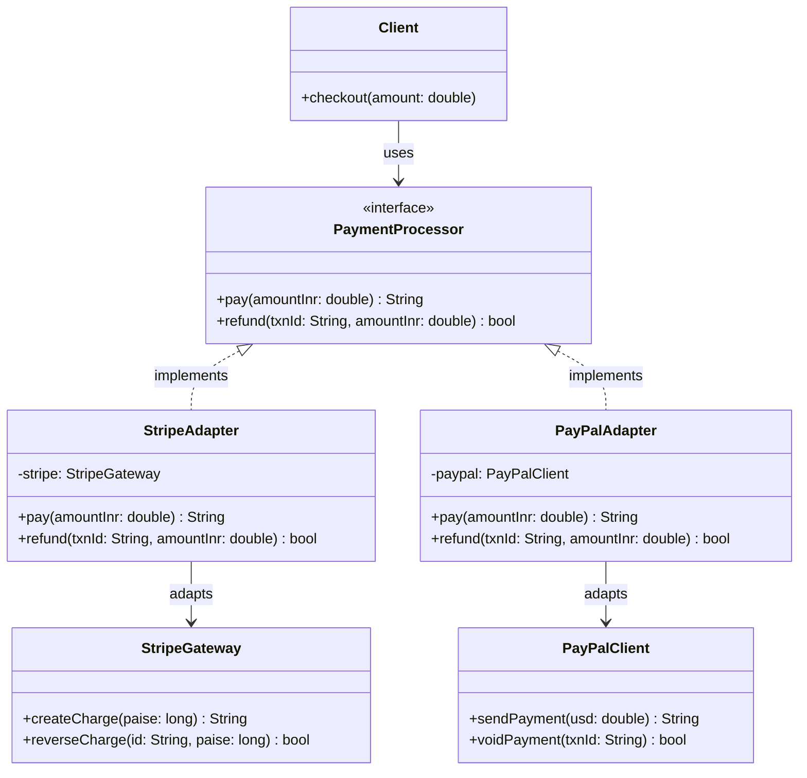
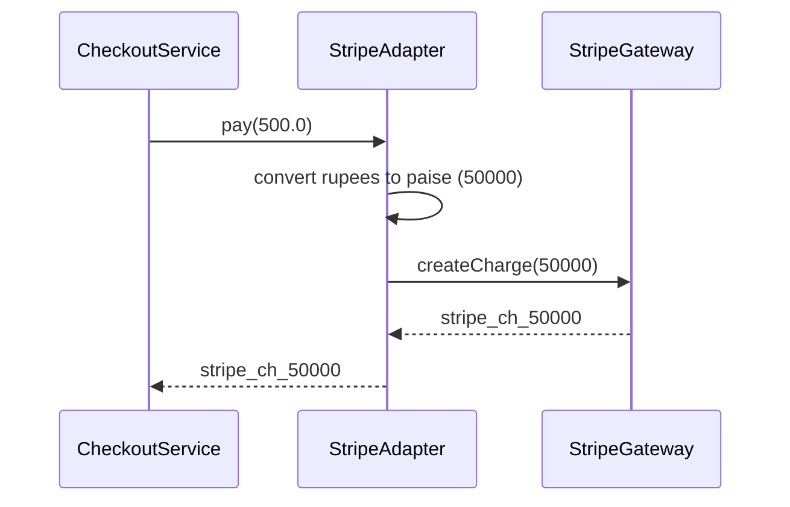

# Adapter Design Pattern

## Youtube

- [20. Adapter Design Pattern with Examples, LLD | Low Level Design Interview Question | System Design](https://www.youtube.com/watch?v=8wrg7IsILhQ)

## 1. Overview and Fundamentals

**Intent (GoF):** Convert the interface of a class into another interface clients expect. Adapter lets classes work together that couldn't otherwise because of incompatible interfaces.

**In one line:** Adapter is a translator — it implements the interface your code wants and delegates to the thing you actually have.

**Real-world analogy:** A universal travel plug. Your laptop charger (adaptee) has a US plug, the Indian wall socket (target) expects a different shape. You don't rewire the hotel — you plug an adapter in between.

**Family context:** Adapter is a *structural* pattern. Structural patterns deal with how classes and objects are composed into larger structures. Adapter specifically deals with interface mismatch.

**Key participants:**

- `Target` — interface the client depends on (e.g., `PaymentProcessor`).
- `Client` — uses only `Target` (e.g., `CheckoutService`).
- `Adaptee` — existing class with incompatible API (e.g., `StripeGateway`, legacy `LegacyPlug`).
- `Adapter` — implements `Target`, holds/translates to `Adaptee`.

**Core characteristics:**

- Wraps an existing object; does not change its code.
- Translates method names, signatures, units, protocols, exceptions.
- Client and adaptee never reference each other directly.
- Follows Open/Closed Principle: add new providers via new adapters.
- Typically one adapter per adaptee-to-target mapping.

**Mental model:**

```text
Client -> Target.pay() -> Adapter.pay() converts -> Adaptee.createCharge()
```

If the wrapper changes signatures to make code compile, it is an Adapter. If it only simplifies, it is a Facade. If it adds features with the same interface, it is a Decorator.

## 2. Detailed Theory

**Problem:** You own clean client code built against interface `T`. You need to reuse a library, SDK, or legacy class that exposes interface `S != T`. You cannot (or should not) modify either side — the library is third-party, the client is stable.

**Solution:** Introduce an `Adapter` that implements `T` and internally calls `S`, performing any data conversion, exception mapping, and sequencing in between.

**Two classic variants:**

1. **Object Adapter (composition — preferred):** Adapter *has-a* adaptee and delegates. Works in any language, supports multiple adaptees, allows lazy creation and decoration. All examples in Section 4 are object adapters.
2. **Class Adapter (inheritance — Java/C++ only):** Adapter *extends* adaptee and *implements* target. Only works when you need to override adaptee behaviour and single inheritance permits it. Rare in modern Java; impossible in Go/Python in the same form.

**Two-way and pluggable adapters:**

- **One-way adapter:** Most common — `StripeGateway -> PaymentProcessor`.
- **Two-way adapter:** Implements both interfaces so either side can call; useful for tool interop but doubles surface area.
- **Pluggable adapter with default:** Provide a default no-op adaptee so clients can run without the real SDK in tests.

**What translation typically includes:**

- **Naming:** `pay()` -> `createCharge()`, `sendPayment()`.
- **Units/types:** rupees `double` -> paise `long`, INR -> USD, `Date` -> epoch.
- **Arity/ordering:** combining `connect() + send()` into one `publish()` call.
- **Error model:** SDK exceptions -> domain exceptions (`StripeException -> PaymentFailedException`).
- **Lifecycle:** lazy connect, retry, timeout wrapping around adaptee calls.

**SOLID and principles:**

- **Open/Closed:** New adaptee = new adapter class, zero client edits.
- **Dependency Inversion:** Client depends on `Target` abstraction, not SDK concretes.
- **Single Responsibility:** Each adapter owns one integration's quirks (currency, auth, pagination).
- **Interface Segregation:** Target should be narrow; don't force adapters to implement methods the adaptee cannot support — split interfaces or throw `UnsupportedOperationException` explicitly.

**Consequences:**

- Reuse without modification, at the cost of one indirection layer.
- Centralises third-party quirks so vendor swap is localised.
- Overused, it hides bad domain modelling behind translators — if you own both sides, refactor instead.

## 3. UML and Architecture Diagrams

### Diagram 1 — Class structure (object adapter)



**Explanation:** `CheckoutService` (Client) depends only on `PaymentProcessor` (Target). `StripeAdapter` and `PayPalAdapter` implement that target and each holds a reference to its own adaptee. Adding Razorpay means adding one new class implementing `PaymentProcessor` — no client change. This is why object adapters scale: N providers need N adapters, not N client branches.

### Diagram 2 — Runtime call flow (sequence)



**Explanation:** The sequence shows where translation happens. The client calls the domain method `pay()` with rupees. The adapter does the unglamorous but critical work — unit conversion, then delegation — before returning the SDK's transaction id unchanged. Error paths follow the same route in reverse: SDK exceptions are caught in the adapter and rethrown as domain exceptions so the client never imports Stripe types.

## 4. Implementation Examples in Java, Python, and Go

### 4.1 Java (OOP, object adapter)

**Explanation:** `CheckoutService` depends only on `PaymentProcessor`. `StripeAdapter` converts rupees to paise and delegates to `StripeGateway`. The `main` method wires the adapter in — swapping to `PayPalAdapter` is a one-line change. This file compiles with `javac AdapterDemo.java && java AdapterDemo`.

```java
interface PaymentProcessor {
    String pay(double amountInr);
    boolean refund(String txnId, double amountInr);
}

class StripeGateway {
    String createCharge(long amountPaise) {
        return "stripe_ch_" + amountPaise;
    }
    boolean reverseCharge(String chargeId, long amountPaise) {
        return true;
    }
}

class StripeAdapter implements PaymentProcessor {
    private final StripeGateway stripe = new StripeGateway();

    @Override
    public String pay(double amountInr) {
        long paise = Math.round(amountInr * 100);
        return stripe.createCharge(paise);
    }

    @Override
    public boolean refund(String txnId, double amountInr) {
        long paise = Math.round(amountInr * 100);
        return stripe.reverseCharge(txnId, paise);
    }
}

class CheckoutService {
    private final PaymentProcessor payments;
    CheckoutService(PaymentProcessor payments) {
        this.payments = payments;
    }
    void checkout(double amount) {
        String txnId = payments.pay(amount);
        System.out.println("Paid, txn=" + txnId);
        System.out.println("Refunded=" + payments.refund(txnId, amount));
    }
}

public class AdapterDemo {
    public static void main(String[] args) {
        CheckoutService checkout = new CheckoutService(new StripeAdapter());
        checkout.checkout(499.50);
    }
}
```

**Sample I/O:**

```text
Paid, txn=stripe_ch_49950
Refunded=true
```

### 4.2 Python (pythonic, PEP 8, composition + duck typing)

**Explanation:** Python rarely needs explicit interfaces — duck typing suffices. `StripeAdapter` wraps `stripe_gateway` and exposes `pay/refund`. `CheckoutService` accepts anything with those methods, so tests can inject a stub. Uses `abc.ABC` for documentation but works with any duck-typed object. Run with `python adapter_demo.py`.

```python
"""Adapter pattern: unify Stripe/PayPal SDKs behind PaymentProcessor protocol."""
from abc import ABC, abstractmethod


class PaymentProcessor(ABC):
    """Target interface expected by application code."""

    @abstractmethod
    def pay(self, amount_inr: float) -> str:
        ...

    @abstractmethod
    def refund(self, txn_id: str, amount_inr: float) -> bool:
        ...


class StripeGateway:
    """Adaptee 1: third-party SDK with its own naming and units."""

    def create_charge(self, amount_paise: int) -> str:
        return f"stripe_ch_{amount_paise}"

    def reverse_charge(self, charge_id: str, amount_paise: int) -> bool:
        return True


class PayPalClient:
    """Adaptee 2: different SDK, different currency."""

    INR_TO_USD = 0.012

    def send_payment(self, amount_usd: float) -> str:
        return f"paypal_txn_{amount_usd:.2f}"

    def void_payment(self, txn_id: str) -> bool:
        return True


class StripeAdapter(PaymentProcessor):
    """Adapter: converts pay/refund into Stripe calls."""

    def __init__(self, gateway: StripeGateway | None = None) -> None:
        self._gateway = gateway or StripeGateway()

    def pay(self, amount_inr: float) -> str:
        paise = round(amount_inr * 100)
        return self._gateway.create_charge(paise)

    def refund(self, txn_id: str, amount_inr: float) -> bool:
        paise = round(amount_inr * 100)
        return self._gateway.reverse_charge(txn_id, paise)


class PayPalAdapter(PaymentProcessor):
    """Adapter: converts pay/refund into PayPal calls."""

    def __init__(self, client: PayPalClient | None = None) -> None:
        self._client = client or PayPalClient()

    def pay(self, amount_inr: float) -> str:
        usd = amount_inr * PayPalClient.INR_TO_USD
        return self._client.send_payment(usd)

    def refund(self, txn_id: str, amount_inr: float) -> bool:
        return self._client.void_payment(txn_id)


class CheckoutService:
    """Client: depends only on the target protocol."""

    def __init__(self, payments: PaymentProcessor) -> None:
        self._payments = payments

    def checkout(self, amount: float) -> None:
        txn_id = self._payments.pay(amount)
        print(f"Paid, txn={txn_id}")
        print(f"Refunded={self._payments.refund(txn_id, amount)}")


if __name__ == "__main__":
    CheckoutService(StripeAdapter()).checkout(499.50)
    CheckoutService(PayPalAdapter()).checkout(499.50)
```

**Sample I/O:**

```text
Paid, txn=stripe_ch_49950
Refunded=True
Paid, txn=paypal_txn_5.99
Refunded=True
```

### 4.3 Go (idiomatic, implicit interfaces)

**Explanation:** Go interfaces are satisfied implicitly, so the adapter needs no `implements` keyword — defining `Pay`/`Refund` methods is enough. `StripeAdapter` embeds a `*StripeGateway` and translates units. `CheckoutService` is a struct holding the `PaymentProcessor` interface, wired in `main`. Run with `go run adapter_demo.go`.

```go
package main

import (
	"fmt"
	"math"
)

// Target: interface the application expects.
type PaymentProcessor interface {
	Pay(amountInr float64) string
	Refund(txnID string, amountInr float64) bool
}

// Adaptee: third-party SDK with incompatible API.
type StripeGateway struct{}

func (s *StripeGateway) CreateCharge(amountPaise int64) string {
	return fmt.Sprintf("stripe_ch_%d", amountPaise)
}

func (s *StripeGateway) ReverseCharge(chargeID string, amountPaise int64) bool {
	return true
}

// Adapter: implements PaymentProcessor by delegating to StripeGateway.
type StripeAdapter struct {
	gateway *StripeGateway
}

func NewStripeAdapter() *StripeAdapter {
	return &StripeAdapter{gateway: &StripeGateway{}}
}

func (a *StripeAdapter) Pay(amountInr float64) string {
	paise := int64(math.Round(amountInr * 100))
	return a.gateway.CreateCharge(paise)
}

func (a *StripeAdapter) Refund(txnID string, amountInr float64) bool {
	paise := int64(math.Round(amountInr * 100))
	return a.gateway.ReverseCharge(txnID, paise)
}

// Client: depends only on the target interface.
type CheckoutService struct {
	payments PaymentProcessor
}

func (c *CheckoutService) Checkout(amount float64) {
	txnID := c.payments.Pay(amount)
	fmt.Println("Paid, txn=" + txnID)
	fmt.Println("Refunded=", c.payments.Refund(txnID, amount))
}

func main() {
	checkout := &CheckoutService{payments: NewStripeAdapter()}
	checkout.Checkout(499.50)
}
```

**Sample I/O:**

```text
Paid, txn=stripe_ch_49950
Refunded= true
```

## 5. Real-World Industry Applications

- **Payments (Stripe, PayPal, Razorpay, Adyen):** Every aggregator (e.g., Shopify, Zerodha Coin, Swiggy checkout) defines one internal `PaymentProcessor` and writes an adapter per PSP handling currency, webhooks, and idempotency differences.
- **Logging facades (SLF4J, Python `logging`, Go `slog`):** SLF4J is an adapter layer over Logback, Log4j, and `java.util.logging` — application code logs once, adapters route to whichever backend is on the classpath.
- **Database drivers (JDBC, ODBC, Python DB-API):** `java.sql.Driver` adapters translate the standard `Connection/Statement` API into MySQL, Postgres, and Oracle wire protocols.
- **Cloud storage (S3 vs GCS vs Azure Blob):** Libraries like Apache Libcloud, Terraform providers, and internal `BlobStore` interfaces adapt each cloud's SDK (different auth, pagination, error codes) behind `Put/Get/Delete`.
- **Messaging (Kafka vs SQS vs RabbitMQ):** Platform teams expose `EventBus.publish()` and adapt each broker's producer/consumer semantics, exactly like the payment example.
- **Legacy modernisation (SOAP to REST, XML to JSON):** Banks wrap decades-old SOAP services with REST adapters so mobile apps see JSON while the mainframe still sees XML — a textbook anti-corruption layer.

## 6. Practical Use Cases and Scenarios

1. **Multi-PSP checkout:** Client code calls `pay/refund`; each PSP adapter handles unit, currency, and status-code translation. Adding UPI later is one new class.
2. **Third-party SDK upgrade:** Vendor releases v2 with renamed methods. Write `VendorV2Adapter` implementing the old target so the rest of the codebase is untouched during migration.
3. **Legacy printer/file API:** Old `LegacyPlug.plugIn()` or `OldLogger.logMsg()` must work with new `Charger.charge()` or `Logger.info()` — a five-line adapter avoids forking legacy code.
4. **Test seam for external services:** Production wires `StripeAdapter`; tests wire `FakePaymentProcessor` or `InMemoryQueueAdapter` — same client, no network.
5. **Protocol bridge (HTTP to gRPC, REST to GraphQL):** Edge adapter translates incoming REST JSON into internal gRPC calls, mapping status codes and pagination tokens.
6. **UI toolkit interop:** Adapt a D3 chart or legacy Swing widget to a React/Angular component interface so old visualisations embed in a new dashboard.

## 7. When to Use and When Not to Use

**Use Adapter when:**

- You must reuse a third-party or legacy class whose interface does not match.
- You want one client code path to work with multiple providers (payments, storage, queues).
- You cannot modify the adaptee (closed source, shared library, frozen legacy).
- You are building an anti-corruption layer between bounded contexts.
- You need a test seam to swap real SDKs for fakes.

**Do NOT use Adapter when:**

- You own both sides and can refactor to a shared interface — an adapter just hides the design smell.
- The target and adaptee semantics differ fundamentally (e.g., void-only vs transactional) — a thin translator becomes a lying abstraction; redesign instead.
- You are tempted to stack adapters on adapters (`AdapterA -> AdapterB -> AdapterC`) — debugging translation chains is miserable; consolidate.
- The goal is simplifying a complex subsystem, not fixing mismatch — that is Facade.
- The goal is adding behaviour with the same interface — that is Decorator.

## 8. Do's and Don'ts

**Do:**

- Depend on the target abstraction in all client code; never import adaptee types into clients.
- Keep one adapter per adaptee; name it `<Adaptee>Adapter` (`StripeAdapter`).
- Translate errors faithfully: map SDK exceptions to domain exceptions with context preserved.
- Handle units, timezones, and pagination explicitly and document them.
- Inject the adaptee (constructor/DI) so tests can mock it.
- Keep adapters thin — orchestration belongs in services, not translators.

**Don't:**

- Don't modify adaptee or target to suit one integration — fix the adapter.
- Don't let adapters accumulate business rules (pricing, authz) — they are translators, not services.
- Don't swallow errors or return magic defaults when the adaptee fails.
- Don't create two-way adapters unless both directions are genuinely needed.
- Don't expose adaptee return types from adapter methods — that leaks the abstraction.

| Do | Don't |
|----|-------|
| Convert units/currencies inside adapter | Force callers to pre-convert units |
| Map exceptions to domain errors | Let `StripeException` propagate to checkout |
| Inject adaptee for testability | `new StripeGateway()` hard-coded with no seam (unless trivial) |
| One focused adapter per provider | One giant `PaymentAdapter` with `if provider == X` branches |

## 9. Comparison with Other Design Patterns

| Aspect | Adapter | Facade | Bridge |
|--------|---------|--------|--------|
| **Intent** | Convert incompatible interface to expected one | Simplify complex subsystem behind one entry point | Decouple abstraction from implementation so both vary |
| **Timing** | Retroactive fix for existing mismatch | Anytime simplification of verbose subsystem | Up-front design for two variation axes |
| **Wraps** | One adaptee (usually) | Whole subsystem (many classes) | Implementation hierarchy via composition |
| **Changes interface?** | Yes — translates signatures | No — orchestrates existing calls | No — both sides designed together |
| **Client sees** | Target interface only | Facade methods only | Abstraction, implementation injected |
| **Example** | `StripeAdapter implements PaymentProcessor` | `VideoConverterFacade.convertToMp4()` | `Notification` bridging to `NotificationChannel` |
| **Without it** | Code does not compile/connect | Code works but is verbose and error-prone | Class explosion (M x N subclasses) |

**Adapter vs Decorator:** Adapter *changes* the interface; Decorator *keeps* it and adds behaviour. If method names change, it is an Adapter.

**Adapter vs Proxy:** Adapter translates so the call can happen at all; Proxy guards/defers the same-interface call. Adapter says "let me rephrase that"; Proxy says "you may / not yet".

**When to pick which:** Mismatched SDK → Adapter. Verbose multi-step library → Facade. Two dimensions of variation you control → Bridge.

## 10. Interview Preparation

**Q1: What is the Adapter pattern and what problem does it solve?**
It converts an incompatible interface into one the client expects, letting otherwise incompatible classes collaborate without modifying either side. Example: wrapping `StripeGateway.createCharge(paise)` and `PayPalClient.sendPayment(usd)` behind a single `PaymentProcessor.pay(rupees)` so checkout code is provider-agnostic.

**Q2: Class adapter vs object adapter?**
Class adapter uses inheritance (extends adaptee, implements target); object adapter uses composition (holds adaptee reference). Prefer object adapters — they work with any adaptee, support multiple adaptees, allow lazy/decorated delegation, and avoid single-inheritance limits in Java. Use class adapter only to override adaptee behaviour directly.

**Q3: How does Adapter differ from Facade, Bridge, and Decorator?**
Adapter changes the interface to fix mismatch; Facade simplifies a compatible subsystem without changing interfaces; Bridge is an up-front split of abstraction and implementation you own; Decorator keeps the interface and adds behaviour. Test: renamed signatures → Adapter; one method hiding four subsystems → Facade; two hierarchies varying independently → Bridge; stacked toppings → Decorator.

**Q4: When would you NOT use Adapter?**
When you own both sides — refactor to a shared interface instead. When semantics diverge too far (adapter becomes bloated with edge cases), redesign or build a proper anti-corruption layer. Never stack adapters on adapters; consolidate.

**Q5: How do you handle incompatible data types and error models?**
Convert inside the adapter (units, currencies, date formats, pagination tokens) and map exceptions to domain errors preserving cause chains. Document every conversion; test rounding, null ids, and SDK-specific failures explicitly.

**Q6: How does Adapter support Open/Closed Principle?**
Client depends on `Target`; each new provider adds one `Adapter` class. `CheckoutService` never changes when Razorpay arrives — you write `RazorpayAdapter` and wire it via DI/config.

**Q7: Give a JDK/framework example of Adapter.**
`Arrays.asList()` adapts arrays to `List`; `InputStreamReader` adapts byte streams to character readers; Spring's `HandlerAdapter` adapts different controller types to a uniform dispatch interface. SLF4J adapters route to Logback/Log4j.

**Q8: Is Adapter an extra hop a performance concern?**
No — one delegation call is negligible versus network/disk SDK cost. The real cost is cognitive (more classes). Keep adapters thin and avoid reflection-heavy generic adapters on hot paths.

**LLD Scenario 1 — Multi-provider payments:** Design `PaymentProcessor` with `pay/refund/getStatus`. Implement `StripeAdapter`, `PayPalAdapter`, `RazorpayAdapter`. Discuss currency conversion, webhook normalisation, idempotency keys, and how checkout stays untouched. Expected: target interface, per-provider adapters, factory/config wiring, fake for tests.

**LLD Scenario 2 — Legacy CSV exporter in new analytics pipeline:** Legacy `CsvWriter.writeRow(String[])` must fit new `Exporter.export(Record)` expecting JSON. Design `CsvExporterAdapter` handling field mapping, escaping, and batching. Discuss error mapping and backpressure. Expected: adapter with schema mapping, buffering, domain exceptions.

**LLD Scenario 3 — Unified notification gateway:** Email (SMTP), SMS (Twilio), Push (FCM) SDKs each differ. Design `NotificationSender.send()` plus three adapters handling truncation (SMS 160 chars), retries, and templating. Discuss how to add WhatsApp without touching callers. Expected: target interface, three adapters, factory, ordering of templating vs truncation.

## 11. Testing and Best Practices

**Unit tests:**

- Test each adapter against a mocked adaptee: verify `pay(499.50)` calls `createCharge(49950)` exactly once with correct conversion.
- Assert return-value and exception translation: SDK error → domain `PaymentFailedException` with cause preserved.
- Test edge cases introduced by translation: rounding (`10.005`), zero/negative amounts, null ids, currency precision.
- Test the client against a stub `PaymentProcessor` — checkout tests must not import Stripe/PayPal types.

**Integration tests:**

- One thin test per adapter against a sandbox/fake SDK proving the real wire mapping works.
- Contract test: same scenario through every adapter yields equivalent domain outcomes.

**Best practices:**

- Constructor-inject adaptees; never hard-code `new` deep inside business logic (except trivial demos).
- Keep adapters stateless where possible; if stateful (connections), document lifecycle and thread-safety.
- Log at the adapter boundary with provider context (`provider=stripe txn=...`) for debuggability.
- Version adapters with the SDK (`StripeV2Adapter`) during migrations; delete old ones after cutover.

| Aspect | Impact |
|--------|--------|
| **Memory** | Low (single wrapper per dependency) |
| **Runtime cost** | Low (one delegation + conversion) |
| **Scalability** | High (N providers = N isolated adapters) |
| **Risk** | Leaky abstraction if adaptee types escape — keep signatures clean |

## 12. Summary and Key Takeaways

- **Adapter = translator:** Implements the interface the client wants, delegates to the interface that exists.
- **Prefer object adapters** (composition) over class adapters (inheritance) for flexibility and testability.
- **Centralise quirks:** Units, currencies, error codes, and pagination live in the adapter, not scattered across clients.
- **Open/Closed in action:** New providers mean new adapter classes, zero client edits.
- **Don't overuse:** If you own both sides, refactor. If semantics diverge wildly, redesign rather than building a bloated translator.
- **Distinguish neighbours:** Renamed signatures → Adapter; simplified subsystem → Facade; independent hierarchies → Bridge; added behaviour → Decorator; guarded access → Proxy.
- **Test the seam:** Mock adaptee for adapter tests; stub target for client tests; one integration test per provider.
